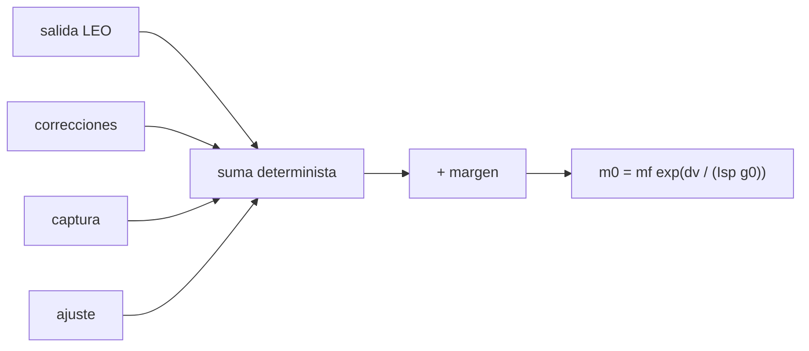

# B75-C09 — Presupuestos de delta-v

<!-- nav:top -->
[🏠 Programa](../../../../README.md) · [📚 Bloque B75](../../../tronco-comun/B75-trayectorias-y-misiones-interplanetarias.md) · [← Anterior: B75-C08 — Secuencias múltiples de sobrevuelos](../B75-C08-secuencias-multiples-de-sobrevuelos/CLASE.md) · [Siguiente: B75-C10 — Maniobras impulsivas →](../B75-C10-maniobras-impulsivas/CLASE.md)
<!-- /nav -->

## 1. Ubicación, nivel y alcance

Clase 9 del bloque B75. Nivel N3. Las clases anteriores midieron el cambio de velocidad respecto al Sol. Una misión paga además el escape desde una órbita baja, las correcciones, la captura y los ajustes, y debe añadir un margen. Aquí armas un **presupuesto de delta-v** para una misión Tierra–Marte del modelo circular y coplanar y lo convertes en masa de propulsante con la ecuación del cohete.

## 2. Por qué esta clase existe

Un presupuesto de delta-v decide el tamaño del cohete. La decisión central: **¿cuánto delta-v hay que reservar en cada fase y cuánta masa de propulsante implica?**

## 3. Lo que podrás hacer al terminar

1. Calcular el delta-v de salida desde una órbita circular baja para un `v∞` dado.
2. Calcular el delta-v de captura en una órbita elíptica alrededor del destino.
3. Sumar fases deterministas y añadir un margen.
4. Aplicar la ecuación de Tsiolkovski y obtener la masa de propulsante.
5. Distinguir el delta-v heliocéntrico del delta-v de la misión.
6. Separar lo consultado, lo calculado y lo sintético (decisiones de diseño del ejercicio).

La evidencia es tu **presupuesto de delta-v con margen** del ejercicio 12 (sección 20).

## 4. Con qué llegas y cómo comprobarlo

1. ¿Qué es el delta-v?
2. ¿Qué dice la ecuación de Tsiolkovski?
3. ¿Qué es el `v∞` de salida y de llegada?
4. ¿Qué es un margen de diseño?
5. ¿Qué se rotula como sintético?

<details>
<summary>Ver respuestas</summary>

1. El cambio de velocidad que debe dar el sistema de propulsión, en km/s. 2. `Δv = I_sp g₀ ln(m₀/m_f)`. 3. Las velocidades relativas a la Tierra y a Marte de B75-C01 (`2,9452` y `2,6493 km/s`). 4. Un delta-v adicional por incertidumbre, que se fija por política. 5. Todo valor que elige el ejercicio y no procede de una fuente.
</details>

Con cuatro o cinco aciertos, sigue; si no, repasa los prerrequisitos.

## 5. Un caso de contexto y casos de referencia

Con la salida desde una órbita circular de `300 km`, las correcciones de trayectoria, la captura en una órbita de `300 × 20 000 km` alrededor de Marte y un ajuste final, el delta-v determinista es `4,7629 km/s`; con un margen del 10 %, `5,2392 km/s`. Con `I_sp = 320 s` y una masa seca de `1000 kg`, la masa inicial es `5309,6 kg`. Es el **ejemplo conductor**. Las masas y radios son de las fichas [S1, S2, S3]; el resto es sintético. La NASA ilustra el valor del propulsante ahorrado: el vuelo de Galileo por Ío redujo el propulsante de inserción en Júpiter en 90 kg [S4].

## 6. Vocabulario

El **presupuesto de delta-v** es la lista de maniobras con su delta-v. El **margen** es la parte añadida por incertidumbre. El **delta-v determinista** es la suma sin margen. La **razón de masa** es `m₀/m_f`. El **impulso específico** `I_sp` mide la eficiencia del propulsor, en segundos. La **masa seca** es la masa final sin propulsante.

## 7. Modelo mental: un presupuesto familiar



*Descripción textual:* Las cuatro fases se suman, se añade el margen y la ecuación del cohete convierte el total en masa inicial.

Analogía: un presupuesto de viaje: gastos fijos, imprevistos y un colchón. Límite: el combustible no se gasta como dinero: cada kilogramo extra exige más cohete, por la forma exponencial.

## 8. La explicación, paso a paso

### 8.1 Salida

Con `v∞ = 2,9452 km/s`, `r₀ = 6371 + 300 = 6671 km` y `μ_T = 398 602,54 km³/s²`: `Δv = √(v∞² + 2μ/r₀) − √(μ/r₀) = 11,3217 − 7,7299 = 3,5916 km/s`. Es más del 70 % del determinista, mucho más que el `2,9452` que se vería con el modelo heliocéntrico.

### 8.2 Captura

Con `v∞ = 2,6493 km/s`, `r_p = 3396,2 + 300 = 3696,2 km` y `μ_M = 42 828,3 km³/s²`: la velocidad hiperbólica en el periapsis es `5,4948 km/s`; la de la elipse `300 × 20 000 km` (`a = 13 546 km`) es `4,4735 km/s`; `Δv = 1,0213 km/s`. Frenar a una órbita circular de 300 km costaría `2,0908 km/s`.

### 8.3 Presupuesto

| Fase | `Δv` (km/s) | Origen |
|---|---|---|
| Salida desde 300 km | 3,5916 | calculado |
| Correcciones de trayectoria | 0,1000 | sintético |
| Captura 300 × 20 000 km | 1,0213 | calculado |
| Ajuste de órbita | 0,0500 | sintético |
| **Determinista** | **4,7629** | |
| Margen 10 % | 0,4763 | sintético |
| **Total** | **5,2392** | |

### 8.4 Masa

Con `I_sp = 320 s` (sintético) y `g₀ = 9,80665 m/s²`: `m₀ = 1000·exp(5,2392/3,1381) = 5309,6 kg`; propulsante `4309,6 kg` (81,2 % de la masa inicial). El producto de las razones de masa de las cuatro fases coincide con la razón del total (error relativo menor que `10⁻¹²`) y una integración numérica de la ecuación del cohete en 200 000 pasos da `5,239168 km/s`, igual al total.

## 9. Magnitudes, símbolos y unidades

| Símbolo | Qué es | Unidad | Valor / nota |
|---|---|---|---|
| `Δv_dep` | delta-v de salida | km/s | 3,5916 |
| `Δv_cap` | delta-v de captura | km/s | 1,0213 |
| `Δv_det` | determinista | km/s | 4,7629 |
| `m₀` | masa inicial | kg | 5309,6 |
| `I_sp` | impulso específico | s | 320 (sintético) |
| `g₀` | gravedad estándar | m/s² | 9,80665 (estándar) |

## 10. Convenciones y referencias

Delta-v en km/s; masas en kg; cónicas empalmadas con impulsos instantáneos (las pérdidas por empuje finito se estudian en C10). `GM = G·M` con `G` del JPL y masas de las fichas; las decisiones de diseño (altitudes, correcciones, margen, `I_sp`, masa seca) son del ejercicio.

## 11. De dónde sale lo que afirmamos

| ID | Fuente | Localizador | Respalda | Estado |
|---|---|---|---|---|
| S1 | NASA/NSSDC, Earth Fact Sheet — https://nssdc.gsfc.nasa.gov/planetary/factsheet/earthfact.html (consultada 2026-11-10) | página leída | semieje 149,598×10⁶ km, periodo sideral 365,256 d, excentricidad 0,0167, velocidad orbital media 29,78 km/s, masa 5,9722×10²⁴ kg, radio medio 6371,000 km, velocidad de escape 11,186 km/s | Consultada |
| S2 | NASA/NSSDC, Mars Fact Sheet — https://nssdc.gsfc.nasa.gov/planetary/factsheet/marsfact.html (consultada 2026-11-10) | página leída | semieje 227,956×10⁶ km, periodo sideral 686,980 d, excentricidad 0,0935, inclinación 1,848°, velocidad media 24,08 km/s, masa 0,64169×10²⁴ kg, radio ecuatorial 3396,2 km, g 3,73 m/s² | Consultada |
| S3 | NASA JPL SSD, Planetary Physical Parameters — https://ssd.jpl.nasa.gov/planets/phys_par.html (consultada 2026-11-10) | página leída | radios ecuatoriales (Venus 6051,8 km; Tierra 6378,1366 km; Marte 3396,19 km; Júpiter 71 492 km) y la constante G = 6,67430×10⁻¹¹ m³ kg⁻¹ s⁻² citada en su registro de cambios. La página no lista GM: aquí GM = G·M con las masas de las fichas NSSDC | Consultada |
| S4 | NASA, Basics of Space Flight, cap. 4 «Interplanetary Trajectories» — https://science.nasa.gov/learn/basics-of-space-flight/chapter4-1/ (consultada 2026-11-10) | página leída | transferencia de Hohmann como ruta de menor propulsante; oportunidades mínimas de energía a Marte cada ~25 meses y a Venus cada ~19 meses; la asistencia gravitacional cambia la velocidad heliocéntrica y deja la relativa en módulo; el vuelo de Galileo por Ío redujo el propulsante de inserción en 90 kg | Consultada |
| — | Valores estándar (no consultados en una fuente concreta de esta clase) | — | GM☉ = 1,32712440×10¹¹ km³/s² (valor estándar, ver la resolución IAU 2015 B3 de la fila anterior donde se cita); 1 au = 149 597 870,7 km; c = 299 792,458 km/s; g₀ = 9,80665 m/s²; ecuaciones de dos cuerpos | No consultada en una fuente concreta |

Límites: ninguna cifra procede de una misión real; la política de márgenes real no se consultó; una sola etapa con `I_sp = 320 s` no es realista, el 81 % de propulsante indica que se usarían varias etapas.

## 12. Cómo ver el presupuesto

| Fase | `Δv` (km/s) | Fracción del total determinista |
|---|---|---|
| Salida | 3,5916 | 75,4 % |
| Correcciones | 0,1000 | 2,1 % |
| Captura | 1,0213 | 21,4 % |
| Ajuste | 0,0500 | 1,0 % |

Descripción larga: tres cuartas partes del delta-v se gastan en salir de la órbita terrestre; la captura gasta una quinta parte.

## 13. Ejemplo trabajado: la captura

**Paso 1 · Periapsis.** `r_p = 3696,2 km`.

**Paso 2 · Velocidad hiperbólica.** `√(2,6493² + 2×42 828,3/3696,2) = 5,4948 km/s`.

**Paso 3 · Velocidad elíptica.** `√(2μ/r_p − μ/a) = 4,4735 km/s` con `a = 13 546 km`.

**Paso 4 · Delta-v.** `1,0213 km/s`.

## 14. Distintas formas de abordar el problema

**Por fases (producto de razones de masa):** cada fase aporta una razón. **Por suma:** `exp(Σ Δv/(I_sp g₀))`. **Por integración numérica:** pasos de masa. **Por comparación de opciones:** captura circular (`2,0908`) frente a elíptica (`1,0213`).

## 15. Práctica guiada

**Ejercicio 1 · con los pasos indicados.** Calcula `Δv_dep` desde `r₀ = 6671 km` con `v∞ = 2,9452`. *Pasos:* `√(v∞² + 2μ/r₀) − √(μ/r₀)`.

<details><summary>Solución comentada</summary>

`11,3217 − 7,7299 = 3,5918 km/s` (`3,5916` en el laboratorio).
</details>

**Ejercicio 2 · con una pista.** Calcula el margen del 10 % del determinista `4,7629 km/s`. *Pista:* multiplica por 0,10.

<details><summary>Solución comentada</summary>

`0,4763 km/s`.
</details>

**Ejercicio 3 · casi autónomo.** Calcula `m₀` si el delta-v total es `5,2392 km/s`, `I_sp = 320 s` y `m_f = 1000 kg`.

<details><summary>Solución comentada</summary>

`5309,6 kg`.
</details>

## 16. Práctica autónoma, transferencia e integrador

**Ejercicio 4 · autónomo.** ¿Cuál es la fracción del delta-v determinista que se gasta en la salida?

<details><summary>Solución comentada</summary>

`3,5916/4,7629 = 75,4 %`.
</details>

**Ejercicio 5 · autónomo.** Con `I_sp = 450 s` (ilustrativo), ¿qué `m₀` resulta?

<details><summary>Solución comentada</summary>

`1000·exp(5,2392/4,4130) = 3278 kg`.
</details>

**Ejercicio 6 · autónomo.** Sin margen, ¿qué `m₀` resulta con `I_sp = 320 s`?

<details><summary>Solución comentada</summary>

`1000·exp(4,7629/3,1381) = 4562 kg`: el margen cuesta unos 748 kg.
</details>

**Ejercicio 7 · autónomo.** Con la salida desde 500 km (en vez de 300 km), ¿sube o baja `Δv_dep`?

<details><summary>Solución comentada</summary>

Baja a `3,5503 km/s`: a mayor altitud la velocidad circular es menor.
</details>

**Ejercicio 8 · autónomo.** ¿Cuánto ahorra capturar en la elipse `300 × 20 000 km` frente a una circular de 300 km?

<details><summary>Solución comentada</summary>

`2,0908 − 1,0213 = 1,0695 km/s`.
</details>

**Ejercicio 9 · transferencia.** Un colega presupuesta `5,59 km/s` por usar la suma de `v∞` heliocéntricos de B75-C01. ¿Qué error comete?

<details><summary>Solución comentada</summary>

Olvida el pozo de la Tierra y de Marte: el determinista del ejemplo es `4,7629`, con un reparto muy distinto, y los `v∞` no son delta-v.
</details>

**Ejercicio 10 · transferencia.** La política de margen cambia al 20 %. ¿Cuánto cambia la masa?

<details><summary>Solución comentada</summary>

Total `5,7155 km/s`; `m₀ = 1000·exp(5,7155/3,1381) = 6180 kg`: sube unos `870 kg`.
</details>

**Ejercicio 11 · transferencia.** ¿Por qué una sola etapa con 81 % de propulsante no es práctica?

<details><summary>Solución comentada</summary>

Porque la estructura de los tanques y motores no cabe en el 19 % restante; se usan etapas o propulsores de mayor `I_sp`.
</details>

**Ejercicio 12 · integrador.** Elabora tu *presupuesto de delta-v con margen* para una misión Tierra–Venus o Tierra–Marte: fases, determinista, margen, masa inicial y qué es consultado, calculado y sintético.

<details><summary>Solución comentada</summary>

Secciones 8.1–8.4 y la salida del laboratorio.
</details>

## 17. Laboratorio: presupuesto Tierra–Marte

El script [presupuesto.py](presupuesto.py) calcula el delta-v de cada fase, el total con margen y la masa inicial, y **comprueba** que el producto de razones de masa iguala la razón del total y que una integración numérica de la ecuación del cohete da el mismo delta-v.

**Datos:** masas y radios de las fichas NASA/NSSDC y JPL (consultados); `G` del JPL; decisiones de diseño **sintéticas**. **Predice antes de ejecutar:** ¿Qué fase domina el presupuesto? (la salida, 75 %.) **Ejecución del 2026-11-10 (Python 3.12.9):**

```text
Python 3.12.9 (biblioteca estandar)
v_inf salida = 2.9452 km/s ; v_inf llegada = 2.6493 km/s ; heliocentrico Hohmann suma = 5.5944 km/s
Fase                                          dv [km/s]
Salida desde orbita baja terrestre (300 km)     3.5916
Correcciones de trayectoria (sintetico)         0.1000
Captura en orbita 300 x 20000 km (Marte)        1.0213
Ajuste de orbita (sintetico)                    0.0500
Determinista = 4.7629 km/s ; margen 10 % = 0.4763 km/s ; TOTAL = 5.2392 km/s
Isp = 320 s (sintetico) ; masa inicial por fases = 5309.619 kg ; por suma de delta-v = 5309.619 kg ; propulsante = 4309.619 kg (81.2 % de la masa inicial)
Prueba 2: dv por integracion numerica = 5.239168 km/s ; dv total = 5.239168 km/s
Pruebas superadas.
```

```bash
python programa/clases/B75/B75-C09-presupuestos-de-delta-v/presupuesto.py
```

**Límites:** impulsos instantáneos, órbitas planetarias circulares y coplanares, una sola etapa.

## 18. Errores frecuentes y cómo corregirlos

**Usar el `v∞` como delta-v de la misión.** Se corrige con 8.1.

**Olvidar el margen.** Se corrige con 8.3.

**Sumar masas en lugar de razones de masa.** Se corrige con 8.4.

**Presentar las decisiones sintéticas como datos de una misión.** Se corrige con la sección 10.

## 19. Cómo sabrás que vas bien

Tras 8.3: ¿qué fase domina? Tras el laboratorio: ¿qué dos comprobaciones hace? (ver la sección 17).

## 20. Qué entregas y cómo se evalúa

El producto es tu **presupuesto de delta-v con margen** (ejercicio 12).

| Criterio | Inicial | En desarrollo | Logrado | Destacado |
|---|---|---|---|---|
| Conceptos | Confunde `v∞` y delta-v | Define fases y margen | Calcula el presupuesto | Explica el reparto |
| Cálculo | Sin unidades | Con errores | Tabla completa | Calcula casos nuevos |
| Numérico | Sin comprobar | Una prueba | Dos pruebas | Interpreta las tolerancias |
| Fuentes | Sin fuente | Sin fecha | Fuentes con fecha y estado | Declara lo sintético |
| Límites | No los nombra | Uno | Tres | Discute las etapas |

**Condiciones críticas (no se compensan con promedio):** rotular lo sintético; no presentar el presupuesto como de una misión; citar solo lo consultado.

## 21. Ética, seguridad y límites

Clase educativa: los modelos son simplificados (órbitas planetarias circulares y coplanares, dos cuerpos) y sus datos son consultados, sintéticos o ilustrativos y están rotulados; ningún resultado es una efeméride, una medición ni un diseño de misión real. Un presupuesto real se somete a revisión formal; esta clase solo enseña el cálculo. Accesibilidad: tablas equivalentes a las gráficas, fórmulas en texto, ejercicios sin conexión.

## 22. Para cerrar y seguir

El determinista de `4,7629 km/s` y el margen suman `5,2392 km/s` y exigen `5309,6 kg` de masa inicial en el ejemplo. Queda una pregunta: ¿cuánto cuesta realmente un impulso que no es instantáneo?

**Glosario español–inglés.** presupuesto de delta-v · *delta-v budget*; margen · *margin*; razón de masa · *mass ratio*; impulso específico · *specific impulse*; masa seca · *dry mass*.

**Continuidad.** [B75-C10](../B75-C10-maniobras-impulsivas/CLASE.md) mide la pérdida por empuje finito.

**Referencias:** ver sección 11.

<!-- nav:bottom -->
---

[← Anterior: B75-C08 — Secuencias múltiples de sobrevuelos](../B75-C08-secuencias-multiples-de-sobrevuelos/CLASE.md) · [📚 Bloque B75](../../../tronco-comun/B75-trayectorias-y-misiones-interplanetarias.md) · [Siguiente: B75-C10 — Maniobras impulsivas →](../B75-C10-maniobras-impulsivas/CLASE.md)
<!-- /nav -->
