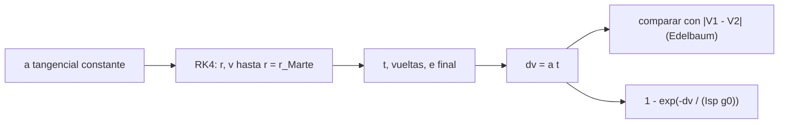

# B75-C11 — Propulsión de bajo empuje

<!-- nav:top -->
[🏠 Programa](../../../../README.md) · [📚 Bloque B75](../../../tronco-comun/B75-trayectorias-y-misiones-interplanetarias.md) · [← Anterior: B75-C10 — Maniobras impulsivas](../B75-C10-maniobras-impulsivas/CLASE.md) · [Siguiente: B75-C12 — Optimización de trayectoria →](../B75-C12-optimizacion-de-trayectoria/CLASE.md)
<!-- /nav -->

## 1. Ubicación, nivel y alcance

Clase 11 del bloque B75. Nivel N3. Un propulsor eléctrico entrega aceleraciones diminutas pero durante meses. La nave no hace una elipse: sube en espiral. Aquí integras con RK4 una espiral heliocéntrica de empuje tangencial constante desde la órbita de la Tierra hasta el radio de Marte y la comparas con el delta-v de Edelbaum y con la transferencia impulsiva de B75-C01. Todo en el modelo circular y coplanar.

## 2. Por qué esta clase existe

Un motor de alta `I_sp` ahorra propulsante pero tarda mucho. La decisión central: **¿cuánto delta-v y cuánto tiempo cuesta una espiral y cuándo es válida la fórmula de Edelbaum?**

## 3. Lo que podrás hacer al terminar

1. Describir la espiral de empuje tangencial constante.
2. Calcular el delta-v de Edelbaum `|V₁ − V₂|` para dos órbitas circulares coplanares.
3. Integrar la espiral con RK4 y obtener el tiempo, el delta-v `a·t` y la excentricidad final.
4. Comparar con el delta-v y el tiempo de la elipse de Hohmann.
5. Calcular la fracción de propulsante con la ecuación del cohete para una `I_sp` alta.
6. Separar lo consultado (semiejes) de lo sintético (aceleración, `I_sp`).

La evidencia es tu **comparación de la espiral de bajo empuje y la transferencia impulsiva** del ejercicio 12 (sección 20).

## 4. Con qué llegas y cómo comprobarlo

1. ¿Qué es una aceleración tangencial?
2. ¿Cuánto vale el delta-v impulsivo de Hohmann Tierra–Marte?
3. ¿Qué es la `I_sp`?
4. ¿Qué es una espiral?
5. ¿Qué es un dato sintético?

<details>
<summary>Ver respuestas</summary>

1. Una aceleración en la dirección de la velocidad. 2. `5,5944 km/s` (suma de excesos, B75-C01). 3. El impulso específico, en segundos; mide la eficiencia del propulsor. 4. Una trayectoria que crece de forma continua en radio en muchas vueltas. 5. Un valor elegido para el ejemplo, no medido.
</details>

Con cuatro o cinco aciertos, sigue; si no, repasa los prerrequisitos.

## 5. Un caso de contexto y casos de referencia

Con aceleración tangencial constante de `1×10⁻⁵ m/s²` la nave tarda `6558,9 d` en cruzar el radio de Marte (13,45 vueltas alrededor del Sol), con `Δv = a·t = 5,6669 km/s`, cerca del valor de Edelbaum `5,6562 km/s`; con `1×10⁻⁴ m/s²` tarda `687,0 d` y el valor se desvía un 4,9 %. La transferencia de Hohmann cuesta `5,5944 km/s` en `258,88 d` [S1, S2]. Es el **ejemplo conductor**. Las aceleraciones son sintéticas; no se consultó ningún propulsor.

## 6. Vocabulario

La **propulsión de bajo empuje** acelera poco y mucho tiempo. La **espiral de Edelbaum** es la trayectoria de empuje tangencial entre órbitas circulares coplanares; su delta-v es `|V₁ − V₂|` cuando la aceleración es mucho menor que la gravedad local. La **fracción de propulsante** es `1 − e^{−Δv/(I_sp g₀)}`. El **cociente `a/g☉`** compara la aceleración con la gravedad solar.

## 7. Modelo mental: subir una rampa muy larga



*Descripción textual:* Se integra la espiral hasta el radio de Marte; el tiempo y la aceleración dan el delta-v; se compara con Edelbaum y se convierte en fracción de propulsante.

Analogía: subir una rampa muy larga y suave en lugar de una escalera corta y empinada: se llega al mismo piso con más tiempo pero menos esfuerzo por unidad de tiempo. Límite: para que la rampa sea suave, la aceleración debe ser mucho menor que la gravedad solar.

## 8. La explicación, paso a paso

### 8.1 Edelbaum

Para dos órbitas circulares coplanares, el empuje tangencial de baja aceleración da `Δv = |V₁ − V₂|`. Con `V_T = 29,7847 km/s` y `V_M = 24,1285 km/s`: `5,6562 km/s`. Es 1,1 % mayor que los `5,5944 km/s` del Hohmann impulsivo. La espiral gasta algo más de delta-v pero ofrece la ventaja de la `I_sp`.

### 8.2 Integración

Aceleración tangencial constante, `μ☉` estándar, paso de 3600 s; se detiene al cruzar `r = 227,956×10⁶ km`.

| `a` (m/s²) | `t` (d) | `Δv = a t` (km/s) | dif. con Edelbaum (%) | `e` final | vueltas | `v` final (km/s) | propulsante (%) |
|---|---|---|---|---|---|---|---|
| 1×10⁻⁵ | 6558,9 | 5,6669 | +0,19 | 0,0105 | 13,45 | 24,1399 | 17,52 |
| 2×10⁻⁵ | 3241,8 | 5,6017 | −0,96 | 0,0187 | 6,68 | 24,0762 | 17,34 |
| 5×10⁻⁵ | 1283,2 | 5,5435 | −1,99 | 0,0471 | 2,66 | 24,0301 | 17,17 |
| 1×10⁻⁴ | 687,0 | 5,9360 | +4,95 | 0,1025 | 1,42 | 24,4732 | 18,27 |
| 2×10⁻⁴ | 309,6 | 5,3496 | −5,42 | 0,1693 | 0,69 | 24,0272 | 16,63 |
| 4×10⁻⁴ | 203,1 | 7,0200 | +24,11 | 0,3839 | 0,48 | 26,3368 | 21,23 |

La columna del propulsante usa `I_sp = 3000 s` (sintético).

### 8.3 Cuándo vale Edelbaum

La gravedad solar a 1 au es `μ/r² = 5,93×10⁻³ m/s²`. Con `a = 10⁻⁵ m/s²` el cociente `a/g☉` es `0,17 %` y la desviación es `0,19 %`; con `4×10⁻⁴` el cociente es `6,7 %`, la excentricidad final es `0,38` y la desviación es `24 %`. La fórmula es un límite de aceleración pequeña, y el criterio de parada «cruzar el radio» deja una órbita final excéntrica cuando la aceleración es mayor.

### 8.4 Verificación

La diferencia con Edelbaum aumenta de forma monótona con la aceleración en los seis casos y la excentricidad final con la menor aceleración es `0,0105`, menor que 0,02.

## 9. Magnitudes, símbolos y unidades

| Símbolo | Qué es | Unidad | Valor / nota |
|---|---|---|---|
| `a` | aceleración tangencial | m/s² | 10⁻⁵ a 4×10⁻⁴ (sintético) |
| `Δv` | delta-v de la espiral | km/s | 5,6669 (a = 10⁻⁵) |
| `V₁ − V₂` | delta-v de Edelbaum | km/s | 5,6562 |
| `t` | tiempo de la espiral | d | 6558,9 |
| `I_sp` | impulso específico | s | 3000 (sintético) |
| `g☉` | gravedad solar a 1 au | m/s² | 5,93×10⁻³ |

## 10. Convenciones y referencias

Marco heliocéntrico plano, órbitas circulares de la Tierra y Marte con los semiejes de las fichas NASA/NSSDC; `μ☉` y `g₀` estándar. Aceleración constante (no se modela la caída de potencia con la distancia al Sol ni la masa decreciente). `I_sp` y masa **sintéticas**.

## 11. De dónde sale lo que afirmamos

| ID | Fuente | Localizador | Respalda | Estado |
|---|---|---|---|---|
| S1 | NASA/NSSDC, Earth Fact Sheet — https://nssdc.gsfc.nasa.gov/planetary/factsheet/earthfact.html (consultada 2026-11-10) | página leída | semieje 149,598×10⁶ km, periodo sideral 365,256 d, excentricidad 0,0167, velocidad orbital media 29,78 km/s, masa 5,9722×10²⁴ kg, radio medio 6371,000 km, velocidad de escape 11,186 km/s | Consultada |
| S2 | NASA/NSSDC, Mars Fact Sheet — https://nssdc.gsfc.nasa.gov/planetary/factsheet/marsfact.html (consultada 2026-11-10) | página leída | semieje 227,956×10⁶ km, periodo sideral 686,980 d, excentricidad 0,0935, inclinación 1,848°, velocidad media 24,08 km/s, masa 0,64169×10²⁴ kg, radio ecuatorial 3396,2 km, g 3,73 m/s² | Consultada |
| S3 | NASA, Basics of Space Flight, cap. 4 «Interplanetary Trajectories» — https://science.nasa.gov/learn/basics-of-space-flight/chapter4-1/ (consultada 2026-11-10) | página leída | transferencia de Hohmann como ruta de menor propulsante; oportunidades mínimas de energía a Marte cada ~25 meses y a Venus cada ~19 meses; la asistencia gravitacional cambia la velocidad heliocéntrica y deja la relativa en módulo; el vuelo de Galileo por Ío redujo el propulsante de inserción en 90 kg | Consultada |
| — | Valores estándar (no consultados en una fuente concreta de esta clase) | — | GM☉ = 1,32712440×10¹¹ km³/s² (valor estándar, ver la resolución IAU 2015 B3 de la fila anterior donde se cita); 1 au = 149 597 870,7 km; c = 299 792,458 km/s; g₀ = 9,80665 m/s²; ecuaciones de dos cuerpos | No consultada en una fuente concreta |

Límites: no se consultó ningún propulsor eléctrico; la caída de empuje con la distancia al Sol y los eclipses no se modelan; la espiral no incluye la fase de captura ni la coincidencia con Marte. La NASA presenta la transferencia de Hohmann como la ruta de menor propulsante entre dos órbitas [S3], una afirmación en régimen impulsivo que aquí no se contradice, pues la espiral compra `I_sp` con tiempo.

## 12. Cómo ver la espiral

| Aceleración (m/s²) | Tiempo (d) | Dif. con Edelbaum |
|---|---|---|
| 1×10⁻⁵ | 6558,9 | +0,19 % |
| 1×10⁻⁴ | 687,0 | +4,95 % |
| 4×10⁻⁴ | 203,1 | +24,11 % |

Descripción larga: a mayor aceleración, menos tiempo pero más desviación respecto de la fórmula.

## 13. Ejemplo trabajado: a = 2×10⁻⁵ m/s²

**Paso 1 · Edelbaum.** `Δv = 5,6562 km/s`.

**Paso 2 · Tiempo estimado.** `t = Δv/a = 5,6562/2×10⁻⁸ = 2,828×10⁸ s = 3273 d`.

**Paso 3 · Integración.** `3241,8 d` (diferencia 1 %).

**Paso 4 · Propulsante.** `1 − e^{−5,6562/29,42} = 17,5 %` con `I_sp = 3000 s`.

## 14. Distintas formas de abordar el problema

**Fórmula de Edelbaum:** `|V₁ − V₂|`. **Integración RK4:** tiempo y excentricidad. **Hohmann impulsivo:** `5,5944 km/s` en `258,88 d`. **Fracción de propulsante:** la ecuación del cohete con `I_sp` alta frente a baja.

## 15. Práctica guiada

**Ejercicio 1 · con los pasos indicados.** Calcula el delta-v de Edelbaum Tierra→radio de Marte. *Pasos:* `V_T − V_M`.

<details><summary>Solución comentada</summary>

`29,7847 − 24,1285 = 5,6562 km/s`.
</details>

**Ejercicio 2 · con una pista.** Estima el tiempo para `a = 2×10⁻⁵ m/s²`. *Pista:* `t = Δv/a`.

<details><summary>Solución comentada</summary>

`5,6562/(2×10⁻⁸ km/s²) = 2,83×10⁸ s ≈ 3273 d`; el laboratorio da `3241,8 d`.
</details>

**Ejercicio 3 · casi autónomo.** Calcula la fracción de propulsante con `I_sp = 3000 s`.

<details><summary>Solución comentada</summary>

`1 − e^{−5,6562/29,42} = 17,5 %`.
</details>

## 16. Práctica autónoma, transferencia e integrador

**Ejercicio 4 · autónomo.** Calcula `g☉` a 1 au y el cociente `a/g☉` para `a = 10⁻⁴ m/s²`.

<details><summary>Solución comentada</summary>

`g☉ = 5,93×10⁻³ m/s²`; `a/g☉ = 1,7 %`.
</details>

**Ejercicio 5 · autónomo.** Compara el tiempo de `a = 10⁻⁴` con el de Hohmann.

<details><summary>Solución comentada</summary>

`687,0/258,88 = 2,65` veces más.
</details>

**Ejercicio 6 · autónomo.** Calcula la fracción de propulsante con `I_sp = 320 s` (químico, sintético).

<details><summary>Solución comentada</summary>

`1 − e^{−5,6562/3,1381} = 83,5 %`, frente a 17,5 % con `I_sp = 3000 s`.
</details>

**Ejercicio 7 · autónomo.** ¿Por qué la espiral cuesta más delta-v que Hohmann?

<details><summary>Solución comentada</summary>

Edelbaum `5,6562` frente a `5,5944 km/s` (+1,1 %): la nave empuja siempre tangencial en lugar de en dos puntos óptimos.
</details>

**Ejercicio 8 · autónomo.** ¿Cuántas vueltas al Sol da la nave con `a = 10⁻⁵ m/s²`?

<details><summary>Solución comentada</summary>

`13,45` (tabla 8.2).
</details>

**Ejercicio 9 · transferencia.** Un equipo quiere llegar a Marte en menos de dos años con aceleración constante. ¿Qué `a` debe superar?

<details><summary>Solución comentada</summary>

Entre `10⁻⁴` (687 d) y `5×10⁻⁵` (1283 d) de la tabla; el valor exacto requiere repetir el laboratorio.
</details>

**Ejercicio 10 · transferencia.** ¿Qué falta para que la espiral termine en una captura en Marte?

<details><summary>Solución comentada</summary>

Coincidir con la fase de Marte (ángulo), igualar la velocidad (`v∞ = 0`) y capturarse en la esfera de Marte; el modelo solo cruza el radio.
</details>

**Ejercicio 11 · transferencia.** La potencia disponible cae con el cuadrado de la distancia al Sol. ¿Qué efecto tendría en la aceleración a 1,52 au?

<details><summary>Solución comentada</summary>

Si el empuje es proporcional a la potencia, bajaría a `1/2,3` del valor a 1 au; el modelo supone aceleración constante, por lo que subestima el tiempo.
</details>

**Ejercicio 12 · integrador.** Elabora tu *comparación de la espiral de bajo empuje y la transferencia impulsiva*: tabla de tiempo, delta-v, propulsante (dos `I_sp`) y desviación con Edelbaum para tres aceleraciones, con tus conclusiones.

<details><summary>Solución comentada</summary>

Secciones 8.1–8.4 y la salida del laboratorio.
</details>

## 17. Laboratorio: espiral de bajo empuje

El script [espiral.py](espiral.py) integra con RK4 seis aceleraciones, compara con Edelbaum y **comprueba** que la desviación crece de forma monótona con la aceleración y que con la menor aceleración es menor que el 1 % y la excentricidad final menor que 0,02.

**Datos:** semiejes de las fichas NASA/NSSDC (consultados); aceleraciones, `I_sp` y masa **sintéticas**. **Predice antes de ejecutar:** ¿Qué dif. con Edelbaum tendrá `a = 10⁻⁵ m/s²`? (+0,19 %.) **Ejecución del 2026-11-10 (Python 3.12.9):**

```text
Python 3.12.9 (biblioteca estandar)
V_Tierra = 29.7847 km/s ; V_Marte = 24.1285 km/s ; Edelbaum |dV| = 5.6562 km/s ; Hohmann (suma de 2 impulsos) = 5.5944 km/s en 258.88 d
 a [m/s2]    t [d]   dv = a t [km/s]   dif. con Edelbaum [%]   e final   vueltas   v final [km/s]   propulsante (Isp 3000 s) [%]
  1.0e-05   6558.9         5.6669                0.189       0.0105     13.45        24.1399                17.52
  2.0e-05   3241.8         5.6017               -0.962       0.0187      6.68        24.0762                17.34
  5.0e-05   1283.2         5.5435               -1.993       0.0471      2.66        24.0301                17.17
  1.0e-04    687.0         5.9360                4.948       0.1025      1.42        24.4732                18.27
  2.0e-04    309.6         5.3496               -5.420       0.1693      0.69        24.0272                16.63
  4.0e-04    203.1         7.0200               24.112       0.3839      0.48        26.3368                21.23
Pruebas superadas.
```

```bash
python programa/clases/B75/B75-C11-propulsion-de-bajo-empuje/espiral.py
```

**Límites:** empuje constante, tangencial, coplanar, sin eclipses ni variación de potencia; el criterio de parada deja órbitas excéntricas con aceleración alta.

## 18. Errores frecuentes y cómo corregirlos

**Usar Edelbaum con aceleraciones altas.** Se corrige con 8.3.

**Olvidar que el tiempo crece cuando la aceleración baja.** Se corrige con 8.2.

**Comparar solo el delta-v y no el propulsante.** Se corrige con el ejercicio 6.

**Presentar los propulsores sintéticos como reales.** Se corrige con la sección 10.

## 19. Cómo sabrás que vas bien

Tras 8.1: ¿qué delta-v esperabas y cuál obtuviste? Tras el laboratorio: ¿qué dos comprobaciones hace? (ver la sección 17).

## 20. Qué entregas y cómo se evalúa

El producto es tu **comparación de la espiral de bajo empuje y la transferencia impulsiva** (ejercicio 12).

| Criterio | Inicial | En desarrollo | Logrado | Destacado |
|---|---|---|---|---|
| Conceptos | Confunde espiral y elipse | Define Edelbaum | Calcula y compara | Explica el límite de validez |
| Cálculo | Sin unidades | Con errores | Tabla completa | Calcula casos nuevos |
| Numérico | Sin comprobar | Una prueba | Dos pruebas | Interpreta las desviaciones |
| Fuentes | Sin fuente | Sin fecha | Fuentes con fecha y estado | Declara lo sintético |
| Límites | No los nombra | Uno | Tres | Discute la potencia solar |

**Condiciones críticas (no se compensan con promedio):** rotular aceleración e `I_sp` como sintéticos; no presentar el resultado como el de un propulsor real; citar solo lo consultado.

## 21. Ética, seguridad y límites

Clase educativa: los modelos son simplificados (órbitas planetarias circulares y coplanares, dos cuerpos) y sus datos son consultados, sintéticos o ilustrativos y están rotulados; ningún resultado es una efeméride, una medición ni un diseño de misión real. Una misión de bajo empuje exige análisis de potencia, eclipses y radiación de cinturones; esta clase no lo hace. Accesibilidad: tablas equivalentes a las gráficas, fórmulas en texto, ejercicios sin conexión.

## 22. Para cerrar y seguir

Con `a = 10⁻⁵ m/s²` la espiral cruza el radio de Marte en `6558,9 d` con `5,667 km/s`, cerca de Edelbaum, y necesita solo el 17,5 % de propulsante con `I_sp = 3000 s`. Queda una pregunta: ¿cómo se elige la mejor trayectoria entre muchas?

**Glosario español–inglés.** bajo empuje · *low thrust*; espiral · *spiral*; propulsión eléctrica · *electric propulsion*; aceleración tangencial · *tangential acceleration*; fracción de propulsante · *propellant fraction*.

**Continuidad.** [B75-C12](../B75-C12-optimizacion-de-trayectoria/CLASE.md) optimiza una trayectoria de dos impulsos.

**Referencias:** ver sección 11.

<!-- nav:bottom -->
---

[← Anterior: B75-C10 — Maniobras impulsivas](../B75-C10-maniobras-impulsivas/CLASE.md) · [📚 Bloque B75](../../../tronco-comun/B75-trayectorias-y-misiones-interplanetarias.md) · [Siguiente: B75-C12 — Optimización de trayectoria →](../B75-C12-optimizacion-de-trayectoria/CLASE.md)
<!-- /nav -->
