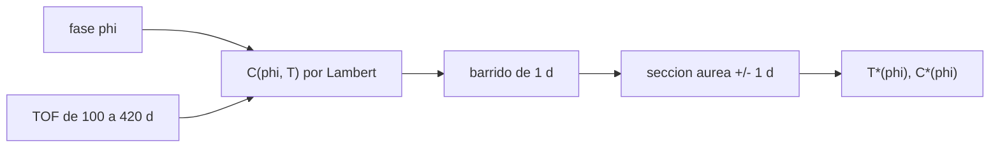

# B75-C12 — Optimización de trayectoria

<!-- nav:top -->
[🏠 Programa](../../../../README.md) · [📚 Bloque B75](../../../tronco-comun/B75-trayectorias-y-misiones-interplanetarias.md) · [← Anterior: B75-C11 — Propulsión de bajo empuje](../B75-C11-propulsion-de-bajo-empuje/CLASE.md) · [Siguiente: B75-C13 — Cambios de plano interplanetarios →](../B75-C13-cambios-de-plano-interplanetarios/CLASE.md)
<!-- /nav -->

## 1. Ubicación, nivel y alcance

Clase 12 del bloque B75. Nivel N3. Con Lambert (B75-C04) se calcula el costo de cualquier arco. Optimizar es elegir el tiempo de vuelo que lo minimiza para una fase de salida dada. Aquí barres el tiempo de vuelo, refinas con sección áurea y ves cómo el costo mínimo y el tiempo óptimo cambian con la fase de salida. El costo es la suma de excesos hiperbólicos del modelo circular y coplanar.

## 2. Por qué esta clase existe

No siempre se sale con la fase ideal, y el tiempo de vuelo no es dato sino variable. La decisión central: **¿qué tiempo de vuelo minimiza la suma de excesos hiperbólicos para una fase de salida dada y cuánto empeora el costo al apartarse de la fase ideal?**

## 3. Lo que podrás hacer al terminar

1. Definir la función de costo `v∞,sal + v∞,lleg` de un arco de Lambert.
2. Barrer el tiempo de vuelo y refinar el mínimo con sección áurea.
3. Verificar que el mínimo es local y que el refinamiento no empeora el barrido.
4. Comparar con la cota de Hohmann (`5,5944 km/s`).
5. Medir cuánto sube el costo al desviarse la fase de la ideal.
6. Separar lo consultado (semiejes, periodo de Marte) de lo ilustrativo (la fase).

La evidencia es tu **curva Δv(tiempo de vuelo) con su mínimo** del ejercicio 12 (sección 20).

## 4. Con qué llegas y cómo comprobarlo

1. ¿Qué resuelve Lambert?
2. ¿Qué es una fase de salida?
3. ¿Qué es un mínimo local?
4. ¿Qué es la sección áurea?
5. ¿Qué es el costo de Hohmann?

<details>
<summary>Ver respuestas</summary>

1. La velocidad inicial y final de un arco entre dos posiciones en un tiempo dado (B75-C04). 2. El adelanto del destino al salir (B75-C02). 3. Un punto cuyos vecinos cuestan más o igual. 4. Un método de búsqueda de mínimos de una función unimodal con razón `0,618`. 5. La suma de excesos de la elipse de menor energía: `5,5944 km/s`.
</details>

Con cuatro o cinco aciertos, sigue; si no, repasa los prerrequisitos.

## 5. Un caso de contexto y casos de referencia

Si Marte va 44,0° por delante de la Tierra al salir (cerca de los 44,34° ideales), el costo mínimo es `5,5951 km/s` con `258,57 d`, apenas `0,01 %` sobre Hohmann. Con 50° el costo mínimo sube a `5,7565 km/s` (+2,9 %) y con 70° a `7,7484 km/s` (+38,5 %). Es el **ejemplo conductor**. La fase y el costo son del modelo circular y coplanar con los semiejes y el periodo de las fichas [S1, S2].

## 6. Vocabulario

El **costo** es `C(φ, T) = v∞,sal + v∞,lleg` en km/s. El **mínimo** `T*(φ)` es el tiempo de vuelo óptimo. La **rama corta** es el arco de menos de 180° y la **larga** el de más. La **sección áurea** reduce el intervalo por un factor `0,618` por iteración. Un **barrido** evalúa el costo en una malla.

## 7. Modelo mental: buscar el fondo de un valle



*Descripción textual:* Para cada fase se evalúa el costo con Lambert en una malla de tiempos, se refina el mínimo y se obtiene el tiempo y el costo óptimos.

Analogía: buscar el punto más bajo de un valle: primero se recorre con pasos grandes y luego se afina cerca del fondo. Límite: si el valle tiene varios fondos, la búsqueda local puede quedar en uno que no es el menor.

## 8. La explicación, paso a paso

### 8.1 La función de costo

Para una fase `φ` y un tiempo de vuelo `T`, Marte llega al ángulo `θ = φ + 360°·T/686,980`. Lambert da `v₁` y `v₂`; el costo es `|v₁ − V_T| + |v₂ − V_M|` con `V_T` y `V_M` las velocidades circulares tangenciales de las posiciones.

### 8.2 Resultado

Referencia de Hohmann: `5,5944 km/s`, `258,88 d`.

| Fase `φ` (°) | `T*` (d) | Costo mínimo (km/s) | Costo con el `TOF` de Hohmann (km/s) | Exceso sobre Hohmann (%) |
|---|---|---|---|---|
| 20 | 339,06 | 8,4189 | 8,7966 | 50,49 |
| 30 | 255,43 | 6,7983 | 6,7996 | 21,52 |
| 40 | 255,21 | 5,7036 | 5,7074 | 1,95 |
| 44 | 258,57 | 5,5951 | 5,5951 | 0,01 |
| 50 | 264,56 | 5,7565 | 5,7707 | 2,90 |
| 60 | 274,30 | 6,5925 | 6,7221 | 17,84 |
| 70 | 281,39 | 7,7484 | 8,0662 | 38,50 |

### 8.3 Lectura

El costo es casi simétrico alrededor de `44°`: sube `0,1085 km/s` a 40° y `0,1614 km/s` a 50°, unos `0,027 km/s` por grado. Un día de retraso cambia la fase `0,4616°` y cuesta unos `12 m/s`. El tiempo óptimo crece con la fase: de `255` a `281 d` entre 40° y 70°. A 20° el mínimo está en otra rama (`339 d`) y cuesta un 50 % más.

### 8.4 Verificación

(1) Con `φ = 44°` el costo mínimo difiere de Hohmann en `0,01 %`. (2) El refinamiento áureo nunca empeora el barrido (diferencia `≤ 10⁻¹²`). (3) Para cada fase, los vecinos de 1 d del mejor punto del barrido cuestan más o igual.

## 9. Magnitudes, símbolos y unidades

| Símbolo | Qué es | Unidad | Valor / nota |
|---|---|---|---|
| `φ` | fase de salida | ° | 20 a 70 |
| `T*` | tiempo de vuelo óptimo | d | 258,57 (φ = 44°) |
| `C*` | costo mínimo | km/s | 5,5951 (φ = 44°) |
| `θ` | ángulo de transferencia | ° | φ + 360 T/686,980 |
| `V_T`, `V_M` | velocidades circulares | km/s | 29,7847; 24,1285 |

## 10. Convenciones y referencias

Marco heliocéntrico plano; trayectoria directa de menos de una vuelta; fase de salida elegida (**ilustrativa**); semiejes y periodo de Marte de las fichas NASA/NSSDC; `μ☉` estándar. El costo no incluye la salida ni la captura planetocéntricas (C09, C14, C23).

## 11. De dónde sale lo que afirmamos

| ID | Fuente | Localizador | Respalda | Estado |
|---|---|---|---|---|
| S1 | NASA/NSSDC, Earth Fact Sheet — https://nssdc.gsfc.nasa.gov/planetary/factsheet/earthfact.html (consultada 2026-11-10) | página leída | semieje 149,598×10⁶ km, periodo sideral 365,256 d, excentricidad 0,0167, velocidad orbital media 29,78 km/s, masa 5,9722×10²⁴ kg, radio medio 6371,000 km, velocidad de escape 11,186 km/s | Consultada |
| S2 | NASA/NSSDC, Mars Fact Sheet — https://nssdc.gsfc.nasa.gov/planetary/factsheet/marsfact.html (consultada 2026-11-10) | página leída | semieje 227,956×10⁶ km, periodo sideral 686,980 d, excentricidad 0,0935, inclinación 1,848°, velocidad media 24,08 km/s, masa 0,64169×10²⁴ kg, radio ecuatorial 3396,2 km, g 3,73 m/s² | Consultada |
| — | Valores estándar (no consultados en una fuente concreta de esta clase) | — | GM☉ = 1,32712440×10¹¹ km³/s² (valor estándar, ver la resolución IAU 2015 B3 de la fila anterior donde se cita); 1 au = 149 597 870,7 km; c = 299 792,458 km/s; g₀ = 9,80665 m/s²; ecuaciones de dos cuerpos | No consultada en una fuente concreta |

Límites: no se consultó ninguna efeméride; los óptimos son del modelo circular y coplanar; el barrido solo cubre 100–420 d y una revolución.

## 12. Cómo ver la curva de costo

| Fase (°) | Costo mínimo (km/s) |
|---|---|
| 30 | 6,7983 |
| 40 | 5,7036 |
| 44 | 5,5951 |
| 50 | 5,7565 |
| 60 | 6,5925 |

Descripción larga: el costo mínimo tiene forma de V redondeada con el fondo en 44° y flancos casi simétricos de unos 0,027 km/s por grado cerca del fondo.

## 13. Ejemplo trabajado: la fase de 44°

**Paso 1 · Ángulo.** Con `T = 258,57 d`, `θ = 44° + 135,5° = 179,5°`.

**Paso 2 · Lambert.** Se resuelve el arco y se obtienen `v₁`, `v₂`.

**Paso 3 · Costo.** `C = 5,5951 km/s`.

**Paso 4 · Comparación.** `0,01 %` sobre `5,5944 km/s`.

## 14. Distintas formas de abordar el problema

**Barrido:** 321 evaluaciones de 1 d. **Sección áurea:** 60 iteraciones en ±1 d. **Cota de Hohmann:** la fase ideal debe dar casi el mismo valor. **Costo con TOF de Hohmann:** evita optimizar pero cuesta algo más fuera de la fase ideal.

## 15. Práctica guiada

**Ejercicio 1 · con los pasos indicados.** Calcula el ángulo de transferencia para `φ = 44°` y `T = 258,88 d`. *Pasos:* `θ = φ + 360 T/686,980`.

<details><summary>Solución comentada</summary>

`44 + 135,66 = 179,66°`, menor que 180°: rama corta.
</details>

**Ejercicio 2 · con una pista.** Compara el costo mínimo con la cota de Hohmann para `φ = 44°`. *Pista:* tabla 8.2.

<details><summary>Solución comentada</summary>

`5,5951` frente a `5,5944`: `+0,01 %`.
</details>

**Ejercicio 3 · casi autónomo.** ¿Por qué el costo con el `TOF` de Hohmann (5,5951) coincide con el mínimo a 44°?

<details><summary>Solución comentada</summary>

Porque a esa fase el óptimo es casi el de Hohmann: `T* = 258,57 d` frente a `258,88 d`.
</details>

## 16. Práctica autónoma, transferencia e integrador

**Ejercicio 4 · autónomo.** Calcula el exceso porcentual a `φ = 50°`.

<details><summary>Solución comentada</summary>

`(5,7565 − 5,5944)/5,5944 = 2,90 %`.
</details>

**Ejercicio 5 · autónomo.** Estima la pendiente del costo por grado entre 44° y 50°.

<details><summary>Solución comentada</summary>

`(5,7565 − 5,5951)/6 = 0,0269 km/s` por grado.
</details>

**Ejercicio 6 · autónomo.** Con esa pendiente, ¿cuánto cuesta un día de retraso de lanzamiento (`0,4616°`)?

<details><summary>Solución comentada</summary>

`0,0269×0,4616 = 12,4 m/s` por día.
</details>

**Ejercicio 7 · autónomo.** ¿Cuánto varía el tiempo óptimo entre 40° y 70°?

<details><summary>Solución comentada</summary>

De `255,21` a `281,39 d`: `26,2 d`.
</details>

**Ejercicio 8 · autónomo.** ¿Por qué a 20° el óptimo salta a `339 d`?

<details><summary>Solución comentada</summary>

Porque el mejor arco pasa a otra rama (ángulo mayor de 180°) y cuesta un 50 % más.
</details>

**Ejercicio 9 · transferencia.** Si la misión acepta hasta un 3 % más de delta-v que Hohmann, ¿qué ancho de ventana tiene?

<details><summary>Solución comentada</summary>

Al menos de 40° (1,95 %) a 50° (2,90 %): 10°, es decir `10/0,4616 = 21,7 d`.
</details>

**Ejercicio 10 · transferencia.** ¿Por qué minimizar `v∞,sal + v∞,lleg` no minimiza la masa de lanzamiento?

<details><summary>Solución comentada</summary>

Porque el costo de lanzamiento depende de `C3 = v∞²` (C23) y la captura de `v∞,lleg` de otra forma (C14); la suma lineal los pesa igual.
</details>

**Ejercicio 11 · transferencia.** ¿Qué haría falta para convertir esta curva en un gráfico *pork-chop*?

<details><summary>Solución comentada</summary>

Variar también la fecha de salida (la fase) y representar el costo en un plano fecha de salida–fecha de llegada (C29).
</details>

**Ejercicio 12 · integrador.** Elabora tu *curva Δv(tiempo de vuelo) con su mínimo* para una fase de salida elegida: barrido, refinamiento, comparación con Hohmann y las tres verificaciones.

<details><summary>Solución comentada</summary>

Secciones 8.1–8.4 y la salida del laboratorio con la fase cambiada en el script.
</details>

## 17. Laboratorio: optimización del tiempo de vuelo

El script [optimizar.py](optimizar.py) barre `T` de 100 a 420 d para siete fases, refina con sección áurea y **comprueba** que el refinamiento no empeora el barrido, que el óptimo es un mínimo local y que `φ = 44°` queda a menos del 3 % de Hohmann.

**Datos:** semiejes y periodo de Marte de las fichas NASA/NSSDC (consultados); fases **ilustrativas**; `μ☉` estándar. **Predice antes de ejecutar:** ¿Qué costo mínimo tiene `φ = 44°`? (5,5951 km/s.) **Ejecución del 2026-11-10 (Python 3.12.9):**

```text
Python 3.12.9 (biblioteca estandar)
Referencia de Hohmann: suma de excesos = 5.5944 km/s ; TOF = 258.88 d
 fase [grados]   TOF optimo [d]   suma optima [km/s]   suma con TOF de Hohmann [km/s]   exceso sobre Hohmann [%]
      20.0           339.06               8.4189                     8.7966                    50.49
      30.0           255.43               6.7983                     6.7996                    21.52
      40.0           255.21               5.7036                     5.7074                     1.95
      44.0           258.57               5.5951                     5.5951                     0.01
      50.0           264.56               5.7565                     5.7707                     2.90
      60.0           274.30               6.5925                     6.7221                    17.84
      70.0           281.39               7.7484                     8.0662                    38.50
Pruebas superadas.
```

```bash
python programa/clases/B75/B75-C12-optimizacion-de-trayectoria/optimizar.py
```

**Límites:** circular, coplanar, una revolución; el costo es la suma de excesos, no el de una misión.

## 18. Errores frecuentes y cómo corregirlos

**Optimizar con un solo punto de partida.** Se corrige con 8.4 (barrido previo).

**Confundir el costo mínimo con el delta-v de la misión.** Se corrige con la sección 10.

**Ignorar la rama larga.** Se corrige con 8.3.

**Presentar el óptimo del modelo como el de una misión.** Se corrige con la sección 10.

## 19. Cómo sabrás que vas bien

Tras 8.2: ¿en qué fase está el fondo? Tras el laboratorio: ¿qué comprobaciones hace? (ver la sección 17).

## 20. Qué entregas y cómo se evalúa

El producto es tu **curva Δv(tiempo de vuelo) con su mínimo** (ejercicio 12).

| Criterio | Inicial | En desarrollo | Logrado | Destacado |
|---|---|---|---|---|
| Conceptos | Confunde costo y Δv de misión | Define costo y rama | Optimiza y compara | Explica la simetría |
| Cálculo | Sin unidades | Con errores | Tabla completa | Calcula casos nuevos |
| Numérico | Sin comprobar | Una prueba | Tres pruebas | Interpreta las ramas |
| Fuentes | Sin fuente | Sin fecha | Fuentes con fecha y estado | Declara lo ilustrativo |
| Límites | No los nombra | Uno | Tres | Discute otras ramas |

**Condiciones críticas (no se compensan con promedio):** rotular la fase como ilustrativa; no presentar el óptimo como de una misión; citar solo lo consultado.

## 21. Ética, seguridad y límites

Clase educativa: los modelos son simplificados (órbitas planetarias circulares y coplanares, dos cuerpos) y sus datos son consultados, sintéticos o ilustrativos y están rotulados; ningún resultado es una efeméride, una medición ni un diseño de misión real. Un óptimo de un modelo simplificado no sustituye al diseño con efemérides y restricciones reales. Accesibilidad: tablas equivalentes a las gráficas, fórmulas en texto, ejercicios sin conexión.

## 22. Para cerrar y seguir

Con la fase ideal el óptimo coincide con Hohmann (`5,5951 km/s`) y fuera de ella el costo sube unos `0,027 km/s` por grado. Queda una pregunta: ¿qué pasa si el destino no está en el mismo plano?

**Glosario español–inglés.** optimización · *optimization*; sección áurea · *golden-section search*; rama corta · *short way*; costo · *cost*; mínimo local · *local minimum*.

**Continuidad.** [B75-C13](../B75-C13-cambios-de-plano-interplanetarios/CLASE.md) añade la inclinación del plano.

**Referencias:** ver sección 11.

<!-- nav:bottom -->
---

[← Anterior: B75-C11 — Propulsión de bajo empuje](../B75-C11-propulsion-de-bajo-empuje/CLASE.md) · [📚 Bloque B75](../../../tronco-comun/B75-trayectorias-y-misiones-interplanetarias.md) · [Siguiente: B75-C13 — Cambios de plano interplanetarios →](../B75-C13-cambios-de-plano-interplanetarios/CLASE.md)
<!-- /nav -->
