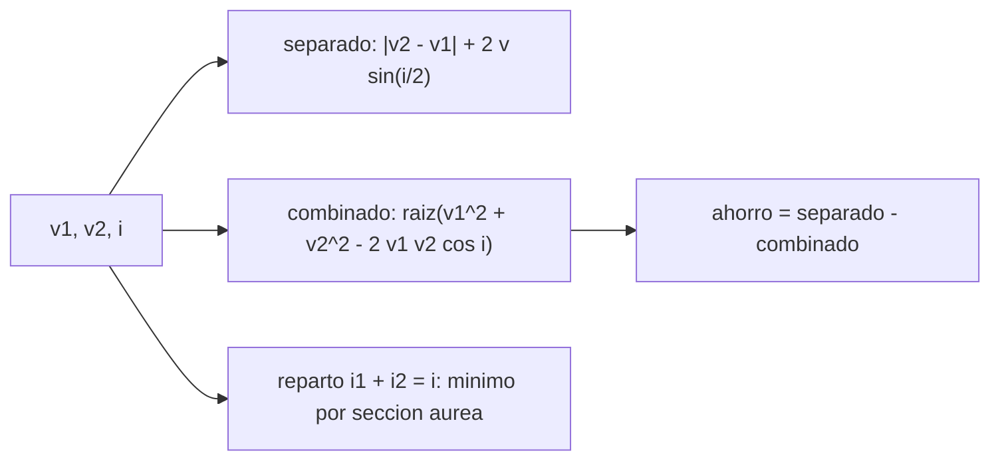

# B75-C13 — Cambios de plano interplanetarios

<!-- nav:top -->
[🏠 Programa](../../../../README.md) · [📚 Bloque B75](../../../tronco-comun/B75-trayectorias-y-misiones-interplanetarias.md) · [← Anterior: B75-C12 — Optimización de trayectoria](../B75-C12-optimizacion-de-trayectoria/CLASE.md) · [Siguiente: B75-C14 — Captura en destino →](../B75-C14-captura-en-destino/CLASE.md)
<!-- /nav -->

## 1. Ubicación, nivel y alcance

Clase 13 del bloque B75. Nivel N3. Los planetas no están todos en el mismo plano: Venus está inclinado `3,395°` respecto a la eclíptica, Marte `1,848°` y Júpiter `1,304°` [S2, S3, S4]. Cuando una nave sale de la Tierra (inclinación `0,000°` [S1]), parte del delta-v se gasta en girar el plano de la órbita. Aquí calculas cuánto, por qué conviene combinarlo con el cambio de velocidad y cómo repartirlo entre salida y llegada.

## 2. Por qué esta clase existe

Un cambio de plano puro es caro: `2 v sin(i/2)` a la velocidad de la nave. La decisión central: **¿dónde y cómo conviene girar el plano para gastar lo menos posible?**

## 3. Lo que podrás hacer al terminar

1. Calcular el delta-v de un cambio de plano puro `2 v sin(i/2)`.
2. Calcular el delta-v combinado `√(v₁² + v₂² − 2 v₁ v₂ cos i)`.
3. Verificar el combinado con la diferencia de vectores en 3D.
4. Hallar el reparto óptimo del cambio de plano entre salida y llegada.
5. Comparar los casos de Venus, Marte y Júpiter.
6. Separar lo consultado (inclinaciones) de las hipótesis (nodo en el punto de llegada).

La evidencia es tu **ficha de un cambio de plano** del ejercicio 12 (sección 20).

## 4. Con qué llegas y cómo comprobarlo

1. ¿Qué es la inclinación de una órbita?
2. ¿Qué es la línea de nodos?
3. ¿Cuánto vale la velocidad de llegada al afelio de Hohmann a Marte?
4. ¿Qué es la ley de cosenos?
5. ¿Qué es un reparto óptimo?

<details>
<summary>Ver respuestas</summary>

1. El ángulo entre su plano y el plano de referencia (la eclíptica). 2. La intersección del plano orbital con el de referencia. 3. `21,479 km/s` (B75-C01). 4. `c² = a² + b² − 2ab cos γ`. 5. La división de un cambio entre dos maniobras que minimiza el total.
</details>

Con cuatro o cinco aciertos, sigue; si no, repasa los prerrequisitos.

## 5. Un caso de contexto y casos de referencia

Para Marte (`i = 1,848°`), la nave llega al afelio a `21,479 km/s` con el planeta a `24,129 km/s`. Cambiar el plano por separado cuesta `0,693 km/s` y igualar la velocidad `2,649 km/s`, en total `3,342 km/s`; hacerlo todo en un solo impulso cuesta `2,749 km/s`, un ahorro de `0,593 km/s`. Es el **ejemplo conductor**. Las inclinaciones son de las fichas; la hipótesis de que el nodo cae en el punto de llegada es del modelo.

## 6. Vocabulario

El **cambio de plano puro** gira la dirección de la velocidad sin cambiar su módulo: `Δv = 2 v sin(i/2)`. El **combinado** cambia módulo y plano a la vez. El **nodo** es el punto donde el plano orbital corta la eclíptica; el cambio de plano es más barato en un nodo. El **reparto** es la división del ángulo `i = i₁ + i₂` entre dos impulsos.

## 7. Modelo mental: girar un volante



*Descripción textual:* Con las velocidades y la inclinación se calcula el costo por separado, el combinado y el ahorro; el reparto entre dos impulsos se optimiza numéricamente.

Analogía: girar un volante cuando va despacio es más fácil que cuando va rápido: conviene girar el plano donde la nave es lenta. Límite: el modelo supone que el nodo coincide con el punto de impulso.

## 8. La explicación, paso a paso

### 8.1 Cuatro fórmulas

Cambio de plano puro: `Δv_p = 2 v sin(i/2)`. Combinado entre dos velocidades `v₁` y `v₂` con ángulo `i`: `Δv = √(v₁² + v₂² − 2 v₁ v₂ cos i)`. Por separado: `|v₂ − v₁| + Δv_p`. Para Marte, `v₁ = 21,4792`, `v₂ = 24,1285` y `i = 1,848°`.

### 8.2 Tres destinos

| Destino | `i` (°) | `v_transf` (km/s) | `V_planeta` (km/s) | separado (km/s) | combinado (km/s) | ahorro (km/s) | plano puro (km/s) |
|---|---|---|---|---|---|---|---|
| Venus | 3,395 | 37,7270 | 35,0205 | 4,9416 | 3,4587 | 1,4829 | 2,2351 |
| Marte | 1,848 | 21,4792 | 24,1285 | 3,3420 | 2,7491 | 0,5929 | 0,6928 |
| Júpiter | 1,304 | 7,4134 | 13,0567 | 5,8120 | 5,6477 | 0,1643 | 0,1687 |

En todos los casos el combinado cuesta menos que hacerlo por separado.

### 8.3 Reparto entre salida y llegada (Marte)

El plano se puede girar en dos puntos: la salida (a `32,730 km/s`) y la llegada (a `21,479 km/s`). Minimizando el delta-v total sobre `i₁ + i₂ = i`: óptimo `i₁ = 0,6834°` en la salida y `i₂ = 1,1646°` en la llegada, con `5,657991 km/s`. Todo en la llegada: `5,694297 km/s`; todo en la salida: `5,761831 km/s`. El coplanar costaba `5,5944 km/s`, así que el cambio de plano añade `0,0636 km/s` (1,1 %) con el mejor reparto. Se gira más donde la nave es más lenta.

### 8.4 Verificación

El combinado coincide con la norma de la diferencia de vectores 3D con error menor que `10⁻¹²`. El reparto de la sección áurea y un barrido de 100 000 pasos coinciden en `0,6834°`.

## 9. Magnitudes, símbolos y unidades

| Símbolo | Qué es | Unidad | Valor / nota |
|---|---|---|---|
| `i` | inclinación del plano del destino | ° | 1,848 (Marte) |
| `Δv_p` | cambio de plano puro | km/s | 0,6928 (Marte) |
| `Δv_c` | combinado | km/s | 2,7491 (Marte) |
| `i₁`, `i₂` | reparto del ángulo | ° | 0,6834; 1,1646 |
| `v₁`, `v₂` | velocidades antes y después | km/s | 21,4792; 24,1285 |

## 10. Convenciones y referencias

Planetas en órbitas circulares con las inclinaciones de las fichas NASA/NSSDC; transferencia de Hohmann desde la Tierra (en la eclíptica). Hipótesis: el nodo cae en el punto de llegada (el caso más desfavorable de no coplanaridad); la Tierra con inclinación `0,000°`. `μ☉` estándar.

## 11. De dónde sale lo que afirmamos

| ID | Fuente | Localizador | Respalda | Estado |
|---|---|---|---|---|
| S1 | NASA/NSSDC, Earth Fact Sheet — https://nssdc.gsfc.nasa.gov/planetary/factsheet/earthfact.html (consultada 2026-11-10) | página leída | semieje 149,598×10⁶ km, periodo sideral 365,256 d, excentricidad 0,0167, velocidad orbital media 29,78 km/s, masa 5,9722×10²⁴ kg, radio medio 6371,000 km, velocidad de escape 11,186 km/s | Consultada |
| S2 | NASA/NSSDC, Venus Fact Sheet — https://nssdc.gsfc.nasa.gov/planetary/factsheet/venusfact.html (consultada 2026-11-10) | página leída | semieje 108,210×10⁶ km, periodo sideral 224,701 d, excentricidad 0,0068, inclinación 3,395°, velocidad media 35,02 km/s, masa 4,8673×10²⁴ kg, radio medio 6051,8 km | Consultada |
| S3 | NASA/NSSDC, Mars Fact Sheet — https://nssdc.gsfc.nasa.gov/planetary/factsheet/marsfact.html (consultada 2026-11-10) | página leída | semieje 227,956×10⁶ km, periodo sideral 686,980 d, excentricidad 0,0935, inclinación 1,848°, velocidad media 24,08 km/s, masa 0,64169×10²⁴ kg, radio ecuatorial 3396,2 km, g 3,73 m/s² | Consultada |
| S4 | NASA/NSSDC, Jupiter Fact Sheet — https://nssdc.gsfc.nasa.gov/planetary/factsheet/jupiterfact.html (consultada 2026-11-10) | página leída | semieje 778,479×10⁶ km, periodo sideral 4332,589 d, excentricidad 0,0487, inclinación 1,304°, velocidad media 13,06 km/s, masa 1898,13×10²⁴ kg, radio medio 69 911 km | Consultada |
| — | Valores estándar (no consultados en una fuente concreta de esta clase) | — | GM☉ = 1,32712440×10¹¹ km³/s² (valor estándar, ver la resolución IAU 2015 B3 de la fila anterior donde se cita); 1 au = 149 597 870,7 km; c = 299 792,458 km/s; g₀ = 9,80665 m/s²; ecuaciones de dos cuerpos | No consultada en una fuente concreta |

Límites: no se consultó la posición real de los nodos ni la fecha en que Marte, Venus o Júpiter cruzan la eclíptica; las inclinaciones son medias de la ficha.

## 12. Cómo ver el ahorro

| Destino | Separado (km/s) | Combinado (km/s) |
|---|---|---|
| Venus | 4,9416 | 3,4587 |
| Marte | 3,3420 | 2,7491 |
| Júpiter | 5,8120 | 5,6477 |

Descripción larga: el ahorro es grande cuando la inclinación es grande y la velocidad de la nave es alta (Venus: 1,48 km/s) y pequeño en el caso de Júpiter (0,16 km/s).

## 13. Ejemplo trabajado: Marte combinado

**Paso 1 · Datos.** `v₁ = 21,4792`, `v₂ = 24,1285`, `i = 1,848°`.

**Paso 2 · Combinado.** `√(21,4792² + 24,1285² − 2×21,4792×24,1285×cos 1,848°) = 2,7491 km/s`.

**Paso 3 · Separado.** `2,6493 + 0,6928 = 3,3420 km/s`.

**Paso 4 · Ahorro.** `0,5929 km/s`.

## 14. Distintas formas de abordar el problema

**Por separado:** velocidad más plano. **Combinado:** un solo impulso. **Por reparto en dos impulsos:** minimiza el total. **Por vectores 3D:** verificación independiente.

## 15. Práctica guiada

**Ejercicio 1 · con los pasos indicados.** Calcula el cambio de plano puro para Marte con `v = 21,4792 km/s` e `i = 1,848°`. *Pasos:* `2 v sin(i/2)`.

<details><summary>Solución comentada</summary>

`2×21,4792×sin 0,924° = 0,6928 km/s`.
</details>

**Ejercicio 2 · con una pista.** Calcula el combinado con la ley de cosenos. *Pista:* usa `v₂ = 24,1285`.

<details><summary>Solución comentada</summary>

`2,7491 km/s`.
</details>

**Ejercicio 3 · casi autónomo.** ¿Cuánto se ahorra al combinar? Compáralo con el cambio de plano puro.

<details><summary>Solución comentada</summary>

`3,3420 − 2,7491 = 0,5929 km/s`, el 86 % del cambio de plano puro.
</details>

## 16. Práctica autónoma, transferencia e integrador

**Ejercicio 4 · autónomo.** Calcula el cambio de plano puro para Venus con `v = 37,727 km/s` e `i = 3,395°`.

<details><summary>Solución comentada</summary>

`2×37,727×sin 1,6975° = 2,2351 km/s`.
</details>

**Ejercicio 5 · autónomo.** ¿Qué fracción del combinado de Venus (`3,4587 km/s`) representa el cambio de velocidad puro (`2,7065 km/s`)?

<details><summary>Solución comentada</summary>

`2,7065/3,4587 = 78 %`.
</details>

**Ejercicio 6 · autónomo.** ¿Por qué conviene girar más en la llegada (Marte)?

<details><summary>Solución comentada</summary>

Porque allí la nave es más lenta (`21,479` frente a `32,730 km/s`) y `2 v sin(i/2)` crece con `v`.
</details>

**Ejercicio 7 · autónomo.** ¿Cuánto añade el cambio de plano al delta-v heliocéntrico coplanar con el mejor reparto?

<details><summary>Solución comentada</summary>

`5,657991 − 5,5944 = 0,0636 km/s` (1,1 %).
</details>

**Ejercicio 8 · autónomo.** ¿Cuánto cuesta hacerlo todo en la salida frente al óptimo?

<details><summary>Solución comentada</summary>

`5,761831 − 5,657991 = 0,1038 km/s` más.
</details>

**Ejercicio 9 · transferencia.** ¿Qué pasa si el nodo no cae en el punto de llegada?

<details><summary>Solución comentada</summary>

El plano de la nave y el del planeta ya difieren en el punto de impulso por un ángulo menor que `i`; el costo bajaría. El modelo es un caso desfavorable.
</details>

**Ejercicio 10 · transferencia.** Venus tiene `i = 3,395°`: ¿por qué el ahorro combinado es 1,48 km/s?

<details><summary>Solución comentada</summary>

Porque el cambio de plano puro es `2,2351 km/s` y combinarlo con el frenado `2,7065 km/s` evita sumar los módulos.
</details>

**Ejercicio 11 · transferencia.** Un sobrevuelo (C06) puede girar el plano. ¿Qué debe cumplir para ser útil?

<details><summary>Solución comentada</summary>

Un giro de `δ` fuera del plano de la eclíptica; el modelo plano de B75-C06 no lo cubre.
</details>

**Ejercicio 12 · integrador.** Elabora tu *ficha de un cambio de plano* para Marte, Venus o Júpiter: separado, combinado, ahorro y, si eliges Marte, el reparto óptimo.

<details><summary>Solución comentada</summary>

Secciones 8.1–8.4 y la salida del laboratorio.
</details>

## 17. Laboratorio: cambio de plano en Venus, Marte y Júpiter

El script [plano.py](plano.py) calcula el costo por separado y combinado para tres destinos y el reparto óptimo para Marte, y **comprueba** el combinado con vectores 3D y el reparto con un barrido fino.

**Datos:** inclinaciones y semiejes de las fichas NASA/NSSDC (consultados); hipótesis del nodo en la llegada; `μ☉` estándar. **Predice antes de ejecutar:** ¿En qué extremo se gira más el plano? (en la llegada: 1,1646°.) **Ejecución del 2026-11-10 (Python 3.12.9):**

```text
Python 3.12.9 (biblioteca estandar)
 destino  i [grados]  v_transf_llegada  V_planeta  dv separado [km/s] (velocidad + plano)  dv combinado [km/s]  ahorro [km/s]  dv solo-plano [km/s]
Venus       3.395          37.7270     35.0205                         4.9416                   3.4587         1.4829             2.2351
Marte       1.848          21.4792     24.1285                         3.3420                   2.7491         0.5929             0.6928
Jupiter     1.304           7.4134     13.0567                         5.8120                   5.6477         0.1643             0.1687
Marte: reparto optimo i1 = 0.6834 grados en la salida y 1.1646 grados en la llegada
   dv total optimo = 5.657991 km/s ; todo en la llegada = 5.694297 km/s ; todo en la salida = 5.761831 km/s
   barrido fino: i1 = 0.6834 grados ; dv = 5.657991 km/s
Pruebas superadas.
```

```bash
python programa/clases/B75/B75-C13-cambios-de-plano-interplanetarios/plano.py
```

**Límites:** órbitas circulares, nodo en el punto de impulso, sin sobrevuelos.

## 18. Errores frecuentes y cómo corregirlos

**Sumar módulos en lugar de combinar vectorialmente.** Se corrige con 8.1.

**Girar el plano a alta velocidad.** Se corrige con 8.3.

**Olvidar que el nodo condiciona el costo.** Se corrige con el ejercicio 9.

**Presentar el caso como posición real del planeta.** Se corrige con la sección 10.

## 19. Cómo sabrás que vas bien

Tras 8.1: ¿cuánto ahorra combinar en Marte? Tras el laboratorio: ¿qué dos cosas se verifican? (ver la sección 17).

## 20. Qué entregas y cómo se evalúa

El producto es tu **ficha de un cambio de plano** (ejercicio 12).

| Criterio | Inicial | En desarrollo | Logrado | Destacado |
|---|---|---|---|---|
| Conceptos | Confunde plano y módulo | Define las fórmulas | Calcula separado y combinado | Explica el reparto |
| Cálculo | Sin unidades | Con errores | Tabla completa | Calcula casos nuevos |
| Numérico | Sin comprobar | Una prueba | Dos pruebas | Interpreta el óptimo |
| Fuentes | Sin fuente | Sin fecha | Fuentes con fecha y estado | Declara la hipótesis del nodo |
| Límites | No los nombra | Uno | Tres | Discute la posición real de los nodos |

**Condiciones críticas (no se compensan con promedio):** rotular la hipótesis del nodo; no presentar el resultado como la geometría real de una misión; citar solo lo consultado.

## 21. Ética, seguridad y límites

Clase educativa: los modelos son simplificados (órbitas planetarias circulares y coplanares, dos cuerpos) y sus datos son consultados, sintéticos o ilustrativos y están rotulados; ningún resultado es una efeméride, una medición ni un diseño de misión real. La geometría real de nodos cambia con la fecha; esta clase calcula un caso desfavorable. Accesibilidad: tablas equivalentes a las gráficas, fórmulas en texto, ejercicios sin conexión.

## 22. Para cerrar y seguir

Girar el plano a Marte cuesta `0,693 km/s` por separado, pero combinado con el cambio de velocidad añade solo `0,0636 km/s` al total con el mejor reparto. Queda una pregunta: ¿cuánto cuesta frenar para que el planeta atrape a la nave?

**Glosario español–inglés.** cambio de plano · *plane change*; inclinación · *inclination*; línea de nodos · *line of nodes*; combinado · *combined maneuver*; eclíptica · *ecliptic*.

**Continuidad.** [B75-C14](../B75-C14-captura-en-destino/CLASE.md) calcula la captura en una órbita final.

**Referencias:** ver sección 11.

<!-- nav:bottom -->
---

[← Anterior: B75-C12 — Optimización de trayectoria](../B75-C12-optimizacion-de-trayectoria/CLASE.md) · [📚 Bloque B75](../../../tronco-comun/B75-trayectorias-y-misiones-interplanetarias.md) · [Siguiente: B75-C14 — Captura en destino →](../B75-C14-captura-en-destino/CLASE.md)
<!-- /nav -->
