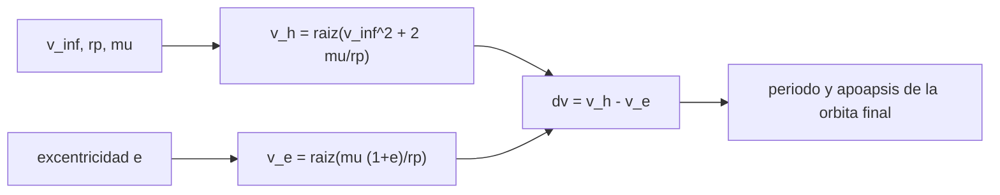

# B75-C14 — Captura en destino

<!-- nav:top -->
[🏠 Programa](../../../../README.md) · [📚 Bloque B75](../../../tronco-comun/B75-trayectorias-y-misiones-interplanetarias.md) · [← Anterior: B75-C13 — Cambios de plano interplanetarios](../B75-C13-cambios-de-plano-interplanetarios/CLASE.md) · [Siguiente: B75-C15 — Aerofrenado conceptual →](../B75-C15-aerofrenado-conceptual/CLASE.md)
<!-- /nav -->

## 1. Ubicación, nivel y alcance

Clase 14 del bloque B75. Nivel N3. Llegar al destino no basta: la nave pasa a gran velocidad y, si no frena, sigue de largo. La captura es un impulso en el periapsis que convierte la hipérbola en una elipse. Aquí calculas cuánto cuesta capturarse en Marte según la excentricidad de la órbita final y por qué una órbita elíptica larga cuesta menos que una circular. Usas `v∞ = 2,6493 km/s`, el valor de llegada de B75-C01.

## 2. Por qué esta clase existe

Frenar cuesta propulsante; cuanto más baja la órbita final, más cuesta. La decisión central: **¿qué órbita de captura minimiza el delta-v, y qué se paga después por llevarla a la órbita de trabajo?**

## 3. Lo que podrás hacer al terminar

1. Calcular la velocidad hiperbólica en el periapsis `√(v∞² + 2μ/r_p)`.
2. Calcular el delta-v de captura para una órbita final de excentricidad `e`.
3. Verificar con Kepler el apoapsis de la órbita final.
4. Calcular el límite parabólico (`e → 1`) y la órbita de un día solar marciano.
5. Medir la sensibilidad a `v∞`.
6. Separar lo consultado de lo ilustrativo (altitud de periapsis, excentricidades).

La evidencia es tu **tabla de captura circular frente a elíptica** del ejercicio 12 (sección 20).

## 4. Con qué llegas y cómo comprobarlo

1. ¿Qué es el periapsis?
2. ¿Qué dice vis-viva?
3. ¿Qué es `v∞` de llegada?
4. ¿Qué es la excentricidad?
5. ¿Qué es un día solar?

<details>
<summary>Ver respuestas</summary>

1. El punto de la órbita más cercano al cuerpo. 2. `v² = μ(2/r − 1/a)`. 3. La velocidad respecto al planeta lejos de él (`2,6493 km/s` para Marte por Hohmann). 4. `e = (r_a − r_p)/(r_a + r_p)`; 0 en un círculo. 5. El tiempo entre dos mediodías; en Marte, `24,6597 h`.
</details>

Con cuatro o cinco aciertos, sigue; si no, repasa los prerrequisitos.

## 5. Un caso de contexto y casos de referencia

En el periapsis a `300 km` de altitud (`r_p = 3696,2 km`), la nave llega a `5,4948 km/s`. Para quedar en órbita circular (`3,4040 km/s`) hay que frenar `2,0908 km/s`; para quedar en una elipse de un día solar marciano (`e = 0,8192`, apoapsis a `33 804 km`), solo `0,9036 km/s`. Es el **ejemplo conductor**. La masa, el radio y el día solar son de la ficha de Marte [S1] y `G` del JPL [S2]; la altitud del periapsis es ilustrativa.

## 6. Vocabulario

La **captura** es el impulso que reduce la energía para pasar de hipérbola a elipse. La **velocidad hiperbólica en el periapsis** es `v_h = √(v∞² + 2μ/r_p)`. El **delta-v de captura** es `v_h − v_e`, con `v_e = √(μ(1+e)/r_p)`. El **límite parabólico** es `e → 1`. Una **órbita de un día solar** tiene periodo de `24,6597 h`.

## 7. Modelo mental: frenar en la rampa de acceso



*Descripción textual:* Con `v∞` y el periapsis se obtiene la velocidad hiperbólica; con la excentricidad elegida, la de la elipse; la diferencia es el delta-v de captura; la órbita final queda definida por su periodo y apoapsis.

Analogía: frenar un coche al entrar en una rotonda: frenar hasta una vuelta cerrada exige más que frenar a una vuelta muy ancha. Límite: las rotondas no gastan combustible por la forma de la vuelta; la nave sí gasta después para bajarla.

## 8. La explicación, paso a paso

### 8.1 La velocidad hiperbólica

Con `GM_M = G M = 42 828,32 km³/s²`, `r_p = 3396,2 + 300 = 3696,2 km` y `v∞ = 2,6493 km/s`: `v_h = √(2,6493² + 2×42 828,32/3696,2) = 5,4948 km/s`. La circular a esa altitud es `√(μ/r_p) = 3,4040 km/s`.

### 8.2 Según la excentricidad

| `e` | Apoapsis, altitud (km) | Periodo (h) | `Δv` captura (km/s) | Ahorro frente a circular (km/s) |
|---|---|---|---|---|
| 0,00 | 300 | 1,90 | 2,0908 | 0,0000 |
| 0,30 | 3468 | 3,24 | 1,6137 | 0,4772 |
| 0,60 | 11 389 | 7,49 | 1,1891 | 0,9018 |
| 0,80 | 29 870 | 21,19 | 0,9279 | 1,1629 |
| 0,90 | 66 832 | 59,93 | 0,8027 | 1,2881 |
| 0,95 | 140 756 | 169,51 | 0,7414 | 1,3494 |
| 0,99 | 732 148 | 1895,16 | 0,6929 | 1,3979 |

El límite parabólico es `0,6809 km/s`.

### 8.3 La órbita de un día solar

Periodo `24,6597 h = 88 774,9 s`: `a = 20 448,0 km`, apoapsis a `33 804 km` de altitud, `e = 0,8192`, `Δv = 0,9036 km/s`. El precio es que la nave queda en una órbita larga: después hay que bajarla (con propulsante o aerofrenado, C15).

### 8.4 Sensibilidad a `v∞`

| `v∞` (km/s) | Circular (km/s) | Día solar (km/s) |
|---|---|---|
| 2,0000 | 1,8089 | 0,6216 |
| 2,6493 | 2,0908 | 0,9036 |
| 3,5000 | 2,5478 | 1,3606 |
| 5,0000 | 3,5368 | 2,3495 |

### 8.5 Verificación

La propagación de Kepler desde el periapsis durante medio periodo con `e = 0,9` llega a `70 227,800 km`, igual a `a(1+e)`. El delta-v decrece al aumentar `e` en todo el rango. El límite `e = 0,999999` da `0,6809 km/s`. El periodo de la órbita de un día solar reproduce `24,6597 h`.

## 9. Magnitudes, símbolos y unidades

| Símbolo | Qué es | Unidad | Valor / nota |
|---|---|---|---|
| `v_h` | velocidad hiperbólica en el periapsis | km/s | 5,4948 |
| `v_e` | velocidad de la elipse en el periapsis | km/s | 4,5912 (e = 0,8192) |
| `Δv` | delta-v de captura | km/s | 2,0908 (circular); 0,9036 (día solar) |
| `e` | excentricidad final | — | 0,8192 |
| `r_p` | radio del periapsis | km | 3696,2 |
| `GM_M` | parámetro gravitacional de Marte | km³/s² | 42 828,32 (G·M) |

## 10. Convenciones y referencias

Marco areocéntrico; impulso instantáneo y tangencial en el periapsis; sin atmósfera, J2 ni perturbaciones; `v∞ = 2,6493 km/s` del modelo circular y coplanar de B75-C01. Altitud del periapsis y excentricidades elegidas por el ejercicio. `GM_M` se calcula como `G·M`.

## 11. De dónde sale lo que afirmamos

| ID | Fuente | Localizador | Respalda | Estado |
|---|---|---|---|---|
| S1 | NASA/NSSDC, Mars Fact Sheet — https://nssdc.gsfc.nasa.gov/planetary/factsheet/marsfact.html (consultada 2026-11-10) | página leída | masa 0,64169×10²⁴ kg, radio ecuatorial 3396,2 km, día solar de 24,6597 h, g 3,73 m/s², excentricidad 0,0935 | Consultada |
| S2 | NASA JPL SSD, Planetary Physical Parameters — https://ssd.jpl.nasa.gov/planets/phys_par.html (consultada 2026-11-10) | página leída | radios ecuatoriales (Venus 6051,8 km; Tierra 6378,1366 km; Marte 3396,19 km; Júpiter 71 492 km) y la constante G = 6,67430×10⁻¹¹ m³ kg⁻¹ s⁻² citada en su registro de cambios. La página no lista GM: aquí GM = G·M con las masas de las fichas NSSDC | Consultada |
| S3 | NASA, Basics of Space Flight, cap. 4 «Interplanetary Trajectories» — https://science.nasa.gov/learn/basics-of-space-flight/chapter4-1/ (consultada 2026-11-10) | página leída | transferencia de Hohmann como ruta de menor propulsante; oportunidades mínimas de energía a Marte cada ~25 meses y a Venus cada ~19 meses; la asistencia gravitacional cambia la velocidad heliocéntrica y deja la relativa en módulo; el vuelo de Galileo por Ío redujo el propulsante de inserción en 90 kg | Consultada |
| — | Valores estándar (no consultados en una fuente concreta de esta clase) | — | GM☉ = 1,32712440×10¹¹ km³/s² (valor estándar, ver la resolución IAU 2015 B3 de la fila anterior donde se cita); 1 au = 149 597 870,7 km; c = 299 792,458 km/s; g₀ = 9,80665 m/s²; ecuaciones de dos cuerpos | No consultada en una fuente concreta |

Límites: no se consultaron las órbitas de misiones reales a Marte; la ficha del día solar respalda solo el periodo de 24,6597 h; el impulso instantáneo ignora las pérdidas por empuje finito (C10); la NASA describe la transferencia de Hohmann y los vuelos, pero esa página no trata la captura [S3].

## 12. Cómo ver la captura

| Órbita final | Δv (km/s) |
|---|---|
| circular 300 km | 2,0908 |
| elíptica `e = 0,6` | 1,1891 |
| un día solar (`e = 0,8192`) | 0,9036 |
| límite parabólico | 0,6809 |

Descripción larga: el costo cae a menos de la mitad al pasar de la circular a la elipse larga; el límite inferior es el parabólico.

## 13. Ejemplo trabajado: la órbita de un día solar

**Paso 1 · Semieje.** `a = (μ (T/2π)²)^{1/3} = 20 448,0 km`.

**Paso 2 · Apoapsis.** `r_a = 2a − r_p = 37 199,8 km`, es decir `33 804 km` de altitud.

**Paso 3 · Velocidad elíptica.** `v_e = √(μ(1+e)/r_p) = 4,5912 km/s` con `e = 0,8192`.

**Paso 4 · Delta-v.** `5,4948 − 4,5912 = 0,9036 km/s`.

## 14. Distintas formas de abordar el problema

**Por vis-viva:** velocidades en el periapsis. **Por la tercera ley:** periodo y semieje. **Por Kepler:** propagación hasta el apoapsis. **Por el límite parabólico:** cota inferior del delta-v.

## 15. Práctica guiada

**Ejercicio 1 · con los pasos indicados.** Calcula `v_h` con `v∞ = 2,6493`, `μ = 42 828,32` y `r_p = 3696,2`. *Pasos:* `√(v∞² + 2μ/r_p)`.

<details><summary>Solución comentada</summary>

`5,4948 km/s`.
</details>

**Ejercicio 2 · con una pista.** Calcula el delta-v para captura circular. *Pista:* `v_c = √(μ/r_p) = 3,4040`.

<details><summary>Solución comentada</summary>

`5,4948 − 3,4040 = 2,0908 km/s`.
</details>

**Ejercicio 3 · casi autónomo.** Calcula el delta-v de la elipse `e = 0,6`. *Pista:* `v_e = √(μ·1,6/r_p)`.

<details><summary>Solución comentada</summary>

`v_e = 4,3057`; `Δv = 1,1891 km/s`.
</details>

## 16. Práctica autónoma, transferencia e integrador

**Ejercicio 4 · autónomo.** Calcula el ahorro al pasar de circular a un día solar.

<details><summary>Solución comentada</summary>

`2,0908 − 0,9036 = 1,1872 km/s`.
</details>

**Ejercicio 5 · autónomo.** ¿Cuál es el delta-v mínimo posible (límite parabólico)?

<details><summary>Solución comentada</summary>

`5,4948 − √(2μ/r_p) = 0,6809 km/s`.
</details>

**Ejercicio 6 · autónomo.** Con `v∞ = 5 km/s`, ¿cuánto cuesta la circular?

<details><summary>Solución comentada</summary>

`3,5368 km/s`: crece con `v∞`.
</details>

**Ejercicio 7 · autónomo.** Compara el costo de la circular con `v∞ = 2,0` y `3,5 km/s`.

<details><summary>Solución comentada</summary>

`1,8089` y `2,5478 km/s`: una diferencia de `0,74 km/s`.
</details>

**Ejercicio 8 · autónomo.** Calcula el periodo de la elipse `e = 0,8`.

<details><summary>Solución comentada</summary>

`21,19 h` (tabla 8.2).
</details>

**Ejercicio 9 · transferencia.** Una misión quiere una órbita circular de trabajo de 300 km. ¿Cómo evita pagar `2,09 km/s` de golpe?

<details><summary>Solución comentada</summary>

Se captura primero en una elipse larga (`0,90 km/s`) y se baja después con aerofrenado (C15) o con propulsante, aceptando el tiempo.
</details>

**Ejercicio 10 · transferencia.** ¿Por qué una órbita más larga cuesta menos captura pero más tiempo?

<details><summary>Solución comentada</summary>

Porque el delta-v baja con `e` y el periodo crece como `a^{3/2}`: de `1,90 h` a `1895 h`.
</details>

**Ejercicio 11 · transferencia.** Si `v∞` aumenta por llegar antes (C12), ¿cómo cambia la captura?

<details><summary>Solución comentada</summary>

Sube: la tabla 8.4 muestra `0,90` a `1,36 km/s` entre `2,65` y `3,5 km/s` para la órbita de un día solar.
</details>

**Ejercicio 12 · integrador.** Elabora tu *tabla de captura circular frente a elíptica* con al menos seis excentricidades, el límite parabólico, la órbita de un día solar y una conclusión sobre la sensibilidad a `v∞`.

<details><summary>Solución comentada</summary>

Secciones 8.1–8.5 y la salida del laboratorio.
</details>

## 17. Laboratorio: captura en Marte

El script [captura.py](captura.py) calcula el delta-v de captura para siete excentricidades, el límite parabólico y la órbita de un día solar, y **comprueba** el apoapsis con Kepler, la monotonía del delta-v, el límite parabólico y el periodo.

**Datos:** masa, radio y día solar de la ficha NASA/NSSDC y `G` del JPL (consultados); `v∞` del modelo de C01; altitud del periapsis y excentricidades **ilustrativas**. **Predice antes de ejecutar:** ¿Cuánto cuesta la captura en la órbita de un día solar? (0,9036 km/s.) **Ejecución del 2026-11-10 (Python 3.12.9):**

```text
Python 3.12.9 (biblioteca estandar)
GM_Marte = 42828.32 km3/s2 ; rp = 3696.2 km ; v_inf = 2.6493 km/s ; v_hiperbolica en rp = 5.4948 km/s
    e      apoapsis [alt, km]   periodo [h]   dv captura [km/s]   ahorro frente a circular [km/s]
  0.00                  300          1.90              2.0908                       0.0000
  0.30                 3468          3.24              1.6137                       0.4772
  0.60                11389          7.49              1.1891                       0.9018
  0.80                29870         21.19              0.9279                       1.1629
  0.90                66832         59.93              0.8027                       1.2881
  0.95               140756        169.51              0.7414                       1.3494
  0.99               732148       1895.16              0.6929                       1.3979
Prueba 1: apoapsis por Kepler = 70227.800 km ; esperado a(1+e) = 70227.800 km
Prueba 3: limite parabolico dv = 0.6809 km/s ; con e = 0.999999: 0.6809 km/s
Orbita de un dia solar (24.6597 h): a = 20448.0 km ; apoapsis altitud = 33804 km ; e = 0.8192 ; dv captura = 0.9036 km/s
Sensibilidad a v_inf (captura circular / dia solar):
   v_inf = 2.0000 km/s: circular 1.8089 km/s ; dia solar 0.6216 km/s
   v_inf = 2.6493 km/s: circular 2.0908 km/s ; dia solar 0.9036 km/s
   v_inf = 3.5000 km/s: circular 2.5478 km/s ; dia solar 1.3606 km/s
   v_inf = 5.0000 km/s: circular 3.5368 km/s ; dia solar 2.3495 km/s
Pruebas superadas.
```

```bash
python programa/clases/B75/B75-C14-captura-en-destino/captura.py
```

**Límites:** impulso instantáneo, dos cuerpos, sin atmósfera ni J2.

## 18. Errores frecuentes y cómo corregirlos

**Pensar que la captura circular es la única opción.** Se corrige con 8.2.

**Olvidar el costo posterior de bajar la órbita.** Se corrige con el ejercicio 9.

**Usar el `v∞` de salida en lugar del de llegada.** Se corrige con la sección 5.

**Presentar la altitud ilustrativa como la de una misión.** Se corrige con la sección 10.

## 19. Cómo sabrás que vas bien

Tras 8.2: ¿cuánto ahorra una elipse larga? Tras el laboratorio: ¿qué cuatro comprobaciones hace? (ver la sección 17).

## 20. Qué entregas y cómo se evalúa

El producto es tu **tabla de captura circular frente a elíptica** (ejercicio 12).

| Criterio | Inicial | En desarrollo | Logrado | Destacado |
|---|---|---|---|---|
| Conceptos | Confunde captura y escape | Define `v_h` y `v_e` | Calcula la tabla | Explica el compromiso tiempo–delta-v |
| Cálculo | Sin unidades | Con errores | Tabla completa | Calcula casos nuevos |
| Numérico | Sin comprobar | Una prueba | Cuatro pruebas | Interpreta el límite |
| Fuentes | Sin fuente | Sin fecha | Fuentes con fecha y estado | Declara lo ilustrativo |
| Límites | No los nombra | Uno | Tres | Discute J2 y la atmósfera |

**Condiciones críticas (no se compensan con promedio):** rotular periapsis y excentricidades como ilustrativos; no presentar el resultado como una misión; citar solo lo consultado.

## 21. Ética, seguridad y límites

Clase educativa: los modelos son simplificados (órbitas planetarias circulares y coplanares, dos cuerpos) y sus datos son consultados, sintéticos o ilustrativos y están rotulados; ningún resultado es una efeméride, una medición ni un diseño de misión real. Un periapsis bajo exige análisis de atmósfera y de riesgo de impacto; esta clase no lo hace. Accesibilidad: tablas equivalentes a las gráficas, fórmulas en texto, ejercicios sin conexión.

## 22. Para cerrar y seguir

Capturarse en la órbita de un día solar cuesta `0,9036 km/s` y en una circular `2,0908 km/s`. Queda una pregunta: ¿cómo bajar la órbita larga sin gastar propulsante?

**Glosario español–inglés.** captura · *orbit insertion / capture*; periapsis · *periapsis*; límite parabólico · *parabolic limit*; excentricidad · *eccentricity*; día solar · *solar day*.

**Continuidad.** [B75-C15](../B75-C15-aerofrenado-conceptual/CLASE.md) baja la órbita con la atmósfera.

**Referencias:** ver sección 11.

<!-- nav:bottom -->
---

[← Anterior: B75-C13 — Cambios de plano interplanetarios](../B75-C13-cambios-de-plano-interplanetarios/CLASE.md) · [📚 Bloque B75](../../../tronco-comun/B75-trayectorias-y-misiones-interplanetarias.md) · [Siguiente: B75-C15 — Aerofrenado conceptual →](../B75-C15-aerofrenado-conceptual/CLASE.md)
<!-- /nav -->
