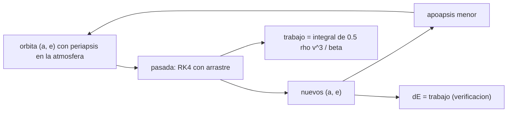

# B75-C15 — Aerofrenado conceptual

<!-- nav:top -->
[🏠 Programa](../../../../README.md) · [📚 Bloque B75](../../../tronco-comun/B75-trayectorias-y-misiones-interplanetarias.md) · [← Anterior: B75-C14 — Captura en destino](../B75-C14-captura-en-destino/CLASE.md) · [Siguiente: B75-C16 — Navegación relativa a lunas →](../B75-C16-navegacion-relativa-a-lunas/CLASE.md)
<!-- /nav -->

## 1. Ubicación, nivel y alcance

Clase 15 del bloque B75. Nivel N3. Capturarse en una elipse larga cuesta poco (B75-C14), pero hay que bajarla. En Marte se puede hacer sin propulsante, rozando la atmósfera en cada periapsis. Aquí simulas pasadas sucesivas por una atmósfera exponencial con densidad y altura de escala de la ficha de la NASA, midiendo cuánto baja el apoapsis en cada una y qué delta-v propulsivo equivale. La atmósfera de este modelo es **ilustrativa**: no es un modelo de Marte.

## 2. Por qué esta clase existe

Cada pasada baja el apoapsis un poco, y hace falta algún margen de seguridad con la densidad. La decisión central: **¿cuántas pasadas y cuánto tiempo hacen falta para bajar el apoapsis, y qué delta-v propulsivo se ahorra?**

## 3. Lo que podrás hacer al terminar

1. Escribir el arrastre `a = −½ ρ v²/β` con el coeficiente balístico `β = m/(C_d A)`.
2. Integrar una pasada con RK4 y obtener los nuevos elementos.
3. Verificar el cambio de energía con la integral de la potencia disipada.
4. Encadenar pasadas y obtener apoapsis, periapsis y periodo en función del número.
5. Calcular el delta-v propulsivo equivalente.
6. Separar lo consultado (densidad, altura de escala) de lo ilustrativo (modelo exponencial a 100–200 km, `β`).

La evidencia es tu **serie de apoapsis por pasada** del ejercicio 12 (sección 20).

## 4. Con qué llegas y cómo comprobarlo

1. ¿Qué es la altura de escala?
2. ¿Qué es el apoapsis?
3. ¿Qué es el coeficiente balístico?
4. ¿Qué mide la energía específica?
5. ¿Qué es una pasada?

<details>
<summary>Ver respuestas</summary>

1. La altura a la que la densidad cae por un factor `e`. 2. El punto de la órbita más lejano del planeta. 3. `β = m/(C_d A)` en kg/m²: a mayor `β`, menor frenado. 4. `ε = v²/2 − μ/r`, en km²/s². 5. Un paso por el periapsis dentro de la atmósfera.
</details>

Con cuatro o cinco aciertos, sigue; si no, repasa los prerrequisitos.

## 5. Un caso de contexto y casos de referencia

Una nave con órbita `110 × 20 000 km` de altitud sobre Marte y `β = 100 kg/m²` pierde `0,0588 km²/s²` en la pasada 5 y baja su apoapsis de `20 000` a `15 824 km`; tras 48 pasadas el apoapsis es de `1950 km` y el periodo de `13,16 h` ha caído a `2,48 h`. Equivale a un delta-v propulsivo de `0,7644 km/s`. Es el **ejemplo conductor**. La densidad de superficie `0,016 ± 0,006 kg/m³` y la altura de escala `11,0 km` son de la ficha de Marte [S1]; extrapolar la exponencial de superficie a 100–200 km de altitud es **ilustrativo**.

## 6. Vocabulario

El **aerofrenado** reduce la energía orbital con el arrastre atmosférico en el periapsis. El **coeficiente balístico** `β = m/(C_d A)` caracteriza la nave. La **densidad exponencial** es `ρ(h) = ρ₀ e^{−h/H}`. El **corredor de aerofrenado** es el rango de altitudes de periapsis útiles. La **potencia disipada** por unidad de masa es `½ ρ v³/β`.

## 7. Modelo mental: frenar rozando el agua



*Descripción textual:* Cada pasada se integra con arrastre; los nuevos elementos dan un apoapsis menor; el cambio de energía debe coincidir con el trabajo del arrastre, y el ciclo se repite.

Analogía: una piedra plana que rebota sobre el agua: cada contacto la frena un poco. Límite: la piedra sale con la misma altura; en la nave, el periapsis se mantiene casi fijo pero el apoapsis baja.

## 8. La explicación, paso a paso

### 8.1 El arrastre

`a = −½ ρ v²/β` en la dirección de la velocidad inercial (sin rotación atmosférica); `ρ(h) = 0,016 kg/m³·e^{−h/11,0 km}`; `β = 100 kg/m²`. A 110 km, `ρ = 7,26×10⁻⁷ kg/m³` y la presión dinámica con `v = 4,61 km/s` es `½ρv² = 7,7 Pa`.

### 8.2 Una pasada

Se parte de la altitud de entrada de 200 km (inbound), se integra con RK4 (paso 0,5 s) hasta salir a 200 km, y se calculan `a` y `e` con los elementos osculadores.

### 8.3 Pasadas sucesivas

| Pasada | Apoapsis (alt., km) | Periapsis (alt., km) | Periodo (h) | `ΔE` (km²/s²) |
|---|---|---|---|---|
| 0 | 20 000 | 110,00 | 13,16 | — |
| 5 | 15 824 | 109,79 | 10,22 | −0,05878 |
| 10 | 12 736 | 109,55 | 8,21 | −0,05961 |
| 20 | 8450 | 108,96 | 5,67 | −0,06218 |
| 30 | 5568 | 108,17 | 4,15 | −0,06683 |
| 40 | 3421 | 106,93 | 3,13 | −0,07657 |
| 48 | 1950 | 105,03 | 2,48 | −0,09735 |

El periapsis baja menos de 1 km por pasada (máximo `0,333 km`). La pérdida de energía por pasada crece porque a menor `a` la nave pasa más veces y a mayor profundidad.

### 8.4 Equivalente propulsivo

La velocidad en el periapsis cae de `4,6093` a `3,8449 km/s`: `0,7644 km/s`, unos `15,9 m/s` por pasada en promedio y `12,8 m/s` en la pasada 5 (`ΔE/v_p`). Con `I_sp = 320 s` (sintético), `0,7644 km/s` cuesta unos `276 kg` de propulsante por cada 1000 kg finales.

### 8.5 Verificaciones

El cambio de energía calculado con los elementos coincide con el trabajo del arrastre integrado con una tolerancia relativa de `10⁻³` en las 48 pasadas (en la tabla coinciden a 5 cifras). El apoapsis decrece de forma monótona.

## 9. Magnitudes, símbolos y unidades

| Símbolo | Qué es | Unidad | Valor / nota |
|---|---|---|---|
| `ρ₀` | densidad de superficie | kg/m³ | 0,016 ± 0,006 |
| `H` | altura de escala | km | 11,0 |
| `β` | coeficiente balístico | kg/m² | 100 (sintético) |
| `ΔE` | cambio de energía por pasada | km²/s² | −0,0588 (pasada 5) |
| `n` | pasadas hasta 2000 km | — | 48 |
| `Δv_eq` | delta-v propulsivo equivalente | km/s | 0,7644 |

## 10. Convenciones y referencias

Marco areocéntrico plano; velocidad inercial (la atmósfera no rota); densidad exponencial desde la superficie (extrapolación **ilustrativa** a 100–200 km); `β` sintético; `GM_M = G·M` con `G` del JPL; paso de 0,5 s dentro de los 200 km de altitud y propagación analítica fuera. La incertidumbre de la densidad (± 0,006) no se propaga.

## 11. De dónde sale lo que afirmamos

| ID | Fuente | Localizador | Respalda | Estado |
|---|---|---|---|---|
| S1 | NASA/NSSDC, Mars Fact Sheet — https://nssdc.gsfc.nasa.gov/planetary/factsheet/marsfact.html (consultada 2026-11-10) | página leída | masa 0,64169×10²⁴ kg, radio ecuatorial 3396,2 km, densidad de superficie ~0,016 ± 0,006 kg/m³, altura de escala 11,0 km, g 3,73 m/s² | Consultada |
| S2 | NASA JPL SSD, Planetary Physical Parameters — https://ssd.jpl.nasa.gov/planets/phys_par.html (consultada 2026-11-10) | página leída | radios ecuatoriales (Venus 6051,8 km; Tierra 6378,1366 km; Marte 3396,19 km; Júpiter 71 492 km) y la constante G = 6,67430×10⁻¹¹ m³ kg⁻¹ s⁻² citada en su registro de cambios. La página no lista GM: aquí GM = G·M con las masas de las fichas NSSDC | Consultada |
| — | Valores estándar (no consultados en una fuente concreta de esta clase) | — | GM☉ = 1,32712440×10¹¹ km³/s² (valor estándar, ver la resolución IAU 2015 B3 de la fila anterior donde se cita); 1 au = 149 597 870,7 km; c = 299 792,458 km/s; g₀ = 9,80665 m/s²; ecuaciones de dos cuerpos | No consultada en una fuente concreta |

Límites: la ficha da la densidad de superficie y la altura de escala, no un perfil de 100–200 km; un modelo real de la atmósfera marciana (con tormentas de polvo, variaciones estacionales y de la termosfera) no se consultó; no se consultó ninguna misión de aerofrenado.

## 12. Cómo ver las pasadas

| Pasada | Apoapsis (km) |
|---|---|
| 0 | 20 000 |
| 10 | 12 736 |
| 20 | 8450 |
| 30 | 5568 |
| 40 | 3421 |
| 48 | 1950 |

Descripción larga: el apoapsis cae unos 4200 km en las cinco primeras pasadas y unos 900 km entre las pasadas 40 y 45; el periapsis casi no se mueve.

## 13. Ejemplo trabajado: la pasada 5

**Paso 1 · Energía.** `ΔE = −0,05878 km²/s²`.

**Paso 2 · Delta-v equivalente.** `Δv ≈ ΔE/v_p = 0,05878/4,61 = 12,8 m/s`.

**Paso 3 · Apoapsis.** Baja de `20 000` a `15 824 km` en las 5 primeras pasadas.

**Paso 4 · Periodo.** De `13,16` a `10,22 h`.

## 14. Distintas formas de abordar el problema

**Por integración RK4:** detalla cada pasada. **Por trabajo del arrastre:** `∫½ρv³/β dt`. **Por equivalente propulsivo:** `Δv = v_p,0 − v_p,f`. **Por escala:** el número de pasadas es aproximadamente inverso a `ρ₀`.

## 15. Práctica guiada

**Ejercicio 1 · con los pasos indicados.** Calcula la densidad a 110 km con `ρ₀ = 0,016` y `H = 11,0`. *Pasos:* `ρ₀ e^{−h/H}`.

<details><summary>Solución comentada</summary>

`0,016·e^{−10} = 7,26×10⁻⁷ kg/m³`.
</details>

**Ejercicio 2 · con una pista.** Calcula la presión dinámica con `v = 4,61 km/s`. *Pista:* `½ρv²`.

<details><summary>Solución comentada</summary>

`½×7,26×10⁻⁷×4610² = 7,7 Pa`.
</details>

**Ejercicio 3 · casi autónomo.** Estima el delta-v equivalente de la pasada 5 con `ΔE/v_p`.

<details><summary>Solución comentada</summary>

`0,05878/4,61 = 12,8 m/s`.
</details>

## 16. Práctica autónoma, transferencia e integrador

**Ejercicio 4 · autónomo.** Calcula el delta-v medio por pasada con el total `0,7644 km/s` y 48 pasadas.

<details><summary>Solución comentada</summary>

`15,9 m/s`.
</details>

**Ejercicio 5 · autónomo.** Calcula la masa de propulsante equivalente con `I_sp = 320 s` y 1000 kg finales.

<details><summary>Solución comentada</summary>

`1000(e^{0,7644/3,1381} − 1) = 276 kg`.
</details>

**Ejercicio 6 · autónomo.** Estima la duración total sumando periodos aproximados de la tabla.

<details><summary>Solución comentada</summary>

Periodo medio de la tabla ≈ 5,9 h × 48 ≈ 283 h ≈ 12 d.
</details>

**Ejercicio 7 · autónomo.** Si la densidad real fuera 0,010 en vez de 0,016 kg/m³, ¿cuántas pasadas aproximadamente?

<details><summary>Solución comentada</summary>

El frenado por pasada es proporcional a `ρ₀`: `48×0,016/0,010 ≈ 77`.
</details>

**Ejercicio 8 · autónomo.** ¿Cuánto baja el periapsis en las 48 pasadas?

<details><summary>Solución comentada</summary>

De `110,00` a `105,03 km`: unos 5 km en total.
</details>

**Ejercicio 9 · transferencia.** Una tormenta de polvo aumenta la densidad a gran altitud. ¿Qué riesgo corre la nave?

<details><summary>Solución comentada</summary>

El arrastre por pasada aumenta; si la corrección no es rápida, el calentamiento o la presión dinámica pueden superar los límites de diseño.
</details>

**Ejercicio 10 · transferencia.** ¿Por qué se baja el apoapsis y no el periapsis?

<details><summary>Solución comentada</summary>

Porque el arrastre actúa en el periapsis: quita energía allí y reduce la altura del lado opuesto, pero el periapsis queda casi fijo.
</details>

**Ejercicio 11 · transferencia.** La atmósfera real rota con el planeta. ¿Cómo cambia la velocidad relativa?

<details><summary>Solución comentada</summary>

Para una órbita directa, la velocidad relativa baja un poco (la atmósfera gira en el mismo sentido); el modelo la supone cero y sobrestima el frenado.
</details>

**Ejercicio 12 · integrador.** Elabora tu *serie de apoapsis por pasada*: tabla de apoapsis, periapsis, periodo y `ΔE` por pasada, el equivalente propulsivo y la lista de qué es consultado, ilustrativo y no incluido.

<details><summary>Solución comentada</summary>

Secciones 8.3–8.5 y la salida del laboratorio.
</details>

## 17. Laboratorio: aerofrenado en Marte

El script [aerofrenado.py](aerofrenado.py) simula 48 pasadas desde `110 × 20 000 km` hasta un apoapsis menor que 2000 km y **comprueba** que el cambio de energía coincide con el trabajo del arrastre, que el periapsis cambia menos de 1 km por pasada y que el apoapsis decrece.

**Datos:** masa, radio, densidad de superficie y altura de escala de la ficha NASA/NSSDC y `G` del JPL (consultados); `β` y la extrapolación exponencial **ilustrativos**. **Predice antes de ejecutar:** ¿Cuántas pasadas hacen falta? (48.) **Ejecución del 2026-11-10 (Python 3.12.9):**

```text
Python 3.12.9 (biblioteca estandar)
Pasadas por la atmosfera (densidad exponencial ILUSTRATIVA, beta = 100 kg/m2):
 pasada   apoapsis [alt, km]   periapsis [alt, km]   periodo [h]   dE por pasada [km2/s2]   trabajo del arrastre [km2/s2]
     0               20000                110.00         13.16
     5               15824                109.79         10.22                 -0.05878                       -0.05878
    10               12736                109.55          8.21                 -0.05961                       -0.05961
    15               10353                109.28          6.76                 -0.06072                       -0.06072
    20                8450                108.96          5.67                 -0.06218                       -0.06218
    25                6886                108.60          4.83                 -0.06414                       -0.06414
    30                5568                108.17          4.15                 -0.06683                       -0.06683
    35                4430                107.63          3.60                 -0.07068                       -0.07068
    40                3421                106.93          3.13                 -0.07657                       -0.07657
    45                2493                105.92          2.71                 -0.08667                       -0.08667
    48                1950                105.03          2.48                 -0.09735                       -0.09735
Pasadas necesarias para bajar el apoapsis a menos de 2000 km de altitud: 48
Delta-v propulsivo equivalente (v_periapsis inicial - final) = 0.7644 km/s (v_p inicial 4.6093, final 3.8449 km/s)
Maximo cambio del periapsis en una pasada = 0.333 km
Pruebas superadas.
```

```bash
python programa/clases/B75/B75-C15-aerofrenado-conceptual/aerofrenado.py
```

**Límites:** atmósfera exponencial sin rotación ni estación; el modelo no sustituye a uno de la atmósfera de Marte.

## 18. Errores frecuentes y cómo corregirlos

**Pensar que el periapsis baja con cada pasada.** Se corrige con 8.3.

**Tomar la densidad de superficie como la de 110 km sin extrapolar con cuidado.** Se corrige con la sección 10.

**Olvidar la incertidumbre de la densidad.** Se corrige con el ejercicio 7.

**Presentar el número de pasadas como el de una misión.** Se corrige con la sección 11.

## 19. Cómo sabrás que vas bien

Tras 8.3: ¿cuánto bajó el apoapsis en las primeras cinco pasadas? Tras el laboratorio: ¿qué tres cosas se verifican? (ver la sección 17).

## 20. Qué entregas y cómo se evalúa

El producto es tu **serie de apoapsis por pasada** (ejercicio 12).

| Criterio | Inicial | En desarrollo | Logrado | Destacado |
|---|---|---|---|---|
| Conceptos | Confunde apoapsis y periapsis | Define `β` y `ρ` | Calcula las pasadas | Explica el compromiso |
| Cálculo | Sin unidades | Con errores | Tabla completa | Calcula casos nuevos |
| Numérico | Sin comprobar | Una prueba | Tres pruebas | Interpreta las tolerancias |
| Fuentes | Sin fuente | Sin fecha | Fuentes con fecha y estado | Declara lo extrapolado |
| Límites | No los nombra | Uno | Tres | Discute la incertidumbre de ρ₀ |

**Condiciones críticas (no se compensan con promedio):** rotular la atmósfera extrapolada y `β` como ilustrativos; no presentar el resultado como el de una misión; citar solo lo consultado.

## 21. Ética, seguridad y límites

Clase educativa: los modelos son simplificados (órbitas planetarias circulares y coplanares, dos cuerpos) y sus datos son consultados, sintéticos o ilustrativos y están rotulados; ningún resultado es una efeméride, una medición ni un diseño de misión real. El aerofrenado real exige monitorizar la densidad en vuelo y márgenes térmicos; esta clase no lo hace. Accesibilidad: tablas equivalentes a las gráficas, fórmulas en texto, ejercicios sin conexión.

## 22. Para cerrar y seguir

En el modelo, 48 pasadas bajan el apoapsis de `20 000` a `1950 km` y ahorran `0,7644 km/s` de propulsante. Queda una pregunta: ¿cómo se navega una nave dentro de un sistema de lunas?

**Glosario español–inglés.** aerofrenado · *aerobraking*; coeficiente balístico · *ballistic coefficient*; altura de escala · *scale height*; pasada · *pass*; presión dinámica · *dynamic pressure*.

**Continuidad.** [B75-C16](../B75-C16-navegacion-relativa-a-lunas/CLASE.md) pasa a la navegación en sistemas de lunas.

**Referencias:** ver sección 11.

<!-- nav:bottom -->
---

[← Anterior: B75-C14 — Captura en destino](../B75-C14-captura-en-destino/CLASE.md) · [📚 Bloque B75](../../../tronco-comun/B75-trayectorias-y-misiones-interplanetarias.md) · [Siguiente: B75-C16 — Navegación relativa a lunas →](../B75-C16-navegacion-relativa-a-lunas/CLASE.md)
<!-- /nav -->
