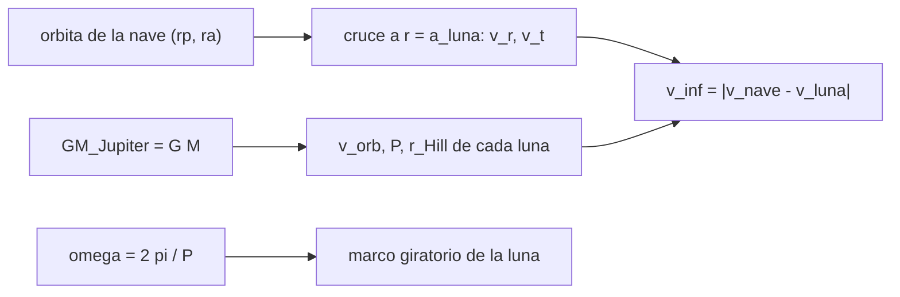

# B75-C16 — Navegación relativa a lunas

<!-- nav:top -->
[🏠 Programa](../../../../README.md) · [📚 Bloque B75](../../../tronco-comun/B75-trayectorias-y-misiones-interplanetarias.md) · [← Anterior: B75-C15 — Aerofrenado conceptual](../B75-C15-aerofrenado-conceptual/CLASE.md) · [Siguiente: B75-C17 — Oportunidades científicas de sobrevuelo →](../B75-C17-oportunidades-cientificas-de-sobrevuelo/CLASE.md)
<!-- /nav -->

## 1. Ubicación, nivel y alcance

Clase 16 del bloque B75. Nivel N3. Cerca de Júpiter la nave se mueve en dos marcos: el de Júpiter, donde las lunas son planetas pequeños, y el de cada luna, donde se hace el sobrevuelo. Aquí calculas las escalas del sistema galileano (velocidad orbital, radio de Hill, escape), la velocidad relativa de una nave sintética al cruzar cada luna y la transformación al marco giratorio de una luna. Es la base de las clases C17, C20 y C26.

## 2. Por qué esta clase existe

Para navegar en un sistema de lunas hay que saber en qué marco se mide cada cosa y qué tan grande es la esfera de influencia de cada luna. La decisión central: **¿con qué velocidad relativa llega una nave a cada luna y cuán grande es la región donde la luna manda?**

## 3. Lo que podrás hacer al terminar

1. Calcular la velocidad orbital y el periodo de una luna con `GM` de Júpiter.
2. Calcular el radio de Hill `a(GM_luna/3GM_J)^{1/3}` y compararlo con el radio de la luna.
3. Calcular la velocidad relativa `v∞` de una nave que cruza la órbita de una luna.
4. Pasar de un marco inercial a uno giratorio centrado en la luna y volver.
5. Interpretar las diferencias entre el periodo de Kepler y el de la tabla.
6. Separar lo consultado de lo sintético (la órbita de la nave).

La evidencia es tu **ficha de escalas de un sistema lunar** del ejercicio 12 (sección 20).

## 4. Con qué llegas y cómo comprobarlo

1. ¿Qué es el radio de Hill?
2. ¿Qué es un marco giratorio?
3. ¿Qué es el `v∞` de un sobrevuelo?
4. ¿Qué es el periodo sideral?
5. ¿Por qué se rotula una órbita sintética?

<details>
<summary>Ver respuestas</summary>

1. El radio de la región donde un cuerpo domina frente a uno mayor: `a(m/3M)^{1/3}`. 2. Un marco que gira con la luna a su movimiento medio `ω = 2π/P`. 3. La velocidad relativa a la luna lejos de ella. 4. El tiempo para volver a la misma dirección respecto a las estrellas. 5. Porque no corresponde a ninguna misión.
</details>

Con cuatro o cinco aciertos, sigue; si no, repasa los prerrequisitos.

## 5. Un caso de contexto y casos de referencia

Europa (`a = 671 100 km = 9,39 R_J`) orbita a `13,74 km/s`, tiene un radio de Hill de `13 657 km` (8,75 veces su radio) y una velocidad de escape de superficie de `2,03 km/s`. Una nave sintética en una elipse de `5 R_J × 3×10⁶ km` cruza su órbita a `17,38 km/s` y llega con `v∞ = 11,07 km/s`. Es el **ejemplo conductor**. Los `GM`, radios, semiejes y periodos son de las tablas del JPL [S1, S2]; `GM_Júpiter` se calcula como `G·M` [S3, S4].

## 6. Vocabulario

El **radio de Hill** de una luna respecto a Júpiter es `r_H = a (GM_luna/3GM_J)^{1/3}`. La **velocidad orbital** es `√(GM_J/a)`. El **marco giratorio** de una luna sincrónica gira con `ω = 2π/P`. La **velocidad relativa** `v∞` es la diferencia vectorial entre la de la nave y la de la luna. Los **elementos medios** son parámetros promedio que no sirven para efemérides.

## 7. Modelo mental: un carrusel de lunas



*Descripción textual:* El `GM` de Júpiter da las escalas de cada luna; la elipse de la nave da su velocidad en el cruce; la diferencia con la velocidad de la luna es `v∞`; el marco giratorio usa el movimiento medio.

Analogía: un carrusel con cuatro caballitos a distinta velocidad: para subir a uno hay que igualar su velocidad. Límite: las lunas no están en la misma fase ni en órbitas perfectamente circulares.

## 8. La explicación, paso a paso

### 8.1 Escalas

Con `GM_J = G·M_J = 1,26687×10⁸ km³/s²` y los datos de las tablas:

| Luna | `a` (`R_J`) | `v_orb` (km/s) | `P` Kepler (d) | `P` tabla (d) | dif. (%) | `r_H` (km) | `r_H/R` | `v_esc` sup. (km/s) |
|---|---|---|---|---|---|---|---|---|
| Ío | 5,90 | 17,3306 | 1,769947 | 1,762732 | 0,409 | 10 558 | 5,80 | 2,5581 |
| Europa | 9,39 | 13,7395 | 3,552067 | 3,525463 | 0,755 | 13 657 | 8,75 | 2,0258 |
| Ganimedes | 14,97 | 10,8791 | 7,155161 | 7,155588 | −0,006 | 31 717 | 12,05 | 2,7415 |
| Calisto | 26,33 | 8,2030 | 16,690601 | 16,690440 | 0,001 | 50 141 | 20,80 | 2,4407 |

Las diferencias de Ío y Europa (0,4 y 0,8 %) superan las de Ganimedes y Calisto; el modelo de dos cuerpos con semieje medio ignora, entre otros, el achatamiento de Júpiter. La causa no se verificó.

### 8.2 Cruce de las órbitas lunares

Nave sintética con periapsis `5 R_J = 357 460 km` y apoapsis `3×10⁶ km` (periodo `14,05 d`):

| Luna | `v_nave` (km/s) | `v_r` | `v_t` | `V_luna` | `v∞` (km/s) |
|---|---|---|---|---|---|
| Ío | 22,9179 | 8,3882 | 21,3277 | 17,3306 | 9,2918 |
| Europa | 17,3806 | 11,0632 | 13,4049 | 13,7395 | 11,0682 |
| Ganimedes | 12,6982 | 9,5190 | 8,4043 | 10,8791 | 9,8354 |
| Calisto | 7,6886 | 6,0235 | 4,7782 | 8,2030 | 6,9290 |

### 8.3 Marco giratorio

Para Europa, `ω = 2π/(3,525463 d) = 2,0628×10⁻⁵ rad/s`. A `t = 3 d` la posición relativa inercial `(502 296,6; 790 561,9) km` se vuelve `(−339 118,8; 873 091,3) km` en el marco giratorio; la ida y vuelta recupera el vector con error `0`.

### 8.4 Qué verifica el laboratorio

(1) Los periodos de Kepler coinciden con la tabla dentro del 1 %. (2) La rotación de ida y vuelta, menor que `10⁻⁹ km`. (3) El radio de Hill supera al radio de cada luna.

## 9. Magnitudes, símbolos y unidades

| Símbolo | Qué es | Unidad | Valor / nota |
|---|---|---|---|
| `GM_J` | parámetro gravitacional de Júpiter | km³/s² | 1,26687×10⁸ |
| `v_orb` | velocidad orbital de la luna | km/s | 13,7395 (Europa) |
| `r_H` | radio de Hill | km | 13 657 (Europa) |
| `v∞` | velocidad relativa a la luna | km/s | 11,0682 (Europa, sintético) |
| `ω` | movimiento medio | rad/s | 2,0628×10⁻⁵ |

## 10. Convenciones y referencias

Marco joviano plano; lunas en órbitas circulares y coplanares con los elementos medios de la tabla del JPL (época 2000-01-01.5 TDB); `GM` y radios de la tabla de parámetros físicos; `GM_J = G·M_J` con `G` del registro del JPL. La órbita de la nave es **sintética**.

## 11. De dónde sale lo que afirmamos

| ID | Fuente | Localizador | Respalda | Estado |
|---|---|---|---|---|
| S1 | NASA JPL SSD, Planetary Satellite Physical Parameters — https://ssd.jpl.nasa.gov/sats/phys_par/ (consultada 2026-11-10) | página leída | GM (km³/s²) y radio medio (km): Ío 5959,91547 y 1821,49; Europa 3202,71210 y 1560,80; Ganimedes 9887,83275 y 2631,20; Calisto 7179,28340 y 2410,30; Titán 8978,13710 y 2574,76; Encélado 7,21037 y 252,10 | Consultada |
| S2 | NASA JPL SSD, Planetary Satellite Mean Elements — https://ssd.jpl.nasa.gov/sats/elem/ (consultada 2026-11-10) | página leída | semiejes (km) y periodos siderales (d), época 2000-01-01,5 TDB: Ío 421 800 y 1,762732; Europa 671 100 y 3,525463; Ganimedes 1 070 400 y 7,155588; Calisto 1 882 700 y 16,690440; Titán 1 221 900 y 15,945448; Encélado 238 400 y 1,370218 (elementos medios, no para efemérides) | Consultada |
| S3 | NASA/NSSDC, Jupiter Fact Sheet — https://nssdc.gsfc.nasa.gov/planetary/factsheet/jupiterfact.html (consultada 2026-11-10) | página leída | semieje 778,479×10⁶ km, periodo sideral 4332,589 d, excentricidad 0,0487, inclinación 1,304°, velocidad media 13,06 km/s, masa 1898,13×10²⁴ kg, radio medio 69 911 km | Consultada |
| S4 | NASA JPL SSD, Planetary Physical Parameters — https://ssd.jpl.nasa.gov/planets/phys_par.html (consultada 2026-11-10) | página leída | radios ecuatoriales (Venus 6051,8 km; Tierra 6378,1366 km; Marte 3396,19 km; Júpiter 71 492 km) y la constante G = 6,67430×10⁻¹¹ m³ kg⁻¹ s⁻² citada en su registro de cambios. La página no lista GM: aquí GM = G·M con las masas de las fichas NSSDC | Consultada |
| — | Valores estándar (no consultados en una fuente concreta de esta clase) | — | GM☉ = 1,32712440×10¹¹ km³/s² (valor estándar, ver la resolución IAU 2015 B3 de la fila anterior donde se cita); 1 au = 149 597 870,7 km; c = 299 792,458 km/s; g₀ = 9,80665 m/s²; ecuaciones de dos cuerpos | No consultada en una fuente concreta |

Límites: las tablas del JPL declaran que los elementos medios no son para efemérides; no se consultó ninguna misión del sistema joviano más allá de lo citado en otras clases; la causa de las diferencias de periodo de Ío y Europa no se verificó.

## 12. Cómo ver las escalas

| Luna | `v_orb` (km/s) | `r_H/R` |
|---|---|---|
| Ío | 17,33 | 5,80 |
| Europa | 13,74 | 8,75 |
| Ganimedes | 10,88 | 12,05 |
| Calisto | 8,20 | 20,80 |

Descripción larga: cuanto más lejos de Júpiter, más lenta y con una región de Hill relativamente más grande respecto a la luna.

## 13. Ejemplo trabajado: Europa

**Paso 1 · Velocidad orbital.** `√(1,26687×10⁸/671 100) = 13,7395 km/s`.

**Paso 2 · Radio de Hill.** `671 100·(3202,712/(3×1,26687×10⁸))^{1/3} = 13 657 km`.

**Paso 3 · Cruce de la nave.** `v_nave = 17,3806 km/s`, `v_r = 11,0632`, `v_t = 13,4049`.

**Paso 4 · v∞.** `√(11,0632² + (13,4049 − 13,7395)²) = 11,0682 km/s`.

## 14. Distintas formas de abordar el problema

**Por Kepler:** periodo y velocidad. **Por Hill:** región de dominio. **Por vectores:** `v∞` en el cruce. **Por rotación:** paso al marco giratorio y vuelta.

## 15. Práctica guiada

**Ejercicio 1 · con los pasos indicados.** Calcula la velocidad orbital de Europa. *Pasos:* `√(GM_J/a)`.

<details><summary>Solución comentada</summary>

`13,7395 km/s`.
</details>

**Ejercicio 2 · con una pista.** Calcula el radio de Hill de Europa. *Pista:* `GM_Europa = 3202,712`.

<details><summary>Solución comentada</summary>

`13 657 km`, es decir 8,75 veces su radio.
</details>

**Ejercicio 3 · casi autónomo.** Calcula `v∞` de la nave sintética con Europa. *Pista:* `v_r = 11,0632`, `v_t − V = −0,3346`.

<details><summary>Solución comentada</summary>

`√(11,0632² + 0,3346²) = 11,068 km/s`.
</details>

## 16. Práctica autónoma, transferencia e integrador

**Ejercicio 4 · autónomo.** Calcula la velocidad de escape de la superficie de Ío con `GM = 5959,915` y `R = 1821,49`.

<details><summary>Solución comentada</summary>

`√(2×5959,915/1821,49) = 2,558 km/s`.
</details>

**Ejercicio 5 · autónomo.** Calcula la velocidad orbital de Calisto.

<details><summary>Solución comentada</summary>

`8,2030 km/s`.
</details>

**Ejercicio 6 · autónomo.** ¿Cuál es el cociente `r_H/R` de Ganimedes?

<details><summary>Solución comentada</summary>

`12,05`.
</details>

**Ejercicio 7 · autónomo.** Compara el `v∞` de Europa y Calisto de la nave sintética.

<details><summary>Solución comentada</summary>

`11,07` frente a `6,93 km/s`: Calisto es el encuentro más lento.
</details>

**Ejercicio 8 · autónomo.** Convierte el movimiento medio de Europa a grados por día.

<details><summary>Solución comentada</summary>

`360/3,525463 = 102,1°/d`.
</details>

**Ejercicio 9 · transferencia.** Un `v∞ = 11 km/s` en Europa es muy alto frente a su escape de superficie (`2,03 km/s`). ¿Qué implica?

<details><summary>Solución comentada</summary>

El sobrevuelo es rápido y el giro es pequeño; se reduce `v∞` con resonancias y sobrevuelos de otras lunas (C26).
</details>

**Ejercicio 10 · transferencia.** ¿Qué marco usarías para estudiar un sobrevuelo y cuál para un tour completo?

<details><summary>Solución comentada</summary>

El de la luna para el sobrevuelo (hipérbola, C07) y el de Júpiter para el tour (C26).
</details>

**Ejercicio 11 · transferencia.** Las tablas del JPL advierten que los elementos son medios. ¿Qué precaución se deduce?

<details><summary>Solución comentada</summary>

No usarlos para predecir encuentros; para eso se necesitan efemérides (Horizons, SPICE).
</details>

**Ejercicio 12 · integrador.** Elabora tu *ficha de escalas de un sistema lunar* con la tabla 8.1, el cruce de 8.2 para una nave que definas y el paso al marco giratorio.

<details><summary>Solución comentada</summary>

Secciones 8.1–8.4 y la salida del laboratorio.
</details>

## 17. Laboratorio: escalas del sistema galileano

El script [lunas.py](lunas.py) calcula las escalas de las cuatro lunas, la velocidad relativa de una nave sintética y la rotación al marco de Europa, y **comprueba** el periodo, la ida y vuelta de la rotación y el radio de Hill.

**Datos:** `GM`, radios, semiejes y periodos del JPL, masa de Júpiter de la ficha NASA/NSSDC (consultados); la órbita de la nave y el instante son **sintéticos**. **Predice antes de ejecutar:** ¿Cuál tiene el menor `v∞` con la nave sintética? (Calisto, 6,93 km/s.) **Ejecución del 2026-11-10 (Python 3.12.9):**

```text
Python 3.12.9 (biblioteca estandar)
GM_Jupiter = G M = 126686890.6 km3/s2
 luna       a [R_J]  v_orb [km/s]  P Kepler [d]  P tabla [d]  dif [%]   r_Hill [km]  r_Hill/R   v_esc sup. [km/s]
Io            5.90      17.3306      1.769947     1.762732    0.409        10558      5.80         2.5581
Europa        9.39      13.7395      3.552067     3.525463    0.755        13657      8.75         2.0258
Ganimedes    14.97      10.8791      7.155161     7.155588   -0.006        31717     12.05         2.7415
Calisto      26.33       8.2030     16.690601    16.690440    0.001        50141     20.80         2.4407
Orbita SINTETICA de la nave: rp = 357460 km, ra = 3000000 km, P = 14.05 d
 luna       v_nave [km/s]  v_radial  v_tangencial  v_luna   v_inf respecto a la luna [km/s]
Io              22.9179    8.3882       21.3277  17.3306                     9.2918
Europa          17.3806   11.0632       13.4049  13.7395                    11.0682
Ganimedes       12.6982    9.5190        8.4043  10.8791                     9.8354
Calisto          7.6886    6.0235        4.7782   8.2030                     6.9290
Marco giratorio de Europa (omega = 2.0628e-05 rad/s) a t = 3 d: posicion relativa inercial (502296.6, 790561.9) km -> giratorio (-339118.8, 873091.3) km ; ida y vuelta: error 0.00e+00 km
Pruebas superadas.
```

```bash
python programa/clases/B75/B75-C16-navegacion-relativa-a-lunas/lunas.py
```

**Límites:** órbitas lunares circulares, elementos medios, nave sin perturbaciones.

## 18. Errores frecuentes y cómo corregirlos

**Usar elementos medios como efemérides.** Se corrige con la sección 10.

**Olvidar la velocidad de la luna al calcular `v∞`.** Se corrige con 8.2.

**Confundir el radio de Hill con la esfera de influencia.** Se corrige con la sección 6.

**Presentar la órbita sintética como la de una misión.** Se corrige con la sección 10.

## 19. Cómo sabrás que vas bien

Tras 8.1: ¿qué luna es más rápida? Tras el laboratorio: ¿qué tres pruebas pasó? (ver la sección 17).

## 20. Qué entregas y cómo se evalúa

El producto es tu **ficha de escalas de un sistema lunar** (ejercicio 12).

| Criterio | Inicial | En desarrollo | Logrado | Destacado |
|---|---|---|---|---|
| Conceptos | Confunde marcos | Define Hill y `v∞` | Calcula las escalas | Explica los dos marcos |
| Cálculo | Sin unidades | Con errores | Tablas completas | Calcula casos nuevos |
| Numérico | Sin comprobar | Una prueba | Tres pruebas | Interpreta las diferencias de periodo |
| Fuentes | Sin fuente | Sin fecha | Fuentes con fecha y estado | Declara lo sintético |
| Límites | No los nombra | Uno | Tres | Discute las efemérides |

**Condiciones críticas (no se compensan con promedio):** rotular la órbita de la nave como sintética; no usar elementos medios como efemérides; citar solo lo consultado.

## 21. Ética, seguridad y límites

Clase educativa: los modelos son simplificados (órbitas planetarias circulares y coplanares, dos cuerpos) y sus datos son consultados, sintéticos o ilustrativos y están rotulados; ningún resultado es una efeméride, una medición ni un diseño de misión real. La navegación real en un sistema de lunas requiere efemérides de misión y radiación; esta clase no las trata. Accesibilidad: tablas equivalentes a las gráficas, fórmulas en texto, ejercicios sin conexión.

## 22. Para cerrar y seguir

Europa orbita a `13,74 km/s` y una nave sintética la cruza con `v∞ = 11,07 km/s`. Queda una pregunta: ¿qué se puede observar durante un sobrevuelo tan rápido?

**Glosario español–inglés.** radio de Hill · *Hill radius*; marco giratorio · *rotating frame*; elementos medios · *mean elements*; luna galileana · *Galilean moon*; velocidad relativa · *relative velocity*.

**Continuidad.** [B75-C17](../B75-C17-oportunidades-cientificas-de-sobrevuelo/CLASE.md) estudia qué observar en un sobrevuelo.

**Referencias:** ver sección 11.

<!-- nav:bottom -->
---

[← Anterior: B75-C15 — Aerofrenado conceptual](../B75-C15-aerofrenado-conceptual/CLASE.md) · [📚 Bloque B75](../../../tronco-comun/B75-trayectorias-y-misiones-interplanetarias.md) · [Siguiente: B75-C17 — Oportunidades científicas de sobrevuelo →](../B75-C17-oportunidades-cientificas-de-sobrevuelo/CLASE.md)
<!-- /nav -->
