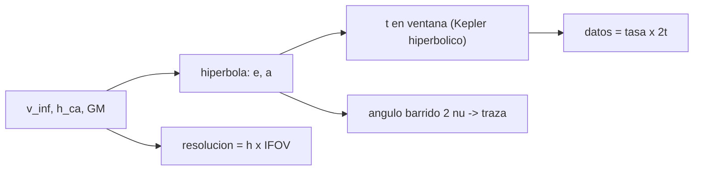

# B75-C17 — Oportunidades científicas de sobrevuelo

<!-- nav:top -->
[🏠 Programa](../../../../README.md) · [📚 Bloque B75](../../../tronco-comun/B75-trayectorias-y-misiones-interplanetarias.md) · [← Anterior: B75-C16 — Navegación relativa a lunas](../B75-C16-navegacion-relativa-a-lunas/CLASE.md) · [Siguiente: B75-C18 — Propagación de dispersión inicial →](../B75-C18-propagacion-de-dispersion-inicial/CLASE.md)
<!-- /nav -->

## 1. Ubicación, nivel y alcance

Clase 17 del bloque B75. Nivel N3. Un sobrevuelo de una luna dura minutos y la nave pasa a kilómetros por segundo. Qué se puede observar depende de la altitud, la velocidad sobre el suelo, el tiempo en ventana y la resolución. Aquí calculas el perfil de observación de un sobrevuelo sintético de Europa con la hipérbola de B75-C07 y un instrumento imaginario. No se estudia ningún instrumento real.

## 2. Por qué esta clase existe

Cada metro de altitud cuesta resolución, y cada segundo de ventana cuesta datos. La decisión central: **¿qué altitud de máxima aproximación equilibra resolución, cobertura y volumen de datos en un sobrevuelo?**

## 3. Lo que podrás hacer al terminar

1. Calcular la hipérbola de un sobrevuelo con `v∞` y altitud dadas.
2. Calcular el tiempo con altitud menor que un umbral con la ecuación hiperbólica de Kepler.
3. Calcular la traza al suelo y la velocidad sobre el suelo.
4. Calcular la resolución lineal `h·IFOV` y el volumen de datos.
5. Verificar el tiempo y el ángulo barrido con Kepler.
6. Separar lo consultado (GM, radio) de lo sintético (`v∞`, instrumento).

La evidencia es tu **perfil de observación de un sobrevuelo** del ejercicio 12 (sección 20).

## 4. Con qué llegas y cómo comprobarlo

1. ¿Qué es la altitud de máxima aproximación?
2. ¿Qué es el IFOV?
3. ¿Qué es el ángulo barrido?
4. ¿Qué es una tasa de datos?
5. ¿Por qué se rotula sintético el instrumento?

<details>
<summary>Ver respuestas</summary>

1. La distancia entre la nave y la superficie en el periapsis. 2. El ángulo que ve un píxel; la resolución lineal es `h·IFOV`. 3. El ángulo, visto desde el centro, entre entrada y salida de la ventana. 4. Bits por segundo que entrega el instrumento. 5. Porque no corresponde a ningún instrumento real.
</details>

Con cuatro o cinco aciertos, sigue; si no, repasa los prerrequisitos.

## 5. Un caso de contexto y casos de referencia

Un sobrevuelo sintético de Europa con `v∞ = 4,0 km/s` a `100 km` de altitud tiene `e = 9,297`, giro `12,35°`, velocidad sobre el suelo `4,19 km/s` y `15,4 min` con altitud menor que `1000 km`; recorre `2853 km` de superficie y con un IFOV de `0,25 mrad` ve píxeles de `25 m` en el punto más cercano. Es el **ejemplo conductor**. `GM` y radio de Europa son del JPL [S1]; el resto es sintético. La página de Europa Clipper indica 49 sobrevuelos cercanos de Europa [S2]; sus altitudes y velocidades no se consultaron.

## 6. Vocabulario

La **ventana de observación** es el intervalo con altitud menor que un umbral. La **traza al suelo** es el recorrido de la proyección de la nave sobre la superficie. La **velocidad sobre el suelo** es la de esa proyección, `v_p R/(R+h)` en el periapsis. La **resolución lineal** es `h·IFOV`. El **volumen de datos** es `tasa × tiempo`.

## 7. Modelo mental: fotografiar desde un tren rápido



*Descripción textual:* La hipérbola da el tiempo y el ángulo en la ventana; el tiempo da el volumen de datos; la altitud y el IFOV dan la resolución.

Analogía: sacar fotos desde un tren: cuanto más cerca de las vías, más detalle pero menos tiempo de enfoque. Límite: el tren sigue vías fijas, la nave sigue una cónica y el suelo gira.

## 8. La explicación, paso a paso

### 8.1 Hipérbola

Con `GM = 3202,7121 km³/s²`, `R = 1560,80 km` [S1] y `v∞ = 4,0 km/s`: `a = GM/v∞² = 200,17 km`; `e = 1 + r_p v∞²/GM`; `v_p = √(v∞² + 2GM/r_p)`.

### 8.2 Cuatro altitudes

| `h_ca` (km) | `e` | giro (°) | `v_p` (km/s) | `v` suelo (km/s) | ventana (min) | traza (km) | resolución en `h_ca` (m) | datos (Gbit) |
|---|---|---|---|---|---|---|---|---|
| 25 | 8,9223 | 12,870 | 4,4765 | 4,4059 | 15,874 | 2985 | 6,25 | 9,52 |
| 100 | 9,2970 | 12,350 | 4,4561 | 4,1878 | 15,415 | 2853 | 25,0 | 9,25 |
| 400 | 10,7957 | 10,630 | 4,3894 | 3,4940 | 13,105 | 2284 | 100,0 | 7,86 |
| 800 | 12,7940 | 8,966 | 4,3259 | 2,8600 | 7,942 | 1290 | 200,0 | 4,77 |

La resolución a `1000 km` es siempre `250 m` (IFOV 0,25 mrad).

### 8.3 Cómo se obtiene la ventana

El tiempo del periapsis al punto de altitud `h` es `t = √(a³/GM)(e sinh H − H)` con `cosh H = (1 + r/a)/e`; la ventana dura `2t`. El ángulo barrido es `2ν` con `cos ν = (p/r − 1)/e` y `p = a(e² − 1)`.

### 8.4 Lectura

Bajar de `800` a `25 km` mejora la resolución 32 veces, pero la ventana solo se duplica (de `7,9` a `15,9 min`) y los datos pasan de `4,8` a `9,5 Gbit`. La ventana crece poco porque a altitud menor la nave sigue entrando desde `1000 km` a `v∞` casi igual. Los riesgos de volar bajo no se modelan.

### 8.5 Verificaciones

El tiempo de la fórmula coincide con el de Kepler universal (el radio al tiempo `t` es `R + 1000 km` con error menor que `10⁻⁶ km`) y el ángulo `2ν` coincide con el entre posiciones, con error menor que `10⁻⁹ rad`.

## 9. Magnitudes, símbolos y unidades

| Símbolo | Qué es | Unidad | Valor / nota |
|---|---|---|---|
| `h_ca` | altitud de máxima aproximación | km | 25 a 800 |
| `e` | excentricidad | — | 9,297 (100 km) |
| `t_v` | ventana de observación | min | 15,4 (100 km) |
| `IFOV` | campo de visión instantáneo | mrad | 0,25 (sintético) |
| `d` | resolución lineal | m | 25 (100 km) |
| `V` | volumen de datos | Gbit | 9,25 (100 km) |

## 10. Convenciones y referencias

Marco de Europa; hipérbola de dos cuerpos con `v∞` sintético; traza sobre una esfera de radio medio; sin rotación de la luna, sin Júpiter. Instrumento (IFOV, tasa) **sintético**.

## 11. De dónde sale lo que afirmamos

| ID | Fuente | Localizador | Respalda | Estado |
|---|---|---|---|---|
| S1 | NASA JPL SSD, Planetary Satellite Physical Parameters — https://ssd.jpl.nasa.gov/sats/phys_par/ (consultada 2026-11-10) | página leída | GM (km³/s²) y radio medio (km): Ío 5959,91547 y 1821,49; Europa 3202,71210 y 1560,80; Ganimedes 9887,83275 y 2631,20; Calisto 7179,28340 y 2410,30; Titán 8978,13710 y 2574,76; Encélado 7,21037 y 252,10 | Consultada |
| S2 | NASA, Europa Clipper (página de la misión) — https://science.nasa.gov/mission/europa-clipper/ (consultada 2026-11-10) | página leída | lanzamiento el 14 de octubre de 2024 en Falcon Heavy; sobrevuelo de Marte en 2025 y de la Tierra el 3 de diciembre de 2026; llegada a Júpiter en abril de 2030; 49 sobrevuelos cercanos de Europa; unos 2,9 mil millones de km hasta Júpiter | Consultada |
| S3 | NASA, Basics of Space Flight, cap. 4 «Interplanetary Trajectories» — https://science.nasa.gov/learn/basics-of-space-flight/chapter4-1/ (consultada 2026-11-10) | página leída | transferencia de Hohmann como ruta de menor propulsante; oportunidades mínimas de energía a Marte cada ~25 meses y a Venus cada ~19 meses; la asistencia gravitacional cambia la velocidad heliocéntrica y deja la relativa en módulo; el vuelo de Galileo por Ío redujo el propulsante de inserción en 90 kg | Consultada |
| — | Valores estándar (no consultados en una fuente concreta de esta clase) | — | GM☉ = 1,32712440×10¹¹ km³/s² (valor estándar, ver la resolución IAU 2015 B3 de la fila anterior donde se cita); 1 au = 149 597 870,7 km; c = 299 792,458 km/s; g₀ = 9,80665 m/s²; ecuaciones de dos cuerpos | No consultada en una fuente concreta |

Límites: ninguna cifra corresponde a una misión; no se consultaron las altitudes, velocidades ni instrumentos de Europa Clipper [S2]; el modelo no incluye la rotación de Europa, la radiación ni las limitaciones térmicas.

## 12. Cómo ver el perfil

| `h_ca` (km) | Resolución (m) | Ventana (min) |
|---|---|---|
| 25 | 6,25 | 15,9 |
| 100 | 25 | 15,4 |
| 400 | 100 | 13,1 |
| 800 | 200 | 7,9 |

Descripción larga: la resolución mejora en proporción directa a la altitud; la ventana crece despacio al bajar.

## 13. Ejemplo trabajado: 100 km de altitud

**Paso 1 · Excentricidad.** `e = 1 + 1660,8×16/3202,71 = 9,297`.

**Paso 2 · Velocidad en `r_p`.** `√(16 + 2×3202,71/1660,8) = 4,4561 km/s`.

**Paso 3 · Resolución.** `100 km × 0,25 mrad = 25 m`.

**Paso 4 · Ventana.** `15,4 min`, y `9,25 Gbit` a 10 Mbit/s.

## 14. Distintas formas de abordar el problema

**Por hipérbola:** tiempo y ángulo. **Por Kepler:** propagación para verificar. **Por geometría:** `h·IFOV`. **Por presupuesto de datos:** `tasa × 2t`.

## 15. Práctica guiada

**Ejercicio 1 · con los pasos indicados.** Calcula la resolución a `h = 400 km` con IFOV `0,25 mrad`. *Pasos:* `h·IFOV`.

<details><summary>Solución comentada</summary>

`100 m`.
</details>

**Ejercicio 2 · con una pista.** Calcula `e` para `h = 100 km`. *Pista:* `r_p = 1660,8 km`, `GM = 3202,71`.

<details><summary>Solución comentada</summary>

`1 + 1660,8×16/3202,71 = 9,297`.
</details>

**Ejercicio 3 · casi autónomo.** Calcula los datos en 15,4 min a 10 Mbit/s.

<details><summary>Solución comentada</summary>

`15,4×60×10⁷ = 9,25×10⁹ bit = 9,25 Gbit`.
</details>

## 16. Práctica autónoma, transferencia e integrador

**Ejercicio 4 · autónomo.** Calcula el giro del sobrevuelo a 100 km.

<details><summary>Solución comentada</summary>

`2 arcsin(1/9,297) = 12,35°`.
</details>

**Ejercicio 5 · autónomo.** ¿Cuántas veces mejora la resolución al bajar de 800 a 25 km?

<details><summary>Solución comentada</summary>

`800/25 = 32` veces.
</details>

**Ejercicio 6 · autónomo.** Calcula la velocidad sobre el suelo a 400 km con `v_p = 4,3894`.

<details><summary>Solución comentada</summary>

`4,3894×1560,8/1960,8 = 3,494 km/s`.
</details>

**Ejercicio 7 · autónomo.** ¿Qué fracción de la traza de 100 km cubre 1 Gbit de datos?

<details><summary>Solución comentada</summary>

`2853 km/9,25 ≈ 308 km`.
</details>

**Ejercicio 8 · autónomo.** ¿Por qué la ventana no se duplica al duplicar la altitud?

<details><summary>Solución comentada</summary>

Porque el tiempo hasta salir de `1000 km` depende de `v∞` y de la distancia a recorrer, y esta cambia poco; la ventana de 800 km es 7,9 min frente a 13,1 min de 400 km.
</details>

**Ejercicio 9 · transferencia.** Se pide resolución de 10 m en el punto más cercano. ¿A qué altitud?

<details><summary>Solución comentada</summary>

`10 m/0,25 mrad = 40 km`.
</details>

**Ejercicio 10 · transferencia.** ¿Qué falta para saber qué parte de la superficie se ve?

<details><summary>Solución comentada</summary>

La rotación de la luna, la geometría de iluminación y el campo de visión del instrumento.
</details>

**Ejercicio 11 · transferencia.** La página de Clipper habla de 49 sobrevuelos [S2]. ¿Cómo repartirías 49 pasadas?

<details><summary>Solución comentada</summary>

Es una decisión de ciencia; el modelo solo dice que bajar mejora resolución y que cada pasada rinde ~10 Gbit en este instrumento sintético.
</details>

**Ejercicio 12 · integrador.** Elabora tu *perfil de observación de un sobrevuelo* para cuatro altitudes: hipérbola, ventana, traza, resolución y datos, con tus conclusiones.

<details><summary>Solución comentada</summary>

Sección 8.2 y la salida del laboratorio.
</details>

## 17. Laboratorio: perfil de un sobrevuelo de Europa

El script [observacion.py](observacion.py) calcula los parámetros de cuatro altitudes y **comprueba** el tiempo y el ángulo con Kepler y la proporcionalidad de la resolución.

**Datos:** `GM` y radio de Europa del JPL (consultados); `v∞`, IFOV, tasa y altitudes **sintéticos**. **Predice antes de ejecutar:** ¿Cuánto mejora la resolución al pasar de 800 a 25 km? (32 veces.) **Ejecución del 2026-11-10 (Python 3.12.9):**

```text
Python 3.12.9 (biblioteca estandar)
v_inf = 4.0 km/s (SINTETICO) ; IFOV = 0.25 mrad ; tasa = 10 Mbit/s ; ventana: altitud < 1000 km
 h_ca [km]   e       giro [grados]  v_p [km/s]  v suelo en h_ca [km/s]  t en ventana [min]  traza [km]  resol. en h_ca [m]  resol. a 1000 km [m]  datos [Gbit]
      25    8.9223      12.870      4.4765               4.4059            15.874        2985               6.2                250.0         9.52
     100    9.2970      12.350      4.4561               4.1878            15.415        2853              25.0                250.0         9.25
     400   10.7957      10.630      4.3894               3.4940            13.105        2284             100.0                250.0         7.86
     800   12.7940       8.966      4.3259               2.8600             7.942        1290             200.0                250.0         4.77
Pruebas superadas.
```

```bash
python programa/clases/B75/B75-C17-oportunidades-cientificas-de-sobrevuelo/observacion.py
```

**Límites:** dos cuerpos, sin rotación, sin radiación; el instrumento no es real.

## 18. Errores frecuentes y cómo corregirlos

**Creer que la ventana crece en proporción a la altitud.** Se corrige con 8.4.

**Confundir velocidad de la nave y velocidad sobre el suelo.** Se corrige con la sección 6.

**Olvidar la geometría de iluminación.** Se corrige con el ejercicio 10.

**Presentar el instrumento como real.** Se corrige con la sección 10.

## 19. Cómo sabrás que vas bien

Tras 8.2: ¿qué altitud da 25 m de resolución? Tras el laboratorio: ¿qué verifican las dos primeras pruebas? (ver la sección 17).

## 20. Qué entregas y cómo se evalúa

El producto es tu **perfil de observación de un sobrevuelo** (ejercicio 12).

| Criterio | Inicial | En desarrollo | Logrado | Destacado |
|---|---|---|---|---|
| Conceptos | Confunde velocidades | Define ventana y traza | Calcula el perfil | Explica el compromiso |
| Cálculo | Sin unidades | Con errores | Tabla completa | Calcula casos nuevos |
| Numérico | Sin comprobar | Una prueba | Tres pruebas | Interpreta las tolerancias |
| Fuentes | Sin fuente | Sin fecha | Fuentes con fecha y estado | Declara lo sintético |
| Límites | No los nombra | Uno | Tres | Discute rotación y radiación |

**Condiciones críticas (no se compensan con promedio):** rotular instrumento, `v∞` y altitudes como sintéticos; no presentar el perfil como de una misión; citar solo lo consultado.

## 21. Ética, seguridad y límites

Clase educativa: los modelos son simplificados (órbitas planetarias circulares y coplanares, dos cuerpos) y sus datos son consultados, sintéticos o ilustrativos y están rotulados; ningún resultado es una efeméride, una medición ni un diseño de misión real. Los sobrevuelos bajos de lunas con radiación exigen análisis de riesgo que esta clase no hace. Accesibilidad: tablas equivalentes a las gráficas, fórmulas en texto, ejercicios sin conexión.

## 22. Para cerrar y seguir

A 100 km un sobrevuelo sintético de Europa ofrece `15,4 min` de ventana, `25 m` de resolución y `9,25 Gbit`. Queda una pregunta: ¿cómo se propaga la incertidumbre de la salida hasta el encuentro?

**Glosario español–inglés.** ventana de observación · *observation window*; traza al suelo · *ground track*; campo de visión instantáneo · *instantaneous field of view*; resolución · *resolution*; sobrevuelo · *flyby*.

**Continuidad.** [B75-C18](../B75-C18-propagacion-de-dispersion-inicial/CLASE.md) propaga la incertidumbre inicial.

**Referencias:** ver sección 11.

<!-- nav:bottom -->
---

[← Anterior: B75-C16 — Navegación relativa a lunas](../B75-C16-navegacion-relativa-a-lunas/CLASE.md) · [📚 Bloque B75](../../../tronco-comun/B75-trayectorias-y-misiones-interplanetarias.md) · [Siguiente: B75-C18 — Propagación de dispersión inicial →](../B75-C18-propagacion-de-dispersion-inicial/CLASE.md)
<!-- /nav -->
