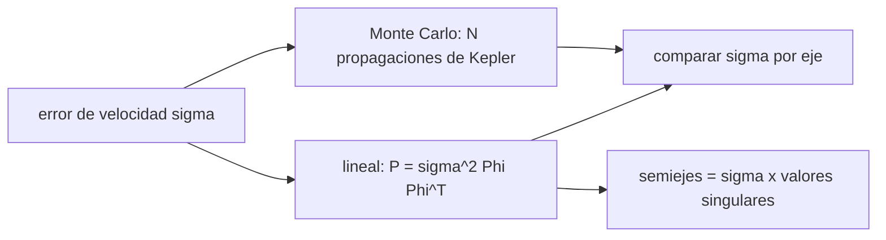

# B75-C18 — Propagación de dispersión inicial

<!-- nav:top -->
[🏠 Programa](../../../../README.md) · [📚 Bloque B75](../../../tronco-comun/B75-trayectorias-y-misiones-interplanetarias.md) · [← Anterior: B75-C17 — Oportunidades científicas de sobrevuelo](../B75-C17-oportunidades-cientificas-de-sobrevuelo/CLASE.md) · [Siguiente: B75-C19 — Restricciones de navegación autónoma →](../B75-C19-restricciones-de-navegacion-autonoma/CLASE.md)
<!-- /nav -->

## 1. Ubicación, nivel y alcance

Clase 18 del bloque B75. Nivel N3. Ninguna maniobra es perfecta: un error de 1 m/s al salir se convierte en decenas de miles de kilómetros al llegar. Aquí propagas la dispersión de la velocidad de salida hasta la llegada a Marte con dos métodos independientes: una matriz de transición lineal (diferencias finitas sobre la propagación de Kepler) y un Monte Carlo no lineal con semilla fija. Todo en el modelo circular y coplanar y con un error sintético.

## 2. Por qué esta clase existe

Para decidir cuántas correcciones de trayectoria hacen falta hay que saber cuánto se dispersa la llegada. La decisión central: **¿qué dispersión de posición produce un error de velocidad dado en la salida y cuán buena es la aproximación lineal?**

## 3. Lo que podrás hacer al terminar

1. Construir la matriz de transición `Φ` (posición final respecto a velocidad inicial) por diferencias finitas.
2. Calcular la covarianza lineal `P = σ² Φ Φᵀ`.
3. Realizar un Monte Carlo con semilla fija y comparar las desviaciones.
4. Interpretar los ejes principales de la elipsoide de dispersión.
5. Explicar por qué la dispersión fuera del plano se anula a 180°.
6. Separar lo consultado de lo sintético (el error de 1 m/s).

La evidencia es tu **elipse de dispersión de llegada** del ejercicio 12 (sección 20).

## 4. Con qué llegas y cómo comprobarlo

1. ¿Qué es una desviación estándar?
2. ¿Qué es una matriz de transición?
3. ¿Qué es Monte Carlo?
4. ¿Qué es una semilla fija?
5. ¿Qué es la propagación de Kepler?

<details>
<summary>Ver respuestas</summary>

1. Una medida de dispersión de una variable aleatoria. 2. La derivada del estado final respecto al inicial. 3. Un método que repite el cálculo con muestras aleatorias. 4. Un valor que hace reproducible la secuencia aleatoria. 5. Avanzar un estado un tiempo bajo dos cuerpos (B75-C04).
</details>

Con cuatro o cinco aciertos, sigue; si no, repasa los prerrequisitos.

## 5. Un caso de contexto y casos de referencia

Con un error de velocidad de salida de `1 m/s` por eje (sintético), la llegada a Marte se dispersa `35 155 km` en x y `70 958 km` en y (1σ), con una elipsoide de semiejes `78 512` y `10 330 km`; la distancia de falla tiene mediana `53 136 km` y percentil 95 `154 452 km`, el `14,2 %` del radio de Hill de Marte (`1 084 136 km`). Es el **ejemplo conductor**. Los semiejes son de las fichas de la NASA [S1, S2] y la masa solar sale de `GM_☉/G` con `G` del JPL [S3]; el error es sintético.

## 6. Vocabulario

La **matriz de transición** `Φ` es la derivada de la posición de llegada respecto a la velocidad de salida. La **covarianza** es `P = σ² Φ Φᵀ`. La **elipsoide de dispersión** tiene semiejes dados por los valores singulares de `Φ` por `σ`. La **distancia de falla** es el módulo del error de llegada. El **Monte Carlo** repite la propagación no lineal con errores aleatorios.

## 7. Modelo mental: una lupa que amplifica los errores



*Descripción textual:* El error se propaga por dos caminos, lineal y Monte Carlo, y se comparan las desviaciones; los valores singulares de `Φ` dan los semiejes de la elipsoide.

Analogía: una lupa que amplifica un temblor de la mano: 1 m/s se vuelve decenas de miles de km. Límite: la lupa solo es lineal si el temblor es pequeño; para errores grandes hay que usar el Monte Carlo.

## 8. La explicación, paso a paso

### 8.1 La matriz de transición

Propagando la elipse de Hohmann `258,88 d` con Kepler y perturbando cada componente de la velocidad (diferencias centradas, `h = 10⁻⁶ km/s`):

| Llegada \ error | `δv_x` | `δv_y` | `δv_z` |
|---|---|---|---|
| `x` (km por km/s) | 0 | −3,5155×10⁷ | 0 |
| `y` (km por km/s) | 2,3071×10⁷ | 6,7103×10⁷ | 0 |
| `z` (km por km/s) | 0 | 0 | 0 |

Un error de `1 m/s` en `δv_y` (a lo largo de la velocidad) desplaza la llegada `35 155 km` en x y `67 103 km` en y. Con el mismo `h = 10⁻⁵ km/s` la matriz cambia en `4×10⁻⁹` (relativo).

### 8.2 Dispersión

| Eje | `σ` lineal (km) | `σ` Monte Carlo (km) | dif. (%) |
|---|---|---|---|
| x | 35 155,3 | 34 854,0 | −0,86 |
| y | 70 957,9 | 70 672,9 | −0,40 |
| z | 0 | 2,2 | segundo orden |

Valores singulares de `Φ`: `7,851×10⁷` y `1,033×10⁷ km/(km/s)`, es decir semiejes 1σ de `78 512` y `10 330 km` para `σ = 1 m/s`.

### 8.3 Por qué `z` no se dispersa

Una componente de velocidad fuera del plano inclina el plano de la órbita alrededor de la recta que une el Sol con el punto de salida. La llegada ocurre a 180° del punto de salida, es decir sobre esa misma recta (la línea de nodos), de modo que `z = 0` a primer orden para cualquier error `δv_z`. Queda un efecto de segundo orden (`2,2 km` en el Monte Carlo); el error fuera del plano sí aparecería en la velocidad de llegada.

### 8.4 Distancia de falla

Con `σ = 1 m/s`: mediana `53 136 km`, percentil 95 `154 452 km`, `14,2 %` del radio de Hill de Marte (`a(m/3M☉)^{1/3} = 1 084 136 km`). Si se duplica `σ`, todas las dispersiones lineales se duplican (verificado con error relativo `10⁻⁹`).

## 9. Magnitudes, símbolos y unidades

| Símbolo | Qué es | Unidad | Valor / nota |
|---|---|---|---|
| `Φ` | matriz de transición | km/(km/s) | −3,5155×10⁷ a 6,7103×10⁷ |
| `σ` | error de velocidad por eje | m/s | 1 (sintético) |
| `σ_x`, `σ_y` | dispersión de llegada | km | 35 155; 70 958 |
| `a_1`, `a_2` | semiejes de la elipsoide | km | 78 512; 10 330 |
| `r_H` | radio de Hill de Marte | km | 1 084 136 |

## 10. Convenciones y referencias

Marco heliocéntrico plano; Hohmann nominal del modelo circular; error de velocidad gaussiano isótropo de 1 m/s por eje (**sintético**), N = 20 000, `random.Random(75)`; sin errores de posición, de tiempo ni de maniobra, sin perturbaciones. `μ☉` estándar.

## 11. De dónde sale lo que afirmamos

| ID | Fuente | Localizador | Respalda | Estado |
|---|---|---|---|---|
| S1 | NASA/NSSDC, Earth Fact Sheet — https://nssdc.gsfc.nasa.gov/planetary/factsheet/earthfact.html (consultada 2026-11-10) | página leída | semieje 149,598×10⁶ km, periodo sideral 365,256 d, excentricidad 0,0167, velocidad orbital media 29,78 km/s, masa 5,9722×10²⁴ kg, radio medio 6371,000 km, velocidad de escape 11,186 km/s | Consultada |
| S2 | NASA/NSSDC, Mars Fact Sheet — https://nssdc.gsfc.nasa.gov/planetary/factsheet/marsfact.html (consultada 2026-11-10) | página leída | semieje 227,956×10⁶ km, periodo sideral 686,980 d, excentricidad 0,0935, inclinación 1,848°, velocidad media 24,08 km/s, masa 0,64169×10²⁴ kg, radio ecuatorial 3396,2 km, g 3,73 m/s² | Consultada |
| S3 | NASA JPL SSD, Planetary Physical Parameters — https://ssd.jpl.nasa.gov/planets/phys_par.html (consultada 2026-11-10) | página leída | radios ecuatoriales (Venus 6051,8 km; Tierra 6378,1366 km; Marte 3396,19 km; Júpiter 71 492 km) y la constante G = 6,67430×10⁻¹¹ m³ kg⁻¹ s⁻² citada en su registro de cambios. La página no lista GM: aquí GM = G·M con las masas de las fichas NSSDC | Consultada |
| — | Valores estándar (no consultados en una fuente concreta de esta clase) | — | GM☉ = 1,32712440×10¹¹ km³/s² (valor estándar, ver la resolución IAU 2015 B3 de la fila anterior donde se cita); 1 au = 149 597 870,7 km; c = 299 792,458 km/s; g₀ = 9,80665 m/s²; ecuaciones de dos cuerpos | No consultada en una fuente concreta |

Límites: no se consultó ninguna incertidumbre de misión; la masa solar sale de `GM_☉/G`; el radio de Hill de Marte es una escala de referencia, no una restricción de misión; la matriz depende de la trayectoria nominal elegida.

## 12. Cómo ver la elipsoide

| Magnitud | Valor |
|---|---|
| Semieje mayor 1σ | 78 512 km |
| Semieje menor 1σ | 10 330 km |
| Eje fuera del plano | 0 |
| Percentil 95 de la falla | 154 452 km |

Descripción larga: la elipsoide es muy alargada en el plano de la órbita y casi plana fuera de él.

## 13. Ejemplo trabajado: un error de 1 m/s a lo largo de la velocidad

**Paso 1 · Error.** `δv_y = 10⁻³ km/s`.

**Paso 2 · Fila de x.** `−3,5155×10⁷ × 10⁻³ = −35 155 km`.

**Paso 3 · Fila de y.** `6,7103×10⁷ × 10⁻³ = 67 103 km`.

**Paso 4 · Módulo.** `√(35 155² + 67 103²) = 75 754 km`.

## 14. Distintas formas de abordar el problema

**Lineal:** `Φ` por diferencias finitas, instantáneo. **Monte Carlo:** 20 000 propagaciones, incluye no linealidad. **Valores singulares:** orientación y tamaño de la elipsoide. **Escala de Hill:** referencia para saber si la dispersión importa.

## 15. Práctica guiada

**Ejercicio 1 · con los pasos indicados.** Calcula el desplazamiento en x para `δv_y = 1 m/s`. *Pasos:* `Φ_{xy} × δv`.

<details><summary>Solución comentada</summary>

`−3,5155×10⁷ × 10⁻³ = −35 155 km`.
</details>

**Ejercicio 2 · con una pista.** Calcula el desplazamiento total para el mismo error. *Pista:* componentes x e y.

<details><summary>Solución comentada</summary>

`√(35 155² + 67 103²) = 75 754 km`.
</details>

**Ejercicio 3 · casi autónomo.** ¿Qué fracción del radio de Hill de Marte es el percentil 95?

<details><summary>Solución comentada</summary>

`154 452/1 084 136 = 14,2 %`.
</details>

## 16. Práctica autónoma, transferencia e integrador

**Ejercicio 4 · autónomo.** Si `σ = 0,1 m/s`, ¿cuánto vale el semieje mayor 1σ?

<details><summary>Solución comentada</summary>

`7851 km`.
</details>

**Ejercicio 5 · autónomo.** Calcula el cociente `σ_y/σ_x`.

<details><summary>Solución comentada</summary>

`70 958/35 155 = 2,02`.
</details>

**Ejercicio 6 · autónomo.** ¿Cuántos m/s de error producirían un desplazamiento de 1000 km en y (solo `δv_y`)?

<details><summary>Solución comentada</summary>

`1000/67 103 = 0,0149 m/s ≈ 15 mm/s`.
</details>

**Ejercicio 7 · autónomo.** Compara el semieje mayor con la distancia entre la Tierra y Marte en la llegada.

<details><summary>Solución comentada</summary>

`78 512 km` frente a `~78×10⁶` a `378×10⁶ km` (rango del modelo): entre `2×10⁻⁴` y `10⁻³`.
</details>

**Ejercicio 8 · autónomo.** ¿Por qué la dispersión en `z` es de segundo orden?

<details><summary>Solución comentada</summary>

Porque la llegada está a 180° del punto de salida (sección 8.3).
</details>

**Ejercicio 9 · transferencia.** Un colega usa solo el análisis lineal para un error de 100 m/s. ¿Qué riesgo corre?

<details><summary>Solución comentada</summary>

La no linealidad crece con el error; no se verificó aquí para 100 m/s y habría que repetir el Monte Carlo.
</details>

**Ejercicio 10 · transferencia.** La falla `P95 = 154 452 km` es el 14 % de Hill. ¿Basta eso para ignorar las correcciones?

<details><summary>Solución comentada</summary>

No: lo que importa es el parámetro de impacto respecto a la meta de captura (C24); 154 000 km es mucho mayor que un periapsis de 3700 km.
</details>

**Ejercicio 11 · transferencia.** ¿Qué falta para modelar un error de posición de la nave?

<details><summary>Solución comentada</summary>

Añadir la parte posición de la matriz de transición (6×6) y una covarianza inicial de posición.
</details>

**Ejercicio 12 · integrador.** Elabora tu *elipse de dispersión de llegada*: `Φ`, desviaciones lineal y Monte Carlo, semiejes, percentil 95 y tus conclusiones sobre cuándo hacen falta correcciones.

<details><summary>Solución comentada</summary>

Secciones 8.1–8.4 y la salida del laboratorio.
</details>

## 17. Laboratorio: dispersión de llegada

El script [dispersion.py](dispersion.py) calcula `Φ` por diferencias finitas, la covarianza lineal, un Monte Carlo de 20 000 muestras y **comprueba** que las desviaciones coinciden dentro del 3 %, que la dispersión es lineal en `σ` y que `Φ` es estable respecto del paso.

**Datos:** semiejes y masa de Marte de las fichas NASA/NSSDC y `G` del JPL (consultados); error de velocidad **sintético**. **Predice antes de ejecutar:** ¿Cuánto vale la dispersión en `z`? (cero a primer orden.) **Ejecución del 2026-11-10 (Python 3.12.9):**

```text
Python 3.12.9 (biblioteca estandar)
Llegada nominal: r = (-227.9560, 0.0000, 0.0) 1e6 km ; |r| = 227.9560e6 km
Phi (km por km/s), filas = x, y, z de la llegada; columnas = dvx, dvy, dvz:
              0.0     -35155268.0             0.0
       23070933.9      67102535.2             0.0
              0.0             0.0             0.0
Valores singulares de Phi: 78512379.8, 10330407.3, 0.0 km/(km/s) ; semiejes 1-sigma de la elipsoide (sigma = 1 m/s): 78512, 10330, 0 km
eje   sigma lineal [km]   sigma Monte Carlo [km]   dif [%]
  x            35155.3                34854.0      -0.86
  y            70957.9                70672.9      -0.40
  z                0.0                    2.2   (la sensibilidad lineal es nula: llegada a 180 grados, en el plano)
Distancia de falla (3D): mediana MC = 53136 km ; percentil 95 = 154452 km ; radio de Hill de Marte = 1084136 km ; P95/Hill = 0.142
Phi con paso 1e-5 frente a 1e-6: diferencia relativa maxima = 4.18e-09
Pruebas superadas.
```

```bash
python programa/clases/B75/B75-C18-propagacion-de-dispersion-inicial/dispersion.py
```

**Límites:** solo error de velocidad, dos cuerpos, sin perturbaciones; no es una incertidumbre real.

## 18. Errores frecuentes y cómo corregirlos

**Creer que la dispersión es la misma en los tres ejes.** Se corrige con 8.2.

**Aplicar el análisis lineal a errores grandes.** Se corrige con el ejercicio 9.

**Confundir el radio de Hill con el objetivo de apuntado.** Se corrige con el ejercicio 10.

**Presentar el error de 1 m/s como el de una misión.** Se corrige con la sección 10.

## 19. Cómo sabrás que vas bien

Tras 8.1: ¿qué eje se dispersa más? Tras el laboratorio: ¿qué tres pruebas pasó? (ver la sección 17).

## 20. Qué entregas y cómo se evalúa

El producto es tu **elipse de dispersión de llegada** (ejercicio 12).

| Criterio | Inicial | En desarrollo | Logrado | Destacado |
|---|---|---|---|---|
| Conceptos | Confunde error y dispersión | Define `Φ` y `P` | Calcula ambas dispersiones | Explica el caso fuera del plano |
| Cálculo | Sin unidades | Con errores | Tablas completas | Calcula casos nuevos |
| Numérico | Sin comprobar | Una prueba | Tres pruebas | Interpreta el 3 % |
| Fuentes | Sin fuente | Sin fecha | Fuentes con fecha y estado | Declara lo sintético |
| Límites | No los nombra | Uno | Tres | Discute la no linealidad |

**Condiciones críticas (no se compensan con promedio):** rotular el error de 1 m/s como sintético; no presentar la dispersión como incertidumbre de misión; citar solo lo consultado.

## 21. Ética, seguridad y límites

Clase educativa: los modelos son simplificados (órbitas planetarias circulares y coplanares, dos cuerpos) y sus datos son consultados, sintéticos o ilustrativos y están rotulados; ningún resultado es una efeméride, una medición ni un diseño de misión real. Una dispersión real exige la incertidumbre medida del sistema de navegación y de propulsión. Accesibilidad: tablas equivalentes a las gráficas, fórmulas en texto, ejercicios sin conexión.

## 22. Para cerrar y seguir

Un error de `1 m/s` al salir produce una elipsoide de `78 512 × 10 330 km` en la llegada. Queda una pregunta: ¿cuánto tarda una señal en llegar para corregirlo?

**Glosario español–inglés.** matriz de transición · *state transition matrix*; covarianza · *covariance*; Monte Carlo · *Monte Carlo*; distancia de falla · *miss distance*; elipsoide de dispersión · *dispersion ellipsoid*.

**Continuidad.** [B75-C19](../B75-C19-restricciones-de-navegacion-autonoma/CLASE.md) estudia el retardo de las señales.

**Referencias:** ver sección 11.

<!-- nav:bottom -->
---

[← Anterior: B75-C17 — Oportunidades científicas de sobrevuelo](../B75-C17-oportunidades-cientificas-de-sobrevuelo/CLASE.md) · [📚 Bloque B75](../../../tronco-comun/B75-trayectorias-y-misiones-interplanetarias.md) · [Siguiente: B75-C19 — Restricciones de navegación autónoma →](../B75-C19-restricciones-de-navegacion-autonoma/CLASE.md)
<!-- /nav -->
