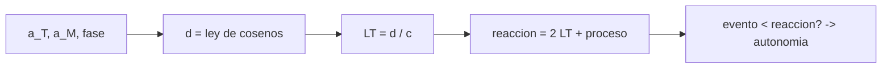

# B75-C19 — Restricciones de navegación autónoma

<!-- nav:top -->
[🏠 Programa](../../../../README.md) · [📚 Bloque B75](../../../tronco-comun/B75-trayectorias-y-misiones-interplanetarias.md) · [← Anterior: B75-C18 — Propagación de dispersión inicial](../B75-C18-propagacion-de-dispersion-inicial/CLASE.md) · [Siguiente: B75-C20 — Diseño de una misión a luna helada →](../B75-C20-diseno-de-una-mision-a-luna-helada/CLASE.md)
<!-- /nav -->

## 1. Ubicación, nivel y alcance

Clase 19 del bloque B75. Nivel N3. Las señales viajan a la velocidad de la luz y Marte está a entre 4 y 21 minutos-luz: una orden de la Tierra puede llegar demasiado tarde para un evento breve. Aquí calculas el retardo de luz Tierra–Marte en un periodo sinódico del modelo circular y decides qué eventos exigen autonomía a bordo. Los tiempos de proceso y las duraciones de eventos son sintéticos.

## 2. Por qué esta clase existe

No se puede dirigir desde la Tierra lo que sucede en minutos. La decisión central: **¿qué eventos duran menos que el tiempo mínimo de reacción desde tierra y por tanto deben ser autónomos?**

## 3. Lo que podrás hacer al terminar

1. Calcular la distancia Tierra–Marte con la ley de cosenos y el retardo de luz `d/c`.
2. Calcular el retardo mínimo, medio y máximo en un periodo sinódico.
3. Calcular el tiempo de reacción `RTLT + proceso`.
4. Clasificar eventos según su duración.
5. Calcular la fracción del ciclo con un retardo de ida y vuelta mayor que un umbral.
6. Separar lo consultado (semiejes, periodos) de lo sintético (proceso, eventos).

La evidencia es tu **tabla de eventos y retardos** del ejercicio 12 (sección 20).

## 4. Con qué llegas y cómo comprobarlo

1. ¿Qué dice la ley de cosenos?
2. ¿Cuál es la velocidad de la luz?
3. ¿Qué es el periodo sinódico?
4. ¿Qué es el RTLT?
5. ¿Por qué se rotulan los tiempos de proceso?

<details>
<summary>Ver respuestas</summary>

1. `d² = a² + b² − 2ab cos γ`. 2. `299 792,458 km/s` (valor exacto del SI). 3. El tiempo entre dos alineaciones iguales: `779,93 d` para Marte (B75-C02). 4. El tiempo de luz de ida y vuelta: `2d/c`. 5. Porque son supuestos del ejercicio, no datos de una operación real.
</details>

Con cuatro o cinco aciertos, sigue; si no, repasa los prerrequisitos.

## 5. Un caso de contexto y casos de referencia

En el modelo, la distancia Tierra–Marte va de `78,36` a `377,55×10⁶ km`; el retardo unidireccional de `4,36` a `20,99 min` (medio `14,08 min`) y el de ida y vuelta de `8,71` a `41,98 min`. Con `1800 s` de proceso en tierra (sintético), el tiempo mínimo de reacción es de `2323 s` (38,7 min): más que cualquiera de los eventos del ejemplo. Es el **ejemplo conductor**. Los semiejes y periodos son de las fichas [S1, S2]; la conjunción solar no se modela.

## 6. Vocabulario

El **retardo unidireccional** es `d/c`. El **RTLT** es el tiempo de ida y vuelta de la luz. El **tiempo de reacción** desde tierra es `RTLT + proceso`. La **autonomía** es la capacidad de ejecutar un evento sin comando en tiempo real. La **conjunción solar** es la alineación Tierra–Sol–Marte que bloquea las comunicaciones.

## 7. Modelo mental: una conversación por carta



*Descripción textual:* La geometría da la distancia; la distancia da el retardo; el retardo más el proceso da el tiempo de reacción; comparado con la duración del evento decide si hace falta autonomía.

Analogía: una conversación por carta: la respuesta tarda lo que tarda el correo. Límite: el correo no se pierde en conjunción solar ni depende de la geometría orbital.

## 8. La explicación, paso a paso

### 8.1 Distancia y retardo

`d = √(a_T² + a_M² − 2 a_T a_M cos γ)` con `γ = 360°·t·(1/365,256 − 1/686,980)`. En oposición, `d_min = a_M − a_T = 78,36×10⁶ km` y en conjunción `d_max = a_T + a_M = 377,55×10⁶ km`.

### 8.2 Retardos

| | Mínimo | Medio | Máximo |
|---|---|---|---|
| Unidireccional | 261,4 s (4,36 min) | 844,7 s (14,08 min) | 1259,4 s (20,99 min) |
| Ida y vuelta | 8,71 min | 28,16 min | 41,98 min |

El `50,7 %` del ciclo (analítico; `50,6 %` por muestreo) tiene un RTLT mayor que 30 min.

### 8.3 Tiempo de reacción y eventos

Reacción = `RTLT + 1800 s` (sintético): `2323 s` en el mínimo, `3489 s` en el medio y `4319 s` en el máximo.

| Evento (duración sintética) | Duración (s) | Reacción mínima (s) | ¿Autonomía? |
|---|---|---|---|
| Maniobra de corrección | 120 | 2323 | sí |
| Pasada de aerofrenado | 540 | 2323 | sí |
| Aterrizaje con paracaidas | 420 | 2323 | sí |
| Captura en órbita | 1800 | 2323 | sí |

### 8.4 Verificaciones

La ley de cosenos coincide con la norma de la diferencia de vectores (error menor que `10⁻⁶ km`). El máximo y mínimo del muestreo diario difieren del analítico en menos del 1 %. La fracción del ciclo con RTLT > 30 min por muestreo y fórmula difiere `0,1` puntos.

## 9. Magnitudes, símbolos y unidades

| Símbolo | Qué es | Unidad | Valor / nota |
|---|---|---|---|
| `d` | distancia Tierra–Marte | 10⁶ km | 78,36 a 377,55 |
| `LT` | retardo unidireccional | s | 261 a 1259 |
| `RTLT` | retardo de ida y vuelta | min | 8,71 a 41,98 |
| `t_react` | tiempo de reacción | s | 2323 a 4319 (con 1800 s) |
| `c` | velocidad de la luz | km/s | 299 792,458 |

## 10. Convenciones y referencias

Órbitas circulares y coplanares con los semiejes y periodos de las fichas NASA/NSSDC; `c` exacta del SI (estándar). Tiempo de proceso y duraciones de eventos **sintéticos**. No se modela la conjunción solar ni el retardo de la propagación en el plasma solar.

## 11. De dónde sale lo que afirmamos

| ID | Fuente | Localizador | Respalda | Estado |
|---|---|---|---|---|
| S1 | NASA/NSSDC, Earth Fact Sheet — https://nssdc.gsfc.nasa.gov/planetary/factsheet/earthfact.html (consultada 2026-11-10) | página leída | semieje 149,598×10⁶ km, periodo sideral 365,256 d, excentricidad 0,0167, velocidad orbital media 29,78 km/s, masa 5,9722×10²⁴ kg, radio medio 6371,000 km, velocidad de escape 11,186 km/s | Consultada |
| S2 | NASA/NSSDC, Mars Fact Sheet — https://nssdc.gsfc.nasa.gov/planetary/factsheet/marsfact.html (consultada 2026-11-10) | página leída | semieje 227,956×10⁶ km, periodo sideral 686,980 d, excentricidad 0,0935, inclinación 1,848°, velocidad media 24,08 km/s, masa 0,64169×10²⁴ kg, radio ecuatorial 3396,2 km, g 3,73 m/s² | Consultada |
| — | Valores estándar (no consultados en una fuente concreta de esta clase) | — | GM☉ = 1,32712440×10¹¹ km³/s² (valor estándar, ver la resolución IAU 2015 B3 de la fila anterior donde se cita); 1 au = 149 597 870,7 km; c = 299 792,458 km/s; g₀ = 9,80665 m/s²; ecuaciones de dos cuerpos | No consultada en una fuente concreta |

Límites: no se consultaron tiempos de operaciones reales; las duraciones de los eventos son del ejercicio; las distancias reales difieren de las del modelo por la excentricidad de Marte (0,0935).

## 12. Cómo ver los retardos

| Situación | RTLT (min) |
|---|---|
| Oposición | 8,71 |
| Promedio | 28,16 |
| Conjunción | 41,98 |

Descripción larga: el retardo de ida y vuelta varía casi cinco veces a lo largo del ciclo sinódico.

## 13. Ejemplo trabajado: el retardo medio

**Paso 1 · Distancia media.** `253,2×10⁶ km` (promedio del muestreo).

**Paso 2 · Retardo.** `LT = 844,7 s = 14,08 min`.

**Paso 3 · Reacción.** `2×844,7 + 1800 = 3489 s`.

**Paso 4 · Evento.** La captura dura `1800 s` < `3489 s`: debe ser autónoma.

## 14. Distintas formas de abordar el problema

**Por geometría:** ley de cosenos. **Por vectores:** norma de la diferencia. **Por muestreo:** extremos y fracción de tiempo. **Por comparación:** duración del evento frente al tiempo de reacción.

## 15. Práctica guiada

**Ejercicio 1 · con los pasos indicados.** Calcula el retardo en oposición. *Pasos:* `d = a_M − a_T`; divide por `c`.

<details><summary>Solución comentada</summary>

`78,358×10⁶/299 792,458 = 261,4 s`.
</details>

**Ejercicio 2 · con una pista.** Calcula el RTLT en conjunción. *Pista:* `d = a_T + a_M`.

<details><summary>Solución comentada</summary>

`2×377,554×10⁶/299 792,458 = 2518,8 s = 41,98 min`.
</details>

**Ejercicio 3 · casi autónomo.** ¿Cuál es el tiempo mínimo de reacción con 1800 s de proceso?

<details><summary>Solución comentada</summary>

`2×261,4 + 1800 = 2323 s`.
</details>

## 16. Práctica autónoma, transferencia e integrador

**Ejercicio 4 · autónomo.** ¿Cuánto tarda la luz en recorrer 1 au (`149,598×10⁶ km`)?

<details><summary>Solución comentada</summary>

`499,0 s = 8,32 min`.
</details>

**Ejercicio 5 · autónomo.** ¿Qué proceso en tierra permitiría reaccionar en menos de 1800 s en oposición?

<details><summary>Solución comentada</summary>

`1800 − 2×261,4 = 1277 s` de proceso o menos.
</details>

**Ejercicio 6 · autónomo.** ¿Qué fracción del ciclo tiene un RTLT menor que 15 min?

<details><summary>Solución comentada</summary>

Se exige `d < 15×60×c/2 = 134,9×10⁶ km`; con la ley de cosenos, `|γ| < 34,6°` (de 180°), es decir el `19,2 %` del ciclo (cálculo analítico adicional, no impreso por el laboratorio).
</details>

**Ejercicio 7 · autónomo.** Si un evento dura 3000 s, ¿requiere autonomía en el RTLT mínimo?

<details><summary>Solución comentada</summary>

No: `3000 > 2323`. Sí lo requiere con el RTLT medio (`3489 s`).
</details>

**Ejercicio 8 · autónomo.** Calcula el tiempo de reacción en el RTLT máximo.

<details><summary>Solución comentada</summary>

`4319 s`.
</details>

**Ejercicio 9 · transferencia.** Una misión opera 8 h al día con una estación. ¿Cómo cambia el tiempo de reacción real?

<details><summary>Solución comentada</summary>

Se suma la espera hasta el siguiente pase; el modelo no lo incluye.
</details>

**Ejercicio 10 · transferencia.** El retardo máximo (21 min) ocurre cerca de la conjunción solar. ¿Qué agrava?

<details><summary>Solución comentada</summary>

La señal pasa cerca del Sol y las comunicaciones se degradan; el modelo no lo trata.
</details>

**Ejercicio 11 · transferencia.** ¿Qué eventos de una misión a Júpiter requerirían autonomía a `5,2 au`?

<details><summary>Solución comentada</summary>

A unos 5,2 au de la Tierra el RTLT es `2×5,2×499 s ≈ 87 min` (distancia aproximada, sin geometría); todo evento de minutos exige autonomía. No se consultó ninguna misión.
</details>

**Ejercicio 12 · integrador.** Elabora tu *tabla de eventos y retardos* con RTLT mínimo, medio y máximo, tu tiempo de proceso y cuatro eventos con sus duraciones, y la decisión de autonomía de cada uno.

<details><summary>Solución comentada</summary>

Secciones 8.2–8.3 y la salida del laboratorio.
</details>

## 17. Laboratorio: retardo de luz Tierra–Marte

El script [retardo.py](retardo.py) calcula el retardo de luz durante un periodo sinódico y **comprueba** la ley de cosenos contra vectores, los extremos contra el análisis y la fracción del ciclo con RTLT > 30 min.

**Datos:** semiejes y periodos de las fichas NASA/NSSDC (consultados); `c` estándar; tiempo de proceso y duraciones de eventos **sintéticos**. **Predice antes de ejecutar:** ¿Cuál es el retardo unidireccional medio? (14,08 min.) **Ejecución del 2026-11-10 (Python 3.12.9):**

```text
Python 3.12.9 (biblioteca estandar)
Periodo sinodico = 779.93 d ; distancia minima (muestreo diario) = 78.36e6 km ; maxima = 377.55e6 km (analiticas: 78.36 y 377.55)
Retardo unidireccional: minimo = 261.4 s (4.36 min) ; medio = 844.7 s (14.08 min) ; maximo = 1259.4 s (20.99 min)
Retardo de ida y vuelta: minimo = 8.71 min ; medio = 28.16 min ; maximo = 41.98 min
Fraccion del ciclo con RTLT > 30 min: muestreo 50.6 % ; analitica 50.7 %
Tiempo de reaccion minimo desde tierra = RTLT + proceso (1800 s, SINTETICO):
 evento                     duracion [s]   reaccion en RTLT minimo [s]   en RTLT medio [s]   en RTLT maximo [s]   requiere autonomia
Maniobra de correccion            120                       2323                3489                 4319   si
Pasada de aerofrenado             540                       2323                3489                 4319   si
Aterrizaje con paracaidas         420                       2323                3489                 4319   si
Captura en orbita                1800                       2323                3489                 4319   si
Pruebas superadas.
```

```bash
python programa/clases/B75/B75-C19-restricciones-de-navegacion-autonoma/retardo.py
```

**Límites:** órbitas circulares y coplanares, sin conjunción solar, procesos sintéticos.

## 18. Errores frecuentes y cómo corregirlos

**Confundir retardo unidireccional con RTLT.** Se corrige con la sección 6.

**Usar el retardo medio como el de un evento concreto.** Se corrige con 8.2.

**Olvidar el tiempo de proceso.** Se corrige con 8.3.

**Presentar los tiempos sintéticos como operativos.** Se corrige con la sección 10.

## 19. Cómo sabrás que vas bien

Tras 8.2: ¿cuál es el RTLT medio? Tras el laboratorio: ¿qué tres cosas verifica? (ver la sección 17).

## 20. Qué entregas y cómo se evalúa

El producto es tu **tabla de eventos y retardos** (ejercicio 12).

| Criterio | Inicial | En desarrollo | Logrado | Destacado |
|---|---|---|---|---|
| Conceptos | Confunde retardos | Define RTLT y reacción | Calcula la tabla | Explica la autonomía |
| Cálculo | Sin unidades | Con errores | Tabla completa | Calcula casos nuevos |
| Numérico | Sin comprobar | Una prueba | Tres pruebas | Interpreta las diferencias |
| Fuentes | Sin fuente | Sin fecha | Fuentes con fecha y estado | Declara lo sintético |
| Límites | No los nombra | Uno | Tres | Discute la conjunción |

**Condiciones críticas (no se compensan con promedio):** rotular tiempos de proceso y eventos como sintéticos; no presentar el resultado como operación real; citar solo lo consultado.

## 21. Ética, seguridad y límites

Clase educativa: los modelos son simplificados (órbitas planetarias circulares y coplanares, dos cuerpos) y sus datos son consultados, sintéticos o ilustrativos y están rotulados; ningún resultado es una efeméride, una medición ni un diseño de misión real. Decidir qué se automatiza afecta a la seguridad de la misión y debe someterse a revisión formal. Accesibilidad: tablas equivalentes a las gráficas, fórmulas en texto, ejercicios sin conexión.

## 22. Para cerrar y seguir

El retardo de ida y vuelta Tierra–Marte va de `8,7` a `42,0 min` en el modelo, y con `1800 s` de proceso todos los eventos del ejemplo exigen autonomía. Queda una pregunta: ¿cómo se reúne todo en el diseño de una misión?

**Glosario español–inglés.** retardo de luz · *light time*; tiempo de ida y vuelta · *round-trip light time*; autonomía · *autonomy*; conjunción solar · *solar conjunction*; tiempo de reacción · *reaction time*.

**Continuidad.** [B75-C20](../B75-C20-diseno-de-una-mision-a-luna-helada/CLASE.md) reúne el bloque en el diseño de una misión.

**Referencias:** ver sección 11.

<!-- nav:bottom -->
---

[← Anterior: B75-C18 — Propagación de dispersión inicial](../B75-C18-propagacion-de-dispersion-inicial/CLASE.md) · [📚 Bloque B75](../../../tronco-comun/B75-trayectorias-y-misiones-interplanetarias.md) · [Siguiente: B75-C20 — Diseño de una misión a luna helada →](../B75-C20-diseno-de-una-mision-a-luna-helada/CLASE.md)
<!-- /nav -->
