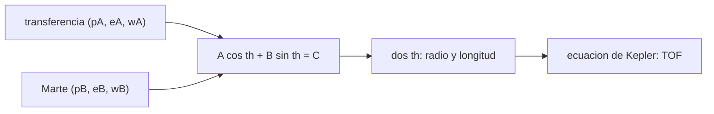

# B75-C21 — Intersección de cónicas en transferencias

<!-- nav:top -->
[🏠 Programa](../../../../README.md) · [📚 Bloque B75](../../../tronco-comun/B75-trayectorias-y-misiones-interplanetarias.md) · [← Anterior: B75-C20 — Diseño de una misión a luna helada](../B75-C20-diseno-de-una-mision-a-luna-helada/CLASE.md) · [Siguiente: B75-C22 — Modelos de primer impulso →](../B75-C22-modelos-de-primer-impulso/CLASE.md)
<!-- /nav -->

## 1. Ubicación, nivel y alcance

Clase 21 del bloque B75 (programada en la ampliación). Nivel N3. La clase B75-C01 trata la geometría general de la transferencia; esta clase estudia un método distinto: encontrar dónde se cruzan la elipse de transferencia y la órbita real del destino. Dos cónicas con foco común (el Sol) se cortan en dos puntos como máximo y se resuelven en forma cerrada. Usas los elementos de Marte de la tabla del JPL, con su excentricidad.

## 2. Por qué esta clase existe

Una transferencia que apunta al radio medio de Marte puede pasar por dentro o por fuera de su órbita real, que es excéntrica. La decisión central: **¿dónde corta una elipse de transferencia a la órbita de Marte, a qué distancia y cuánto tarda en llegar allí?**

## 3. Lo que podrás hacer al terminar

1. Escribir las cónicas con foco común `r = p/(1 + e cos θ)`.
2. Reducir la intersección a `A cos θ + B sin θ = C` y resolverla.
3. Obtener la distancia y la longitud heliocéntricas de cada punto de cruce.
4. Calcular el tiempo de vuelo hasta cada cruce con la ecuación de Kepler.
5. Distinguir el cruce saliente y el entrante.
6. Separar lo consultado (elementos de Marte) de lo ilustrativo (la elipse de transferencia).

La evidencia es tu **ficha de una transferencia por intersección** del ejercicio 12 (sección 20).

## 4. Con qué llegas y cómo comprobarlo

1. ¿Qué es el semilatus rectum `p`?
2. ¿Qué es la longitud del perihelio?
3. ¿Qué es la verdadera anomalía?
4. ¿Qué es la ecuación de Kepler?
5. ¿Por qué se rotula la elipse como ilustrativa?

<details>
<summary>Ver respuestas</summary>

1. `p = a(1 − e²)`. 2. El ángulo desde el equinoccio hasta el perihelio, medido en la eclíptica. 3. El ángulo del cuerpo desde el perihelio. 4. `M = E − e sin E` con `M` proporcional al tiempo. 5. Porque no está optimizada para ninguna misión.
</details>

Con cuatro o cinco aciertos, sigue; si no, repasa los prerrequisitos.

## 5. Un caso de contexto y casos de referencia

La órbita de Marte tiene `a = 1,52371 au`, `e = 0,09339` y longitud del perihelio `336,056°`, de modo que su radio va de `1,3814` a `1,6660 au` [S1, S2]. Una elipse tangente a la órbita terrestre con apoapsis a `1,8 au` y salida en la longitud `100°` corta la órbita de Marte primero a `1,5566 au` en la longitud `227,53°` tras `164,69 d` (cruce saliente) y luego a `1,3879 au` en `355,07°` tras `484,21 d` (entrante). Es el **ejemplo conductor**. La elipse es ilustrativa.

## 6. Vocabulario

Dos cónicas con **foco común** se describen con `(p, e, ϖ)` cada una. Una **intersección** es un punto con el mismo radio y la misma longitud en ambas. La ecuación se reduce a `A cos θ + B sin θ = C`, con `A = p_A e_B cos Δϖ − p_B e_A`, `B = p_A e_B sin Δϖ`, `C = p_B − p_A`. El cruce **saliente** ocurre antes del apoapsis de la transferencia y el **entrante** después.

## 7. Modelo mental: dos hilos que se cruzan



*Descripción textual:* Los parámetros de ambas cónicas dan una ecuación trigonométrica cuyas dos soluciones son los cruces; la ecuación de Kepler da el tiempo hasta cada uno.

Analogía: dos hilos con un clavo común: se cruzan en dos puntos. Límite: el cruce solo es un encuentro si el planeta está allí en ese instante; la intersección da la geometría, no la fecha.

## 8. La explicación, paso a paso

### 8.1 La ecuación

`p_A/(1 + e_A cos θ) = p_B/(1 + e_B cos(θ − Δϖ))` equivale a `A cos θ + B sin θ = C`; sus soluciones son `θ = atan2(B, A) ± arccos(C/√(A²+B²))`, que existen si `|C| ≤ √(A²+B²)`.

### 8.2 Resultados para Marte

Elipse tangente a 1 au con apoapsis `r_a` y longitud de salida `λ_d`:

| `λ_d` (°) | `r_a` (au) | Cruce saliente: long. (°), `r` (au), `TOF` (d) | `Δv_sal` (km/s) | Cruce entrante: long. (°), `r` (au), `TOF` (d) |
|---|---|---|---|---|
| 60 | 1,8 | 196,97; 1,6251; 186,08 | 3,9880 | 314,85; 1,3894; 483,83 |
| 100 | 1,8 | 227,53; 1,5566; 164,69 | 3,9880 | 355,07; 1,3879; 484,21 |
| 100 | 2,2 | 211,56; 1,5948; 139,66 | 5,1410 | 7,40; 1,3988; 636,21 |
| 140 | 1,8 | 257,68; 1,4825; 144,35 | 3,9880 | 29,26; 1,4304; 473,89 |

(`Δv_sal` es el delta-v tangencial heliocéntrico desde la órbita circular de 1 au.)

### 8.3 Lectura

El mismo apoapsis da el mismo `Δv` pero cruces distintos según la longitud de salida: la excentricidad de Marte hace que el cruce ocurra entre `1,48` y `1,63 au` para `r_a = 1,8 au`. Una elipse de apoapsis mayor cruza antes (`TOF` menor) pero cuesta más: de `3,99` a `5,14 km/s` entre `1,8` y `2,2 au`.

### 8.4 Verificaciones

En todos los cruces los radios de las dos cónicas coinciden con error relativo menor que `10⁻⁹`; la propagación de Kepler desde el perihelio durante el `TOF` calculado llega al radio del cruce con error menor que `10⁻⁶`.

## 9. Magnitudes, símbolos y unidades

| Símbolo | Qué es | Unidad | Valor / nota |
|---|---|---|---|
| `p` | semilatus rectum | km | `a(1 − e²)` |
| `ϖ` | longitud del perihelio | ° | 336,056 (Marte) |
| `θ` | verdadera anomalía en el cruce | ° | se resuelve |
| `TOF` | tiempo hasta el cruce | d | 164,69 |
| `Δv_sal` | delta-v heliocéntrico tangencial | km/s | 3,9880 (r_a = 1,8 au) |

## 10. Convenciones y referencias

Elementos de la tabla del JPL a J2000 (válidos 1800–2050); la Tierra en órbita circular de 1 au (1 au estándar); longitudes en la eclíptica J2000; `μ☉` estándar. Elipses de transferencia **ilustrativas**; no se fija la fecha.

## 11. De dónde sale lo que afirmamos

| ID | Fuente | Localizador | Respalda | Estado |
|---|---|---|---|---|
| S1 | NASA JPL SSD, Approximate Positions of the Planets (Table 1) — https://ssd.jpl.nasa.gov/planets/approx_pos.html (consultada 2026-11-10) | página leída | elementos a J2000 válidos de 1800 a 2050: baricentro Tierra–Luna a = 1,00000261 au, L = 100,46457166°; Marte a = 1,52371034 au, e = 0,09339410, L = −4,55343205°; Venus a = 0,72333566 au, L = 181,97909950°; Júpiter a = 5,20288700 au, L = 34,39644051° | Consultada |
| S2 | NASA/NSSDC, Mars Fact Sheet — https://nssdc.gsfc.nasa.gov/planetary/factsheet/marsfact.html (consultada 2026-11-10) | página leída | semieje 227,956×10⁶ km, periodo sideral 686,980 d, excentricidad 0,0935, inclinación 1,848°, velocidad media 24,08 km/s, masa 0,64169×10²⁴ kg, radio ecuatorial 3396,2 km, g 3,73 m/s² | Consultada |
| — | Valores estándar (no consultados en una fuente concreta de esta clase) | — | GM☉ = 1,32712440×10¹¹ km³/s² (valor estándar, ver la resolución IAU 2015 B3 de la fila anterior donde se cita); 1 au = 149 597 870,7 km; c = 299 792,458 km/s; g₀ = 9,80665 m/s²; ecuaciones de dos cuerpos | No consultada en una fuente concreta |

Límites: se usan solo `a`, `e` y la longitud del perihelio de Marte a J2000, sin sus variaciones seculares; la fecha del encuentro no se calcula; no se consultó ninguna transferencia de misión.

## 12. Cómo ver los cruces

| `λ_d` (°) | `r_a` (au) | `r` del cruce saliente (au) | `TOF` (d) |
|---|---|---|---|
| 60 | 1,8 | 1,6251 | 186,08 |
| 100 | 1,8 | 1,5566 | 164,69 |
| 140 | 1,8 | 1,4825 | 144,35 |

Descripción larga: al aumentar la longitud de salida, el cruce se acerca al perihelio de Marte y el tiempo de vuelo disminuye.

## 13. Ejemplo trabajado: salida en 100° con apoapsis 1,8 au

**Paso 1 · Elipse.** `a = 1,4 au`, `e = 0,2857`, `p = 1,2857 au`.

**Paso 2 · Intersección.** `Δϖ = 336,056° − 100°`; se resuelve `A cos θ + B sin θ = C`.

**Paso 3 · Cruce saliente.** Longitud `227,53°`, `r = 1,5566 au`.

**Paso 4 · Tiempo.** Con Kepler, `164,69 d`.

## 14. Distintas formas de abordar el problema

**Por intersección de cónicas:** forma cerrada, sin iterar. **Por Lambert:** un solo arco con tiempo fijo (B75-C04). **Por Hohmann:** radio medio. **Por simulación:** propagar y buscar el radio.

## 15. Práctica guiada

**Ejercicio 1 · con los pasos indicados.** Calcula `p` de la elipse con `a = 1,4 au` y `e = 0,2857`. *Pasos:* `a(1 − e²)`.

<details><summary>Solución comentada</summary>

`1,4×(1 − 0,0816) = 1,2857 au`.
</details>

**Ejercicio 2 · con una pista.** ¿Cuál es el perihelio y el afelio de Marte con `a = 1,52371` y `e = 0,09339`? *Pista:* `a(1 ∓ e)`.

<details><summary>Solución comentada</summary>

`1,3814` y `1,6660 au`.
</details>

**Ejercicio 3 · casi autónomo.** ¿Hay intersección si `|C| > √(A² + B²)`?

<details><summary>Solución comentada</summary>

No: la ecuación trigonométrica no tiene solución real y las órbitas no se cruzan.
</details>

## 16. Práctica autónoma, transferencia e integrador

**Ejercicio 4 · autónomo.** Compara los `TOF` de los cruces salientes para `λ_d = 60°` y `140°` con `r_a = 1,8 au`.

<details><summary>Solución comentada</summary>

`186,08` y `144,35 d`: 41,7 d menos.
</details>

**Ejercicio 5 · autónomo.** ¿Cuánto más cuesta una elipse de apoapsis `2,2 au` que una de `1,8 au`?

<details><summary>Solución comentada</summary>

`5,1410 − 3,9880 = 1,153 km/s`.
</details>

**Ejercicio 6 · autónomo.** ¿Por qué hay dos cruces?

<details><summary>Solución comentada</summary>

Dos elipses con foco común se cortan en dos puntos si se solapan en radio (saliente y entrante).
</details>

**Ejercicio 7 · autónomo.** Calcula la diferencia de radio entre perihelio y afelio de Marte.

<details><summary>Solución comentada</summary>

`0,2846 au = 42,6×10⁶ km`.
</details>

**Ejercicio 8 · autónomo.** ¿Qué magnitud de la elipse fija `Δv_sal`?

<details><summary>Solución comentada</summary>

Solo su apoapsis, pues parte tangente a 1 au.
</details>

**Ejercicio 9 · transferencia.** Un diseñador usa el radio medio de Marte (1,524 au) como meta. ¿Qué error puede cometer?

<details><summary>Solución comentada</summary>

Hasta `±0,14 au` según la longitud del cruce; la elipse puede quedarse corta.
</details>

**Ejercicio 10 · transferencia.** Si el cruce entrante tarda `484 d`, ¿por qué no se usa?

<details><summary>Solución comentada</summary>

Porque cuesta tiempo; el cruce saliente da el mismo `Δv` con 165 d.
</details>

**Ejercicio 11 · transferencia.** ¿Qué falta para convertir la intersección en una ventana de lanzamiento?

<details><summary>Solución comentada</summary>

Pedir que Marte esté en el cruce en ese instante (B75-C03, C29).
</details>

**Ejercicio 12 · integrador.** Elabora tu *ficha de una transferencia por intersección*: parámetros de ambas cónicas, los dos cruces, `TOF`, `Δv` y verificaciones.

<details><summary>Solución comentada</summary>

Secciones 8.1–8.4 y la salida del laboratorio.
</details>

## 17. Laboratorio: intersección de cónicas

El script [interseccion.py](interseccion.py) resuelve la intersección de nueve elipses de transferencia con la órbita de Marte y **comprueba** la igualdad de los radios y el tiempo de vuelo con Kepler.

**Datos:** elementos de Marte de la tabla del JPL (consultada); elipses de transferencia **ilustrativas**; `μ☉` y `au` estándar. **Predice antes de ejecutar:** ¿Cuántos cruces hay? (dos.) **Ejecución del 2026-11-10 (Python 3.12.9):**

```text
Python 3.12.9 (biblioteca estandar)
Marte (JPL, J2000): a = 1.52371 au, e = 0.09339, longitud del perihelio = 336.056 grados ; perihelio 1.3814 au, afelio 1.6660 au
 lambda_d [g]  apoapsis [au]   1.a interseccion (saliente): longitud [g]  r [au]  TOF [d]   Dv_sal [km/s]   (2.a, entrante: longitud [g], r [au], TOF [d])
      60.0           1.8                   196.97    1.6251    186.08         3.9880   (314.85, 1.3894, 483.83)
      60.0           2.2                   176.81    1.6549    151.66         5.1410   (329.20, 1.3822, 639.23)
      60.0           3.0                   161.45    1.6653    124.68         6.6940   (339.86, 1.3817, 949.05)
     100.0           1.8                   227.53    1.5566    164.69         3.9880   (355.07, 1.3879, 484.21)
     100.0           2.2                   211.56    1.5948    139.66         5.1410   (7.40, 1.3988, 636.21)
     100.0           3.0                   198.65    1.6219    118.42         6.6940   (17.23, 1.4112, 944.79)
     140.0           1.8                   257.68    1.4825    144.35         3.9880   (29.26, 1.4304, 473.89)
     140.0           2.2                   244.25    1.5149    124.38         5.1410   (41.64, 1.4543, 626.08)
     140.0           3.0                   233.16    1.5426    107.05         6.6940   (51.82, 1.4765, 935.46)
Pruebas superadas.
```

```bash
python programa/clases/B75/B75-C21-interseccion-de-conicas-en-transferencias/interseccion.py
```

**Límites:** elementos a J2000, sin variación secular; no calcula la fecha.

## 18. Errores frecuentes y cómo corregirlos

**Tomar el radio medio de Marte como meta.** Se corrige con el ejercicio 9.

**Usar el cruce entrante sin pensar en el tiempo.** Se corrige con el ejercicio 10.

**Olvidar la diferencia de longitudes de perihelio.** Se corrige con 8.1.

**Presentar las elipses como diseños de misión.** Se corrige con la sección 10.

## 19. Cómo sabrás que vas bien

Tras 8.2: ¿qué cruce prefieres y por qué? Tras el laboratorio: ¿qué verifican las dos pruebas? (ver la sección 17).

## 20. Qué entregas y cómo se evalúa

El producto es tu **ficha de una transferencia por intersección** (ejercicio 12).

| Criterio | Inicial | En desarrollo | Logrado | Destacado |
|---|---|---|---|---|
| Conceptos | Confunde cruce y encuentro | Plantea la ecuación | Resuelve y calcula `TOF` | Distingue saliente y entrante |
| Cálculo | Sin unidades | Con errores | Tabla completa | Calcula casos nuevos |
| Numérico | Sin comprobar | Una prueba | Dos pruebas | Interpreta tolerancias |
| Fuentes | Sin fuente | Sin fecha | Fuentes con fecha y estado | Declara los límites de J2000 |
| Límites | No los nombra | Uno | Tres | Discute la fecha del encuentro |

**Condiciones críticas (no se compensan con promedio):** rotular las elipses como ilustrativas; no presentar el cruce como un encuentro; citar solo lo consultado.

## 21. Ética, seguridad y límites

Clase educativa: los modelos son simplificados (órbitas planetarias circulares y coplanares, dos cuerpos) y sus datos son consultados, sintéticos o ilustrativos y están rotulados; ningún resultado es una efeméride, una medición ni un diseño de misión real. La intersección geométrica no garantiza un encuentro: la fecha exige una efeméride. Accesibilidad: tablas equivalentes a las gráficas, fórmulas en texto, ejercicios sin conexión.

## 22. Para cerrar y seguir

Una elipse que parte a 100° con apoapsis `1,8 au` corta la órbita de Marte a `1,5566 au` tras `164,69 d`. Queda una pregunta: ¿cómo se elige el primer impulso para que la elipse alcance una meta con el menor costo?

**Glosario español–inglés.** intersección de cónicas · *conic intersection*; foco común · *common focus*; semilatus rectum · *semi-latus rectum*; cruce saliente · *outbound crossing*; longitud del perihelio · *longitude of perihelion*.

**Continuidad.** [B75-C22](../B75-C22-modelos-de-primer-impulso/CLASE.md) estudia cómo el primer impulso fija la elipse.

**Referencias:** ver sección 11.

<!-- nav:bottom -->
---

[← Anterior: B75-C20 — Diseño de una misión a luna helada](../B75-C20-diseno-de-una-mision-a-luna-helada/CLASE.md) · [📚 Bloque B75](../../../tronco-comun/B75-trayectorias-y-misiones-interplanetarias.md) · [Siguiente: B75-C22 — Modelos de primer impulso →](../B75-C22-modelos-de-primer-impulso/CLASE.md)
<!-- /nav -->
