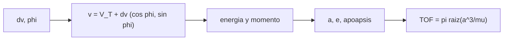

# B75-C22 — Modelos de primer impulso

<!-- nav:top -->
[🏠 Programa](../../../../README.md) · [📚 Bloque B75](../../../tronco-comun/B75-trayectorias-y-misiones-interplanetarias.md) · [← Anterior: B75-C21 — Intersección de cónicas en transferencias](../B75-C21-interseccion-de-conicas-en-transferencias/CLASE.md) · [Siguiente: B75-C23 — Energía característica C3 y exceso hiperbólico →](../B75-C23-energia-caracteristica-c3-y-exceso-hiperbolico/CLASE.md)
<!-- /nav -->

## 1. Ubicación, nivel y alcance

Clase 22 del bloque B75 (programada en la `0.2.0`). Nivel N3. El primer impulso lo fija todo: con él la elipse queda determinada y el apoapsis y el tiempo de vuelo se deducen. Aquí estudias cómo el módulo y la dirección del primer impulso heliocéntrico determinan el apoapsis alcanzado y el tiempo de vuelo, y compruebas que el impulso tangencial es el mínimo para alcanzar un radio dado. Modelo circular y coplanar.

## 2. Por qué esta clase existe

Antes de optimizar toda la misión conviene entender el primer impulso. La decisión central: **¿qué módulo y qué dirección del primer impulso alcanzan un radio dado con el menor delta-v y en cuánto tiempo?**

## 3. Lo que podrás hacer al terminar

1. Calcular energía, momento angular, semieje y apoapsis tras un impulso `Δv` en una dirección `φ`.
2. Hallar por bisección el `Δv` mínimo para alcanzar un radio objetivo.
3. Comprobar con un barrido de `φ` que la dirección tangencial maximiza el apoapsis.
4. Calcular el tiempo hasta el apoapsis.
5. Leer la familia tangencial `Δv` → apoapsis → tiempo de vuelo.
6. Separar lo consultado (semiejes) de lo calculado.

La evidencia es tu **curva de Δv₁ frente al apoapsis** del ejercicio 12 (sección 20).

## 4. Con qué llegas y cómo comprobarlo

1. ¿Qué es la velocidad circular de la Tierra?
2. ¿Qué es el momento angular específico?
3. ¿Qué es el apoapsis?
4. ¿Qué es una dirección tangencial?
5. ¿Qué es la bisección?

<details>
<summary>Ver respuestas</summary>

1. `29,7847 km/s` (B75-C01). 2. `h = r·v_⊥`, conservado en dos cuerpos. 3. `a(1 + e)`. 4. La de la velocidad circular. 5. Un método que reduce a la mitad un intervalo que contiene la raíz.
</details>

Con cuatro o cinco aciertos, sigue; si no, repasa los prerrequisitos.

## 5. Un caso de contexto y casos de referencia

Un impulso tangencial de `2,9452 km/s` desde la órbita circular de la Tierra lleva el apoapsis a `1,524 au` (Marte) en `258,9 d`; uno de `8,7933 km/s` a `5,204 au` (Júpiter) en `997,7 d` [S1, S2, S3]. Es el **ejemplo conductor**. La NASA describe la transferencia de Hohmann como la ruta de menor propulsante [S4]; aquí se comprueba para el primer impulso.

## 6. Vocabulario

El **primer impulso** es el de la salida. Su **dirección** `φ` se mide desde la velocidad (0 = tangencial). La **familia tangencial** es el conjunto de elipses que salen tangentes. El **apoapsis alcanzado** es `a(1 + e)`. El **tiempo hasta el apoapsis** es medio periodo.

## 7. Modelo mental: lanzar una piedra a una altura



*Descripción textual:* El impulso y su dirección dan el vector velocidad; de él salen la energía y el momento, los elementos y el apoapsis; el semieje da el tiempo hasta el apoapsis.

Analogía: lanzar una piedra a una altura: se alcanza más alto lanzando en la dirección óptima. Límite: aquí la «altura» es el radio heliocéntrico y la mejor dirección es tangencial por el momento angular.

## 8. La explicación, paso a paso

### 8.1 El modelo

`v = (Δv sin φ, V_T + Δv cos φ)`; `ε = v²/2 − μ/r₁`, `h = r₁ v_y`, `a = −μ/(2ε)`, `e = √(1 + 2εh²/μ²)`, apoapsis `a(1 + e)`.

### 8.2 Δv mínimo para alcanzar un radio

| Destino | `Δv` Hohmann (km/s) | `Δv` mínimo por bisección (km/s) | `φ` óptimo (°) | `TOF` (d) |
|---|---|---|---|---|
| Marte | 2,9452 | 2,9452 | 0,00 | 258,88 |
| Júpiter | 8,7933 | 8,7933 | 0,00 | 997,73 |

Venus es interior: el impulso es retrógrado (`Δv = −2,4953 km/s`).

### 8.3 Familia tangencial

| `Δv` (km/s) | Apoapsis (au) | `TOF` (d) | `e` |
|---|---|---|---|
| 1,0 | 1,147 | 203,1 | 0,0683 |
| 2,0 | 1,322 | 228,5 | 0,1388 |
| 2,9452 | 1,524 | 258,9 | 0,2075 |
| 4,0 | 1,804 | 303,1 | 0,2866 |
| 6,0 | 2,594 | 439,9 | 0,4435 |
| 8,0 | 4,119 | 747,9 | 0,6093 |
| 8,7933 | 5,204 | 997,7 | 0,6776 |

### 8.4 Verificaciones

La bisección da el `Δv` de Hohmann con error menor que `10⁻⁹`; el barrido de `φ` de −90° a 90° con paso `0,05°` muestra el máximo en `φ = 0` dentro de `0,1°`; el apoapsis tras el tiempo de la ecuación de Kepler coincide con el de la propagación universal dentro de `10⁻⁶`.

## 9. Magnitudes, símbolos y unidades

| Símbolo | Qué es | Unidad | Valor / nota |
|---|---|---|---|
| `Δv` | módulo del primer impulso | km/s | 2,9452 |
| `φ` | dirección respecto de la velocidad | ° | 0 (óptimo) |
| `r_a` | apoapsis | au | 1,524 |
| `e` | excentricidad | — | 0,2075 |
| `TOF` | tiempo hasta el apoapsis | d | 258,9 |

## 10. Convenciones y referencias

Marco heliocéntrico plano; la Tierra en órbita circular con el semieje de la ficha NASA/NSSDC (149,598×10⁶ km); `μ☉` estándar; impulso instantáneo; `au` = 149 597 870,7 km (estándar).

## 11. De dónde sale lo que afirmamos

| ID | Fuente | Localizador | Respalda | Estado |
|---|---|---|---|---|
| S1 | NASA/NSSDC, Earth Fact Sheet — https://nssdc.gsfc.nasa.gov/planetary/factsheet/earthfact.html (consultada 2026-11-10) | página leída | semieje 149,598×10⁶ km, periodo sideral 365,256 d, excentricidad 0,0167, velocidad orbital media 29,78 km/s, masa 5,9722×10²⁴ kg, radio medio 6371,000 km, velocidad de escape 11,186 km/s | Consultada |
| S2 | NASA/NSSDC, Mars Fact Sheet — https://nssdc.gsfc.nasa.gov/planetary/factsheet/marsfact.html (consultada 2026-11-10) | página leída | semieje 227,956×10⁶ km, periodo sideral 686,980 d, excentricidad 0,0935, inclinación 1,848°, velocidad media 24,08 km/s, masa 0,64169×10²⁴ kg, radio ecuatorial 3396,2 km, g 3,73 m/s² | Consultada |
| S3 | NASA/NSSDC, Jupiter Fact Sheet — https://nssdc.gsfc.nasa.gov/planetary/factsheet/jupiterfact.html (consultada 2026-11-10) | página leída | semieje 778,479×10⁶ km, periodo sideral 4332,589 d, excentricidad 0,0487, inclinación 1,304°, velocidad media 13,06 km/s, masa 1898,13×10²⁴ kg, radio medio 69 911 km | Consultada |
| S4 | NASA, Basics of Space Flight, cap. 4 «Interplanetary Trajectories» — https://science.nasa.gov/learn/basics-of-space-flight/chapter4-1/ (consultada 2026-11-10) | página leída | transferencia de Hohmann como ruta de menor propulsante; oportunidades mínimas de energía a Marte cada ~25 meses y a Venus cada ~19 meses; la asistencia gravitacional cambia la velocidad heliocéntrica y deja la relativa en módulo; el vuelo de Galileo por Ío redujo el propulsante de inserción en 90 kg | Consultada |
| — | Valores estándar (no consultados en una fuente concreta de esta clase) | — | GM☉ = 1,32712440×10¹¹ km³/s² (valor estándar, ver la resolución IAU 2015 B3 de la fila anterior donde se cita); 1 au = 149 597 870,7 km; c = 299 792,458 km/s; g₀ = 9,80665 m/s²; ecuaciones de dos cuerpos | No consultada en una fuente concreta |

Límites: no se consultó ninguna maniobra real; el modelo ignora la esfera de influencia de la Tierra y el costo de salida (B75-C23).

## 12. Cómo ver la familia

| `Δv` (km/s) | Apoapsis (au) |
|---|---|
| 1,0 | 1,147 |
| 2,9452 | 1,524 |
| 4,0 | 1,804 |
| 8,7933 | 5,204 |

Descripción larga: el apoapsis crece más rápido que el delta-v; para llegar a Júpiter hace falta triplicar el delta-v de Marte.

## 13. Ejemplo trabajado: alcanzar Marte

**Paso 1 · Velocidad.** `v = 29,7847 + 2,9452 = 32,7299 km/s`.

**Paso 2 · Energía.** `ε = v²/2 − μ/r₁`.

**Paso 3 · Apoapsis.** `a(1 + e) = 1,524 au`.

**Paso 4 · Tiempo.** `π√(a³/μ) = 258,9 d`.

## 14. Distintas formas de abordar el problema

**Por energía y momento:** elementos del impulso. **Por bisección:** `Δv` mínimo. **Por barrido de dirección:** comprueba la tangencial. **Por Hohmann:** fórmula cerrada.

## 15. Práctica guiada

**Ejercicio 1 · con los pasos indicados.** Calcula la velocidad tras `Δv = 2,9452 km/s` tangencial. *Pasos:* `V_T + Δv`.

<details><summary>Solución comentada</summary>

`32,7299 km/s`.
</details>

**Ejercicio 2 · con una pista.** Lee en la tabla el apoapsis para `Δv = 4 km/s`.

<details><summary>Solución comentada</summary>

`1,804 au` en `303,1 d`.
</details>

**Ejercicio 3 · casi autónomo.** ¿Por qué la dirección tangencial es la óptima?

<details><summary>Solución comentada</summary>

Porque para un `Δv` dado el momento angular se maximiza con `φ = 0` y eso maximiza el apoapsis.
</details>

## 16. Práctica autónoma, transferencia e integrador

**Ejercicio 4 · autónomo.** ¿Cuánto cuesta alcanzar `2,594 au`?

<details><summary>Solución comentada</summary>

`6,0 km/s`.
</details>

**Ejercicio 5 · autónomo.** Compara el `Δv` de Júpiter y Marte.

<details><summary>Solución comentada</summary>

`8,7933/2,9452 = 2,98` veces.
</details>

**Ejercicio 6 · autónomo.** Calcula `e` para `Δv = 4,0 km/s`.

<details><summary>Solución comentada</summary>

`0,2866`.
</details>

**Ejercicio 7 · autónomo.** ¿Cuánto tarda en llegar a `1,322 au`?

<details><summary>Solución comentada</summary>

`228,5 d`.
</details>

**Ejercicio 8 · autónomo.** Estima el `Δv` para `1,2 au` por interpolación entre 1,0 (1,147 au) y 2,0 (1,322 au).

<details><summary>Solución comentada</summary>

`1,0 + (1,2 − 1,147)/(1,322 − 1,147) = 1,3 km/s` (lineal, aproximado).
</details>

**Ejercicio 9 · transferencia.** Un diseñador quiere llegar antes de 200 d a un punto a `1,15 au`. ¿Qué dice la tabla?

<details><summary>Solución comentada</summary>

`Δv = 1,0 km/s` da `1,147 au` en `203 d`: casi, pero con apoapsis aún menor; necesitaría más impulso.
</details>

**Ejercicio 10 · transferencia.** ¿Qué ocurre si el impulso tiene una componente radial?

<details><summary>Solución comentada</summary>

El apoapsis alcanzado baja respecto del tangencial (barrido de `φ`), por lo que cuesta más llegar al mismo radio.
</details>

**Ejercicio 11 · transferencia.** ¿Por qué el `Δv` a Venus es negativo?

<details><summary>Solución comentada</summary>

Porque hay que frenar para bajar el perihelio por debajo de `1 au`.
</details>

**Ejercicio 12 · integrador.** Elabora tu *curva de Δv₁ frente al apoapsis* con al menos siete puntos, el `TOF` y la comprobación de la dirección tangencial.

<details><summary>Solución comentada</summary>

Secciones 8.2–8.4 y la salida del laboratorio.
</details>

## 17. Laboratorio: primer impulso

El script [primer_impulso.py](primer_impulso.py) calcula la familia tangencial y **comprueba** que el `Δv` mínimo coincide con Hohmann por bisección, que `φ = 0` maximiza el apoapsis y que el tiempo coincide con la propagación de Kepler.

**Datos:** semiejes de las fichas NASA/NSSDC (consultados); `μ☉` estándar. **Predice antes de ejecutar:** ¿Qué `φ` maximiza el apoapsis? (0°.) **Ejecución del 2026-11-10 (Python 3.12.9):**

```text
Python 3.12.9 (biblioteca estandar)
 destino   dv Hohmann [km/s]   dv minimo (biseccion) [km/s]   phi optimo [grados]   TOF a apoapsis [d]
Venus            -2.4953   (destino interior: impulso retrogrado, dv negativo; |dv| = 2.4953)
Marte             2.9452                      2.9452                0.00             258.88
Jupiter           8.7933                      8.7933                0.00             997.73
Familia tangencial: dv, apoapsis y tiempo hasta el apoapsis
  dv [km/s]   apoapsis [au]   TOF a apoapsis [d]   excentricidad
   1.0000          1.147                203.1         0.0683
   2.0000          1.322                228.5         0.1388
   2.9452          1.524                258.9         0.2075
   4.0000          1.804                303.1         0.2866
   6.0000          2.594                439.9         0.4435
   8.0000          4.119                747.9         0.6093
   8.7933          5.204                997.7         0.6776
Pruebas superadas.
```

```bash
python programa/clases/B75/B75-C22-modelos-de-primer-impulso/primer_impulso.py
```

**Límites:** plano único, impulso instantáneo, sin esfera de influencia.

## 18. Errores frecuentes y cómo corregirlos

**Dar al impulso una componente radial sin necesidad.** Se corrige con el ejercicio 10.

**Confundir el `Δv` heliocéntrico con el de la misión.** Se corrige con B75-C09.

**Olvidar el signo para destinos interiores.** Se corrige con el ejercicio 11.

**Presentar el modelo como una efeméride.** Se corrige con la sección 10.

## 19. Cómo sabrás que vas bien

Tras 8.3: ¿qué apoapsis da `Δv = 6 km/s`? Tras el laboratorio: ¿qué dirección resulta óptima? (ver la sección 17).

## 20. Qué entregas y cómo se evalúa

El producto es tu **curva de Δv₁ frente al apoapsis** (ejercicio 12).

| Criterio | Inicial | En desarrollo | Logrado | Destacado |
|---|---|---|---|---|
| Conceptos | Confunde `Δv` y `v` | Define el primer impulso | Calcula la familia | Explica la dirección óptima |
| Cálculo | Sin unidades | Con errores | Tabla completa | Calcula casos nuevos |
| Numérico | Sin comprobar | Una prueba | Tres pruebas | Interpreta tolerancias |
| Fuentes | Sin fuente | Sin fecha | Fuentes con fecha y estado | Declara lo calculado |
| Límites | No los nombra | Uno | Tres | Discute la esfera de influencia |

**Condiciones críticas (no se compensan con promedio):** rotular el modelo circular; no presentar el `Δv` heliocéntrico como el de la misión; citar solo lo consultado.

## 21. Ética, seguridad y límites

Clase educativa: los modelos son simplificados (órbitas planetarias circulares y coplanares, dos cuerpos) y sus datos son consultados, sintéticos o ilustrativos y están rotulados; ningún resultado es una efeméride, una medición ni un diseño de misión real. El primer impulso real depende del lanzador y del tiempo de ventana; esta clase calcula solo el modelo. Accesibilidad: tablas equivalentes a las gráficas, fórmulas en texto, ejercicios sin conexión.

## 22. Para cerrar y seguir

El primer impulso tangencial de `2,9452 km/s` fija el apoapsis en `1,524 au` y el viaje en `258,9 d`. Queda una pregunta: ¿cómo se mide esa energía de salida respecto de la Tierra?

**Glosario español–inglés.** primer impulso · *first impulse*; impulso tangencial · *tangential burn*; familia de órbitas · *family of orbits*; apoapsis · *apoapsis*; bisección · *bisection*.

**Continuidad.** [B75-C23](../B75-C23-energia-caracteristica-c3-y-exceso-hiperbolico/CLASE.md) define `C3` y el exceso hiperbólico.

**Referencias:** ver sección 11.

<!-- nav:bottom -->
---

[← Anterior: B75-C21 — Intersección de cónicas en transferencias](../B75-C21-interseccion-de-conicas-en-transferencias/CLASE.md) · [📚 Bloque B75](../../../tronco-comun/B75-trayectorias-y-misiones-interplanetarias.md) · [Siguiente: B75-C23 — Energía característica C3 y exceso hiperbólico →](../B75-C23-energia-caracteristica-c3-y-exceso-hiperbolico/CLASE.md)
<!-- /nav -->
