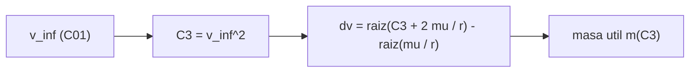

# B75-C23 — Energía característica C3 y exceso hiperbólico

<!-- nav:top -->
[🏠 Programa](../../../../README.md) · [📚 Bloque B75](../../../tronco-comun/B75-trayectorias-y-misiones-interplanetarias.md) · [← Anterior: B75-C22 — Modelos de primer impulso](../B75-C22-modelos-de-primer-impulso/CLASE.md) · [Siguiente: B75-C24 — Plano B y parámetro de impacto →](../B75-C24-plano-b-y-parametro-de-impacto/CLASE.md)
<!-- /nav -->

## 1. Ubicación, nivel y alcance

Clase 23 del bloque B75 (programada en la ampliación). Nivel N3. La clase B71-C15 trata la velocidad de escape; esta clase define la medida con la que se dimensiona un lanzamiento interplanetario: la energía característica `C3 = v∞²`. Calculas `C3` y el delta-v de salida desde una órbita baja para Venus, Marte y Júpiter, y verificas la energía con una propagación de Kepler.

## 2. Por qué esta clase existe

Un lanzador entrega una masa distinta según la energía que se le pida. La decisión central: **¿cuánta energía característica y cuánto delta-v hay que dar desde una órbita baja para alcanzar un destino?**

## 3. Lo que podrás hacer al terminar

1. Definir `C3 = v∞² = 2ε` con `ε` la energía específica hiperbólica.
2. Calcular el delta-v de salida `√(C3 + 2μ/r) − √(μ/r)`.
3. Comparar con el delta-v de escape (`C3 = 0`).
4. Verificar la energía con una propagación de Kepler.
5. Interpretar la pendiente `d(Δv)/d(C3)`.
6. Separar lo consultado (masa, radio, velocidad de escape) de lo sintético (la relación masa útil–C3).

La evidencia es tu **tabla de C3 por destino** del ejercicio 12 (sección 20).

## 4. Con qué llegas y cómo comprobarlo

1. ¿Qué es la energía específica?
2. ¿Qué es el exceso hiperbólico `v∞`?
3. ¿Qué es la velocidad de escape?
4. ¿Qué es una órbita baja?
5. ¿Qué es un dato sintético?

<details>
<summary>Ver respuestas</summary>

1. `ε = v²/2 − μ/r`. 2. La velocidad lejos del planeta, `v∞² = 2ε`. 3. `√(2μ/r)`: la que da `ε = 0`. 4. Una órbita circular de unos cientos de km de altitud. 5. Un valor del ejemplo no medido.
</details>

Con cuatro o cinco aciertos, sigue; si no, repasa los prerrequisitos.

## 5. Un caso de contexto y casos de referencia

Para ir a Marte desde una órbita circular de `300 km` hace falta `C3 = 8,67 km²/s²` y `Δv = 3,5916 km/s`; para Júpiter, `C3 = 77,32 km²/s²` y `6,2995 km/s`. Escapar sin exceso (`C3 = 0`) cuesta `3,2018 km/s`. Es el **ejemplo conductor**. La velocidad de escape de la superficie calculada (`11,1862 km/s`) coincide con la de la ficha de la NASA (`11,186 km/s`) [S1]; la masa útil frente a `C3` es sintética.

## 6. Vocabulario

La **energía característica** es `C3 = v∞²`, en km²/s². El **exceso hiperbólico** `v∞` es la velocidad respecto a la Tierra lejos de ella. El **delta-v de salida** es el impulso en el periapsis de la órbita baja. La **capacidad de un lanzador** se expresa como masa útil en función de `C3`.

## 7. Modelo mental: saltar una pared con un resorte



*Descripción textual:* El exceso da `C3`; con `C3` y el radio de la órbita baja se obtiene el delta-v de salida; la masa útil depende de `C3`.

Analogía: saltar una pared con un resorte: la energía sobrante después de pasar la pared es `C3`. Límite: el resorte (el pozo gravitatorio) ya consume parte de la energía en subir.

## 8. La explicación, paso a paso

### 8.1 De C3 al delta-v

`Δv = √(C3 + 2μ_T/r) − √(μ_T/r)`, con `μ_T = G·M_T = 398 602,54 km³/s²` (masa de la ficha y `G` del JPL [S1, S2]) y `r = 6371 + 300 = 6671 km`: `v_c = 7,7299 km/s`, `v_esc,local = 10,9317 km/s`.

### 8.2 Tres destinos

| Destino | `v∞` (km/s) | `C3` (km²/s²) | `Δv` desde 300 km (km/s) | `Δv/Δv_esc` |
|---|---|---|---|---|
| Escape | 0 | 0 | 3,2018 | 1,000 |
| Venus | 2,4953 | 6,23 | 3,4830 | 1,088 |
| Marte | 2,9452 | 8,67 | 3,5916 | 1,122 |
| Júpiter | 8,7933 | 77,32 | 6,2995 | 1,967 |

### 8.3 Una relación sintética

Con una masa útil **sintética** `m = 1500 − 14·C3 (kg)`, que no corresponde a ningún lanzador: Venus `1412,8 kg`, Marte `1378,6 kg`, Júpiter `417,5 kg`. Muestra la pérdida fuerte de capacidad con `C3`.

### 8.4 La pendiente

`dΔv/dC3 = 1/(2√(C3 + 2μ/r))`; en `C3 = 0` vale `0,045738 s/km` (numérica y analítica coinciden). Por eso un `C3` pequeño cuesta poco delta-v extra y uno grande, mucho.

### 8.5 Verificaciones

La velocidad de escape de superficie calculada coincide con la ficha (0,1 %); la energía `½v² − μ/r` tras `10⁷ s` de propagación de Kepler iguala `C3/2` con error relativo menor que `10⁻⁹`.

## 9. Magnitudes, símbolos y unidades

| Símbolo | Qué es | Unidad | Valor / nota |
|---|---|---|---|
| `C3` | energía característica | km²/s² | 8,67 (Marte) |
| `v∞` | exceso hiperbólico | km/s | 2,9452 |
| `Δv` | delta-v de salida desde 300 km | km/s | 3,5916 |
| `v_esc` | escape local a 300 km | km/s | 10,9317 |
| `μ_T` | parámetro gravitacional terrestre | km³/s² | 398 602,54 (G·M) |

## 10. Convenciones y referencias

Marco geocéntrico; órbita de salida circular de 300 km (ilustrativa); `v∞` del modelo de Hohmann circular y coplanar; `GM_T = G·M` con la masa de la ficha y `G` del registro del JPL; masa útil frente a `C3` **sintética**.

## 11. De dónde sale lo que afirmamos

| ID | Fuente | Localizador | Respalda | Estado |
|---|---|---|---|---|
| S1 | NASA/NSSDC, Earth Fact Sheet — https://nssdc.gsfc.nasa.gov/planetary/factsheet/earthfact.html (consultada 2026-11-10) | página leída | semieje 149,598×10⁶ km, periodo sideral 365,256 d, excentricidad 0,0167, velocidad orbital media 29,78 km/s, masa 5,9722×10²⁴ kg, radio medio 6371,000 km, velocidad de escape 11,186 km/s | Consultada |
| S2 | NASA JPL SSD, Planetary Physical Parameters — https://ssd.jpl.nasa.gov/planets/phys_par.html (consultada 2026-11-10) | página leída | radios ecuatoriales (Venus 6051,8 km; Tierra 6378,1366 km; Marte 3396,19 km; Júpiter 71 492 km) y la constante G = 6,67430×10⁻¹¹ m³ kg⁻¹ s⁻² citada en su registro de cambios. La página no lista GM: aquí GM = G·M con las masas de las fichas NSSDC | Consultada |
| — | Valores estándar (no consultados en una fuente concreta de esta clase) | — | GM☉ = 1,32712440×10¹¹ km³/s² (valor estándar, ver la resolución IAU 2015 B3 de la fila anterior donde se cita); 1 au = 149 597 870,7 km; c = 299 792,458 km/s; g₀ = 9,80665 m/s²; ecuaciones de dos cuerpos | No consultada en una fuente concreta |

Límites: no se consultó la capacidad de ningún lanzador; el valor `11,186 km/s` de escape es el de la ficha; no se modelan las pérdidas de lanzamiento ni la inclinación de la órbita baja.

## 12. Cómo ver C3 y Δv

| Destino | `C3` (km²/s²) | `Δv` (km/s) |
|---|---|---|
| Venus | 6,23 | 3,4830 |
| Marte | 8,67 | 3,5916 |
| Júpiter | 77,32 | 6,2995 |

Descripción larga: `C3` crece unas nueve veces de Marte a Júpiter, pero el delta-v solo se multiplica por 1,75 (raíz cuadrada dentro de la fórmula).

## 13. Ejemplo trabajado: Marte

**Paso 1 · v∞.** `2,9452 km/s`; `C3 = 8,67 km²/s²`.

**Paso 2 · Velocidad hiperbólica en 300 km.** `√(8,67 + 2×398 602,54/6671) = 11,3217 km/s`.

**Paso 3 · Circular.** `7,7299 km/s`.

**Paso 4 · Delta-v.** `3,5916 km/s`.

## 14. Distintas formas de abordar el problema

**Por C3:** energía por unidad de masa. **Por el delta-v:** lo que paga la propulsión. **Por la masa útil:** lo que entrega el lanzador (sintética aquí). **Por Kepler:** verifica la energía.

## 15. Práctica guiada

**Ejercicio 1 · con los pasos indicados.** Calcula `C3` de salida a Venus. *Pasos:* `v∞²` con `v∞ = 2,4953`.

<details><summary>Solución comentada</summary>

`6,23 km²/s²`.
</details>

**Ejercicio 2 · con una pista.** Calcula `√(2μ/r)` a 300 km. *Pista:* `2μ/r = 119,50`.

<details><summary>Solución comentada</summary>

`10,9317 km/s`.
</details>

**Ejercicio 3 · casi autónomo.** Calcula el delta-v de escape.

<details><summary>Solución comentada</summary>

`10,9317 − 7,7299 = 3,2018 km/s`.
</details>

## 16. Práctica autónoma, transferencia e integrador

**Ejercicio 4 · autónomo.** Calcula `Δv/Δv_esc` para Júpiter.

<details><summary>Solución comentada</summary>

`6,2995/3,2018 = 1,967`.
</details>

**Ejercicio 5 · autónomo.** Con `m = 1500 − 14·C3`, ¿qué `C3` hace `m = 0`?

<details><summary>Solución comentada</summary>

`1500/14 = 107,1 km²/s²` (sintético).
</details>

**Ejercicio 6 · autónomo.** Calcula la pendiente `dΔv/dC3` en `C3 = 8,67`.

<details><summary>Solución comentada</summary>

`1/(2×11,3217) = 0,0442 s/km`.
</details>

**Ejercicio 7 · autónomo.** ¿Cuánto Δv extra cuesta pasar de Marte a Venus-escape? (`3,5916 − 3,4830`).

<details><summary>Solución comentada</summary>

`0,1086 km/s` más para Marte que para Venus.
</details>

**Ejercicio 8 · autónomo.** ¿Por qué el delta-v de Júpiter no es 9 veces el de Marte?

<details><summary>Solución comentada</summary>

Porque `Δv` depende de `√(C3 + 2μ/r)`, y `2μ/r = 119,5` pesa mucho; solo sube 1,75 veces.
</details>

**Ejercicio 9 · transferencia.** Un lanzador entrega 1400 kg a `C3 = 8`. ¿Qué pasa con `C3 = 80`?

<details><summary>Solución comentada</summary>

No se puede decir sin su curva de capacidad; la sintética lo bajaría a unos 380 kg; se necesita la curva real, no consultada.
</details>

**Ejercicio 10 · transferencia.** ¿Qué cambia si la órbita baja es de 500 km?

<details><summary>Solución comentada</summary>

El `Δv` baja un poco (la órbita es más lenta y más alta); en B75-C09 se calcula `3,5503 km/s`.
</details>

**Ejercicio 11 · transferencia.** ¿Por qué las misiones a Júpiter usan asistencias?

<details><summary>Solución comentada</summary>

Para reducir `C3` a cambio de tiempo (C06, C27).
</details>

**Ejercicio 12 · integrador.** Elabora tu *tabla de C3 por destino*: `v∞`, `C3`, `Δv`, razón con el escape y una conclusión sobre qué destino cuesta más y por qué.

<details><summary>Solución comentada</summary>

Sección 8.2 y la salida del laboratorio.
</details>

## 17. Laboratorio: C3 y delta-v de salida

El script [c3.py](c3.py) calcula `C3` y `Δv` para tres destinos y el escape, y **comprueba** la velocidad de escape contra la ficha, la energía por Kepler y la pendiente `dΔv/dC3`.

**Datos:** masa, radio y velocidad de escape de la ficha NASA/NSSDC y `G` del JPL (consultados); altitud de salida y relación masa–C3 **ilustrativas**. **Predice antes de ejecutar:** ¿Qué destino cuesta más `C3`? (Júpiter, 77,32 km²/s².) **Ejecución del 2026-11-10 (Python 3.12.9):**

```text
Python 3.12.9 (biblioteca estandar)
Velocidad de escape de la superficie = 11.1862 km/s (ficha: 11.186 km/s)
Orbita de salida: r = 6671 km ; v_circ = 7.7299 km/s ; v_escape local = 10.9317 km/s
Pendiente d(dv)/d(C3) en C3 = 0: numerica 0.045738 ; analitica 1/(2 v_esc) = 0.045738 (s/km)
 destino   v_inf [km/s]   C3 [km2/s2]   dv desde 300 km [km/s]   dv / dv(escape)
escape          0.0000        0.00            3.2018               1.000
Venus          2.4953          6.23                 3.4830            1.088
Marte          2.9452          8.67                 3.5916            1.122
Jupiter        8.7933         77.32                 6.2995            1.967
Masa util SINTETICA m(C3) = 1500 - 14 C3 [kg] (no corresponde a ningun lanzador):
   Venus    C3 =    6.23 -> m =   1412.8 kg
   Marte    C3 =    8.67 -> m =   1378.6 kg
   Jupiter  C3 =   77.32 -> m =    417.5 kg
Pruebas superadas.
```

```bash
python programa/clases/B75/B75-C23-energia-caracteristica-c3-y-exceso-hiperbolico/c3.py
```

**Límites:** impulso instantáneo, sin pérdidas de lanzamiento ni inclinación.

## 18. Errores frecuentes y cómo corregirlos

**Confundir `C3` con `v∞`.** Se corrige con la sección 6.

**Pensar que el delta-v crece como `C3`.** Se corrige con 8.4.

**Usar la relación sintética de masa como real.** Se corrige con 8.3.

**Ignorar la altitud de la órbita baja.** Se corrige con el ejercicio 10.

## 19. Cómo sabrás que vas bien

Tras 8.2: ¿qué `Δv` paga Venus? Tras el laboratorio: ¿qué tres cosas verifica? (ver la sección 17).

## 20. Qué entregas y cómo se evalúa

El producto es tu **tabla de C3 por destino** (ejercicio 12).

| Criterio | Inicial | En desarrollo | Logrado | Destacado |
|---|---|---|---|---|
| Conceptos | Confunde `C3` y `v∞` | Define `C3` | Calcula la tabla | Explica la pendiente |
| Cálculo | Sin unidades | Con errores | Tabla completa | Calcula casos nuevos |
| Numérico | Sin comprobar | Una prueba | Tres pruebas | Interpreta tolerancias |
| Fuentes | Sin fuente | Sin fecha | Fuentes con fecha y estado | Declara lo sintético |
| Límites | No los nombra | Uno | Tres | Discute las pérdidas de lanzamiento |

**Condiciones críticas (no se compensan con promedio):** rotular la relación masa–C3 como sintética; no presentar el resultado como capacidad de un lanzador; citar solo lo consultado.

## 21. Ética, seguridad y límites

Clase educativa: los modelos son simplificados (órbitas planetarias circulares y coplanares, dos cuerpos) y sus datos son consultados, sintéticos o ilustrativos y están rotulados; ningún resultado es una efeméride, una medición ni un diseño de misión real. La capacidad real de un lanzador la publica su operador; esta clase no la sustituye. Accesibilidad: tablas equivalentes a las gráficas, fórmulas en texto, ejercicios sin conexión.

## 22. Para cerrar y seguir

Marte pide `C3 = 8,67 km²/s²` y `3,5916 km/s` desde 300 km; Júpiter, `77,32` y `6,2995 km/s`. Queda una pregunta: ¿cómo se apunta la nave a un planeta a millones de kilómetros?

**Glosario español–inglés.** energía característica · *characteristic energy*; exceso hiperbólico · *hyperbolic excess*; velocidad de escape · *escape velocity*; órbita de estacionamiento · *parking orbit*; capacidad de lanzamiento · *launch capability*.

**Continuidad.** [B75-C24](../B75-C24-plano-b-y-parametro-de-impacto/CLASE.md) define cómo se apunta un sobrevuelo.

**Referencias:** ver sección 11.

<!-- nav:bottom -->
---

[← Anterior: B75-C22 — Modelos de primer impulso](../B75-C22-modelos-de-primer-impulso/CLASE.md) · [📚 Bloque B75](../../../tronco-comun/B75-trayectorias-y-misiones-interplanetarias.md) · [Siguiente: B75-C24 — Plano B y parámetro de impacto →](../B75-C24-plano-b-y-parametro-de-impacto/CLASE.md)
<!-- /nav -->
