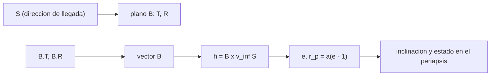

# B75-C24 — Plano B y parámetro de impacto

<!-- nav:top -->
[🏠 Programa](../../../../README.md) · [📚 Bloque B75](../../../tronco-comun/B75-trayectorias-y-misiones-interplanetarias.md) · [← Anterior: B75-C23 — Energía característica C3 y exceso hiperbólico](../B75-C23-energia-caracteristica-c3-y-exceso-hiperbolico/CLASE.md) · [Siguiente: B75-C25 — Resonancias para sobrevuelos →](../B75-C25-resonancias-para-sobrevuelos/CLASE.md)
<!-- /nav -->

## 1. Ubicación, nivel y alcance

Clase 24 del bloque B75 (programada en la `0.2.0`). Nivel N3. Para apuntar un sobrevuelo no se maneja la hipérbola entera sino el punto donde su asíntota corta un plano perpendicular a la llegada: el **plano B**. Aquí defines el vector `B`, sus componentes `B·T` y `B·R`, la relación con la distancia de periapsis y la inclinación, y compruebas con Kepler que la construcción es coherente. El sobrevuelo es sintético, de la Tierra.

## 2. Por qué esta clase existe

Los equipos de navegación expresan los errores de llegada en el plano B. La decisión central: **¿en qué punto del plano B hay que apuntar para obtener una distancia de periapsis y un plano de sobrevuelo dados, y qué pasa si el punto cae dentro del planeta?**

## 3. Lo que podrás hacer al terminar

1. Definir `S`, `T`, `R` y el vector `B = S × ĥ` con módulo `h/v∞`.
2. Calcular el periapsis `r_p` a partir de `|B|`.
3. Construir el estado en el periapsis desde `(B·T, B·R)` y `S`, y recuperar las componentes.
4. Reconocer los puntos que impactan con el planeta.
5. Relacionar la posición en el plano B con la inclinación del plano del sobrevuelo.
6. Separar lo consultado (masa, radio) de lo sintético (`v∞`, dirección, puntos).

La evidencia es tu **ficha del plano B de una hipérbola** del ejercicio 12 (sección 20).

## 4. Con qué llegas y cómo comprobarlo

1. ¿Qué es la asíntota de entrada?
2. ¿Qué es el parámetro de impacto?
3. ¿Qué es el producto vectorial?
4. ¿Qué es el momento angular `h`?
5. ¿Qué es una inclinación?

<details>
<summary>Ver respuestas</summary>

1. La recta a la que tiende la trayectoria lejos del planeta; tiene la dirección de `v∞`. 2. `B = |a|√(e²−1)` (B75-C07). 3. `a × b`, perpendicular a ambos. 4. `r × v`, perpendicular al plano de la órbita. 5. El ángulo entre `ĥ` y el eje `z`.
</details>

Con cuatro o cinco aciertos, sigue; si no, repasa los prerrequisitos.

## 5. Un caso de contexto y casos de referencia

Con `v∞ = 3,0 km/s` y la dirección `S = (0,7198; 0,6040; 0,3420)` (sintética), el punto `(B·T, B·R) = (25 000; 0) km` da `|B| = 25 000 km`, `e = 1,1483`, `r_p = 6568,8 km` (197,8 km de altitud) y un plano inclinado `20°`; `(0; 26 000)` da `r_p = 7067,7 km` y plano de `90°`; `(20 000; 10 000)` da `r_p = 5324,6 km`, dentro de la Tierra. Es el **ejemplo conductor**. Masa y radio terrestres son de la ficha [S1] y `G` del JPL [S2]; la dirección y los puntos son sintéticos.

## 6. Vocabulario

El **plano B** pasa por el centro del planeta y es perpendicular a `S`. `T̂ = S × k̂/|S × k̂|` y `R̂ = S × T̂`. El **vector B** va del centro al punto donde la asíntota corta ese plano; su módulo es `h/v∞`. Las **componentes** `B·T` y `B·R` definen el punto de apuntado. Un punto con `r_p` menor que el radio **impacta**.

## 7. Modelo mental: una diana perpendicular a la flecha



*Descripción textual:* La dirección de llegada define el plano B; el punto de apuntado define `B`; `B` y `v∞` dan el momento angular, la excentricidad, el periapsis y el plano del sobrevuelo.

Analogía: una diana perpendicular a la flecha: dónde da la flecha en la diana decide cuánto se acerca al centro. Límite: la diana es un plano; la trayectoria es una curva que se dobla por gravedad.

## 8. La explicación, paso a paso

### 8.1 Definiciones

`h = B × (v∞ S)`, `|B| = h/v∞ = |a|√(e² − 1)` con `|a| = μ/v∞² = 44 289 km` y `μ = G·M_T = 398 602,54 km³/s²`. El periapsis es `r_p = |a|(e − 1)`.

### 8.2 Cinco puntos de apuntado

Con `S` (dec. 20°, asc. 40°, sintéticos): `T̂ = (0,6428; −0,7660; 0)`, `R̂ = (0,2620; 0,2198; −0,9397)`.

| `B·T` (km) | `B·R` (km) | `|B|` (km) | `e` | `r_p` (km) | altitud (km) | inclinación (°) |
|---|---|---|---|---|---|---|
| 20 000 | 10 000 | 22 360,7 | 1,1202 | 5324,6 | −1046,4 (**impacta**) | 32,81 |
| 25 000 | 0 | 25 000,0 | 1,1483 | 6568,8 | 197,8 | 20,00 |
| 0 | 26 000 | 26 000,0 | 1,1596 | 7067,7 | 696,7 | 90,00 |
| −15 000 | −22 000 | 26 627,1 | 1,1668 | 7388,0 | 1017,0 | 121,96 |
| 30 000 | 5000 | 30 413,8 | 1,2131 | 9437,3 | 3066,3 | 22,04 |

### 8.3 Sensibilidad

De `|B|` a `r_p`: pasar de `25 000` a `26 000 km` sube `r_p` en `498,9 km`, es decir `d r_p/d|B| ≈ 0,5`, consistente con `dB/dr_p = (r_p + μ/v∞²)/B ≈ 2` de B75-C07. Un error de apuntado de 100 km en el plano B cambia el periapsis unos 50 km.

### 8.4 Verificaciones

(1) `|B|` calculado como `h/v∞` coincide con `|a|√(e² − 1)` (error `< 10⁻⁹`). (2) Construir el estado en el periapsis desde `(B·T, B·R)` y volver a extraerlas devuelve los valores de partida (error `< 10⁻⁹ km`). (3) La dirección asintótica recuperada propagando con Kepler a ±2×10⁴ y ±4×10⁴ d y extrapolando difiere de `S` en `9×10⁻¹² rad`.

## 9. Magnitudes, símbolos y unidades

| Símbolo | Qué es | Unidad | Valor / nota |
|---|---|---|---|
| `S` | dirección de la asíntota de entrada | — | (0,7198; 0,6040; 0,3420) |
| `B·T`, `B·R` | componentes en el plano B | km | 25 000; 0 |
| `|B|` | parámetro de impacto | km | 25 000 |
| `r_p` | distancia de periapsis | km | 6568,8 |
| `i` | inclinación del plano de sobrevuelo | ° | 20,00 |

## 10. Convenciones y referencias

Marco inercial genérico (eje `z` = polo de referencia); `T̂ = S × k̂`, `R̂ = S × T̂`; masa y radio medio de la ficha NASA/NSSDC; `G` del JPL; `v∞` y `S` **sintéticos**. Dos cuerpos, sin atmósfera.

## 11. De dónde sale lo que afirmamos

| ID | Fuente | Localizador | Respalda | Estado |
|---|---|---|---|---|
| S1 | NASA/NSSDC, Earth Fact Sheet — https://nssdc.gsfc.nasa.gov/planetary/factsheet/earthfact.html (consultada 2026-11-10) | página leída | semieje 149,598×10⁶ km, periodo sideral 365,256 d, excentricidad 0,0167, velocidad orbital media 29,78 km/s, masa 5,9722×10²⁴ kg, radio medio 6371,000 km, velocidad de escape 11,186 km/s | Consultada |
| S2 | NASA JPL SSD, Planetary Physical Parameters — https://ssd.jpl.nasa.gov/planets/phys_par.html (consultada 2026-11-10) | página leída | radios ecuatoriales (Venus 6051,8 km; Tierra 6378,1366 km; Marte 3396,19 km; Júpiter 71 492 km) y la constante G = 6,67430×10⁻¹¹ m³ kg⁻¹ s⁻² citada en su registro de cambios. La página no lista GM: aquí GM = G·M con las masas de las fichas NSSDC | Consultada |
| — | Valores estándar (no consultados en una fuente concreta de esta clase) | — | GM☉ = 1,32712440×10¹¹ km³/s² (valor estándar, ver la resolución IAU 2015 B3 de la fila anterior donde se cita); 1 au = 149 597 870,7 km; c = 299 792,458 km/s; g₀ = 9,80665 m/s²; ecuaciones de dos cuerpos | No consultada en una fuente concreta |

Límites: no se consultó ninguna convención de equipo (hay variantes de signo y de ejes); no se modelan correcciones de apuntado ni errores de navegación (B75-C18); el caso no corresponde a ningún sobrevuelo real.

## 12. Cómo ver el plano B

| Punto | Resultado |
|---|---|
| (25 000; 0) | 198 km de altitud, plano 20° |
| (0; 26 000) | 697 km, plano 90° |
| (20 000; 10 000) | impacta |

Descripción larga: el módulo de `B` decide cuánto se acerca la nave y su dirección en el plano decide la inclinación del plano de sobrevuelo; los puntos dentro del círculo de `|B| ≈ 24 600 km` impactan.

## 13. Ejemplo trabajado: el punto (25 000; 0)

**Paso 1 · Módulo.** `|B| = 25 000 km`.

**Paso 2 · Excentricidad.** `e = √(1 + (|B|/|a|)²) = 1,1483`.

**Paso 3 · Periapsis.** `r_p = 44 289×0,1483 = 6568,8 km`.

**Paso 4 · Altitud.** `6568,8 − 6371 = 197,8 km`.

## 14. Distintas formas de abordar el problema

**Por plano B:** dos números fijan el sobrevuelo. **Por elementos:** `r_p`, `i`, `Ω`. **Por Kepler:** la asíntota recuperada confirma `S`. **Por la geometría:** `|B| = |a|√(e²−1)`.

## 15. Práctica guiada

**Ejercicio 1 · con los pasos indicados.** Calcula `e` para `|B| = 25 000 km` y `|a| = 44 289 km`. *Pasos:* `√(1 + (B/|a|)²)`.

<details><summary>Solución comentada</summary>

`√(1 + 0,3186) = 1,1483`.
</details>

**Ejercicio 2 · con una pista.** Calcula `r_p`. *Pista:* `|a|(e − 1)`.

<details><summary>Solución comentada</summary>

`44 289×0,1483 = 6568,8 km`.
</details>

**Ejercicio 3 · casi autónomo.** ¿Impacta el punto `|B| = 22 360,7 km`? *Pista:* `r_p` de la tabla.

<details><summary>Solución comentada</summary>

Sí: `r_p = 5324,6 km < 6371 km`.
</details>

## 16. Práctica autónoma, transferencia e integrador

**Ejercicio 4 · autónomo.** Calcula el `|B|` mínimo para no impactar. *Pasos:* `|B| = √(r_p² + 2μ r_p/v∞²)` con `r_p = 6371`.

<details><summary>Solución comentada</summary>

`√(6371² + 2×398 602,54×6371/9) = 24 595 km`.
</details>

**Ejercicio 5 · autónomo.** Calcula `|B|` para `r_p = 7000 km`.

<details><summary>Solución comentada</summary>

`√(7000² + 2×398 602,54×7000/9) = 25 866 km`.
</details>

**Ejercicio 6 · autónomo.** ¿Qué punto tiene un plano de sobrevuelo polar (90°)?

<details><summary>Solución comentada</summary>

`(0; 26 000)`, a lo largo de `R̂`.
</details>

**Ejercicio 7 · autónomo.** Un error de 100 km en `|B|` a 25 000 km, ¿cuánto cambia `r_p`?

<details><summary>Solución comentada</summary>

`≈ 50 km`.
</details>

**Ejercicio 8 · autónomo.** ¿Por qué `T̂ = S × k̂` tiene `z = 0`?

<details><summary>Solución comentada</summary>

Porque es perpendicular a `k̂`.
</details>

**Ejercicio 9 · transferencia.** El error de apuntado tiene `σ = 5000 km` en el plano B. ¿Cuál es la probabilidad cualitativa de impacto en el punto (25 000; 0)?

<details><summary>Solución comentada</summary>

El punto está a `25 000 − 24 595 = 405 km` del límite de impacto, mucho menos que `σ`: la probabilidad de impacto es alta; hay que corregir (B75-C18).
</details>

**Ejercicio 10 · transferencia.** ¿Por qué se prefiere el plano B a elementos keplerianos para navegar?

<details><summary>Solución comentada</summary>

Porque sus dos componentes son casi lineales respecto a los errores de la llegada y separan magnitud (periapsis) y dirección (plano).
</details>

**Ejercicio 11 · transferencia.** Otra convención cambia el signo de `R̂`. ¿Qué cambia?

<details><summary>Solución comentada</summary>

El signo de `B·R`; el módulo `|B|` y `r_p` no cambian; hay que declarar la convención.
</details>

**Ejercicio 12 · integrador.** Elabora tu *ficha del plano B de una hipérbola*: `S`, `T̂`, `R̂`, cinco puntos de apuntado, `r_p`, inclinación, impacto o no, y las verificaciones.

<details><summary>Solución comentada</summary>

Secciones 8.1–8.4 y la salida del laboratorio.
</details>

## 17. Laboratorio: plano B de un sobrevuelo terrestre

El script [plano_b.py](plano_b.py) construye el estado en el periapsis desde cinco puntos del plano B y **comprueba** `|B|` por dos fórmulas, la recuperación de `(B·T, B·R)` y la dirección asintótica con Kepler.

**Datos:** masa y radio de la ficha NASA/NSSDC y `G` del JPL (consultados); `v∞`, `S` y los puntos **sintéticos**. **Predice antes de ejecutar:** ¿Impacta el punto (20 000; 10 000)? (Sí, 1046 km por debajo de la superficie.) **Ejecución del 2026-11-10 (Python 3.12.9):**

```text
Python 3.12.9 (biblioteca estandar)
GM_Tierra = 398602.54 km3/s2 ; v_inf = 3.0 km/s (SINTETICO) ; S = (0.7198, 0.6040, 0.3420)
T = (0.6428, -0.7660, 0.0000) ; R = (0.2620, 0.2198, -0.9397)
 B.T [km]  B.R [km]   |B| [km]     e        r_p [km]  altitud [km]   i del plano [grados]   B.T,B.R recuperados [km]
    20000     10000    22360.7   1.1202      5324.6      -1046.4                32.81   (20000.000, 10000.000)  IMPACTA con la superficie
    25000         0    25000.0   1.1483      6568.8        197.8                20.00   (25000.000, -0.000)
        0     26000    26000.0   1.1596      7067.7        696.7                90.00   (0.000, 26000.000)
   -15000    -22000    26627.1   1.1668      7388.0       1017.0               121.96   (-15000.000, -22000.000)
    30000      5000    30413.8   1.2131      9437.3       3066.3                22.04   (30000.000, 5000.000)
Prueba 3: distancia entre la direccion asintotica recuperada por Kepler y S de partida = 9.21e-12 rad
Pruebas superadas.
```

```bash
python programa/clases/B75/B75-C24-plano-b-y-parametro-de-impacto/plano_b.py
```

**Límites:** dos cuerpos, sin atmósfera; las convenciones de ejes son las del laboratorio.

## 18. Errores frecuentes y cómo corregirlos

**Confundir `B` con `r_p`.** Se corrige con 8.3.

**No declarar la convención de ejes.** Se corrige con la sección 10.

**Olvidar comprobar el impacto.** Se corrige con el ejercicio 3.

**Presentar el sobrevuelo sintético como real.** Se corrige con la sección 10.

## 19. Cómo sabrás que vas bien

Tras 8.2: ¿qué punto prefieres si quieres un plano polar? Tras el laboratorio: ¿qué tres cosas verifica? (ver la sección 17).

## 20. Qué entregas y cómo se evalúa

El producto es tu **ficha del plano B de una hipérbola** (ejercicio 12).

| Criterio | Inicial | En desarrollo | Logrado | Destacado |
|---|---|---|---|---|
| Conceptos | Confunde `B` y `r_p` | Define `T`, `R`, `B` | Calcula los cinco puntos | Explica la sensibilidad |
| Cálculo | Sin unidades | Con errores | Tabla completa | Calcula casos nuevos |
| Numérico | Sin comprobar | Una prueba | Tres pruebas | Interpreta tolerancias |
| Fuentes | Sin fuente | Sin fecha | Fuentes con fecha y estado | Declara la convención |
| Límites | No los nombra | Uno | Tres | Discute otras convenciones |

**Condiciones críticas (no se compensan con promedio):** rotular `S`, `v∞` y los puntos como sintéticos; declarar la convención; no presentar el caso como un sobrevuelo real; citar solo lo consultado.

## 21. Ética, seguridad y límites

Clase educativa: los modelos son simplificados (órbitas planetarias circulares y coplanares, dos cuerpos) y sus datos son consultados, sintéticos o ilustrativos y están rotulados; ningún resultado es una efeméride, una medición ni un diseño de misión real. Un impacto no intencionado con un planeta tiene implicaciones de protección planetaria; esta clase solo enseña la geometría. Accesibilidad: tablas equivalentes a las gráficas, fórmulas en texto, ejercicios sin conexión.

## 22. Para cerrar y seguir

El punto `(25 000; 0)` del plano B da un periapsis de `197,8 km` y un plano de `20°`, y `|B| < 24 595 km` impacta. Queda una pregunta: ¿cómo se encadenan retornos al mismo planeta?

**Glosario español–inglés.** plano B · *B-plane*; parámetro de impacto · *impact parameter*; asíntota · *asymptote*; apuntado · *targeting*; protección planetaria · *planetary protection*.

**Continuidad.** [B75-C25](../B75-C25-resonancias-para-sobrevuelos/CLASE.md) estudia los retornos resonantes al mismo planeta.

**Referencias:** ver sección 11.

<!-- nav:bottom -->
---

[← Anterior: B75-C23 — Energía característica C3 y exceso hiperbólico](../B75-C23-energia-caracteristica-c3-y-exceso-hiperbolico/CLASE.md) · [📚 Bloque B75](../../../tronco-comun/B75-trayectorias-y-misiones-interplanetarias.md) · [Siguiente: B75-C25 — Resonancias para sobrevuelos →](../B75-C25-resonancias-para-sobrevuelos/CLASE.md)
<!-- /nav -->
