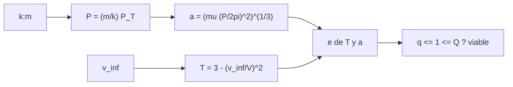

# B75-C25 — Resonancias para sobrevuelos

<!-- nav:top -->
[🏠 Programa](../../../../README.md) · [📚 Bloque B75](../../../tronco-comun/B75-trayectorias-y-misiones-interplanetarias.md) · [← Anterior: B75-C24 — Plano B y parámetro de impacto](../B75-C24-plano-b-y-parametro-de-impacto/CLASE.md) · [Siguiente: B75-C26 — Sobrevuelos de lunas y tours de sistemas planetarios →](../B75-C26-sobrevuelos-de-lunas-y-tours-de-sistemas-planetarios/CLASE.md)
<!-- /nav -->

## 1. Ubicación, nivel y alcance

Clase 25 del bloque B75 (programada en la `0.2.0`). Nivel N3. Un sobrevuelo puede dejar a la nave en una órbita cuyo periodo sea un múltiplo racional del año terrestre, de modo que vuelve a encontrar la Tierra. Estos retornos resonantes permiten encadenar sobrevuelos del mismo planeta. Aquí calculas el semieje, la excentricidad y la viabilidad de cada resonancia `k:m` para un `v∞` dado y el `v∞` mínimo que cada una exige.

## 2. Por qué esta clase existe

Para volver a un planeta hay que llegar a la misma posición un número entero de años después. La decisión central: **¿qué resonancias `k:m` son alcanzables con un `v∞` dado y cuánto `v∞` hace falta para las demás?**

## 3. Lo que podrás hacer al terminar

1. Calcular el semieje de una resonancia `k:m` con `P = (m/k) P_T`.
2. Calcular la excentricidad de la órbita que cruza la de la Tierra con un `v∞` dado (Tisserand).
3. Decidir si la órbita cruza la de la Tierra (`q ≤ 1 ≤ Q`).
4. Calcular el `v∞` mínimo que exige cada resonancia.
5. Verificar que, tras `m` años, la nave vuelve a su posición.
6. Separar lo consultado (periodo y semieje terrestres) de lo ilustrativo (el `v∞` de 3 km/s).

La evidencia es tu **tabla de resonancias de retorno** del ejercicio 12 (sección 20).

## 4. Con qué llegas y cómo comprobarlo

1. ¿Qué es una resonancia `k:m`?
2. ¿Qué dice la tercera ley?
3. ¿Qué es el parámetro de Tisserand?
4. ¿Qué es `q` y `Q`?
5. ¿Qué es un retorno?

<details>
<summary>Ver respuestas</summary>

1. La nave da `k` vueltas al Sol mientras la Tierra da `m`. 2. `P² ∝ a³`; `a = (μ(P/2π)²)^{1/3}`. 3. `T = a_p/a + 2√((a/a_p)(1 − e²))` (B75-C08). 4. Perihelio y afelio. 5. Un nuevo encuentro con el mismo planeta.
</details>

Con cuatro o cinco aciertos, sigue; si no, repasa los prerrequisitos.

## 5. Un caso de contexto y casos de referencia

Con `v∞ = 3,0 km/s` en la Tierra (ilustrativo), la resonancia `3:4` (3 vueltas de la nave en 4 años) tiene `a = 1,2114 au`, `e = 0,1824`, `q = 0,9905` y `Q = 1,4323 au`: cruza la órbita terrestre y es viable; la `1:2` tiene `q = 1,0309 au` y no la alcanza. Es el **ejemplo conductor**. El periodo y el semieje terrestres son de la ficha de la NASA [S1]. La ficha de la ESA indica que Juice usa asistencias de la Luna–Tierra, Venus y la Tierra [S2]; si usa retornos resonantes no se consultó.

## 6. Vocabulario

Una **resonancia `k:m`** hace que el periodo de la nave sea `(m/k)` años. El **retorno** ocurre cuando la nave y la Tierra coinciden de nuevo. La **viabilidad** exige que la órbita cruce la de la Tierra. El **`v∞` mínimo** es el que hace la órbita tangente a la terrestre.

## 7. Modelo mental: un reloj de arena con engranajes



*Descripción textual:* La resonancia fija el periodo y el semieje; el `v∞` fija `T` y con ello la excentricidad; si la órbita cruza la terrestre, la resonancia es viable.

Analogía: dos engranajes que vuelven a coincidir cada cierto número de vueltas. Límite: los engranajes aquí son órbitas circulares y coplanares; la Tierra real es excéntrica.

## 8. La explicación, paso a paso

### 8.1 De la resonancia al semieje

`a = (μ(m P_T/(2π k))²)^{1/3}`. Con `P_T = 365,256 d` y `μ☉` estándar sale `a_T = 149,5976×10⁶ km` (la ficha da `149,598×10⁶ km`, diferencia `< 10⁻³ %`) y `V_T = 29,7847 km/s`.

### 8.2 Excentricidad por Tisserand

`T = 3 − (v∞/V_T)² = 2,98985` para `v∞ = 3 km/s`. Con `x = a/a_T`: `1 − e² = ((T − 1/x)/2)²/x`.

| `k:m` | `P` (años) | `a` (au) | `e` | `q` (au) | `Q` (au) | ¿viable? | `v∞` mínimo (km/s) |
|---|---|---|---|---|---|---|---|
| 1:1 | 1,000 | 1,0000 | 0,1006 | 0,8994 | 1,1006 | sí | 0,0000 |
| 1:2 | 2,000 | 1,5874 | 0,3506 | 1,0309 | 2,1439 | no | 5,0779 |
| 2:3 | 1,500 | 1,3104 | 0,2325 | 1,0058 | 1,6150 | no | 3,3401 |
| 3:2 | 0,667 | 0,7631 | 0,2756 | 0,5528 | 0,9735 | no | 5,0503 |
| 1:3 | 3,000 | 2,0801 | 0,4933 | 1,0540 | 3,1062 | no | 6,9273 |
| 2:1 | 0,500 | 0,6300 | 0,4684 | 0,3349 | 0,9251 | no | 10,6528 |
| 3:4 | 1,333 | 1,2114 | 0,1824 | 0,9905 | 1,4323 | sí | 2,4945 |
| 4:3 | 0,750 | 0,8255 | 0,2052 | 0,6561 | 0,9949 | no | 3,3352 |
| 1:4 | 4,000 | 2,5198 | 0,5770 | 1,0659 | 3,9738 | no | 7,9274 |

### 8.3 Lectura

Con 3 km/s solo las resonancias casi 1:1 (`1:1` y `3:4`) alcanzan a cruzar la Tierra. Para volver tras 2 años en una órbita exterior (`1:2`) hace falta `5,08 km/s`; para `2:1`, interior, `10,65 km/s`. Un sobrevuelo gira `v∞` pero no lo cambia (B75-C06): el `v∞` de la tabla es el que la nave ya tiene.

### 8.4 Verificaciones

Para las resonancias viables, tras `m` años la nave propagada con Kepler vuelve a su posición con error relativo menor que `10⁻⁶`. El `v∞` mínimo por Tisserand coincide con `|v_tangencial − V_T|` con error menor que `10⁻⁹ km/s`.

## 9. Magnitudes, símbolos y unidades

| Símbolo | Qué es | Unidad | Valor / nota |
|---|---|---|---|
| `k:m` | resonancia (vueltas de la nave : años) | — | 3:4 |
| `a` | semieje | au | 1,2114 |
| `e` | excentricidad | — | 0,1824 |
| `v∞,min` | exceso mínimo para cruzar la Tierra | km/s | 2,4945 |
| `T` | parámetro de Tisserand | — | 2,98985 |

## 10. Convenciones y referencias

Planeta en órbita circular con periodo de la ficha NASA/NSSDC; `μ☉` estándar; `v∞` de 3 km/s **ilustrativo**; coplanar; `au = a_T` de la tabla.

## 11. De dónde sale lo que afirmamos

| ID | Fuente | Localizador | Respalda | Estado |
|---|---|---|---|---|
| S1 | NASA/NSSDC, Earth Fact Sheet — https://nssdc.gsfc.nasa.gov/planetary/factsheet/earthfact.html (consultada 2026-11-10) | página leída | semieje 149,598×10⁶ km, periodo sideral 365,256 d, excentricidad 0,0167, velocidad orbital media 29,78 km/s, masa 5,9722×10²⁴ kg, radio medio 6371,000 km, velocidad de escape 11,186 km/s | Consultada |
| S2 | ESA, Juice factsheet — https://www.esa.int/Science_Exploration/Space_Science/Juice/Juice_factsheet (consultada 2026-11-10) | página leída | lanzamiento el 14 de abril de 2023 en Ariane 5 desde Kourou; asistencias de la Luna–Tierra, Venus y la Tierra; llegada a Júpiter en julio de 2031; tour que termina en órbita de Ganimedes | Consultada |
| — | Valores estándar (no consultados en una fuente concreta de esta clase) | — | GM☉ = 1,32712440×10¹¹ km³/s² (valor estándar, ver la resolución IAU 2015 B3 de la fila anterior donde se cita); 1 au = 149 597 870,7 km; c = 299 792,458 km/s; g₀ = 9,80665 m/s²; ecuaciones de dos cuerpos | No consultada en una fuente concreta |

Límites: no se consultó ninguna secuencia de retornos de una misión real; el modelo ignora la excentricidad de la Tierra y las perturbaciones; el sobrevuelo solo gira `v∞`, no lo cambia.

## 12. Cómo ver las resonancias

| `k:m` | `a` (au) | ¿viable con 3 km/s? |
|---|---|---|
| 1:1 | 1,0000 | sí |
| 3:4 | 1,2114 | sí |
| 2:3 | 1,3104 | no |
| 1:2 | 1,5874 | no |

Descripción larga: cuanto mayor el periodo, mayor `v∞` hace falta para que la órbita llegue a cruzar la terrestre.

## 13. Ejemplo trabajado: la resonancia 3:4

**Paso 1 · Periodo.** `P = (4/3)×365,256 d = 1,333 años`.

**Paso 2 · Semieje.** `a = 1,2114 au`.

**Paso 3 · T y e.** `T = 2,98985`; `1 − e² = ((2,98985 − 0,8255)/2)²/1,2114 = 0,9667`; `e = 0,1824`.

**Paso 4 · Viabilidad.** `q = 0,9905 ≤ 1 ≤ Q = 1,4323`: sí.

## 14. Distintas formas de abordar el problema

**Por Tisserand:** excentricidad desde `v∞`. **Por tangencia:** `v∞` mínimo. **Por Kepler:** propagación de `m` años. **Por tabla:** viabilidad con el `v∞` disponible.

## 15. Práctica guiada

**Ejercicio 1 · con los pasos indicados.** Calcula el semieje de la resonancia `3:4`. *Pasos:* `(4/3)^{2/3}` en unidades de `a_T`.

<details><summary>Solución comentada</summary>

`1,3333^{0,6667} = 1,2114 au`.
</details>

**Ejercicio 2 · con una pista.** Calcula `T` para `v∞ = 3 km/s`. *Pista:* `V_T = 29,7847 km/s`.

<details><summary>Solución comentada</summary>

`2,98985`.
</details>

**Ejercicio 3 · casi autónomo.** ¿Es viable la `1:2` con 3 km/s? *Pista:* mira `q`.

<details><summary>Solución comentada</summary>

No: `q = 1,0309 au > 1`.
</details>

## 16. Práctica autónoma, transferencia e integrador

**Ejercicio 4 · autónomo.** ¿Qué `v∞` mínimo exige la `2:3`?

<details><summary>Solución comentada</summary>

`3,3401 km/s`.
</details>

**Ejercicio 5 · autónomo.** Compara el `v∞` mínimo de `1:2` y `1:3`.

<details><summary>Solución comentada</summary>

`5,0779` y `6,9273 km/s`: crece con el periodo.
</details>

**Ejercicio 6 · autónomo.** Calcula el periodo de la `3:2` en días.

<details><summary>Solución comentada</summary>

`(2/3)×365,256 = 243,5 d`.
</details>

**Ejercicio 7 · autónomo.** ¿Por qué la `2:1` exige tanto `v∞`?

<details><summary>Solución comentada</summary>

Porque su semieje `0,63 au` queda muy lejos de la órbita terrestre y el afelio debe llegar a `1 au`.
</details>

**Ejercicio 8 · autónomo.** Calcula `Q − q` de la `3:4` en au.

<details><summary>Solución comentada</summary>

`1,4323 − 0,9905 = 0,4418 au`.
</details>

**Ejercicio 9 · transferencia.** Una misión llega con `v∞ = 5 km/s` y quiere volver en 2 años. ¿Es posible?

<details><summary>Solución comentada</summary>

Sí: el mínimo de la `1:2` es `5,0779 km/s`; con 5 km/s falta un poco (hay que subir `v∞` o usar otro retorno).
</details>

**Ejercicio 10 · transferencia.** ¿Qué falta para convertir la resonancia en un retorno real?

<details><summary>Solución comentada</summary>

Que la nave llegue a la misma posición orbital que la Tierra (fase), lo que exige el plano B (C24) y las perturbaciones.
</details>

**Ejercicio 11 · transferencia.** ¿Puede un sobrevuelo cambiar de `3:4` a `1:2`?

<details><summary>Solución comentada</summary>

Solo si cambia `v∞`; un sobrevuelo conserva `v∞` en el marco del planeta (C06), pero cambia la energía heliocéntrica y por tanto `a`, dentro del mismo `T` (C08).
</details>

**Ejercicio 12 · integrador.** Elabora tu *tabla de resonancias de retorno* para tu `v∞` y al menos seis resonancias, con viabilidad, `v∞` mínimo y la prueba de retorno.

<details><summary>Solución comentada</summary>

Secciones 8.2–8.4 y la salida del laboratorio.
</details>

## 17. Laboratorio: resonancias de retorno a la Tierra

El script [resonancias.py](resonancias.py) calcula nueve resonancias para `v∞ = 3 km/s` y **comprueba** el retorno por Kepler, el `v∞` en el cruce y el `v∞` mínimo por tangencia.

**Datos:** periodo y semieje terrestres de la ficha NASA/NSSDC (consultados); `v∞` **ilustrativo**; `μ☉` estándar. **Predice antes de ejecutar:** ¿Cuántas resonancias son viables con 3 km/s? (dos: 1:1 y 3:4.) **Ejecución del 2026-11-10 (Python 3.12.9):**

```text
Python 3.12.9 (biblioteca estandar)
a de la Tierra con mu estandar y P = 365.256 d: 149.5976e6 km (ficha: 149.598e6 km, dif. -0.000 %) ; V_T = 29.7847 km/s
v_inf = 3.0 km/s (ILUSTRATIVO) ; T de Tisserand = 2.98985
 k:m (revs nave : anios)  P [anios]  a [au]    e       q [au]   Q [au]   viable   v_inf minimo para que q = 1 [km/s]
   1:1                    1.000   1.0000   0.1006   0.8994   1.1006   si        0.0000
   1:2                    2.000   1.5874   0.3506   1.0309   2.1439   no        5.0779
   2:3                    1.500   1.3104   0.2325   1.0058   1.6150   no        3.3401
   3:2                    0.667   0.7631   0.2756   0.5528   0.9735   no        5.0503
   1:3                    3.000   2.0801   0.4933   1.0540   3.1062   no        6.9273
   2:1                    0.500   0.6300   0.4684   0.3349   0.9251   no       10.6528
   3:4                    1.333   1.2114   0.1824   0.9905   1.4323   si        2.4945
   4:3                    0.750   0.8255   0.2052   0.6561   0.9949   no        3.3352
   1:4                    4.000   2.5198   0.5770   1.0659   3.9738   no        7.9274
Prueba 1: para las resonancias viables, tras m anios terrestres la nave regresa a su posicion inicial (error relativo < 1e-6).
Pruebas superadas.
```

```bash
python programa/clases/B75/B75-C25-resonancias-para-sobrevuelos/resonancias.py
```

**Límites:** coplanar, planeta circular, sin perturbaciones.

## 18. Errores frecuentes y cómo corregirlos

**Confundir `k` con `m`.** Se corrige con la sección 6.

**Suponer que la resonancia siempre cruza la Tierra.** Se corrige con 8.2.

**Olvidar que el sobrevuelo conserva `v∞`.** Se corrige con 8.3.

**Presentar el `v∞` ilustrativo como real.** Se corrige con la sección 10.

## 19. Cómo sabrás que vas bien

Tras 8.2: ¿qué resonancias cruzan la Tierra con 3 km/s? Tras el laboratorio: ¿qué verifica la prueba de retorno? (ver la sección 17).

## 20. Qué entregas y cómo se evalúa

El producto es tu **tabla de resonancias de retorno** (ejercicio 12).

| Criterio | Inicial | En desarrollo | Logrado | Destacado |
|---|---|---|---|---|
| Conceptos | Confunde `k:m` | Define resonancia y viabilidad | Calcula la tabla | Explica el `v∞` mínimo |
| Cálculo | Sin unidades | Con errores | Tabla completa | Calcula casos nuevos |
| Numérico | Sin comprobar | Una prueba | Dos pruebas | Interpreta tolerancias |
| Fuentes | Sin fuente | Sin fecha | Fuentes con fecha y estado | Declara lo no consultado |
| Límites | No los nombra | Uno | Tres | Discute la excentricidad terrestre |

**Condiciones críticas (no se compensan con promedio):** rotular el `v∞` como ilustrativo; no presentar la tabla como una secuencia real; citar solo lo consultado.

## 21. Ética, seguridad y límites

Clase educativa: los modelos son simplificados (órbitas planetarias circulares y coplanares, dos cuerpos) y sus datos son consultados, sintéticos o ilustrativos y están rotulados; ningún resultado es una efeméride, una medición ni un diseño de misión real. Un retorno resonante exige análisis de riesgo de impacto y de protección planetaria. Accesibilidad: tablas equivalentes a las gráficas, fórmulas en texto, ejercicios sin conexión.

## 22. Para cerrar y seguir

Con `v∞ = 3 km/s`, la resonancia `3:4` es viable (`a = 1,2114 au`, `e = 0,1824`) y la `1:2` exige `5,08 km/s`. Queda una pregunta: ¿cómo se hace lo mismo en un sistema de lunas?

**Glosario español–inglés.** resonancia · *resonance*; retorno · *return*; viabilidad · *feasibility*; semieje · *semi-major axis*; periodo · *period*.

**Continuidad.** [B75-C26](../B75-C26-sobrevuelos-de-lunas-y-tours-de-sistemas-planetarios/CLASE.md) aplica la idea a los tours de lunas.

**Referencias:** ver sección 11.

<!-- nav:bottom -->
---

[← Anterior: B75-C24 — Plano B y parámetro de impacto](../B75-C24-plano-b-y-parametro-de-impacto/CLASE.md) · [📚 Bloque B75](../../../tronco-comun/B75-trayectorias-y-misiones-interplanetarias.md) · [Siguiente: B75-C26 — Sobrevuelos de lunas y tours de sistemas planetarios →](../B75-C26-sobrevuelos-de-lunas-y-tours-de-sistemas-planetarios/CLASE.md)
<!-- /nav -->
