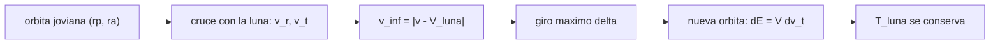

# B75-C26 — Sobrevuelos de lunas y tours de sistemas planetarios

<!-- nav:top -->
[🏠 Programa](../../../../README.md) · [📚 Bloque B75](../../../tronco-comun/B75-trayectorias-y-misiones-interplanetarias.md) · [← Anterior: B75-C25 — Resonancias para sobrevuelos](../B75-C25-resonancias-para-sobrevuelos/CLASE.md) · [Siguiente: B75-C27 — Duración de misión y tiempo de vuelo como restricción →](../B75-C27-duracion-de-mision-y-tiempo-de-vuelo-como-restriccion/CLASE.md)
<!-- /nav -->

## 1. Ubicación, nivel y alcance

Clase 26 del bloque B75 (programada en la `0.2.0`). Nivel N3. La clase B75-C20 trata una misión a una luna como caso de diseño; esta clase estudia la técnica: un tour por un sistema de lunas encadena sobrevuelos de lunas distintas para cambiar la órbita joviana casi sin propulsante. Aplicas el criterio de Tisserand (B75-C08) a las lunas galileanas, ves un paso del tour (un sobrevuelo de Ganimedes) y compruebas que el parámetro se conserva en 100 sobrevuelos aleatorios.

## 2. Por qué esta clase existe

Cada luna es un peldaño de energía en torno a Júpiter. La decisión central: **¿qué órbitas jovianas puede alcanzar una nave con un sobrevuelo de Ganimedes de `v∞` dado y cuánto cambia la energía en un solo paso?**

## 3. Lo que podrás hacer al terminar

1. Calcular `T_G` respecto a Ganimedes y la familia de órbitas con igual `T_G`.
2. Calcular el `v∞` en otra luna (Europa) para esas órbitas.
3. Calcular el giro máximo y el cambio de energía de un sobrevuelo de Ganimedes.
4. Comprobar la identidad `ΔE = V_G Δv_t` y la conservación de `T_G`.
5. Interpretar el cambio del periodo y del periapsis tras un paso.
6. Separar lo consultado de lo sintético (la órbita inicial, los `v∞` de la familia).

La evidencia es tu **esbozo de tour por Tisserand** del ejercicio 12 (sección 20).

## 4. Con qué llegas y cómo comprobarlo

1. ¿Qué conserva un sobrevuelo?
2. ¿Qué es el parámetro de Tisserand?
3. ¿Qué es la velocidad orbital de Ganimedes?
4. ¿Qué es el giro máximo?
5. ¿Qué es un tour?

<details>
<summary>Ver respuestas</summary>

1. El módulo de `v∞` en el marco de la luna (B75-C06). 2. `T = a_m/a + 2√((a/a_m)(1 − e²))` respecto a una luna de semieje `a_m`. 3. `√(GM_J/a_G) = 10,8791 km/s` (B75-C16). 4. `2 arcsin(1/e)` para el periapsis más bajo permitido. 5. Una secuencia de sobrevuelos.
</details>

Con cuatro o cinco aciertos, sigue; si no, repasa los prerrequisitos.

## 5. Un caso de contexto y casos de referencia

Una nave sintética en una elipse joviana de `8,39 × 41,96 R_J` (periodo `15,60 d`) llega a Ganimedes con `v∞ = 7,4759 km/s`. Un sobrevuelo a `100 km` de altitud gira `6,98°` como máximo y cambia la energía en `+9,895 km²/s²` (periodo `25,60 d`, periapsis `9,561 R_J`) o `−9,836 km²/s²` (periodo `10,78 d`), con `T_G = 2,527778` en ambos casos. Es el **ejemplo conductor**. `GM`, radios y semiejes son de las tablas del JPL [S1, S2]; la órbita inicial es sintética. Las páginas de la NASA sobre Europa Clipper (49 sobrevuelos de Europa [S5]) y de la ESA sobre Juice (tour que termina en Ganimedes [S6]) muestran que estos tours existen; sus secuencias no se consultaron.

## 6. Vocabulario

Un **tour** es una secuencia de sobrevuelos de lunas. El **Tisserand** respecto a una luna se conserva en cada sobrevuelo de esa luna. La **identidad de la energía** `Δε = V_m Δv_t` relaciona el cambio de energía con el de la componente tangencial. El **giro máximo** lo fija el periapsis mínimo. El **delta-v apalancado** es el cambio de órbita que se logra con casi nada de propulsante.

## 7. Modelo mental: una escalera mecánica de lunas



*Descripción textual:* La órbita determina la velocidad en el cruce con la luna; la diferencia con la velocidad de la luna da `v∞`; el giro máximo fija la nueva velocidad y con ella la nueva órbita, con `T` constante.

Analogía: subir una escalera mecánica de peldaños variables: cada luna te sube o te baja un tramo. Límite: los peldaños aparecen solo cuando la luna está en el lugar del cruce (fase), que aquí no se modela.

## 8. La explicación, paso a paso

### 8.1 Familia de Tisserand respecto a Ganimedes

Con `V_G = 10,8791 km/s` y `T_G = 3 − (v∞/V_G)²`, las órbitas con apoapsis `r_a` tienen un periapsis `q` fijo por `T_G`:

| `v∞,G` (km/s) | `T_G` | `r_a` (`R_J`) | `q` (`R_J`) | periodo (d) | `v∞` en Europa (km/s) |
|---|---|---|---|---|---|
| 1,0 | 2,99155 | 15,0 | 10,628 | 5,67 | — |
| 2,0 | 2,96620 | 15,0 | 7,562 | 4,68 | 4,3002 |
| 3,0 | 2,92396 | 15,0 | 5,383 | 4,02 | 6,7529 |
| 3,0 | 2,92396 | 25,0 | 12,947 | 10,21 | — |
| 4,0 | 2,86481 | 15,0 | 3,784 | 3,55 | 8,6436 |
| 4,0 | 2,86481 | 40,0 | 13,184 | 16,94 | — |

Solo las órbitas con periapsis menor que el semieje de Europa (`9,39 R_J`) cruzan su órbita; las demás no. Con `v∞,G` pequeño no se llega a Europa: para rebajar el `v∞` en Europa hay que bajar el periapsis.

### 8.2 Un paso del tour

Orbita inicial: periapsis `8,39 R_J`, apoapsis `41,96 R_J`, periodo `15,60 d`; `v∞,G = 7,4759 km/s`; `r_p` del sobrevuelo `2731,2 km`; `e = 1 + r_p v∞²/GM_G = 16,44`; giro máximo `6,98°`.

| Giro | `r_p` nuevo (`R_J`) | `r_a` nuevo (`R_J`) | periodo (d) | `ΔE` (km²/s²) | `T_G` |
|---|---|---|---|---|---|
| +6,98° | 9,561 | 60,492 | 25,60 | +9,895 | 2,527778 |
| −6,98° | 7,137 | 32,218 | 10,78 | −9,836 | 2,527778 |

Un solo sobrevuelo cambia el periodo entre 10,78 y 25,60 d: con `0` propulsante.

### 8.3 Verificaciones

(1) En 100 sobrevuelos de giro aleatorio (semilla 26), `T_G` varía como máximo `1,8×10⁻¹⁴`. (2) `ΔE = V_G Δv_t` con error menor que `10⁻⁹`. (3) El `v∞` calculado en el cruce con Ganimedes para la familia de Tisserand coincide con el pedido con error menor que `10⁻⁶ km/s`.

### 8.4 Lectura

El tour real sube y baja la energía con sobrevuelos de Ganimedes, Calisto y Europa. Aquí un paso cambia el apoapsis de 41,96 a 60,49 o 32,22 `R_J`; para ir al sistema interno hay que bajar el periapsis con pasos sucesivos, a costa de tiempo (C27).

## 9. Magnitudes, símbolos y unidades

| Símbolo | Qué es | Unidad | Valor / nota |
|---|---|---|---|
| `T_G` | Tisserand respecto a Ganimedes | — | 2,527778 |
| `v∞,G` | exceso en Ganimedes | km/s | 7,4759 (órbita sintética) |
| `δ_max` | giro máximo | ° | 6,98 |
| `ΔE` | cambio de energía por paso | km²/s² | +9,895 / −9,836 |
| `V_G` | velocidad orbital de Ganimedes | km/s | 10,8791 |

## 10. Convenciones y referencias

Marco joviano plano; lunas circulares y coplanares con elementos medios del JPL (época 2000-01-01.5 TDB); `GM_J = G·M_J` con `G` del registro del JPL; órbita inicial, `v∞` de la familia y altitud de sobrevuelo (100 km) **sintéticos**; sobrevuelo instantáneo.

## 11. De dónde sale lo que afirmamos

| ID | Fuente | Localizador | Respalda | Estado |
|---|---|---|---|---|
| S1 | NASA JPL SSD, Planetary Satellite Physical Parameters — https://ssd.jpl.nasa.gov/sats/phys_par/ (consultada 2026-11-10) | página leída | GM (km³/s²) y radio medio (km): Ío 5959,91547 y 1821,49; Europa 3202,71210 y 1560,80; Ganimedes 9887,83275 y 2631,20; Calisto 7179,28340 y 2410,30; Titán 8978,13710 y 2574,76; Encélado 7,21037 y 252,10 | Consultada |
| S2 | NASA JPL SSD, Planetary Satellite Mean Elements — https://ssd.jpl.nasa.gov/sats/elem/ (consultada 2026-11-10) | página leída | semiejes (km) y periodos siderales (d), época 2000-01-01,5 TDB: Ío 421 800 y 1,762732; Europa 671 100 y 3,525463; Ganimedes 1 070 400 y 7,155588; Calisto 1 882 700 y 16,690440; Titán 1 221 900 y 15,945448; Encélado 238 400 y 1,370218 (elementos medios, no para efemérides) | Consultada |
| S3 | NASA/NSSDC, Jupiter Fact Sheet — https://nssdc.gsfc.nasa.gov/planetary/factsheet/jupiterfact.html (consultada 2026-11-10) | página leída | semieje 778,479×10⁶ km, periodo sideral 4332,589 d, excentricidad 0,0487, inclinación 1,304°, velocidad media 13,06 km/s, masa 1898,13×10²⁴ kg, radio medio 69 911 km | Consultada |
| S4 | NASA JPL SSD, Planetary Physical Parameters — https://ssd.jpl.nasa.gov/planets/phys_par.html (consultada 2026-11-10) | página leída | radios ecuatoriales (Venus 6051,8 km; Tierra 6378,1366 km; Marte 3396,19 km; Júpiter 71 492 km) y la constante G = 6,67430×10⁻¹¹ m³ kg⁻¹ s⁻² citada en su registro de cambios. La página no lista GM: aquí GM = G·M con las masas de las fichas NSSDC | Consultada |
| S5 | NASA, Europa Clipper (página de la misión) — https://science.nasa.gov/mission/europa-clipper/ (consultada 2026-11-10) | página leída | lanzamiento el 14 de octubre de 2024 en Falcon Heavy; sobrevuelo de Marte en 2025 y de la Tierra el 3 de diciembre de 2026; llegada a Júpiter en abril de 2030; 49 sobrevuelos cercanos de Europa; unos 2,9 mil millones de km hasta Júpiter | Consultada |
| S6 | ESA, Juice factsheet — https://www.esa.int/Science_Exploration/Space_Science/Juice/Juice_factsheet (consultada 2026-11-10) | página leída | lanzamiento el 14 de abril de 2023 en Ariane 5 desde Kourou; asistencias de la Luna–Tierra, Venus y la Tierra; llegada a Júpiter en julio de 2031; tour que termina en órbita de Ganimedes | Consultada |
| — | Valores estándar (no consultados en una fuente concreta de esta clase) | — | GM☉ = 1,32712440×10¹¹ km³/s² (valor estándar, ver la resolución IAU 2015 B3 de la fila anterior donde se cita); 1 au = 149 597 870,7 km; c = 299 792,458 km/s; g₀ = 9,80665 m/s²; ecuaciones de dos cuerpos | No consultada en una fuente concreta |

Límites: los elementos medios no son para efemérides; no se modela la fase de las lunas, las resonancias ni la radiación; no se consultaron secuencias de tours reales.

## 12. Cómo ver un paso del tour

| Giro | Periodo nuevo (d) | `ΔE` (km²/s²) |
|---|---|---|
| inicial | 15,60 | — |
| +6,98° | 25,60 | +9,895 |
| −6,98° | 10,78 | −9,836 |

Descripción larga: un sobrevuelo de Ganimedes a 100 km cambia el periodo de la órbita joviana en un factor de 1,6 hacia arriba o de 0,7 hacia abajo.

## 13. Ejemplo trabajado: el giro máximo

**Paso 1 · v∞.** `7,4759 km/s` desde el cruce.

**Paso 2 · Excentricidad.** `e = 1 + 2731,2×7,4759²/9887,83 = 16,44`.

**Paso 3 · Giro.** `δ = 2 arcsin(1/16,44) = 6,98°`.

**Paso 4 · Energía.** `ΔE = V_G Δv_t = 9,895 km²/s²` (giro positivo).

## 14. Distintas formas de abordar el problema

**Por Tisserand:** las órbitas alcanzables. **Por vectores:** el sobrevuelo explícito. **Por la identidad `ΔE = V Δv_t`:** verificación rápida. **Por múltiples pasos:** simular 100 giros aleatorios.

## 15. Práctica guiada

**Ejercicio 1 · con los pasos indicados.** Calcula `T_G` para `v∞ = 3 km/s`. *Pasos:* `3 − (3/10,8791)²`.

<details><summary>Solución comentada</summary>

`2,92396`.
</details>

**Ejercicio 2 · con una pista.** Calcula `e` y `δ` del sobrevuelo con `v∞ = 7,4759`, `r_p = 2731,2` y `GM_G = 9887,83`.

<details><summary>Solución comentada</summary>

`e = 16,44`; `δ = 6,98°`.
</details>

**Ejercicio 3 · casi autónomo.** Con `ΔE = 9,895 km²/s²`, calcula `Δv_t`. *Pista:* `ΔE = V_G Δv_t`.

<details><summary>Solución comentada</summary>

`9,895/10,8791 = 0,909 km/s`.
</details>

## 16. Práctica autónoma, transferencia e integrador

**Ejercicio 4 · autónomo.** Calcula el periodo nuevo relativo `25,60/15,60`.

<details><summary>Solución comentada</summary>

`1,64`.
</details>

**Ejercicio 5 · autónomo.** ¿Qué `v∞` en Europa tiene la órbita con `v∞,G = 4 km/s` y `r_a = 15 R_J`?

<details><summary>Solución comentada</summary>

`8,6436 km/s`.
</details>

**Ejercicio 6 · autónomo.** Compara el periapsis de las órbitas de `r_a = 15 R_J` con `v∞,G = 2` y `4 km/s`.

<details><summary>Solución comentada</summary>

`7,562` y `3,784 R_J`: más `v∞` permite periapsis más bajos.
</details>

**Ejercicio 7 · autónomo.** ¿Por qué los pasos de Europa serían más cortos en tiempo que los de Calisto?

<details><summary>Solución comentada</summary>

Porque su periodo orbital es `3,5` frente a `16,7 d` (B75-C16).
</details>

**Ejercicio 8 · autónomo.** ¿Qué cambio de periodo da el giro −6,98°?

<details><summary>Solución comentada</summary>

De `15,60` a `10,78 d`.
</details>

**Ejercicio 9 · transferencia.** ¿Qué falta para saber si el sobrevuelo es posible en una fecha dada?

<details><summary>Solución comentada</summary>

Que Ganimedes esté en el punto de cruce (fase) y el apuntado al plano B (C24).
</details>

**Ejercicio 10 · transferencia.** ¿Por qué un tour necesita muchos pasos?

<details><summary>Solución comentada</summary>

Cada paso cambia la energía en una cantidad pequeña (`≈ 10 km²/s²`) frente a lo que se necesita para ir del exterior al sistema interno.
</details>

**Ejercicio 11 · transferencia.** Europa Clipper hará 49 sobrevuelos de Europa [S5]. ¿Qué técnica del bloque lo hace posible sin propulsante?

<details><summary>Solución comentada</summary>

La combinación de sobrevuelos de lunas y resonancias (C25) para volver a encontrar la luna; el detalle de la misión no se consultó.
</details>

**Ejercicio 12 · integrador.** Elabora tu *esbozo de tour por Tisserand*: familia de órbitas para un `v∞` de tu elección, un paso con giro máximo y la verificación de `T`.

<details><summary>Solución comentada</summary>

Secciones 8.1–8.3 y la salida del laboratorio.
</details>

## 17. Laboratorio: un paso de tour por Ganimedes

El script [tour.py](tour.py) calcula la familia de Tisserand respecto a Ganimedes y un paso del tour, y **comprueba** `T` en 100 sobrevuelos aleatorios, la identidad de la energía y el `v∞` de la familia.

**Datos:** `GM`, radios y semiejes del JPL y masa de Júpiter de la ficha NASA/NSSDC (consultados); órbita inicial y `v∞` **sintéticos**. **Predice antes de ejecutar:** ¿Cuánto cambia el periodo con el giro máximo? (de 15,60 a 25,60 o 10,78 d.) **Ejecución del 2026-11-10 (Python 3.12.9):**

```text
Python 3.12.9 (biblioteca estandar)
GM_Jupiter = 126686890.6 km3/s2 ; V_Ganimedes = 10.8791 km/s
Familia de Tisserand respecto a Ganimedes: apoapsis dado, periapsis q y v_inf en Europa (si q < a_Europa):
 v_inf_G [km/s]  T_G     r_a [R_J]   q [R_J]   periodo [d]   v_inf en Europa [km/s]
         1.0   2.99155       15.0    10.628         5.67                    -
         2.0   2.96620       15.0     7.562         4.68               4.3002
         2.0   2.96620       25.0    14.286        10.75                    -
         3.0   2.92396       15.0     5.383         4.02               6.7529
         3.0   2.92396       25.0    12.947        10.21                    -
         3.0   2.92396       40.0    14.301        17.47                    -
         4.0   2.86481       15.0     3.784         3.55               8.6436
         4.0   2.86481       25.0    11.318         9.56                    -
         4.0   2.86481       40.0    13.184        16.94                    -
Orbita inicial SINTETICA: rp = 600000 km (8.39 R_J), ra = 3000000 km (41.96 R_J), periodo 15.60 d ; v_inf en Ganimedes = 7.4759 km/s ; giro maximo (100 km de altitud) = 6.98 grados
 giro [grados]    rp nuevo [R_J]   ra nuevo [R_J]   periodo [d]   dE [km2/s2]   T_G
        6.98             9.561           60.492        25.60        9.8950 2.527778349
       -6.98             7.137           32.218        10.78       -9.8364 2.527778349
Prueba 1: 100 sobrevuelos aleatorios (semilla 26): max |T_G - T_G0| = 1.82e-14
Pruebas superadas.
```

```bash
python programa/clases/B75/B75-C26-sobrevuelos-de-lunas-y-tours-de-sistemas-planetarios/tour.py
```

**Límites:** sobrevuelo instantáneo, lunas circulares, sin fase ni radiación.

## 18. Errores frecuentes y cómo corregirlos

**Mezclar `T` de distintas lunas.** Se corrige con la sección 6.

**Suponer que el sobrevuelo es siempre posible.** Se corrige con el ejercicio 9.

**Olvidar que el giro máximo es pequeño a `v∞` alto.** Se corrige con 8.2.

**Presentar la órbita sintética como real.** Se corrige con la sección 10.

## 19. Cómo sabrás que vas bien

Tras 8.2: ¿qué cambia más, el periodo o el periapsis? Tras el laboratorio: ¿cuánto varió `T_G`? (ver la sección 17).

## 20. Qué entregas y cómo se evalúa

El producto es tu **esbozo de tour por Tisserand** (ejercicio 12).

| Criterio | Inicial | En desarrollo | Logrado | Destacado |
|---|---|---|---|---|
| Conceptos | Confunde lunas | Define Tisserand y tour | Calcula un paso | Explica la limitación de fase |
| Cálculo | Sin unidades | Con errores | Tablas completas | Calcula casos nuevos |
| Numérico | Sin comprobar | Una prueba | Tres pruebas | Interpreta 10⁻¹⁴ |
| Fuentes | Sin fuente | Sin fecha | Fuentes con fecha y estado | Declara lo sintético |
| Límites | No los nombra | Uno | Tres | Discute resonancias y radiación |

**Condiciones críticas (no se compensan con promedio):** rotular la órbita inicial como sintética; no presentar el paso como parte de una misión real; citar solo lo consultado.

## 21. Ética, seguridad y límites

Clase educativa: los modelos son simplificados (órbitas planetarias circulares y coplanares, dos cuerpos) y sus datos son consultados, sintéticos o ilustrativos y están rotulados; ningún resultado es una efeméride, una medición ni un diseño de misión real. Un tour real exige análisis de radiación y protección planetaria que esta clase no hace. Accesibilidad: tablas equivalentes a las gráficas, fórmulas en texto, ejercicios sin conexión.

## 22. Para cerrar y seguir

Un sobrevuelo de Ganimedes a 100 km cambia el periodo de la órbita sintética entre `10,78` y `25,60 d` sin propulsante y conserva `T_G`. Queda una pregunta: ¿cuánto tiempo cuesta un tour y cómo se pesa contra el costo?

**Glosario español–inglés.** tour de lunas · *moon tour*; delta-v apalancado · *leveraging*; luna galileana · *Galilean moon*; identidad de la energía · *energy identity*; giro máximo · *maximum turn*.

**Continuidad.** [B75-C27](../B75-C27-duracion-de-mision-y-tiempo-de-vuelo-como-restriccion/CLASE.md) pesa el tiempo contra el costo.

**Referencias:** ver sección 11.

<!-- nav:bottom -->
---

[← Anterior: B75-C25 — Resonancias para sobrevuelos](../B75-C25-resonancias-para-sobrevuelos/CLASE.md) · [📚 Bloque B75](../../../tronco-comun/B75-trayectorias-y-misiones-interplanetarias.md) · [Siguiente: B75-C27 — Duración de misión y tiempo de vuelo como restricción →](../B75-C27-duracion-de-mision-y-tiempo-de-vuelo-como-restriccion/CLASE.md)
<!-- /nav -->
