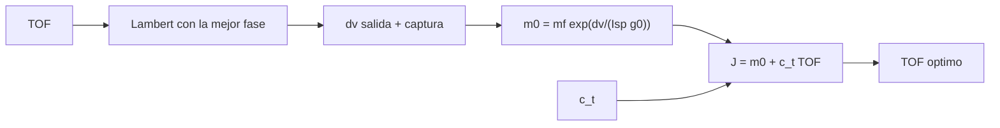

# B75-C27 — Duración de misión y tiempo de vuelo como restricción

<!-- nav:top -->
[🏠 Programa](../../../../README.md) · [📚 Bloque B75](../../../tronco-comun/B75-trayectorias-y-misiones-interplanetarias.md) · [← Anterior: B75-C26 — Sobrevuelos de lunas y tours de sistemas planetarios](../B75-C26-sobrevuelos-de-lunas-y-tours-de-sistemas-planetarios/CLASE.md) · [Siguiente: B75-C28 — Restricciones de radiación en trayectorias →](../B75-C28-restricciones-de-radiacion-en-trayectorias/CLASE.md)
<!-- /nav -->

## 1. Ubicación, nivel y alcance

Clase 27 del bloque B75 (programada en la `0.2.0`). Nivel N3. El tiempo de vuelo no es solo un dato de la transferencia: es una restricción de la misión, porque cada día cuesta operación, riesgo y exposición, y porque acortar el viaje cuesta delta-v. Aquí calculas, con Lambert, el delta-v mínimo para cada tiempo de vuelo (eligiendo la mejor fecha de salida), lo conviertes en masa, y buscas el tiempo que minimiza un costo total con un costo temporal ilustrativo.

## 2. Por qué esta clase existe

Un viaje más corto gasta más combustible y uno más largo gasta más tiempo. La decisión central: **¿qué tiempo de vuelo minimiza el costo total cuando se pesan la masa lanzada y la duración?**

## 3. Lo que podrás hacer al terminar

1. Construir la curva de delta-v mínimo frente al tiempo de vuelo con la fecha libre.
2. Convertir el delta-v en masa inicial con la ecuación del cohete.
3. Definir un costo total `m₀ + c_t·TOF` y hallar su mínimo.
4. Ver cómo el óptimo se desplaza al subir el costo temporal.
5. Reconocer que el mínimo de delta-v coincide con Hohmann.
6. Separar lo consultado, lo calculado y lo sintético (`c_t`, `I_sp`, masas).

La evidencia es tu **curva de costo total** del ejercicio 12 (sección 20).

## 4. Con qué llegas y cómo comprobarlo

1. ¿Qué resuelve Lambert?
2. ¿Qué es un delta-v mínimo para un tiempo dado?
3. ¿Qué dice la ecuación del cohete?
4. ¿Qué es un costo ilustrativo?
5. ¿Qué es una curva de costo total?

<details>
<summary>Ver respuestas</summary>

1. El arco entre dos posiciones en un tiempo dado (B75-C04). 2. El de la mejor fase de salida para ese tiempo (B75-C12). 3. `m₀/m_f = e^{Δv/(I_sp g₀)}`. 4. Un número del ejercicio que no corresponde a una misión. 5. La suma de componentes de costo en función del tiempo de vuelo.
</details>

Con cuatro o cinco aciertos, sigue; si no, repasa los prerrequisitos.

## 5. Un caso de contexto y casos de referencia

Con fecha de salida libre, el delta-v de salida más captura cuesta `4,4954 km/s` a `260 d` (igual al de Hohmann, `4,4952`), `4,7281` a `220 d` y `7,3896` a `140 d`. Con un costo temporal **ilustrativo** de `0,02 u/d`, el costo total mínimo (masa en toneladas + tiempo) cae en `220 d`: se paga más masa (`4,512 t` en vez de `4,189 t`) para ahorrar 40 días. Es el **ejemplo conductor**. Las masas y radios son de las fichas [S1, S2, S3]. Las páginas de la NASA y la ESA dan tránsitos de unos 5,5 y 8,2 años para Europa Clipper y Juice [S4, S5], más largos que cualquiera de este modelo; sus razones de diseño no se consultaron.

## 6. Vocabulario

El **costo total** es `J = m₀ + c_t·TOF`, con `m₀` en toneladas y `c_t` en unidades por día. El **delta-v mínimo para un tiempo** es el de la mejor fase de salida. La **curva de costo** tiene un mínimo de delta-v en el tiempo de Hohmann. El **óptimo** se desplaza a tiempos más cortos al subir `c_t`.

## 7. Modelo mental: elegir entre un tren rápido y uno barato



*Descripción textual:* Para cada tiempo se resuelve Lambert con la mejor fecha, se convierte el delta-v en masa y se suma el costo del tiempo; el mínimo da el tiempo óptimo.

Analogía: elegir entre un tren rápido y caro y uno lento y barato: el mejor depende de cuánto vale tu tiempo. Límite: aquí el valor del tiempo es un número inventado.

## 8. La explicación, paso a paso

### 8.1 La curva de delta-v

Para cada `TOF` se elige la fase de salida que minimiza `v∞,sal + v∞,lleg` (Lambert, circular y coplanar). El delta-v de salida desde 300 km y de captura (periapsis 300 km, `e = 0,8192`) da:

| `TOF` (d) | fase óptima (°) | `v∞,sal` (km/s) | `v∞,lleg` (km/s) | `Δv` (km/s) | `m₀` (t) |
|---|---|---|---|---|---|
| 120 | 25,9 | 5,980 | 7,346 | 8,9221 | 17,169 |
| 160 | 32,7 | 4,220 | 4,979 | 6,3228 | 7,499 |
| 200 | 38,4 | 3,351 | 3,490 | 5,0587 | 5,013 |
| 220 | 40,8 | 3,113 | 3,020 | 4,7281 | 4,512 |
| 260 | 44,4 | 2,945 | 2,650 | 4,4954 | 4,189 |
| 300 | 44,2 | 3,058 | 3,030 | 4,7184 | 4,498 |
| 360 | 34,3 | 3,383 | 4,389 | 5,6367 | 6,027 |
| 440 | 9,4 | 3,935 | 6,291 | 7,2185 | 9,977 |

El mínimo está en `260 d` con `4,4954 km/s`; Hohmann (`258,9 d`) da `4,4952 km/s`. La curva sube rápido por la izquierda (viajes cortos) y más despacio por la derecha.

### 8.2 Costo total

`J = m₀ + c_t·TOF` con `m₀` en toneladas (`I_sp = 320 s` y `m_f = 1 t`, sintéticos):

| `c_t` (u/d) | `TOF` óptimo (d) | `Δv` (km/s) | `m₀` (t) | tiempo (u) | `J` (u) |
|---|---|---|---|---|---|
| 0 | 260 | 4,4954 | 4,189 | 0,00 | 4,189 |
| 0,005 | 250 | 4,5066 | 4,204 | 1,25 | 5,454 |
| 0,02 | 220 | 4,7281 | 4,512 | 4,40 | 8,912 |
| 0,05 | 190 | 5,2904 | 5,397 | 9,50 | 14,897 |
| 0,2 | 140 | 7,3896 | 10,536 | 28,00 | 38,536 |

### 8.3 Lectura

El óptimo baja de `260` a `140 d` cuando `c_t` sube de 0 a 0,2 u/d. Con `c_t = 0` el óptimo es el de Hohmann. Acortar 40 días (de 260 a 220) cuesta `0,2327 km/s` y `0,323 t` de masa inicial. El costo temporal real de una misión no se consultó.

### 8.4 Verificaciones

(1) Con `c_t = 0` el óptimo coincide con el mínimo de delta-v. (2) Con la malla de 10 d el mínimo de delta-v difiere en no más de 20 d de la de 20 d. (3) El mínimo de delta-v con fase libre entre 250 y 270 d es `4,4954 km/s`, dentro del 1 % del de Hohmann (`4,4952`).

## 9. Magnitudes, símbolos y unidades

| Símbolo | Qué es | Unidad | Valor / nota |
|---|---|---|---|
| `TOF` | tiempo de vuelo | d | 120 a 440 |
| `Δv` | salida + captura | km/s | 4,4954 (260 d) |
| `m₀` | masa inicial | t | 4,189 |
| `c_t` | costo temporal | u/d | 0 a 0,2 (ilustrativo) |
| `J` | costo total | u | 8,912 (c_t = 0,02) |

## 10. Convenciones y referencias

Circular y coplanar; Lambert directo de menos de una vuelta; salida a 300 km y captura en `300 km × e = 0,8192` (sintéticas); `G` del registro del JPL; `μ☉` y `g₀` estándar; `I_sp`, masa final y `c_t` **sintéticos**.

## 11. De dónde sale lo que afirmamos

| ID | Fuente | Localizador | Respalda | Estado |
|---|---|---|---|---|
| S1 | NASA/NSSDC, Earth Fact Sheet — https://nssdc.gsfc.nasa.gov/planetary/factsheet/earthfact.html (consultada 2026-11-10) | página leída | semieje 149,598×10⁶ km, periodo sideral 365,256 d, excentricidad 0,0167, velocidad orbital media 29,78 km/s, masa 5,9722×10²⁴ kg, radio medio 6371,000 km, velocidad de escape 11,186 km/s | Consultada |
| S2 | NASA/NSSDC, Mars Fact Sheet — https://nssdc.gsfc.nasa.gov/planetary/factsheet/marsfact.html (consultada 2026-11-10) | página leída | semieje 227,956×10⁶ km, periodo sideral 686,980 d, excentricidad 0,0935, inclinación 1,848°, velocidad media 24,08 km/s, masa 0,64169×10²⁴ kg, radio ecuatorial 3396,2 km, g 3,73 m/s² | Consultada |
| S3 | NASA JPL SSD, Planetary Physical Parameters — https://ssd.jpl.nasa.gov/planets/phys_par.html (consultada 2026-11-10) | página leída | radios ecuatoriales (Venus 6051,8 km; Tierra 6378,1366 km; Marte 3396,19 km; Júpiter 71 492 km) y la constante G = 6,67430×10⁻¹¹ m³ kg⁻¹ s⁻² citada en su registro de cambios. La página no lista GM: aquí GM = G·M con las masas de las fichas NSSDC | Consultada |
| S4 | NASA, Europa Clipper (página de la misión) — https://science.nasa.gov/mission/europa-clipper/ (consultada 2026-11-10) | página leída | lanzamiento el 14 de octubre de 2024 en Falcon Heavy; sobrevuelo de Marte en 2025 y de la Tierra el 3 de diciembre de 2026; llegada a Júpiter en abril de 2030; 49 sobrevuelos cercanos de Europa; unos 2,9 mil millones de km hasta Júpiter | Consultada |
| S5 | ESA, Juice factsheet — https://www.esa.int/Science_Exploration/Space_Science/Juice/Juice_factsheet (consultada 2026-11-10) | página leída | lanzamiento el 14 de abril de 2023 en Ariane 5 desde Kourou; asistencias de la Luna–Tierra, Venus y la Tierra; llegada a Júpiter en julio de 2031; tour que termina en órbita de Ganimedes | Consultada |
| — | Valores estándar (no consultados en una fuente concreta de esta clase) | — | GM☉ = 1,32712440×10¹¹ km³/s² (valor estándar, ver la resolución IAU 2015 B3 de la fila anterior donde se cita); 1 au = 149 597 870,7 km; c = 299 792,458 km/s; g₀ = 9,80665 m/s²; ecuaciones de dos cuerpos | No consultada en una fuente concreta |

Límites: ningún costo corresponde a una misión; no hay maniobras de corrección ni márgenes; el modelo no incluye asistencias gravitacionales, que explican los tránsitos más largos de las misiones consultadas.

## 12. Cómo ver la curva de costo

| `TOF` (d) | `Δv` (km/s) | `J` con `c_t = 0,02` (u) |
|---|---|---|
| 140 | 7,3896 | 13,34 |
| 180 | 5,5734 | 9,51 |
| 220 | 4,7281 | 8,91 |
| 260 | 4,4954 | 9,39 |
| 300 | 4,7184 | 10,50 |

Descripción larga: el costo total tiene un mínimo claro en 220 d; a la izquierda sube por el combustible y a la derecha por el tiempo.

## 13. Ejemplo trabajado: c_t = 0,02 u/d

**Paso 1 · Opción 260 d.** `J = 4,189 + 0,02×260 = 9,389 u`.

**Paso 2 · Opción 220 d.** `J = 4,512 + 0,02×220 = 8,912 u`.

**Paso 3 · Opción 180 d.** `J = 5,906 + 3,6 = 9,506 u`.

**Paso 4 · Elección.** El mínimo de la malla está en 220 d.

## 14. Distintas formas de abordar el problema

**Por delta-v:** el mínimo está en el tiempo de Hohmann. **Por masa:** la ecuación del cohete amplifica el delta-v. **Por costo total:** con `c_t` el óptimo se desplaza. **Por asistencias (no incluidas):** bajan `C3` y alargan el tiempo (C06).

## 15. Práctica guiada

**Ejercicio 1 · con los pasos indicados.** Calcula `m₀` para `Δv = 4,7281 km/s` con `I_sp = 320 s`. *Pasos:* `e^{Δv/3,1381}`.

<details><summary>Solución comentada</summary>

`4,512 t`.
</details>

**Ejercicio 2 · con una pista.** Calcula `J` con `c_t = 0,02` y `TOF = 260 d`. *Pista:* `4,189 + 0,02×260`.

<details><summary>Solución comentada</summary>

`9,389 u`.
</details>

**Ejercicio 3 · casi autónomo.** ¿Qué opción es mejor con `c_t = 0,02`: 220 o 260 d?

<details><summary>Solución comentada</summary>

`220 d` (`8,912 < 9,389`).
</details>

## 16. Práctica autónoma, transferencia e integrador

**Ejercicio 4 · autónomo.** Calcula el delta-v extra de acortar de 260 a 220 d.

<details><summary>Solución comentada</summary>

`4,7281 − 4,4954 = 0,2327 km/s`.
</details>

**Ejercicio 5 · autónomo.** Calcula la masa extra de ese acortamiento.

<details><summary>Solución comentada</summary>

`4,512 − 4,189 = 0,323 t`.
</details>

**Ejercicio 6 · autónomo.** ¿A partir de qué `c_t` deja de convenir 260 d frente a 220 d?

<details><summary>Solución comentada</summary>

Cuando `0,323 < c_t×40`, es decir `c_t > 0,008 u/d`.
</details>

**Ejercicio 7 · autónomo.** ¿Qué `TOF` óptimo sale con `c_t = 0,2 u/d`?

<details><summary>Solución comentada</summary>

`140 d`.
</details>

**Ejercicio 8 · autónomo.** ¿Por qué el delta-v sube más rápido a la izquierda del mínimo que a la derecha?

<details><summary>Solución comentada</summary>

Porque los viajes cortos exigen `v∞` de salida y llegada altos a la vez (`5,98` y `7,35 km/s` a 120 d).
</details>

**Ejercicio 9 · transferencia.** Una misión tripulada valora mucho el tiempo (`c_t = 0,5 u/d`). ¿Qué espera la curva?

<details><summary>Solución comentada</summary>

Un `TOF` óptimo por debajo de 140 d, con un delta-v mayor que 7,4 km/s (fuera de la malla de 10 d); no se calculó.
</details>

**Ejercicio 10 · transferencia.** Las misiones a Europa consultadas tardan 5,5 y 8,2 años [S4, S5]. ¿Qué dice eso de `c_t`?

<details><summary>Solución comentada</summary>

Que el costo temporal de esas misiones es pequeño frente al de la masa (`C3`) y que usan asistencias; no se puede concluir un `c_t` real.
</details>

**Ejercicio 11 · transferencia.** ¿Qué costo no incluye `m₀`?

<details><summary>Solución comentada</summary>

El de operaciones, de los márgenes de seguridad y de la radiación; el modelo solo es didáctico.
</details>

**Ejercicio 12 · integrador.** Elabora tu *curva de costo total* para un `c_t` que justifiques: tabla de `TOF`, `Δv`, `m₀`, `J`, el óptimo y la comparación con Hohmann.

<details><summary>Solución comentada</summary>

Secciones 8.1–8.4 y la salida del laboratorio.
</details>

## 17. Laboratorio: costo total y tiempo de vuelo

El script [duracion.py](duracion.py) calcula con Lambert el delta-v mínimo para 17 tiempos con fecha libre, la masa y el costo total para cinco costos temporales, y **comprueba** el óptimo con `c_t = 0`, la malla y la cota de Hohmann.

**Datos:** semiejes, periodo y masas de las fichas NASA/NSSDC y `G` del JPL (consultados); `I_sp`, masa final y `c_t` **sintéticos**. **Predice antes de ejecutar:** ¿En qué `TOF` está el mínimo de delta-v? (260 d.) **Ejecución del 2026-11-10 (Python 3.12.9):**

```text
Python 3.12.9 (biblioteca estandar)
 TOF [d]  fase optima [g]  v_inf_sal  v_inf_lleg  dv salida+captura [km/s]  m0 [t] (mf = 1 t)
    120            25.9      5.980       7.346                   8.9221        17.169
    140            29.4      4.942       6.027                   7.3896        10.536
    160            32.7      4.220       4.979                   6.3228         7.499
    180            35.7      3.709       4.142                   5.5734         5.906
    200            38.4      3.351       3.490                   5.0587         5.013
    220            40.8      3.113       3.020                   4.7281         4.512
    240            42.9      2.982       2.737                   4.5477         4.260
    260            44.4      2.945       2.650                   4.4954         4.189
    280            45.0      2.981       2.755                   4.5563         4.271
    300            44.2      3.058       3.030                   4.7184         4.498
    320            42.1      3.155       3.427                   4.9659         4.867
    340            38.7      3.264       3.894                   5.2789         5.377
    360            34.3      3.383       4.389                   5.6367         6.027
    380            29.0      3.512       4.888                   6.0215         6.813
    400            23.0      3.648       5.376                   6.4194         7.734
    420            16.4      3.790       5.844                   6.8206         8.789
    440             9.4      3.935       6.291                   7.2185         9.977
Minimo de delta-v en la malla de 20 d: TOF = 260 d, dv = 4.4954 km/s
Hohmann (258.9 d): dv salida+captura = 4.4952 km/s
Costo total = m0 [t] + c_t * TOF (unidades u; c_t ILUSTRATIVO):
   c_t [u/d]   TOF optimo [d]   dv [km/s]   m0 [t]   costo masa [u]   costo tiempo [u]   total [u]
      0.000              260      4.4954    4.189            4.189               0.00       4.189
      0.005              250      4.5066    4.204            4.204               1.25       5.454
      0.020              220      4.7281    4.512            4.512               4.40       8.912
      0.050              190      5.2904    5.397            5.397               9.50      14.897
      0.200              140      7.3896   10.536           10.536              28.00      38.536
Pruebas superadas.
```

```bash
python programa/clases/B75/B75-C27-duracion-de-mision-y-tiempo-de-vuelo-como-restriccion/duracion.py
```

**Límites:** circular y coplanar, sin asistencias ni márgenes; el costo temporal es inventado.

## 18. Errores frecuentes y cómo corregirlos

**Confundir el óptimo en delta-v con el óptimo en costo total.** Se corrige con 8.3.

**Usar un `c_t` sin justificar.** Se corrige con la sección 10.

**Olvidar que el modelo no incluye asistencias.** Se corrige con la sección 11.

**Interpretar la masa de una etapa como realista.** Se corrige con C09.

## 19. Cómo sabrás que vas bien

Tras 8.2: ¿cuánto cambia el óptimo al pasar de `c_t = 0` a `0,05`? Tras el laboratorio: ¿qué tres cosas verifica? (ver la sección 17).

## 20. Qué entregas y cómo se evalúa

El producto es tu **curva de costo total** (ejercicio 12).

| Criterio | Inicial | En desarrollo | Logrado | Destacado |
|---|---|---|---|---|
| Conceptos | Confunde delta-v y costo | Define `J` y `c_t` | Halla el óptimo | Explica el desplazamiento |
| Cálculo | Sin unidades | Con errores | Tablas completas | Calcula casos nuevos |
| Numérico | Sin comprobar | Una prueba | Tres pruebas | Interpreta tolerancias |
| Fuentes | Sin fuente | Sin fecha | Fuentes con fecha y estado | Declara lo sintético |
| Límites | No los nombra | Uno | Tres | Discute las asistencias |

**Condiciones críticas (no se compensan con promedio):** rotular `c_t`, `I_sp` y masas como sintéticos; no presentar el óptimo como el de una misión; citar solo lo consultado.

## 21. Ética, seguridad y límites

Clase educativa: los modelos son simplificados (órbitas planetarias circulares y coplanares, dos cuerpos) y sus datos son consultados, sintéticos o ilustrativos y están rotulados; ningún resultado es una efeméride, una medición ni un diseño de misión real. El costo temporal real incluye riesgo humano y operativo, que una cifra didáctica no representa. Accesibilidad: tablas equivalentes a las gráficas, fórmulas en texto, ejercicios sin conexión.

## 22. Para cerrar y seguir

Con `c_t = 0,02 u/d` el costo total mínimo está en `220 d`; sin costo temporal, en `260 d` (Hohmann). Queda una pregunta: ¿qué restricción de seguridad añade el entorno de radiación?

**Glosario español–inglés.** costo total · *total cost*; tiempo de vuelo · *time of flight*; curva de costo · *cost curve*; masa inicial · *initial mass*; óptimo · *optimum*.

**Continuidad.** [B75-C28](../B75-C28-restricciones-de-radiacion-en-trayectorias/CLASE.md) añade el entorno de radiación.

**Referencias:** ver sección 11.

<!-- nav:bottom -->
---

[← Anterior: B75-C26 — Sobrevuelos de lunas y tours de sistemas planetarios](../B75-C26-sobrevuelos-de-lunas-y-tours-de-sistemas-planetarios/CLASE.md) · [📚 Bloque B75](../../../tronco-comun/B75-trayectorias-y-misiones-interplanetarias.md) · [Siguiente: B75-C28 — Restricciones de radiación en trayectorias →](../B75-C28-restricciones-de-radiacion-en-trayectorias/CLASE.md)
<!-- /nav -->
