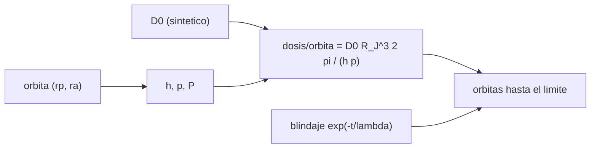

# B75-C28 — Restricciones de radiación en trayectorias

<!-- nav:top -->
[🏠 Programa](../../../../README.md) · [📚 Bloque B75](../../../tronco-comun/B75-trayectorias-y-misiones-interplanetarias.md) · [← Anterior: B75-C27 — Duración de misión y tiempo de vuelo como restricción](../B75-C27-duracion-de-mision-y-tiempo-de-vuelo-como-restriccion/CLASE.md) · [Siguiente: B75-C29 — Análisis de calendario con gráficos pork-chop →](../B75-C29-analisis-de-calendario-con-graficos-pork-chop/CLASE.md)
<!-- /nav -->

## 1. Ubicación, nivel y alcance

Clase 28 del bloque B75 (programada en la ampliación). Nivel N3. Cerca de Júpiter la radiación limita cuánto tiempo puede estar una nave en cada región. Esta clase **no** enseña el entorno real de radiación, que no se consultó: enseña a convertir una tasa de dosis **sintética** en una dosis acumulada por órbita con una integral analítica verificada, y a pesar la dosis contra el blindaje y el periapsis. Todo número de dosis es sintético.

## 2. Por qué esta clase existe

Una trayectoria es también un perfil de exposición. La decisión central: **¿cuánta dosis acumula una nave por órbita y cuántas órbitas aguanta, según el periapsis y el blindaje?**

## 3. Lo que podrás hacer al terminar

1. Escribir una tasa de dosis `D(r) = D₀ (R_J/r)³` como modelo sintético.
2. Calcular la dosis por órbita con la fórmula analítica `D₀ R_J³ · 2π/(h p)`.
3. Verificarla integrando numéricamente con Kepler.
4. Calcular la dosis en una órbita circular.
5. Aplicar un blindaje exponencial y calcular cuántas órbitas se pueden hacer hasta un límite.
6. Separar con claridad lo sintético de lo consultado (masa, radio, semieje).

La evidencia es tu **presupuesto de dosis sintético** del ejercicio 12 (sección 20).

## 4. Con qué llegas y cómo comprobarlo

1. ¿Qué es una tasa de dosis?
2. ¿Qué es el momento angular `h`?
3. ¿Qué es la dosis acumulada?
4. ¿Qué es un blindaje exponencial?
5. ¿Por qué lo llamamos sintético?

<details>
<summary>Ver respuestas</summary>

1. La dosis por unidad de tiempo (aquí en unidades arbitrarias por día). 2. `√(GM p)` en una órbita de semilatus rectum `p`. 3. La integral de la tasa a lo largo del tiempo. 4. Una atenuación `e^{−t/λ}` con el espesor `t`. 5. Porque no es un dato medido.
</details>

Con cuatro o cinco aciertos, sigue; si no, repasa los prerrequisitos.

## 5. Un caso de contexto y casos de referencia

Con una tasa **sintética** `D(r) = 10⁶ u/d·(R_J/r)³`, una órbita de `5 R_J × 3×10⁶ km` acumula `4624 u` por órbita (`43` órbitas hasta un límite sintético de `2×10⁵ u`; `71` con `5 g/cm²` de blindaje); la órbita de captura de `9,5 R_J` y 60 d, `1681 u` por órbita (`119` órbitas); la circular de Europa (`671 100 km`), `1209 u/d`. Es el **ejemplo conductor**. Solo la masa y el radio de Júpiter y el semieje de Europa son de las fichas [S1, S2, S3]; la tasa, el límite y el blindaje son inventados. El campo real de radiación de Júpiter no se consultó.

## 6. Vocabulario

La **tasa de dosis** sintética es `D(r) = D₀ (R_J/r)³`. La **dosis por órbita** es `∫ D dt`. El **blindaje** atenúa por `e^{−t/λ}` con `t` en g/cm². El **límite de dosis** es un tope de misión sintético. La **unidad** `u` es arbitraria.

## 7. Modelo mental: tomar sol cerca de una fogata



*Descripción textual:* La órbita da `h`, `p` y el periodo; con la tasa sintética la integral analítica da la dosis por órbita; el blindaje y el límite dan el número de órbitas posibles.

Analogía: tomar sol cerca de una fogata: la exposición depende de la distancia al fuego y del tiempo que estés cerca. Límite: el fuego es un modelo inventado; la radiación real tiene forma, partículas y variabilidad distintas.

## 8. La explicación, paso a paso

### 8.1 Dosis por órbita

Con `ρ = R_J/r` y `dt = r² dν/h`: `∫ r⁻³ dt = ∫ dν/(h r) = (1/(h p))∫(1 + e cos ν) dν = 2π/(h p)` en una vuelta. La dosis por órbita es `D₀ R_J³/(86 400)·2π/(h p)` en `u` (con `h` en km²/s y `p` en km).

### 8.2 Tres órbitas

| Órbita | Periodo (d) | Dosis/órbita (u) | Numérica (u) | Órbitas hasta `2×10⁵ u` | Con 5 g/cm² |
|---|---|---|---|---|---|
| `5 R_J × 3×10⁶ km` | 14,05 | 4624,03 | 4624,03 | 43 | 71 |
| `9,5 R_J`, 60 d | 60,00 | 1681,34 | 1681,34 | 119 | 196 |
| `15 R_J × 40 R_J` | 17,81 | 1211,88 | 1211,88 | 165 | 272 |

### 8.3 Europa y el blindaje

Órbita circular de `671 100 km`: `1208,96 u/d`; periodo `3,5521 d`; `4294,29 u` por órbita; `36 269 u` por 30 d. Blindaje (`λ = 10 g/cm²`, sintético): factor `0,9048` con 1 g/cm², `0,6065` con 5, `0,3679` con 10 y `0,1353` con 20; la dosis por órbita de la primera órbita baja de `4624` a `4184`, `2805`, `1701` y `626 u`.

### 8.4 Lectura

Subir el periapsis de `5` a `15 R_J` baja la dosis por órbita unas 3,8 veces; 5 g/cm² de blindaje la baja un 39 %. El tiempo en cada región pesa tanto como la dosis instantánea: la órbita larga de 60 d acumula poco por órbita pero también hace pocas.

### 8.5 Verificaciones

La integración numérica (20 000 pasos con Kepler universal y trapecio) coincide con la fórmula analítica con error relativo menor que `10⁻⁴` (iguales a 6 cifras en las tres órbitas). La dosis de la órbita circular de Europa es `D(a)×P` (error `10⁻⁹`). El blindaje multiplica por `e^{−t/λ}` exactamente.

## 9. Magnitudes, símbolos y unidades

| Símbolo | Qué es | Unidad | Valor / nota |
|---|---|---|---|
| `D₀` | tasa a `r = R_J` (sintética) | u/d | 10⁶ |
| `D(r)` | tasa de dosis | u/d | `D₀ (R_J/r)³` |
| `h` | momento angular | km²/s | `√(GM p)` |
| `λ` | longitud de atenuación (sintética) | g/cm² | 10 |
| `L` | límite de dosis (sintético) | u | 2×10⁵ |

## 10. Convenciones y referencias

Marco joviano; órbitas de dos cuerpos; `GM_J = G·M_J` (ficha NASA/NSSDC y `G` del JPL); radio ecuatorial del JPL; semieje de Europa del JPL. **Tasa de dosis, blindaje y límite sintéticos**. No se modelan partículas, campo magnético, rotación ni variabilidad.

## 11. De dónde sale lo que afirmamos

| ID | Fuente | Localizador | Respalda | Estado |
|---|---|---|---|---|
| S1 | NASA/NSSDC, Jupiter Fact Sheet — https://nssdc.gsfc.nasa.gov/planetary/factsheet/jupiterfact.html (consultada 2026-11-10) | página leída | semieje 778,479×10⁶ km, periodo sideral 4332,589 d, excentricidad 0,0487, inclinación 1,304°, velocidad media 13,06 km/s, masa 1898,13×10²⁴ kg, radio medio 69 911 km | Consultada |
| S2 | NASA JPL SSD, Planetary Physical Parameters — https://ssd.jpl.nasa.gov/planets/phys_par.html (consultada 2026-11-10) | página leída | radios ecuatoriales (Venus 6051,8 km; Tierra 6378,1366 km; Marte 3396,19 km; Júpiter 71 492 km) y la constante G = 6,67430×10⁻¹¹ m³ kg⁻¹ s⁻² citada en su registro de cambios. La página no lista GM: aquí GM = G·M con las masas de las fichas NSSDC | Consultada |
| S3 | NASA JPL SSD, Planetary Satellite Mean Elements — https://ssd.jpl.nasa.gov/sats/elem/ (consultada 2026-11-10) | página leída | semiejes (km) y periodos siderales (d), época 2000-01-01,5 TDB: Ío 421 800 y 1,762732; Europa 671 100 y 3,525463; Ganimedes 1 070 400 y 7,155588; Calisto 1 882 700 y 16,690440; Titán 1 221 900 y 15,945448; Encélado 238 400 y 1,370218 (elementos medios, no para efemérides) | Consultada |
| — | Valores estándar (no consultados en una fuente concreta de esta clase) | — | GM☉ = 1,32712440×10¹¹ km³/s² (valor estándar, ver la resolución IAU 2015 B3 de la fila anterior donde se cita); 1 au = 149 597 870,7 km; c = 299 792,458 km/s; g₀ = 9,80665 m/s²; ecuaciones de dos cuerpos | No consultada en una fuente concreta |

Límites: no se consultó ninguna fuente sobre el entorno de radiación de Júpiter ni sobre límites de dosis de misión: todas las cifras de dosis son sintéticas y ninguna debe usarse para diseñar ni para sacar conclusiones físicas.

## 12. Cómo ver la dosis por órbita

| Periapsis | Dosis/órbita (u) |
|---|---|
| 5 `R_J` | 4624 |
| 9,5 `R_J` | 1681 |
| 15 `R_J` | 1212 |

Descripción larga: la dosis por órbita cae con el periapsis, pero no tanto como la tasa instantánea, porque la nave pasa más tiempo lejos.

## 13. Ejemplo trabajado: la órbita de 5 R_J

**Paso 1 · Elementos.** `r_p = 357 460 km`, `r_a = 3×10⁶ km`, `p = 1,2·10⁶ km`.

**Paso 2 · Momento angular.** `h = √(GM_J p)`.

**Paso 3 · Dosis.** `D₀ R_J³/86 400 · 2π/(h p) = 4624 u`.

**Paso 4 · Órbitas.** `2×10⁵/4624 = 43`.

## 14. Distintas formas de abordar el problema

**Analítica:** `2π/(h p)`. **Numérica:** Kepler y trapecio. **Por blindaje:** factor exponencial. **Por límite:** número de órbitas.

## 15. Práctica guiada

**Ejercicio 1 · con los pasos indicados.** Calcula el número de órbitas hasta `2×10⁵ u` con `4624 u` por órbita. *Pasos:* divide.

<details><summary>Solución comentada</summary>

`43,3 → 43`.
</details>

**Ejercicio 2 · con una pista.** Calcula el factor de blindaje para `t = 5 g/cm²` y `λ = 10`. *Pista:* `e^{−t/λ}`.

<details><summary>Solución comentada</summary>

`0,6065`.
</details>

**Ejercicio 3 · casi autónomo.** Calcula la dosis por órbita con 5 g/cm².

<details><summary>Solución comentada</summary>

`4624×0,6065 = 2805 u`.
</details>

## 16. Práctica autónoma, transferencia e integrador

**Ejercicio 4 · autónomo.** ¿Cuántas órbitas se pueden hacer con 5 g/cm² en la de `5 R_J × 3×10⁶ km`?

<details><summary>Solución comentada</summary>

`71`.
</details>

**Ejercicio 5 · autónomo.** ¿En cuántos días de órbita circular de Europa se llega al límite `2×10⁵ u`?

<details><summary>Solución comentada</summary>

`2×10⁵/1208,96 = 165 d`.
</details>

**Ejercicio 6 · autónomo.** Compara la dosis por órbita de `5` y `15 R_J`.

<details><summary>Solución comentada</summary>

`4624/1212 = 3,8` veces.
</details>

**Ejercicio 7 · autónomo.** ¿Qué espesor reduce la dosis a la mitad?

<details><summary>Solución comentada</summary>

`t = λ ln 2 = 6,93 g/cm²`.
</details>

**Ejercicio 8 · autónomo.** ¿Por qué la dosis por órbita no cae como `(r_p)⁻³`?

<details><summary>Solución comentada</summary>

Porque la integral depende de `h p`, no solo del periapsis.
</details>

**Ejercicio 9 · transferencia.** Un colega usa esta tasa para decidir el blindaje de una nave. ¿Qué responde?

<details><summary>Solución comentada</summary>

Que la tasa es sintética y que el blindaje real exige el entorno real y un análisis de transporte que no se consultaron.
</details>

**Ejercicio 10 · transferencia.** ¿Qué trayectoria minimiza la dosis acumulada en el sistema joviano?

<details><summary>Solución comentada</summary>

Con este modelo, periapsis altos y pocas órbitas; el modelo real puede dar otro resultado.
</details>

**Ejercicio 11 · transferencia.** ¿Qué falta para convertir esto en un análisis de radiación?

<details><summary>Solución comentada</summary>

Un modelo medido del campo, su geometría (rotación y campo magnético), un modelo de transporte y los límites de los componentes.
</details>

**Ejercicio 12 · integrador.** Elabora tu *presupuesto de dosis sintético* para tres órbitas y un blindaje, rotulando todo como sintético y listando qué datos reales faltarían.

<details><summary>Solución comentada</summary>

Secciones 8.2–8.5 y la salida del laboratorio.
</details>

## 17. Laboratorio: dosis sintética por órbita

El script [radiacion.py](radiacion.py) calcula la dosis por órbita para tres órbitas, la órbita circular de Europa y el blindaje, y **comprueba** la integral numérica contra la analítica, la dosis circular y el factor de blindaje.

**Datos:** masa, radio y semieje de las fichas NASA/NSSDC y JPL (consultados); **tasa de dosis, blindaje y límite sintéticos**. **Predice antes de ejecutar:** ¿Cuántas órbitas aguanta la de `5 R_J` sin blindaje? (43.) **Ejecución del 2026-11-10 (Python 3.12.9):**

```text
Python 3.12.9 (biblioteca estandar)
Tasa SINTETICA D(r) = D0 (R_J/r)^3, D0 = 1e6 u/d (NO es el entorno real de radiacion)
 orbita                                   periodo [d]   dosis por orbita [u]   numerica [u]   dif [%]   orbitas hasta 2e5 u (sin blindaje)   con 5 g/cm2
Orbita sintetica 5 R_J x 3e6 km (C16)         14.05               4624.03        4624.03   -0.0000                             43             71
Captura 9.5 R_J, periodo 60 d (C20)           60.00               1681.34        1681.34   -0.0000                            119            196
Orbita 15 R_J x 40 R_J                        17.81               1211.88        1211.88    0.0000                            165            272
Orbita circular de Europa (671 100 km): tasa = 1208.9564 u/d ; periodo = 3.5521 d ; dosis por orbita = 4294.2940 u ; por 30 d = 36268.69 u
Blindaje exp(-t/lambda), lambda = 10 g/cm2 (SINTETICO):
   t =   0.0 g/cm2: factor 1.0000 ; dosis por orbita en la orbita 5 R_J x 3e6 km = 4624.03 u
   t =   1.0 g/cm2: factor 0.9048 ; dosis por orbita en la orbita 5 R_J x 3e6 km = 4184.00 u
   t =   5.0 g/cm2: factor 0.6065 ; dosis por orbita en la orbita 5 R_J x 3e6 km = 2804.62 u
   t =  10.0 g/cm2: factor 0.3679 ; dosis por orbita en la orbita 5 R_J x 3e6 km = 1701.09 u
   t =  20.0 g/cm2: factor 0.1353 ; dosis por orbita en la orbita 5 R_J x 3e6 km = 625.79 u
Pruebas superadas.
```

```bash
python programa/clases/B75/B75-C28-restricciones-de-radiacion-en-trayectorias/radiacion.py
```

**Límites:** tasa inventada; sin campo magnético, partículas ni variabilidad.

## 18. Errores frecuentes y cómo corregirlos

**Tomar las unidades `u` como dosis reales.** Se corrige con la sección 6.

**Pensar que la dosis solo depende del periapsis.** Se corrige con 8.4.

**Usar el blindaje exponencial como real.** Se corrige con la sección 11.

**Presentar el límite sintético como un requisito.** Se corrige con la sección 10.

## 19. Cómo sabrás que vas bien

Tras 8.2: ¿qué órbita acumula menos por vuelta? Tras el laboratorio: ¿cuánto difieren las integrales? (ver la sección 17).

## 20. Qué entregas y cómo se evalúa

El producto es tu **presupuesto de dosis sintético** (ejercicio 12).

| Criterio | Inicial | En desarrollo | Logrado | Destacado |
|---|---|---|---|---|
| Conceptos | Confunde tasa y dosis | Define dosis por órbita | Calcula y verifica | Explica el papel del periodo |
| Cálculo | Sin unidades | Con errores | Tabla completa | Calcula casos nuevos |
| Numérico | Sin comprobar | Una prueba | Tres pruebas | Interpreta 10⁻⁴ |
| Fuentes | Sin fuente | Sin fecha | Fuentes con fecha y estado | Rotula todo lo sintético |
| Límites | No los nombra | Uno | Tres | Lista los datos reales que faltan |

**Condiciones críticas (no se compensan con promedio):** rotular TODA la dosis como sintética; no presentar el resultado como entorno real de radiación; citar solo lo consultado.

## 21. Ética, seguridad y límites

Clase educativa: los modelos son simplificados (órbitas planetarias circulares y coplanares, dos cuerpos) y sus datos son consultados, sintéticos o ilustrativos y están rotulados; ningún resultado es una efeméride, una medición ni un diseño de misión real. La radiación afecta a la seguridad de personas e instrumentos: esta clase es didáctica y no sirve para evaluar un diseño ni un riesgo. Accesibilidad: tablas equivalentes a las gráficas, fórmulas en texto, ejercicios sin conexión.

## 22. Para cerrar y seguir

Con una tasa sintética, la órbita de `5 R_J × 3×10⁶ km` acumula `4624 u` por vuelta y aguanta `43` órbitas hasta el límite sintético. Queda una pregunta: ¿cómo se explora de forma sistemática el calendario de lanzamiento y llegada?

**Glosario español–inglés.** tasa de dosis · *dose rate*; dosis acumulada · *accumulated dose*; blindaje · *shielding*; longitud de atenuación · *attenuation length*; cinturón de radiación · *radiation belt*.

**Continuidad.** [B75-C29](../B75-C29-analisis-de-calendario-con-graficos-pork-chop/CLASE.md) explora el calendario fecha de salida–fecha de llegada.

**Referencias:** ver sección 11.

<!-- nav:bottom -->
---

[← Anterior: B75-C27 — Duración de misión y tiempo de vuelo como restricción](../B75-C27-duracion-de-mision-y-tiempo-de-vuelo-como-restriccion/CLASE.md) · [📚 Bloque B75](../../../tronco-comun/B75-trayectorias-y-misiones-interplanetarias.md) · [Siguiente: B75-C29 — Análisis de calendario con gráficos pork-chop →](../B75-C29-analisis-de-calendario-con-graficos-pork-chop/CLASE.md)
<!-- /nav -->
