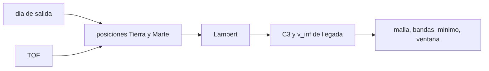

# B75-C29 — Análisis de calendario con gráficos pork-chop

<!-- nav:top -->
[🏠 Programa](../../../../README.md) · [📚 Bloque B75](../../../tronco-comun/B75-trayectorias-y-misiones-interplanetarias.md) · [← Anterior: B75-C28 — Restricciones de radiación en trayectorias](../B75-C28-restricciones-de-radiacion-en-trayectorias/CLASE.md) · [Siguiente: B75-C30 — Validación de maniobras por reintegración →](../B75-C30-validacion-de-maniobras-por-reintegracion/CLASE.md)
<!-- /nav -->

## 1. Ubicación, nivel y alcance

Clase 29 del bloque B75 (programada en la `0.2.0`). Nivel N3. Un gráfico *pork-chop* es el mapa de una magnitud (aquí `C3`) frente a la fecha de salida y la de llegada; su forma de chuleta señala la ventana. Con el Lambert de B75-C04 construyes la malla para Tierra–Marte en el modelo circular y coplanar, con fechas **relativas** al día ideal del modelo, localizas el mínimo y mides el ancho de la ventana.

## 2. Por qué esta clase existe

El diseño de una misión necesita ver el espacio de soluciones, no un solo punto. La decisión central: **¿qué combinaciones de fecha de salida y tiempo de vuelo dan un `C3` aceptable y cuán ancha es la ventana?**

## 3. Lo que podrás hacer al terminar

1. Construir la malla `C3(salida, TOF)` con Lambert.
2. Localizar el mínimo y compararlo con el de Hohmann.
3. Leer las bandas de `C3` en un mapa ASCII.
4. Medir el ancho de la ventana para un `C3` límite.
5. Reconocer la singularidad de Lambert a 180°.
6. Separar lo consultado de lo modelado (fechas relativas, no de calendario).

La evidencia es tu **gráfico pork-chop del modelo** del ejercicio 12 (sección 20).

## 4. Con qué llegas y cómo comprobarlo

1. ¿Qué es `C3`?
2. ¿Qué resuelve Lambert?
3. ¿Qué es una fecha relativa?
4. ¿Qué es un contorno?
5. ¿Por qué Lambert falla a 180°?

<details>
<summary>Ver respuestas</summary>

1. `v∞²` de salida (B75-C23). 2. El arco entre dos posiciones en un tiempo dado. 3. Un día medido desde un origen del modelo (día 0), no una fecha de calendario. 4. Una línea de igual valor. 5. Porque el plano de transferencia queda indeterminado (B75-C04).
</details>

Con cuatro o cinco aciertos, sigue; si no, repasa los prerrequisitos.

## 5. Un caso de contexto y casos de referencia

En el modelo, el mínimo de la malla es `C3 = 8,67 km²/s²` el día `0` con `TOF = 260 d`; refinado, `8,6740 km²/s²` en `TOF = 258,79 d`, igual al de Hohmann (`8,674`). Con `C3 < 12 km²/s²` la ventana dura `62 d` (del día `−25` al `+36`). Es el **ejemplo conductor**. Los semiejes y periodos son de las fichas [S1, S2]; las fechas son relativas al día ideal del modelo. La NASA indica oportunidades a Marte cada unos 25 meses [S3], que es lo que se repite el ciclo de este mapa.

## 6. Vocabulario

Un **gráfico pork-chop** es la malla de una magnitud frente a fecha de salida y fecha de llegada (aquí, salida y TOF). La **banda** es un rango de `C3`. La **ventana** es el rango de días de salida con `C3` bajo un límite. El **día 0** es el día ideal de Hohmann del modelo. Un **arco singular** es el de 180°.

## 7. Modelo mental: un mapa de curvas de nivel



*Descripción textual:* Para cada pareja día de salida–TOF se calculan las posiciones, se resuelve Lambert y se guardan `C3` y `v∞` de llegada; la malla da el mapa.

Analogía: un mapa de curvas de nivel de una colina: el mínimo es el valle y la ventana la zona baja. Límite: el mapa es del modelo; las curvas reales dependen de las excentricidades.

## 8. La explicación, paso a paso

### 8.1 La malla

Marte a `44,337°` de la Tierra el día 0 (B75-C02); `λ_T = n_T t`, `λ_M = 44,337° + n_M t`. Para cada día de salida y `TOF`, `C3 = |v₁ − V_T|²`.

| día \ `TOF` (d) | 180 | 220 | 260 | 300 | 340 |
|---|---|---|---|---|---|
| −60 | 52,3 | 31,3 | 25,1 | 26,3 | 34,3 |
| −40 | 33,0 | 19,8 | 16,4 | 18,0 | 24,2 |
| −20 | 19,0 | 12,1 | 10,8 | 12,2 | 16,8 |
| −10 | 14,6 | 10,0 | 9,2 | 10,4 | 14,1 |
| 0 | 12,2 | 9,3 | 8,7 | 9,4 | 12,1 |
| 10 | 11,9 | 10,0 | 9,2 | 9,2 | 10,8 |
| 20 | 14,2 | 12,5 | 11,0 | 9,9 | 10,3 |
| 40 | 26,9 | 23,0 | 18,6 | 14,5 | 11,8 |
| 60 | 52,3 | 42,2 | 32,4 | 23,7 | 17,0 |

### 8.2 El mínimo

Mínimo de la malla: `8,67 km²/s²` (día 0, `TOF = 260 d`). Refinado con una búsqueda local: `8,6740 km²/s²`, `v∞,lleg = 2,6493 km/s`, día `+0,001` y `TOF = 258,79 d`: el de Hohmann (`8,674`). Al excluir los arcos a menos de `0,05°` de 180° (Lambert singular), el mínimo no queda sesgado por ruido numérico: sin la exclusión, el refinamiento llegó a un valor espurio de `8,618`.

### 8.3 Forma y ventana

El mapa de bandas (`.` < 10, `o` < 12, `O` < 16, `#` < 25 km²/s²) muestra una región de `C3 < 10` alargada a lo largo de la diagonal de la salida y el `TOF`: salir más tarde permite `TOF` más largo y viceversa. Con `C3 < 12`, la ventana (mejor `TOF` para cada día) abarca del día `−25` al `+36`: `62 d`. La simetría es aproximada: `C3(+10 d, 260 d) = 9,23` y `C3(−10 d, 260 d) = 9,22`.

### 8.4 Verificaciones

El mínimo refinado coincide con el de Hohmann dentro del 0,5 %; el de la malla de 10 d está dentro del 3 % del refinado; la simetría a ±10 d difiere menos del 25 %.

## 9. Magnitudes, símbolos y unidades

| Símbolo | Qué es | Unidad | Valor / nota |
|---|---|---|---|
| `C3` | energía característica de salida | km²/s² | 8,674 (mínimo) |
| día | salida relativa al ideal | d | −60 a +60 |
| `TOF` | tiempo de vuelo | d | 180 a 340 |
| `v∞,lleg` | exceso de llegada | km/s | 2,6493 (mínimo) |
| ancho | ventana con `C3 < 12` | d | 62 |

## 10. Convenciones y referencias

Circular y coplanar; días relativos al día ideal del modelo (**no** fechas de calendario); Lambert directo de menos de una vuelta; arcos a menos de `0,05°` de 180° excluidos; `μ☉` estándar.

## 11. De dónde sale lo que afirmamos

| ID | Fuente | Localizador | Respalda | Estado |
|---|---|---|---|---|
| S1 | NASA/NSSDC, Earth Fact Sheet — https://nssdc.gsfc.nasa.gov/planetary/factsheet/earthfact.html (consultada 2026-11-10) | página leída | semieje 149,598×10⁶ km, periodo sideral 365,256 d, excentricidad 0,0167, velocidad orbital media 29,78 km/s, masa 5,9722×10²⁴ kg, radio medio 6371,000 km, velocidad de escape 11,186 km/s | Consultada |
| S2 | NASA/NSSDC, Mars Fact Sheet — https://nssdc.gsfc.nasa.gov/planetary/factsheet/marsfact.html (consultada 2026-11-10) | página leída | semieje 227,956×10⁶ km, periodo sideral 686,980 d, excentricidad 0,0935, inclinación 1,848°, velocidad media 24,08 km/s, masa 0,64169×10²⁴ kg, radio ecuatorial 3396,2 km, g 3,73 m/s² | Consultada |
| S3 | NASA, Basics of Space Flight, cap. 4 «Interplanetary Trajectories» — https://science.nasa.gov/learn/basics-of-space-flight/chapter4-1/ (consultada 2026-11-10) | página leída | transferencia de Hohmann como ruta de menor propulsante; oportunidades mínimas de energía a Marte cada ~25 meses y a Venus cada ~19 meses; la asistencia gravitacional cambia la velocidad heliocéntrica y deja la relativa en módulo; el vuelo de Galileo por Ío redujo el propulsante de inserción en 90 kg | Consultada |
| — | Valores estándar (no consultados en una fuente concreta de esta clase) | — | GM☉ = 1,32712440×10¹¹ km³/s² (valor estándar, ver la resolución IAU 2015 B3 de la fila anterior donde se cita); 1 au = 149 597 870,7 km; c = 299 792,458 km/s; g₀ = 9,80665 m/s²; ecuaciones de dos cuerpos | No consultada en una fuente concreta |

Límites: el modelo no incluye la excentricidad de Marte, que desplaza y deforma el mapa real; no se consultó ningún mapa de una misión real; solo se midió `C3` de salida y no el delta-v de captura.

## 12. Cómo ver el mapa

| Banda | Significado |
|---|---|
| `.` | `C3 < 10` |
| `o` | `C3 < 12` |
| `O` | `C3 < 16` |
| `#` | `C3 < 25` |

Descripción larga: la región de `C3` bajo forma una banda diagonal y estrecha en torno al día 0 y al `TOF` de Hohmann, abierta a TOF mayores si se sale más tarde.

## 13. Ejemplo trabajado: leer la malla

**Paso 1 · Día 0, `TOF` 260.** `C3 = 8,7 km²/s²`.

**Paso 2 · Día +20, `TOF` 300.** `C3 = 9,9 km²/s²`: se paga poco por salir 20 d tarde si se viaja más.

**Paso 3 · Día −20, `TOF` 260.** `C3 = 10,8`.

**Paso 4 · Ventana.** `C3 < 12` para días `−25` a `+36`.

## 14. Distintas formas de abordar el problema

**Por malla:** exploración completa. **Por refinamiento local:** mínimo exacto. **Por bandas:** forma de la ventana. **Por la referencia de Hohmann:** verificación.

## 15. Práctica guiada

**Ejercicio 1 · con los pasos indicados.** Lee en la tabla `C3` el día 10 con `TOF = 300 d`.

<details><summary>Solución comentada</summary>

`9,2 km²/s²`.
</details>

**Ejercicio 2 · con una pista.** ¿Cuál es el exceso respecto al mínimo en el día −20 con `TOF = 260 d`? *Pista:* `10,8 − 8,67`.

<details><summary>Solución comentada</summary>

`2,1 km²/s²` (24 %).
</details>

**Ejercicio 3 · casi autónomo.** ¿Por qué el mapa tiene forma diagonal?

<details><summary>Solución comentada</summary>

Porque una salida tardía se compensa con un `TOF` más largo para llegar a la misma posición de Marte.
</details>

## 16. Práctica autónoma, transferencia e integrador

**Ejercicio 4 · autónomo.** Lee el `C3` del día +40 con `TOF = 340 d`.

<details><summary>Solución comentada</summary>

`11,8 km²/s²`.
</details>

**Ejercicio 5 · autónomo.** ¿Qué `TOF` es mejor el día −10 de la tabla?

<details><summary>Solución comentada</summary>

`260 d` (9,2), `TOF` de la malla.
</details>

**Ejercicio 6 · autónomo.** ¿Cuántos días de salida tiene la ventana con `C3 < 12`?

<details><summary>Solución comentada</summary>

`62 d`.
</details>

**Ejercicio 7 · autónomo.** Compara `C3` de los días −60 y +60 con `TOF = 260`.

<details><summary>Solución comentada</summary>

`25,1` y `32,4`: la asimetría es del 29 %.
</details>

**Ejercicio 8 · autónomo.** ¿Qué hace el arco de 180° en el mapa?

<details><summary>Solución comentada</summary>

Un arco de `180°` es singular; se excluyen los puntos a menos de `0,05°`.
</details>

**Ejercicio 9 · transferencia.** Un lanzamiento se retrasa 20 d respecto al ideal. ¿Qué `TOF` conviene?

<details><summary>Solución comentada</summary>

`300 d`, con `C3 = 9,9` en la tabla, en vez de 260 d (`11,0`).
</details>

**Ejercicio 10 · transferencia.** ¿Por qué el mapa real de Marte es distinto del del modelo?

<details><summary>Solución comentada</summary>

Porque Marte es excéntrico (`0,0935`) y su distancia al Sol cambia entre `1,38` y `1,67 au`.
</details>

**Ejercicio 11 · transferencia.** Si se quisiera incluir el delta-v de captura, ¿qué cambia en el mapa?

<details><summary>Solución comentada</summary>

Se añade `v∞,lleg` (B75-C14) y la ventana óptima se desplaza hacia llegadas de menor `v∞`.
</details>

**Ejercicio 12 · integrador.** Elabora tu *gráfico pork-chop del modelo*: malla de `C3`, mapa de bandas, mínimo refinado, ancho de ventana para un `C3` que elijas y la lista de supuestos.

<details><summary>Solución comentada</summary>

Secciones 8.1–8.4 y la salida del laboratorio.
</details>

## 17. Laboratorio: pork-chop Tierra–Marte

El script [pork_chop.py](pork_chop.py) calcula la malla de `C3` con Lambert, un mapa de bandas, el mínimo refinado y el ancho de la ventana, y **comprueba** el mínimo contra Hohmann, la malla contra el refinado y la simetría.

**Datos:** semiejes y periodos de las fichas NASA/NSSDC (consultados); fechas **relativas** del modelo. **Predice antes de ejecutar:** ¿Qué `C3` tiene el mínimo? (8,674 km²/s², el de Hohmann.) **Ejecución del 2026-11-10 (Python 3.12.9):**

```text
Python 3.12.9 (biblioteca estandar)
Referencia de Hohmann del modelo: C3 = 8.674 km2/s2 en TOF = 258.88 d (dia 0)
C3 [km2/s2] de salida: filas = dia de salida (relativo al ideal), columnas = TOF [d]
  dia     180    200    220    240    260    280    300    320    340
  -60    52.3   39.1   31.3   27.0   25.1   24.9   26.3   29.3   34.3
  -50    42.1   31.3   25.1   21.8   20.4   20.5   21.8   24.6   28.9
  -40    33.0   24.5   19.8   17.3   16.4   16.7   18.0   20.4   24.2
  -30    25.2   18.8   15.4   13.7   13.2   13.6   14.8   16.9   20.2
  -20    19.0   14.5   12.1   11.0   10.8   11.2   12.2   14.0   16.8
  -10    14.6   11.5   10.0    9.3    9.2    9.6   10.4   11.8   14.1
    0    12.2   10.2    9.3    8.8    8.7    8.8    9.4   10.4   12.1
   10    11.9   10.7   10.0    9.6    9.2    9.1    9.2    9.7   10.8
   20    14.2   13.2   12.5   11.7   11.0   10.4    9.9    9.9   10.3
   30    19.1   17.9   16.7   15.4   14.1   12.8   11.7   10.9   10.7
   40    26.9   25.0   23.0   20.8   18.6   16.4   14.5   12.9   11.8
   50    37.9   34.7   31.4   28.0   24.6   21.4   18.5   15.9   13.9
   60    52.3   47.2   42.2   37.2   32.4   27.8   23.7   20.0   17.0
Minimo de la malla: C3 = 8.67 km2/s2 en dia +0, TOF = 260 d
Mapa de bandas de C3 (. < 10 ; o < 12 ; O < 16 ; # < 25 ; espacio = mas) con dia -60..+60 (filas, paso 6 d) y TOF 150..350 (columnas, paso 5 d):
  -60 |                       ####              |
  -54 |                 ################        |
  -48 |              ######################     |
  -42 |           ###########################   |
  -36 |         #########OOOOOOOOOOO############|
  -30 |       #######OOOOOOOOOOOOOOOOOOO########|
  -24 |     ######OOOOOOOooooooooOOOOOOOOOO#####|
  -18 |   #####OOOOOooooooooooooooooooOOOOOOO###|
  -12 | #####OOOOoooooo............ooooooOOOOOO#|
   -6 |####OOOOooooo..................oooooOOOOO|
    0 |###OOOOoooo......................oooooOOO|
    6 |#OOOOOoooooo.......................oooooO|
   12 |#OOOOOOoooooooooo...................ooooo|
   18 |#OOOOOOOOOOOOOooooooooooooo..........oooo|
   24 |######OOOOOOOOOOOOOOOOOooo?oooooooooooooo|
   30 |#################OOOOOOOOOOOOoooooooooooo|
   36 |   #####################OOOOOOOOOOooooooo|
   42 |              ###############OOOOOOOOOOoo|
   48 |                    #############OOOOOOOO|
   54 |                         ############OOOO|
   60 |                             ###########O|
Minimo refinado: C3 = 8.6740 km2/s2 ; v_inf llegada = 2.6493 km/s ; dia +0.001, TOF = 258.788 d
Simetria: C3(+10 d, 260 d) = 9.23 ; C3(-10 d, 260 d) = 9.22 km2/s2
Ancho de la ventana con C3 < 12 km2/s2 (mejor TOF para cada dia): de -25 a +36 d (62 d)
Pruebas superadas.
```

```bash
python programa/clases/B75/B75-C29-analisis-de-calendario-con-graficos-pork-chop/pork_chop.py
```

**Límites:** circular y coplanar; sin excentricidad; arcos a 180° excluidos.

## 18. Errores frecuentes y cómo corregirlos

**Tomar los días relativos como fechas de calendario.** Se corrige con la sección 10.

**Ignorar la singularidad a 180°.** Se corrige con 8.2.

**Olvidar que solo se mide `C3`.** Se corrige con el ejercicio 11.

**Presentar el mapa como el de una misión.** Se corrige con la sección 11.

## 19. Cómo sabrás que vas bien

Tras 8.1: ¿dónde está el valle? Tras el laboratorio: ¿cuánto difieren el mínimo refinado y el de Hohmann? (ver la sección 17).

## 20. Qué entregas y cómo se evalúa

El producto es tu **gráfico pork-chop del modelo** (ejercicio 12).

| Criterio | Inicial | En desarrollo | Logrado | Destacado |
|---|---|---|---|---|
| Conceptos | Confunde malla y trayectoria | Define `C3` y ventana | Lee la malla | Explica la diagonal |
| Cálculo | Sin unidades | Con errores | Tabla completa | Calcula casos nuevos |
| Numérico | Sin comprobar | Una prueba | Tres pruebas | Interpreta la exclusión de 180° |
| Fuentes | Sin fuente | Sin fecha | Fuentes con fecha y estado | Declara las fechas relativas |
| Límites | No los nombra | Uno | Tres | Discute la excentricidad de Marte |

**Condiciones críticas (no se compensan con promedio):** rotular las fechas como relativas; no presentar el mapa como el de una misión; citar solo lo consultado.

## 21. Ética, seguridad y límites

Clase educativa: los modelos son simplificados (órbitas planetarias circulares y coplanares, dos cuerpos) y sus datos son consultados, sintéticos o ilustrativos y están rotulados; ningún resultado es una efeméride, una medición ni un diseño de misión real. Un mapa real de ventana se construye con efemérides y restricciones del lanzador; esta clase es didáctica. Accesibilidad: tablas equivalentes a las gráficas, fórmulas en texto, ejercicios sin conexión.

## 22. Para cerrar y seguir

El mapa del modelo tiene su mínimo en `C3 = 8,674 km²/s²` con `TOF = 258,8 d` y una ventana de `62 d` para `C3 < 12`. Queda una pregunta: ¿cómo se valida una maniobra calculada con estos métodos?

**Glosario español–inglés.** gráfico pork-chop · *pork-chop plot*; malla · *grid*; banda · *band*; ventana · *window*; arco singular · *singular transfer*.

**Continuidad.** [B75-C30](../B75-C30-validacion-de-maniobras-por-reintegracion/CLASE.md) valida una maniobra por reintegración.

**Referencias:** ver sección 11.

<!-- nav:bottom -->
---

[← Anterior: B75-C28 — Restricciones de radiación en trayectorias](../B75-C28-restricciones-de-radiacion-en-trayectorias/CLASE.md) · [📚 Bloque B75](../../../tronco-comun/B75-trayectorias-y-misiones-interplanetarias.md) · [Siguiente: B75-C30 — Validación de maniobras por reintegración →](../B75-C30-validacion-de-maniobras-por-reintegracion/CLASE.md)
<!-- /nav -->
