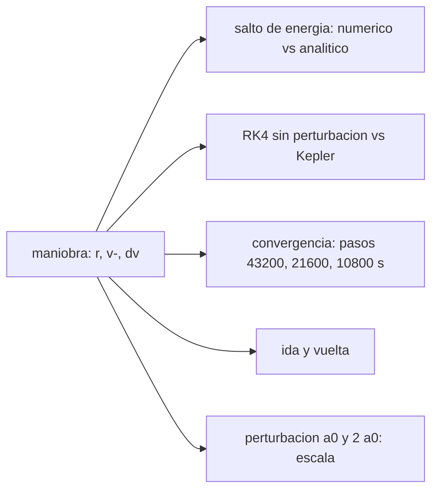

# B75-C30 — Validación de maniobras por reintegración

<!-- nav:top -->
[🏠 Programa](../../../../README.md) · [📚 Bloque B75](../../../tronco-comun/B75-trayectorias-y-misiones-interplanetarias.md) · [← Anterior: B75-C29 — Análisis de calendario con gráficos pork-chop](../B75-C29-analisis-de-calendario-con-graficos-pork-chop/CLASE.md) · [Siguiente: B76-C01 — Sistema Tierra-Luna →](../../B76/B76-C01-sistema-tierra-luna/CLASE.md)
<!-- /nav -->

## 1. Ubicación, nivel y alcance

Clase 30 del bloque B75 (programada en la ampliación). Nivel N3. Una maniobra calculada con cónicas empalmadas debe comprobarse antes de aceptarse: se reintegra el movimiento antes y después del impulso con un integrador independiente y se compara con lo previsto. Aquí validas la salida heliocéntrica de B75-C01 con cinco comprobaciones: salto de energía, equivalencia con Kepler, convergencia con el paso, reversibilidad y escala de una perturbación sintética.

## 2. Por qué esta clase existe

Un número de una hoja de cálculo no es una trayectoria validada. La decisión central: **¿qué comprobaciones demuestran que el impulso y la trayectoria que sigue son coherentes y que el integrador es fiable?**

## 3. Lo que podrás hacer al terminar

1. Calcular el salto de energía de un impulso con `v⁻·Δv + ½|Δv|²`.
2. Comparar un integrador RK4 sin perturbación con la propagación de Kepler.
3. Medir el orden de convergencia con el paso.
4. Verificar la reversibilidad integrando hacia delante y hacia atrás.
5. Medir cómo escala el desplazamiento con la magnitud de una perturbación.
6. Separar lo consultado de lo sintético (la perturbación).

La evidencia es tu **informe de reintegración de una maniobra** del ejercicio 12 (sección 20).

## 4. Con qué llegas y cómo comprobarlo

1. ¿Qué es la energía específica?
2. ¿Qué es RK4?
3. ¿Qué es el orden de un método?
4. ¿Qué es reversibilidad temporal?
5. ¿Qué es una perturbación sintética?

<details>
<summary>Ver respuestas</summary>

1. `ε = v²/2 − μ/r`. 2. Un integrador de cuarto orden con paso fijo. 3. Si el error cae como `h^p`, `p` es el orden; para RK4, `p = 4`. 4. Integrar hacia atrás reproduce el estado inicial. 5. Una aceleración inventada para el ejercicio.
</details>

Con cuatro o cinco aciertos, sigue; si no, repasa los prerrequisitos.

## 5. Un caso de contexto y casos de referencia

El impulso tangencial de `2,9452 km/s` desde la órbita de la Tierra sube la energía en `92,0577 km²/s²`, igual a `v⁻·Δv + Δv²/2` con error menor que `10⁻⁹`. RK4 sin perturbación reproduce la propagación de Kepler al cabo de `258,88 d` con diferencia menor que `0,0001 km`; con una perturbación radial **sintética** de `2×10⁻⁹ km/s²` la llegada se desplaza `491 212 km` y con el doble `982 222 km` (cociente `2,000`). Es el **ejemplo conductor**. Los semiejes son de las fichas [S1, S2]; la perturbación no se consultó.

## 6. Vocabulario

La **reintegración** es repetir la propagación con un método independiente. El **salto de energía** de un impulso es `Δε = v⁻·Δv + ½|Δv|²`. El **orden de convergencia** es `log₂` del cociente de diferencias al halvar el paso. La **reversibilidad** es regresar al inicio integrando hacia atrás. La **perturbación sintética** `a = a₀(1 au/r)²` es radial.

## 7. Modelo mental: revisar una cuenta por dos caminos



*Descripción textual:* La maniobra se somete a cinco comprobaciones independientes: energía, equivalencia con Kepler, convergencia, reversibilidad y escala de la perturbación.

Analogía: revisar una cuenta por dos caminos distintos: si ambos dan lo mismo, el resultado es más confiable. Límite: dos caminos que comparten un error de modelo coinciden pero pueden estar equivocados.

## 8. La explicación, paso a paso

### 8.1 El impulso

`Δv = 2,9452 km/s` tangencial desde `r = 149,598×10⁶ km` con `V_T = 29,7847 km/s`; `TOF = 258,88 d`. Salto de energía: numérico `92,057699496 km²/s²`, analítico `92,057699496`.

### 8.2 Sin perturbación

RK4 con paso `3600 s` frente a Kepler: diferencia `< 10⁻⁴ km` en el punto de llegada.

### 8.3 Con perturbación sintética

`a = a₀(1 au/r)²` radial con `a₀ = 2×10⁻⁹ km/s²` (**inventada**).

| Comprobación | Resultado |
|---|---|
| Diferencia entre pasos de `43 200` y `21 600 s` | `0,0823 km` |
| Entre `21 600` y `10 800 s` | `0,0051 km` |
| Cociente (orden 4: 16) | `16,15` |
| Ida y vuelta (velocidad invertida) | `0,00000 km` |
| Desplazamiento con `a₀` | `491 212,3 km` |
| Desplazamiento con `2 a₀` | `982 222,4 km` |
| Cociente | `2,000` |
| Radio de llegada con / sin perturbación | `228,1501×10⁶` / `227,9560×10⁶ km` |

### 8.4 Qué demuestran

El salto de energía valida el impulso; Kepler valida el integrador sin perturbación; el cociente `16,15` confirma el orden 4; la ida y vuelta muestra reversibilidad; el cociente `2,000` muestra que, a primer orden, la perturbación actúa de forma lineal. No prueban que el modelo de perturbación sea realista.

## 9. Magnitudes, símbolos y unidades

| Símbolo | Qué es | Unidad | Valor / nota |
|---|---|---|---|
| `Δε` | salto de energía | km²/s² | 92,0577 |
| `Δv` | impulso | km/s | 2,9452 |
| `h` | paso de integración | s | 43 200 a 10 800 |
| `a₀` | perturbación sintética | km/s² | 2×10⁻⁹ |
| `δr` | desplazamiento de llegada | km | 491 212 |

## 10. Convenciones y referencias

Marco heliocéntrico plano; cónicas empalmadas; RK4 de paso fijo; semiejes de las fichas NASA/NSSDC; `μ☉` estándar; la perturbación radial `a₀(1 au/r)²` y su magnitud son **sintéticas**.

## 11. De dónde sale lo que afirmamos

| ID | Fuente | Localizador | Respalda | Estado |
|---|---|---|---|---|
| S1 | NASA/NSSDC, Earth Fact Sheet — https://nssdc.gsfc.nasa.gov/planetary/factsheet/earthfact.html (consultada 2026-11-10) | página leída | semieje 149,598×10⁶ km, periodo sideral 365,256 d, excentricidad 0,0167, velocidad orbital media 29,78 km/s, masa 5,9722×10²⁴ kg, radio medio 6371,000 km, velocidad de escape 11,186 km/s | Consultada |
| S2 | NASA/NSSDC, Mars Fact Sheet — https://nssdc.gsfc.nasa.gov/planetary/factsheet/marsfact.html (consultada 2026-11-10) | página leída | semieje 227,956×10⁶ km, periodo sideral 686,980 d, excentricidad 0,0935, inclinación 1,848°, velocidad media 24,08 km/s, masa 0,64169×10²⁴ kg, radio ecuatorial 3396,2 km, g 3,73 m/s² | Consultada |
| — | Valores estándar (no consultados en una fuente concreta de esta clase) | — | GM☉ = 1,32712440×10¹¹ km³/s² (valor estándar, ver la resolución IAU 2015 B3 de la fila anterior donde se cita); 1 au = 149 597 870,7 km; c = 299 792,458 km/s; g₀ = 9,80665 m/s²; ecuaciones de dos cuerpos | No consultada en una fuente concreta |

Límites: no se consultó ningún valor de perturbación real (presión de radiación solar, gravedad de otros planetas); no se validó contra una efeméride (JPL Horizons, SPICE: no consultados).

## 12. Cómo ver la validación

| Prueba | Resultado |
|---|---|
| Energía | igual a `10⁻⁹` |
| RK4 sin perturbación frente a Kepler | `< 10⁻⁴ km` |
| Orden de convergencia | 16,15 (≈ 16) |
| Ida y vuelta | `0,00000 km` |
| Escala con `a₀` | 2,000 |

Descripción larga: cinco comprobaciones independientes dan resultados coherentes con lo esperado.

## 13. Ejemplo trabajado: el salto de energía

**Paso 1 · Estado previo.** `v⁻ = 29,7847 km/s`.

**Paso 2 · Impulso.** `Δv = 2,9452 km/s`.

**Paso 3 · Fórmula.** `29,7847×2,9452 + 2,9452²/2 = 87,72 + 4,34 = 92,06 km²/s²`.

**Paso 4 · Numérico.** `ε⁺ − ε⁻ = 92,057699496`.

## 14. Distintas formas de abordar el problema

**Por energía:** valida el impulso. **Por Kepler:** valida el integrador. **Por convergencia:** valida el orden. **Por reversibilidad:** valida la consistencia. **Por escala:** muestra el efecto de una perturbación.

## 15. Práctica guiada

**Ejercicio 1 · con los pasos indicados.** Calcula `Δε` con `v⁻ = 29,7847` y `Δv = 2,9452` km/s. *Pasos:* `v⁻Δv + Δv²/2`.

<details><summary>Solución comentada</summary>

`87,72 + 4,34 = 92,06 km²/s²`.
</details>

**Ejercicio 2 · con una pista.** Calcula el cociente de convergencia con `d₁ = 0,0823` y `d₂ = 0,0051` km. *Pista:* `d₁/d₂`.

<details><summary>Solución comentada</summary>

`16,1`: orden 4.
</details>

**Ejercicio 3 · casi autónomo.** Calcula el cociente de desplazamientos para `2 a₀` y `a₀`.

<details><summary>Solución comentada</summary>

`982 222,4/491 212,3 = 2,000`.
</details>

## 16. Práctica autónoma, transferencia e integrador

**Ejercicio 4 · autónomo.** ¿Qué orden de método tendría un cociente de 8?

<details><summary>Solución comentada</summary>

Orden 3 (`2³`).
</details>

**Ejercicio 5 · autónomo.** Si el desplazamiento con `a₀` es 491 212 km, ¿cuál se espera con `0,5 a₀`?

<details><summary>Solución comentada</summary>

`≈ 245 606 km`.
</details>

**Ejercicio 6 · autónomo.** Calcula el cambio relativo del radio de llegada por la perturbación.

<details><summary>Solución comentada</summary>

`(228,1501 − 227,9560)/227,956 = 0,085 %`.
</details>

**Ejercicio 7 · autónomo.** ¿Por qué la ida y vuelta no demuestra que el modelo sea correcto?

<details><summary>Solución comentada</summary>

Porque un integrador reversible puede reproducir un modelo equivocado.
</details>

**Ejercicio 8 · autónomo.** ¿Qué comprobación detecta un error de signo en el impulso?

<details><summary>Solución comentada</summary>

El salto de energía: `v⁻·Δv` cambiaría de signo.
</details>

**Ejercicio 9 · transferencia.** Un colega valida solo con ida y vuelta. ¿Qué falta?

<details><summary>Solución comentada</summary>

Comparar con una referencia independiente (Kepler o efeméride) y probar la convergencia.
</details>

**Ejercicio 10 · transferencia.** La perturbación real no es radial ni constante. ¿Qué tendría que cambiar en la comprobación?

<details><summary>Solución comentada</summary>

El modelo de aceleración; las pruebas siguen igual.
</details>

**Ejercicio 11 · transferencia.** ¿Cómo validarías una maniobra de una misión real?

<details><summary>Solución comentada</summary>

Reintegrando con una efeméride y un modelo de fuerzas de referencia (SPICE/Horizons) y comparando con la solución de navegación; esas fuentes no se consultaron aquí.
</details>

**Ejercicio 12 · integrador.** Elabora tu *informe de reintegración de una maniobra* con las cinco comprobaciones, sus resultados y qué demuestra y qué no cada una.

<details><summary>Solución comentada</summary>

Secciones 8.1–8.4 y la salida del laboratorio.
</details>

## 17. Laboratorio: reintegración de una salida a Marte

El script [reintegracion.py](reintegracion.py) aplica cinco comprobaciones a una maniobra de salida y **comprueba** el salto de energía, Kepler sin perturbación, el orden 4, la ida y vuelta y la escala de la perturbación.

**Datos:** semiejes de las fichas NASA/NSSDC (consultados); perturbación **sintética**; `μ☉` estándar. **Predice antes de ejecutar:** ¿Qué cociente de convergencia esperas? (≈ 16.) **Ejecución del 2026-11-10 (Python 3.12.9):**

```text
Python 3.12.9 (biblioteca estandar)
Impulso tangencial dv = 2.9452 km/s ; TOF = 258.88 d
Salto de energia: numerico = 92.057699496 km2/s2 ; analitico v-.dv + dv^2/2 = 92.057699496 km2/s2
Sin perturbacion: |RK4 - Kepler| tras el TOF = 0.0000 km
Con perturbacion a0 = 2.0e-09 km/s2 (SINTETICA): diferencia entre pasos de 43200 y 21600 s = 0.0823 km ; entre 21600 y 10800 s = 0.0051 km ; cociente = 16.15 (orden 4: 16)
Ida y vuelta (con la velocidad invertida): distancia a la posicion inicial = 0.00000 km
Desplazamiento de la llegada por la perturbacion: a0 -> 491212.3 km ; 2 a0 -> 982222.4 km ; cociente = 2.000
Radio de llegada con perturbacion = 228.1501e6 km (sin ella 227.9560e6 km)
Pruebas superadas.
```

```bash
python programa/clases/B75/B75-C30-validacion-de-maniobras-por-reintegracion/reintegracion.py
```

**Límites:** perturbación inventada; no hay validación contra una efeméride.

## 18. Errores frecuentes y cómo corregirlos

**Validar solo con ida y vuelta.** Se corrige con el ejercicio 7.

**Confundir convergencia con exactitud.** Se corrige con 8.4.

**Usar la perturbación sintética como real.** Se corrige con la sección 10.

**Olvidar el signo del impulso.** Se corrige con el ejercicio 8.

## 19. Cómo sabrás que vas bien

Tras 8.3: ¿qué cociente de convergencia obtuviste? Tras el laboratorio: ¿qué cinco comprobaciones pasó? (ver la sección 17).

## 20. Qué entregas y cómo se evalúa

El producto es tu **informe de reintegración de una maniobra** (ejercicio 12).

| Criterio | Inicial | En desarrollo | Logrado | Destacado |
|---|---|---|---|---|
| Conceptos | Confunde validar y repetir | Define las comprobaciones | Las calcula | Explica qué no demuestran |
| Cálculo | Sin unidades | Con errores | Tabla completa | Calcula casos nuevos |
| Numérico | Sin comprobar | Una prueba | Cinco pruebas | Interpreta el orden 4 |
| Fuentes | Sin fuente | Sin fecha | Fuentes con fecha y estado | Declara lo sintético |
| Límites | No los nombra | Uno | Tres | Discute la validación con una efeméride |

**Condiciones críticas (no se compensan con promedio):** rotular la perturbación como sintética; no presentar la validación como la de una misión; citar solo lo consultado.

## 21. Ética, seguridad y límites

Clase educativa: los modelos son simplificados (órbitas planetarias circulares y coplanares, dos cuerpos) y sus datos son consultados, sintéticos o ilustrativos y están rotulados; ningún resultado es una efeméride, una medición ni un diseño de misión real. La validación de una maniobra real la hace el equipo de navegación con datos y herramientas de misión; esta clase solo muestra las comprobaciones básicas. Accesibilidad: tablas equivalentes a las gráficas, fórmulas en texto, ejercicios sin conexión.

## 22. Para cerrar y seguir

Cinco comprobaciones independientes validan el impulso y el integrador del modelo: energía, Kepler, orden 4 (`16,15`), reversibilidad y escala `2,000`. Con esto se cierra el bloque B75; queda como continuidad el diseño con efemérides y modelos de fuerzas reales de bloques posteriores.

**Glosario español–inglés.** reintegración · *re-integration*; salto de energía · *energy jump*; orden de convergencia · *order of convergence*; reversibilidad · *time reversibility*; perturbación · *perturbation*.

**Continuidad.** Fin del bloque. La continuidad natural es el [bloque B76](../../../tronco-comun/B76-dinamica-cislunar-y-operaciones-de-proximidad.md).

**Referencias:** ver sección 11.

<!-- nav:bottom -->
---

[← Anterior: B75-C29 — Análisis de calendario con gráficos pork-chop](../B75-C29-analisis-de-calendario-con-graficos-pork-chop/CLASE.md) · [📚 Bloque B75](../../../tronco-comun/B75-trayectorias-y-misiones-interplanetarias.md) · [Siguiente: B76-C01 — Sistema Tierra-Luna →](../../B76/B76-C01-sistema-tierra-luna/CLASE.md)
<!-- /nav -->
