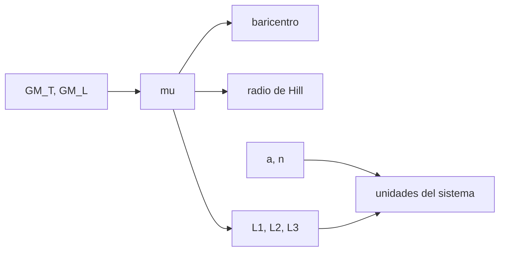

# B76-C01 — Sistema Tierra-Luna

<!-- nav:top -->
[🏠 Programa](../../../../README.md) · [📚 Bloque B76](../../../tronco-comun/B76-dinamica-cislunar-y-operaciones-de-proximidad.md) · [← Anterior: B75-C30 — Validación de maniobras por reintegración](../../../tronco-comun/B75-trayectorias-y-misiones-interplanetarias.md#b75-c30) · [Siguiente: B76-C02 — Escalas sinódicas de referencia →](../B76-C02-escalas-sinodicas-de-referencia/CLASE.md)
<!-- /nav -->

## 1. Ubicación, nivel y alcance

Clase 1 del bloque B76, nivel N3. Abre el bloque: antes de hablar de órbitas halo o de encuentros hace falta saber qué es el sistema Tierra-Luna como problema de ingeniería, con qué números se describe y dónde se comprueban. Calculas el parámetro de masa, la posición del baricentro, el radio de Hill de la Luna y los puntos de Lagrange colineales. Usas [B74](../../../tronco-comun/B74-estimacion-de-orbitas-y-navegacion-espacial.md) solo como contexto de órbitas; aquí todo se reconstruye desde las constantes. Los números son los del modelo circular y plano, no una efeméride.

## 2. Por qué esta clase existe

Una nave que sale de la Tierra hacia la Luna siente dos atracciones comparables en una región pequeña. La decisión central: **¿en qué punto del sistema deja de bastar el modelo de dos cuerpos y qué escalas gobiernan el problema?** Sin esas escalas, ni las órbitas ni las transferencias de las clases siguientes tienen sentido.

## 3. Lo que podrás hacer al terminar

1. Calcular el parámetro de masa `μ = GM_L/(GM_T+GM_L)` y la razón de masas Tierra/Luna.
2. Ubicar el baricentro del sistema y compararlo con el radio de la Tierra.
3. Estimar el radio de Hill y la esfera de influencia de Laplace de la Luna.
4. Resolver por bisección los puntos de Lagrange colineales `L1`, `L2` y `L3`.
5. Convertir longitud, tiempo y velocidad a las unidades del sistema.
6. Separar lo consultado (constantes) de lo modelado (círculo plano sin Sol).

La evidencia es la **ficha del sistema Tierra-Luna** del ejercicio 12 (sección 20).

## 4. Con qué llegas y cómo comprobarlo

1. ¿Qué es el parámetro gravitacional `GM` y en qué unidades se da?
2. ¿Qué es el baricentro de dos cuerpos?
3. ¿Qué es un punto de equilibrio en un marco que rota?
4. ¿Qué es un dato sintético?
5. ¿Qué es una verificación por segunda vía?

<details>
<summary>Ver respuestas</summary>

1. El producto de la constante de gravitación por la masa, en km³/s². 2. El centro de masa común, alrededor del cual orbitan ambos. 3. Un punto donde la aceleración neta (gravedad más términos inerciales) es cero. 4. Un dato generado para el ejemplo, no medido. 5. Calcular lo mismo con otro método y comparar.
</details>

Con cuatro o cinco aciertos, sigue; si no, repasa los prerrequisitos.

## 5. Un caso de contexto y casos de referencia

La Tierra pesa `81,3006` veces la Luna. El baricentro cae a `4670,7 km` del centro de la Tierra, dentro de ella (`0,7331` radios medios). `L1` queda a `58.019 km` de la Luna y `L2` a `64.515 km`. Ese es el **ejemplo conductor**: constantes consultadas, modelo circular y plano; ninguna cifra es una posición de efemérides.

## 6. Vocabulario

El **parámetro de masa** `μ = GM_L/(GM_T+GM_L)` fija el problema restringido. El **baricentro** es el centro de masa común. El **radio de Hill** aproximado es `a (μ/3)^(1/3)`; la **esfera de Laplace** es `a (GM_L/GM_T)^(2/5)`. Los **puntos de Lagrange colineales** `L1`, `L2`, `L3` están sobre la línea Tierra-Luna y son puntos de equilibrio en el marco sinódico.

## 7. Modelo mental: una balanza que gira



*Descripción textual:* de las dos constantes gravitacionales sale `μ`, y de `μ` salen el baricentro, el radio de Hill y los puntos de Lagrange; la distancia media y el movimiento medio fijan las unidades.

Analogía: dos personas en un tiovivo sujetan una cuerda con una bola; hay posiciones donde la bola queda quieta respecto al tiovivo. Límite: el modelo supone órbitas circulares y masa despreciable de la nave; la Luna real tiene excentricidad `0,0549` y el Sol perturba.

## 8. La explicación, paso a paso

### 8.1 Parámetro de masa y baricentro

Con `GM_T = 398600,435507` y `GM_L = 4902,800118 km³/s²`: `μ = 4902,800118/403503,235625 = 0,01215058` y `GM_T/GM_L = 81,3006`. El baricentro dista `a μ = 384400 × 0,01215058 = 4670,7 km` del centro de la Tierra. Como `4670,7 < 6371` km, está dentro de la Tierra.

### 8.2 Radio de Hill y esfera de influencia

`R_H ≈ a (μ/3)^(1/3) = 61.274 km` y `r_L = a (GM_L/GM_T)^(2/5) = 66.183 km`. Son dos criterios distintos para «hasta dónde manda la Luna»; ninguno es una frontera exacta.

### 8.3 Puntos colineales

Se resuelve `dΩ/dx = x − (1−μ)(x+μ)/|x+μ|³ − μ(x−1+μ)/|x−1+μ|³ = 0` por bisección: `x_L1 = 0,836915`, `x_L2 = 1,155682`, `x_L3 = −1,005063`. Distancias: `L1` a `58.019 km` de la Luna, `L2` a `64.515 km`, `L3` a `381.675 km` de la Tierra en el lado opuesto. El residuo máximo es `1,11 × 10⁻¹⁵`.

### 8.4 Unidades del sistema

Longitud `a = 384.400 km`; tiempo `1/n` con `n = 2,665314 × 10⁻⁶ rad/s`, o sea `4,3425 d`; velocidad `a n = 1,02455 km/s`. En esas unidades la Tierra está en `x = −μ` y la Luna en `x = 1−μ`.

## 9. Magnitudes, símbolos y unidades

| Símbolo | Qué es | Unidad | Valor / nota |
|---|---|---|---|
| `μ` | parámetro de masa | — | 0,01215058 |
| `GM_T/GM_L` | razón de masas | — | 81,3006 |
| `a μ` | baricentro desde la Tierra | km | 4670,7 |
| `R_H` | radio de Hill aproximado | km | 61.274 |
| `x_L1`, `x_L2` | puntos colineales | — | 0,836915; 1,155682 |
| `n` | movimiento medio | rad/s | 2,665314e-6 |

## 10. Convenciones y referencias

Constantes de las fuentes citadas (JPL DE440 para `GM`; NASA/NSSDC para `a = 384.400 km`). CR3BP circular y plano: ejes sinódicos adimensionales, origen en el baricentro, Tierra en `(−μ, 0)`, Luna en `(1−μ, 0)`. El modelo no incluye el Sol, la excentricidad lunar ni armónicos.

## 11. De dónde sale lo que afirmamos

| ID | Fuente | Localizador | Respalda | Estado |
|---|---|---|---|---|
| S1 | NASA JPL SSD, Astrodynamic Parameters — https://ssd.jpl.nasa.gov/astro_par.html (consultada 2026-11-10) | tabla de GM y constantes | GM de la Tierra = 398600,435507 km³/s²; GM de la Luna = 4902,800118 km³/s² (DE440, Park et al. 2021); UA = 149597870700 m | Consultada |
| S2 | NASA/NSSDC, Moon Fact Sheet — https://nssdc.gsfc.nasa.gov/planetary/factsheet/moonfact.html (consultada 2026-11-10) | ficha completa leída | semieje mayor 0,3844×10⁶ km; periodo sideral 27,3217 d; periodo sinódico 29,53 d; excentricidad 0,0549; radio medio 1737,4 km; gravedad superficial 1,62 m/s² | Consultada |
| S3 | NASA/NSSDC, Earth Fact Sheet — https://nssdc.gsfc.nasa.gov/planetary/factsheet/earthfact.html (consultada 2026-11-10) | ficha leída | masa 5,9722×10²⁴ kg; radio medio volumétrico 6371,000 km; radio ecuatorial 6378,137 km | Consultada |
| — | Relaciones estándar: problema restringido de tres cuerpos, radio de Hill, esfera de Laplace | — | las verifica el laboratorio con una segunda vía (residuo de `dΩ/dx`) | No consultada en una fuente concreta |

Límites: el radio de Hill y la esfera de Laplace son aproximaciones; no se consultó una efeméride (Horizons ni SPICE) y no se infiere ninguna posición real de la Luna.

## 12. Cómo ver el sistema

| Magnitud | Valor |
|---|---|
| Razón de masas | 81,3006 |
| Baricentro | 4670,7 km del centro terrestre |
| `L1`, `L2` desde la Luna | 58.019 km; 64.515 km |
| Unidad de tiempo | 4,3425 d |

Descripción larga: el baricentro cae dentro de la Tierra y los puntos `L1` y `L2` están a un par de decenas de radios lunares de la Luna.

## 13. Ejemplo trabajado: el baricentro

**Paso 1 · Parámetro.** `μ = GM_L/(GM_T+GM_L) = 0,01215058`.

**Paso 2 · Distancia.** `a μ = 384.400 × 0,01215058 = 4670,7 km`.

**Paso 3 · Comparación.** `4670,7/6371 = 0,7331`: el baricentro está dentro de la Tierra.

**Paso 4 · Lectura.** La Tierra describe un círculo de `4670,7 km` de radio alrededor de ese punto.

## 14. Distintas formas de describir el sistema

**Por masas:** `μ`. **Por escala:** `a`, `n`. **Por equilibrio:** `L1`–`L3`. **Por influencia:** `R_H` o `r_L`. **Por energía:** la constante de Jacobi (clase 8).

## 15. Práctica guiada

**Ejercicio 1 · con los pasos indicados.** Calcula la razón `GM_T/GM_L`. *Pasos:* divide los dos `GM` de la sección 10.

<details><summary>Solución comentada</summary>

`398600,435507/4902,800118 = 81,3006`; coincide con el laboratorio.
</details>

**Ejercicio 2 · con una pista.** Predice si el baricentro cae dentro de la Tierra. *Pista:* compáralo con `6371 km`.

<details><summary>Solución comentada</summary>

`4670,7 < 6371`: sí, a `0,7331` radios medios.
</details>

**Ejercicio 3 · casi autónomo.** ¿Por qué `L1` y `L2` no quedan exactamente a un radio de Hill?

<details><summary>Solución comentada</summary>

El radio de Hill es una aproximación de orden más bajo en `μ`; `58.019` y `64.515 km` difieren de `61.274 km` en un 5–6 %.
</details>

## 16. Práctica autónoma, transferencia e integrador

**Ejercicio 4 · autónomo.** Calcula la unidad de velocidad `a n`.

<details><summary>Solución comentada</summary>

`384.400 × 2,665314 × 10⁻⁶ = 1,02455 km/s`.
</details>

**Ejercicio 5 · autónomo.** Convierte un periodo de `6,56 d` a unidades del sistema.

<details><summary>Solución comentada</summary>

`6,56/4,3425 = 1,5107` unidades de tiempo.
</details>

**Ejercicio 6 · autónomo.** ¿Cuántos kilómetros mide `x_L3 + μ` en valor absoluto?

<details><summary>Solución comentada</summary>

`|−1,005063 + 0,01215058| = 0,99291`; `× 384.400 = 381.675 km`.
</details>

**Ejercicio 7 · autónomo.** Estima la razón `R_H` / radio medio lunar (1737,4 km).

<details><summary>Solución comentada</summary>

`61.274/1737,4 = 35,3`.
</details>

**Ejercicio 8 · autónomo.** Explica qué cambiaría en `μ` si la Luna tuviera el doble de masa.

<details><summary>Solución comentada</summary>

`μ` casi se duplica (`≈ 0,0240`), el baricentro sube a `≈ 9.200 km` y el radio de Hill crece por `2^(1/3) = 1,26`.
</details>

**Ejercicio 9 · transferencia.** **Transferencia.** Un colega dice que la Luna orbita la Tierra en un círculo de `384.400 km` de radio exacto. ¿Qué respondes?

<details><summary>Solución comentada</summary>

Es la distancia media; la excentricidad `0,0549` varía la distancia y el modelo circular es una aproximación.
</details>

**Ejercicio 10 · transferencia.** **Transferencia.** Se propone usar `L2` como punto de relevo de comunicaciones. ¿Qué falta saber de este modelo?

<details><summary>Solución comentada</summary>

Que es inestable y que el Sol perturba: el CR3BP indica el equilibrio, no el costo de mantenerse (clases 4 y 19).
</details>

**Ejercicio 11 · transferencia.** **Transferencia.** Un informe da la posición de `L1` en kilómetros sin nombrar el modelo. ¿Qué objetas?

<details><summary>Solución comentada</summary>

Falta rotular que es CR3BP circular y plano y las constantes usadas; sin eso no es reproducible.
</details>

**Ejercicio 12 · integrador.** **Integrador.** Elabora tu *ficha del sistema Tierra-Luna*: `μ`, razón de masas, baricentro, `R_H`, `L1`–`L3` y unidades, con fuentes.

<details><summary>Solución comentada</summary>

Secciones 8.1–8.4 y la salida del laboratorio, con constantes consultadas y modelo rotulado.
</details>

## 17. Laboratorio: escalas y puntos colineales del sistema Tierra-Luna

El script [sistema.py](sistema.py) calcula `μ`, el baricentro, `R_H`, la esfera de Laplace, los puntos `L1`–`L3` por bisección y las unidades del sistema Usa la biblioteca común [cislunar_lib.py](../cislunar_lib.py) del bloque (**comprueba** residuo de `dΩ/dx` < 1e-12, baricentro dentro de la Tierra y `L1`, `L2` cerca del radio de Hill).

**Datos:** `GM` de la Tierra y de la Luna (JPL, DE440), `a` (NASA/NSSDC) y radios (NASA/NSSDC, JPL) **consultados** el 2026-11-10; el modelo circular y plano es una **simplificación**. **Predice antes de ejecutar:** ¿cae el baricentro dentro de la Tierra? (sí, a `0,73` radios medios.) **Ejecución del 2026-11-10 (Python 3.12.9):**

```text
Python 3.12.9 (biblioteca estandar)
mu = GM_L/(GM_T+GM_L) = 0.01215058 ; GM_T/GM_L = 81.3006
Baricentro a 4670.7 km del centro de la Tierra = 0.7331 radios medios terrestres
Radio de Hill de la Luna ~ 61274 km ; esfera de Laplace ~ 66183 km
L1 a 58019 km de la Luna ; L2 a 64515 km ; L3 a 381675 km de la Tierra, en el lado opuesto a la Luna
x adimensional: L1 = 0.836915 ; L2 = 1.155682 ; L3 = -1.005063
Residuo maximo de dOmega/dx = 1.11e-15
n = 2.665314e-06 rad/s ; unidad de tiempo = 4.3425 d ; unidad de velocidad = 1.02455 km/s
Pruebas superadas.
```

```bash
python programa/clases/B76/B76-C01-sistema-tierra-luna/sistema.py
```

**Límites:** CR3BP circular y plano, sin Sol ni excentricidad; es un cálculo de escalas, no una efeméride.

## 18. Errores frecuentes y cómo corregirlos

**Tomar `a μ` como la altura de la Luna.** Es la distancia de la Tierra al baricentro. Se corrige con 8.1.

**Creer que el radio de Hill es una frontera exacta.** Es una aproximación. Se corrige con 8.2.

**Usar `n` sinódico en lugar del sideral para el tiempo del sistema.** Se corrige con 8.4 y la clase 2.

**Presentar el resultado como posición real de la Luna.** Se corrige con la sección 10.

## 19. Cómo sabrás que vas bien

Tras la sección 8: ¿qué distancia esperabas para el baricentro y cuál obtuviste? Si dudas, repasa el ejemplo 13. Tras el laboratorio: ¿qué comprueba el residuo? (ver la sección 17).

## 20. Qué entregas y cómo se evalúa

El producto es tu **ficha del sistema Tierra-Luna** (ejercicio 12).

| Criterio | Inicial | En desarrollo | Logrado | Destacado |
|---|---|---|---|---|
| Conceptos | Los confunde | Parciales | Define `μ`, baricentro y puntos colineales | Explica los límites del círculo plano |
| Cálculo | Sin unidades | Con errores | Tablas completas con unidades | Calcula casos con otras masas |
| Numérico | Sin comprobar | Un caso | Residuo y comparación con `R_H` | Interpreta las diferencias |
| Fuentes | Sin fuente | Sin fecha | Fuentes con fecha y estado | Declara lo no consultado |
| Límites | No los nombra | Uno | Tres | Discute qué falta del modelo |

**Condiciones críticas (no se compensan con promedio):** rotular el modelo como circular y plano; no presentar un resultado como efeméride; citar solo lo consultado.

## 21. Ética, seguridad y límites

Clase educativa: los modelos son simplificados y sus datos son sintéticos, ilustrativos o publicados con fuente; ningún resultado es una efeméride, una telemetría ni una recomendación operativa, y lo simulado nunca se presenta como observado.  Accesibilidad: tablas equivalentes a las gráficas, fórmulas en texto, ejercicios sin conexión.

## 22. Para cerrar y seguir

El sistema Tierra-Luna se resume en `μ = 0,01215058`: el baricentro está a `4670,7 km` del centro terrestre y `L1` y `L2` a `58.019` y `64.515 km` de la Luna. Queda una pregunta: ¿qué escalas de tiempo usan las órbitas que los rodean?

**Glosario español–inglés.** baricentro · *barycenter*; radio de Hill · *Hill radius*; punto de Lagrange · *Lagrange point*; parámetro de masa · *mass parameter*; marco sinódico · *synodic frame*.

**Continuidad.** [B76-C02](../B76-C02-escalas-sinodicas-de-referencia/CLASE.md) trata las escalas sinódicas y de tiempo.

**Referencias:** ver sección 11.

<!-- nav:bottom -->
---

[← Anterior: B75-C30 — Validación de maniobras por reintegración](../../../tronco-comun/B75-trayectorias-y-misiones-interplanetarias.md#b75-c30) · [📚 Bloque B76](../../../tronco-comun/B76-dinamica-cislunar-y-operaciones-de-proximidad.md) · [Siguiente: B76-C02 — Escalas sinódicas de referencia →](../B76-C02-escalas-sinodicas-de-referencia/CLASE.md)
<!-- /nav -->
