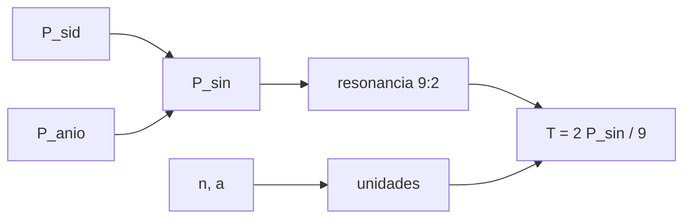

# B76-C02 — Escalas sinódicas de referencia

<!-- nav:top -->
[🏠 Programa](../../../../README.md) · [📚 Bloque B76](../../../tronco-comun/B76-dinamica-cislunar-y-operaciones-de-proximidad.md) · [← Anterior: B76-C01 — Sistema Tierra-Luna](../B76-C01-sistema-tierra-luna/CLASE.md) · [Siguiente: B76-C03 — Órbitas alrededor de la Luna →](../B76-C03-orbitas-alrededor-de-la-luna/CLASE.md)
<!-- /nav -->

## 1. Ubicación, nivel y alcance

Clase 2 del bloque B76, nivel N3. Un mes lunar tiene dos duraciones —sideral y sinódica— y la dinámica cislunar usa ambas. Aquí conviertes entre ellas, defines las unidades adimensionales del problema de tres cuerpos y compruebas con la referencia publicada que una NRHO de 9:2 tiene el periodo esperado. Parte de [B76-C01](../B76-C01-sistema-tierra-luna/CLASE.md). Todo es cálculo sobre constantes; no se usa ninguna efeméride.

## 2. Por qué esta clase existe

Un equipo que mezcla el mes sideral con el sinódico desplaza una resonancia en medio día y pierde una geometría de eclipses. La decisión central: **¿qué escala de tiempo corresponde a cada pregunta y cómo se convierte sin error?**

## 3. Lo que podrás hacer al terminar

1. Calcular el periodo sinódico a partir del sideral y del año.
2. Convertir longitudes, tiempos y velocidades a unidades adimensionales del sistema y de vuelta.
3. Obtener el periodo de una órbita resonante `p:q` con el mes sinódico.
4. Comprobar la resonancia 9:2 contra el periodo publicado de una NRHO.
5. Verificar una conversión con la ida y vuelta.
6. Rotular qué valor se consultó y cuál es un valor estándar no consultado.

La evidencia es la **tabla de escalas y conversión de unidades** del ejercicio 12 (sección 20).

## 4. Con qué llegas y cómo comprobarlo

1. ¿Qué es un periodo sideral?
2. ¿Qué es un periodo sinódico?
3. ¿Qué es una resonancia 9:2?
4. ¿Qué es una cantidad adimensional?
5. ¿Qué es una verificación por ida y vuelta?

<details>
<summary>Ver respuestas</summary>

1. El tiempo de una vuelta respecto a las estrellas. 2. El tiempo entre dos alineaciones iguales con el Sol (fases). 3. Nueve vueltas de la nave por cada dos del otro periodo. 4. Una magnitud dividida por una escala de su misma dimensión. 5. Convertir y volver y comprobar que se recupera el valor.
</details>

Con cuatro o cinco aciertos, sigue; si no, repasa los prerrequisitos.

## 5. Un caso de contexto y casos de referencia

Con el periodo sideral lunar `27,3217 d` y el año `365,256 d` (valor estándar, no consultado en esta sesión) se obtiene un mes sinódico de `29,5306 d`, que coincide con los `29,53 d` de la ficha de la NASA (diferencia `0,0006 d`). Dos meses sinódicos divididos entre nueve da `6,5622 d`, el periodo medio publicado `6,56 d` de la NRHO de Gateway. Es el **ejemplo conductor**.

## 6. Vocabulario

El **periodo sideral** `P_sid = 27,3217 d`. El **periodo sinódico** `1/P_sin = 1/P_sid − 1/P_año`. Las **unidades del sistema**: longitud `a`, tiempo `1/n`, velocidad `a n`. Una **resonancia 9:2** con el mes sinódico significa `T = 2 P_sin/9`.

## 7. Modelo mental: dos relojes con engranajes distintos



*Descripción textual:* el mes sideral y el año dan el mes sinódico; de él sale el periodo de la órbita resonante; las unidades del sistema permiten expresar todo sin dimensiones.

Analogía: las agujas de un reloj coinciden cada 65,45 minutos, no cada hora; el periodo entre coincidencias depende de la diferencia de velocidades. Límite: el mes sinódico real varía por la excentricidad y el Sol; aquí se usa el valor medio.

## 8. La explicación, paso a paso

### 8.1 Mes sinódico

`1/P_sin = 1/27,3217 − 1/365,256 = 0,0338632 d⁻¹`, así que `P_sin = 29,5306 d`. La ficha da `29,53 d`; la diferencia es `0,0006 d`. El año `365,256 d` es un valor estándar que **no se consultó** en esta sesión y solo sirve como comprobación.

### 8.2 Movimientos medios

`n_sid = 2π/27,3217 = 0,22997 rad/d` y `n_sin = 2π/29,53 = 0,21277 rad/d`. El marco sinódico gira con el movimiento sideral `n`, que es el de las ecuaciones del CR3BP.

### 8.3 Unidades del sistema

Longitud `384.400 km`, tiempo `4,3425 d`, velocidad `1,02455 km/s`. Para la NRHO publicada: apolune `71.100/384.400 = 0,18496` y periodo `6,56/4,3425 = 1,51066`. La ida y vuelta devuelve el valor con error `0`.

### 8.4 Resonancia 9:2

`T = 2 P_sin/9 = 6,5622 d` frente al periodo medio publicado `6,56 d`; `2 P_sin/6,56 = 9,003` revoluciones por dos meses sinódicos. La resonancia con el mes sinódico (y no con el sideral) es la que mantiene la geometría con respecto al Sol, que es lo que importa para los eclipses.

## 9. Magnitudes, símbolos y unidades

| Símbolo | Qué es | Unidad | Valor / nota |
|---|---|---|---|
| `P_sid` | periodo sideral lunar | d | 27,3217 |
| `P_sin` | periodo sinódico | d | 29,5306 (calc.); 29,53 (ficha) |
| `n` | movimiento medio sideral | rad/d | 0,22997 |
| `T` | periodo de la NRHO resonante | d | 6,5622 |
| tiempo | unidad del sistema | d | 4,3425 |
| velocidad | unidad del sistema | km/s | 1,02455 |

## 10. Convenciones y referencias

Constantes de las fuentes citadas. El año de `365,256 d` es un valor estándar no consultado. Unidades adimensionales del CR3BP: longitud `a`, tiempo `1/n`, `n = √((GM_T+GM_L)/a³)`.

## 11. De dónde sale lo que afirmamos

| ID | Fuente | Localizador | Respalda | Estado |
|---|---|---|---|---|
| S1 | NASA/NSSDC, Moon Fact Sheet — https://nssdc.gsfc.nasa.gov/planetary/factsheet/moonfact.html (consultada 2026-11-10) | ficha completa leída | semieje mayor 0,3844×10⁶ km; periodo sideral 27,3217 d; periodo sinódico 29,53 d; excentricidad 0,0549; radio medio 1737,4 km; gravedad superficial 1,62 m/s² | Consultada |
| S2 | NASA JPL SSD, Astrodynamic Parameters — https://ssd.jpl.nasa.gov/astro_par.html (consultada 2026-11-10) | tabla de GM y constantes | GM de la Tierra = 398600,435507 km³/s²; GM de la Luna = 4902,800118 km³/s² (DE440, Park et al. 2021); UA = 149597870700 m | Consultada |
| S3 | Davis, Khoury, Howell y Sweeney, «Phase Control and Eclipse Avoidance in Near Rectilinear Halo Orbits», NASA NTRS 20200000733 — https://ntrs.nasa.gov/api/citations/20200000733/downloads/20200000733.pdf (PDF leído con PyMuPDF el 2026-11-10; la fecha de publicación no se consultó) | introducción, figura 1 y tabla 1 | NRHO sur de L2 de referencia de Gateway; resonancia 9:2 con el periodo sinódico lunar; periodo medio 6,56 d (6,26–6,76); radio de perilune 3.195–3.557 km (medio 3.366); radio de apolune 70.005–71.849 km (medio 71.100); eclipses lunares < 90 min | Consultada |
| — | Valor estándar del año sideral, 365,256 d | — | comprobación del mes sinódico | No consultada |

Límites: el periodo medio de 6,56 d y el apolune medio de 71.100 km son valores de una NRHO calculada en un modelo de efemérides; aquí solo se comparan con el cálculo de escalas.

## 12. Cómo ver las escalas

| Magnitud | Valor |
|---|---|
| `P_sin` calculado | 29,5306 d |
| `2 P_sin / 9` | 6,5622 d |
| Revoluciones en dos meses sinódicos | 9,003 |
| Apolune publicado (adim.) | 0,18496 |

Descripción larga: el cálculo reproduce el mes sinódico de la ficha y el periodo medio publicado de la órbita resonante con una diferencia de centésimas de día.

## 13. Ejemplo trabajado: el periodo de una órbita 9:2

**Paso 1 · Mes sinódico.** `P_sin = 29,5306 d`.

**Paso 2 · Dos meses.** `2 P_sin = 59,0612 d`.

**Paso 3 · Nueve revoluciones.** `T = 59,0612/9 = 6,5624 d` (con `29,53` sale `6,5622`).

**Paso 4 · Comparación.** El periodo medio publicado es `6,56 d`: diferencia de `0,002 d`, menos de tres minutos.

## 14. Distintas formas de expresar un tiempo

**En días:** `6,56 d`. **En segundos:** `566.784 s`. **En unidades del sistema:** `1,5107`. **En fase sinódica:** `6,56/29,53 = 0,2222` del mes, es decir `2/9`.

## 15. Práctica guiada

**Ejercicio 1 · con los pasos indicados.** Calcula `P_sin` con `P_sid = 27,3217 d` y `P_año = 365,256 d`. *Pasos:* invierte, resta, invierte.

<details><summary>Solución comentada</summary>

`1/27,3217 = 0,0366011`; `1/365,256 = 0,0027379`; diferencia `0,0338632`; `P_sin = 29,531 d`.
</details>

**Ejercicio 2 · con una pista.** Calcula el periodo de una resonancia 9:2. *Pista:* son dos meses sinódicos para nueve vueltas.

<details><summary>Solución comentada</summary>

`2 × 29,53/9 = 6,562 d`.
</details>

**Ejercicio 3 · casi autónomo.** Convierte `1 d` a unidades del sistema.

<details><summary>Solución comentada</summary>

`1/4,3425 = 0,2303` unidades de tiempo.
</details>

## 16. Práctica autónoma, transferencia e integrador

**Ejercicio 4 · autónomo.** Convierte el apolune medio publicado a unidades del sistema.

<details><summary>Solución comentada</summary>

`71.100/384.400 = 0,18496`.
</details>

**Ejercicio 5 · autónomo.** Calcula `n_sin` en rad/d.

<details><summary>Solución comentada</summary>

`2π/29,53 = 0,21277 rad/d`.
</details>

**Ejercicio 6 · autónomo.** ¿Qué periodo tendría una resonancia 4:1 con el mes sinódico?

<details><summary>Solución comentada</summary>

Un mes sinódico entre cuatro vueltas: `29,53/4 = 7,38 d`.
</details>

**Ejercicio 7 · autónomo.** Convierte `1 km/s` a unidades del sistema.

<details><summary>Solución comentada</summary>

`1/1,02455 = 0,9760`.
</details>

**Ejercicio 8 · autónomo.** ¿Cuántas revoluciones de `6,56 d` caben en un año de `365,256 d`?

<details><summary>Solución comentada</summary>

`365,256/6,56 = 55,68` revoluciones.
</details>

**Ejercicio 9 · transferencia.** **Transferencia.** Un colega calcula la resonancia con el mes sideral: `2 × 27,3217/9`. ¿Qué obtiene y qué objeta?

<details><summary>Solución comentada</summary>

`6,07 d`, fuera del rango publicado `6,26–6,76 d`; la geometría solar depende del mes sinódico.
</details>

**Ejercicio 10 · transferencia.** **Transferencia.** Un informe dice «periodo 1,5 en unidades del sistema» sin definir la unidad. ¿Qué falta?

<details><summary>Solución comentada</summary>

La unidad de tiempo (`1/n = 4,3425 d`); sin ella, `1,5` equivale a `6,51 d` o a otra cosa según la convención.
</details>

**Ejercicio 11 · transferencia.** **Transferencia.** ¿Por qué la ida y vuelta de unidades no demuestra que la unidad sea la correcta?

<details><summary>Solución comentada</summary>

Solo comprueba la consistencia interna; la unidad correcta se valida contra una fuente, aquí `n` y `a` consultados.
</details>

**Ejercicio 12 · integrador.** **Integrador.** Elabora tu *tabla de escalas y conversión de unidades*: `P_sin`, `n`, unidades del sistema, 9:2 y la NRHO publicada, con fuentes.

<details><summary>Solución comentada</summary>

Secciones 8.1–8.4 y la salida del laboratorio, con la diferencia de `0,0006 d` y el valor estándar rotulado.
</details>

## 17. Laboratorio: escalas sinódicas y resonancia 9:2

El script [escalas.py](escalas.py) calcula el mes sinódico, los movimientos medios, las unidades del sistema, la resonancia 9:2 y la ida y vuelta de unidades Usa la biblioteca común [cislunar_lib.py](../cislunar_lib.py) del bloque (**comprueba** `P_sin` frente a 29,53 d < 0,05 d, `T` frente a 6,56 d < 0,02 d e ida y vuelta < 1e-12).

**Datos:** Periodos de la ficha de la Luna (NASA/NSSDC), `a` y `GM` (consultados el 2026-11-10); periodo medio y apolune medio de la NRHO publicada (Davis et al., NTRS 20200000733); el año de 365,256 d es **estándar no consultado**. **Predice antes de ejecutar:** ¿cuántas revoluciones caben en dos meses sinódicos? (`9,003`.) **Ejecución del 2026-11-10 (Python 3.12.9):**

```text
Python 3.12.9 (biblioteca estandar)
Periodo sinodico calculado = 29.5306 d ; consultado = 29.53 d ; diferencia = 0.0006 d
Movimiento medio sideral = 0.22997 rad/d ; sinodico = 0.21277 rad/d
Unidades: longitud = 384400 km ; tiempo = 4.3425 d ; velocidad = 1.02455 km/s
Resonancia 9:2: 2*P_sin/9 = 6.5622 d (periodo medio publicado 6.56 d)
Revoluciones de 6.56 d en dos meses sinodicos = 9.003
NRHO publicada en unidades adimensionales: apolune = 0.18496 ; periodo = 1.51066
Error de ida y vuelta de unidades = 0.00e+00
Pruebas superadas.
```

```bash
python programa/clases/B76/B76-C02-escalas-sinodicas-de-referencia/escalas.py
```

**Límites:** Valores medios; el mes sinódico real varía y no se usó ninguna efeméride.

## 18. Errores frecuentes y cómo corregirlos

**Mezclar el mes sideral con el sinódico.** Se corrige con 8.1.

**Dar un tiempo adimensional sin la unidad.** Se corrige con 8.3.

**Usar `n_sin` en las ecuaciones del CR3BP.** El marco gira con `n` sideral. Se corrige con 8.2.

**Tomar el periodo de una NRHO de efemérides como el del CR3BP exacto.** Se corrige en la clase 5.

## 19. Cómo sabrás que vas bien

Tras la sección 8: ¿qué periodo esperabas para la resonancia y cuál obtuviste? Si dudas, repasa el ejemplo 13. Tras el laboratorio: ¿qué comprueba la ida y vuelta? (ver la sección 17).

## 20. Qué entregas y cómo se evalúa

El producto es tu **tabla de escalas y conversión de unidades** (ejercicio 12).

| Criterio | Inicial | En desarrollo | Logrado | Destacado |
|---|---|---|---|---|
| Conceptos | Los confunde | Parciales | Distingue sideral y sinódico | Explica por qué la resonancia es sinódica |
| Cálculo | Sin unidades | Con errores | Tabla completa con unidades | Calcula resonancias nuevas |
| Numérico | Sin comprobar | Un caso | Ida y vuelta y comparación con la ficha | Interpreta las diferencias |
| Fuentes | Sin fuente | Sin fecha | Fuentes con fecha y estado | Declara el año como no consultado |
| Límites | No los nombra | Uno | Tres | Discute la variación del mes real |

**Condiciones críticas (no se compensan con promedio):** declarar el año de 365,256 d como no consultado; dar unidades en todo tiempo adimensional; citar solo lo consultado.

## 21. Ética, seguridad y límites

Clase educativa: los modelos son simplificados y sus datos son sintéticos, ilustrativos o publicados con fuente; ningún resultado es una efeméride, una telemetría ni una recomendación operativa, y lo simulado nunca se presenta como observado.  Accesibilidad: tablas equivalentes a las gráficas, fórmulas en texto, ejercicios sin conexión.

## 22. Para cerrar y seguir

Un mes sinódico de `29,53 d` y nueve vueltas en dos meses dan `6,56 d`, el periodo de una NRHO de Gateway. Queda una pregunta: ¿qué órbitas caben alrededor de la Luna cuando la Tierra también tira?

**Glosario español–inglés.** periodo sinódico · *synodic period*; periodo sideral · *sidereal period*; resonancia · *resonance*; unidades adimensionales · *nondimensional units*; movimiento medio · *mean motion*.

**Continuidad.** [B76-C03](../B76-C03-orbitas-alrededor-de-la-luna/CLASE.md) estudia las órbitas alrededor de la Luna.

**Referencias:** ver sección 11.

<!-- nav:bottom -->
---

[← Anterior: B76-C01 — Sistema Tierra-Luna](../B76-C01-sistema-tierra-luna/CLASE.md) · [📚 Bloque B76](../../../tronco-comun/B76-dinamica-cislunar-y-operaciones-de-proximidad.md) · [Siguiente: B76-C03 — Órbitas alrededor de la Luna →](../B76-C03-orbitas-alrededor-de-la-luna/CLASE.md)
<!-- /nav -->
