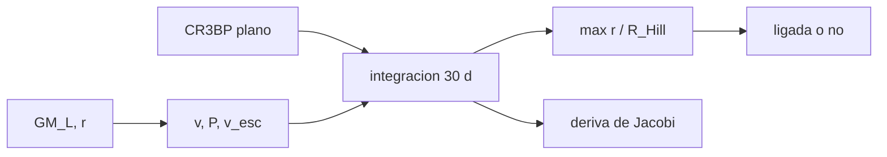

# B76-C03 — Órbitas alrededor de la Luna

<!-- nav:top -->
[🏠 Programa](../../../../README.md) · [📚 Bloque B76](../../../tronco-comun/B76-dinamica-cislunar-y-operaciones-de-proximidad.md) · [← Anterior: B76-C02 — Escalas sinódicas de referencia](../B76-C02-escalas-sinodicas-de-referencia/CLASE.md) · [Siguiente: B76-C04 — Órbitas halo →](../B76-C04-orbitas-halo/CLASE.md)
<!-- /nav -->

## 1. Ubicación, nivel y alcance

Clase 3 del bloque B76, nivel N3. Cerca de la Luna una órbita es casi kepleriana; lejos, la Tierra la deforma o la expulsa. Aquí calculas la velocidad y el periodo de órbitas lunares bajas y pruebas en el problema de tres cuerpos hasta qué radio sobreviven, en sentido directo y retrógrado. Usa [B76-C01](../B76-C01-sistema-tierra-luna/CLASE.md) para el radio de Hill. El campo gravitatorio no esférico de la Luna no se modela.

## 2. Por qué esta clase existe

Un orbitador lunar bajo y un satélite de relevo alto obedecen leyes distintas. La decisión central: **¿hasta qué distancia de la Luna puede mantenerse una órbita casi circular y qué sentido de giro resiste mejor la perturbación terrestre?**

## 3. Lo que podrás hacer al terminar

1. Calcular velocidad, periodo y velocidad de escape en una órbita lunar circular.
2. Escalar el periodo con `r^(3/2)` entre dos altitudes.
3. Integrar una órbita lunar en el CR3BP plano y medir la distancia máxima a la Luna.
4. Comparar el comportamiento prógrado y retrógrado a igual radio.
5. Verificar la integración con la conservación de la constante de Jacobi.
6. Separar lo consultado (`GM_L`, radios) de lo ilustrativo (radios de prueba).

La evidencia es la **ficha de una órbita lunar baja** del ejercicio 12 (sección 20).

## 4. Con qué llegas y cómo comprobarlo

1. ¿Qué es la velocidad circular `√(GM/r)`?
2. ¿Qué es un radio de Hill?
3. ¿Qué distingue una órbita prógrada de una retrógrada?
4. ¿Qué es la constante de Jacobi?
5. ¿Qué es un dato ilustrativo?

<details>
<summary>Ver respuestas</summary>

1. La velocidad de una órbita circular de radio `r`. 2. El radio aproximado dentro del cual la Luna domina sobre la Tierra. 3. El sentido de giro: igual o contrario al de la Luna alrededor de la Tierra. 4. La integral de energía del problema restringido en el marco que rota. 5. Un valor elegido para el ejemplo, no medido.
</details>

Con cuatro o cinco aciertos, sigue; si no, repasa los prerrequisitos.

## 5. Un caso de contexto y casos de referencia

A `100 km` de altitud sobre la Luna (`r = 1837,4 km`) la velocidad circular es `1,6335 km/s` y el periodo `117,79 min`. A `0,5` radios de Hill (`≈ 30.600 km`), una órbita prógrada alcanza `0,689` radios de Hill en 30 d y una retrógrada solo `0,530`. Es el **ejemplo conductor**; los radios de prueba son ilustrativos.

## 6. Vocabulario

El **radio de Hill** `R_H = 61.274 km`. Una órbita **prógrada** gira como la Luna alrededor de la Tierra; una **retrógrada** gira al revés. La **velocidad de escape** es `√2` veces la circular. El **criterio de ligada** de este laboratorio: la distancia a la Luna no supera `R_H` en 30 d.

## 7. Modelo mental: una canica en un cuenco que se inclina



*Descripción textual:* de `GM_L` y `r` salen la velocidad y el periodo; se integra en el CR3BP plano durante 30 d, se mide el alejamiento máximo y se comprueba la conservación de Jacobi.

Analogía: una canica gira en un cuenco; si el cuenco se inclina periódicamente, las órbitas cercanas al centro siguen limpias y las del borde se desbordan. Límite: sin el campo no esférico de la Luna ni el Sol, las órbitas bajas reales también se deforman.

## 8. La explicación, paso a paso

### 8.1 Kepleriano lunar

Con `GM_L = 4902,800118 km³/s²`: a `h = 100 km`, `v = 1,6335 km/s`, `P = 117,79 min`, `v_esc = 2,3101 km/s`. A `h = 2000 km`, `v = 1,1453 km/s`, `P = 341,71 min`. El periodo escala con `r^(3/2)`: `(3737,4/1837,4)^1,5 = 2,901`.

### 8.2 Efecto de la Tierra

Se integran órbitas circulares de radio `r = f R_H` en el CR3BP plano con velocidad sinódica `±v − r` (prógrada `+`). La constante de Jacobi se conserva con deriva máxima `1,1 × 10⁻⁷` (órbita más cerrada, paso fijo) o `10⁻¹² ` (las demás).

### 8.3 Resultados a 30 d

| `r/R_H` | prógrada | retrógrada |
|---|---|---|
| 0,1 | 0,100 (ligada) | 0,100 (ligada) |
| 0,3 | 0,306 (ligada) | 0,304 (ligada) |
| 0,5 | 0,689 (ligada) | 0,530 (ligada) |
| 0,9 | sale (3,0 a los 9,58 d) | 1,029 (sale por poco) |

### 8.4 Lectura

Hasta `0,3 R_H` ambas órbitas son casi círculos. A `0,5 R_H` la prógrada ya se deforma un 38 %, la retrógrada solo un 6 %. A `0,9 R_H` ninguna es utilizable. La retrógrada resiste más: es lo que la clase 6 aprovecha para las órbitas retrógradas distantes.

## 9. Magnitudes, símbolos y unidades

| Símbolo | Qué es | Unidad | Valor / nota |
|---|---|---|---|
| `r` | radio orbital lunar | km | 1837,4 (h = 100 km) |
| `v` | velocidad circular | km/s | 1,6335 |
| `P` | periodo | min | 117,79 |
| `R_H` | radio de Hill | km | 61.274 |
| `r/R_H` | radio relativo de prueba | — | 0,1; 0,3; 0,5; 0,9 (ilustrativo) |

## 10. Convenciones y referencias

`GM_L` (JPL, DE440) y radio medio `1737,4 km` consultados. CR3BP circular y plano, ejes sinódicos adimensionales, RK4 de paso `5 × 10⁻⁴`; criterio de ligada ilustrativo del autor. Sin Sol, sin armónicos lunares.

## 11. De dónde sale lo que afirmamos

| ID | Fuente | Localizador | Respalda | Estado |
|---|---|---|---|---|
| S1 | NASA JPL SSD, Planetary Satellite Physical Parameters — https://ssd.jpl.nasa.gov/sats/phys_par/ (consultada 2026-11-10) | fila de la Luna (301) | GM = 4902,800 ± 0,001 km³/s² (DE440); radio medio 1737,4 ± 0,1 km (Archinal et al. 2018) | Consultada |
| S2 | NASA JPL SSD, Astrodynamic Parameters — https://ssd.jpl.nasa.gov/astro_par.html (consultada 2026-11-10) | tabla de GM y constantes | GM de la Tierra = 398600,435507 km³/s²; GM de la Luna = 4902,800118 km³/s² (DE440, Park et al. 2021); UA = 149597870700 m | Consultada |
| S3 | NASA/NSSDC, Moon Fact Sheet — https://nssdc.gsfc.nasa.gov/planetary/factsheet/moonfact.html (consultada 2026-11-10) | ficha completa leída | semieje mayor 0,3844×10⁶ km; periodo sideral 27,3217 d; periodo sinódico 29,53 d; excentricidad 0,0549; radio medio 1737,4 km; gravedad superficial 1,62 m/s² | Consultada |
| — | Relaciones estándar: velocidad circular, escala `r^(3/2)`, CR3BP | — | las verifica el laboratorio (conservación de Jacobi) | No consultada en una fuente concreta |

Límites: no se consultó el campo gravitatorio lunar (armónicos); el criterio de órbita ligada y los radios de prueba son ilustrativos.

## 12. Cómo ver las órbitas lunares

| Magnitud | Valor |
|---|---|
| `v` a 100 km | 1,6335 km/s |
| `P` a 100 km | 117,79 min |
| Prógrada 0,5 `R_H` | 0,689 `R_H` |
| Retrógrada 0,5 `R_H` | 0,530 `R_H` |

Descripción larga: a igual radio de partida, la órbita retrógrada se aleja menos que la prógrada.

## 13. Ejemplo trabajado: velocidad y periodo a 100 km

**Paso 1 · Radio.** `r = 1737,4 + 100 = 1837,4 km`.

**Paso 2 · Velocidad.** `v = √(4902,800118/1837,4) = 1,6335 km/s`.

**Paso 3 · Periodo.** `P = 2π × 1837,4/1,6335 = 7067 s = 117,8 min`.

**Paso 4 · Escape.** `v_esc = √2 × 1,6335 = 2,3101 km/s`.

## 14. Distintas formas de describir una órbita lunar

**Por altitud:** `h`. **Por radio:** `r`. **Por velocidad:** `v`. **Por periodo:** `P`. **Por fracción de Hill:** `r/R_H`. **Por sentido:** prógrada o retrógrada.

## 15. Práctica guiada

**Ejercicio 1 · con los pasos indicados.** Calcula la velocidad circular a `h = 100 km`. *Pasos:* suma el radio medio y usa `√(GM/r)`.

<details><summary>Solución comentada</summary>

`r = 1837,4 km`; `√(4902,800118/1837,4) = 1,6335 km/s`.
</details>

**Ejercicio 2 · con una pista.** Calcula el periodo a `h = 100 km`. *Pista:* `P = 2π r/v`.

<details><summary>Solución comentada</summary>

`2π × 1837,4/1,6335 = 7067 s = 117,8 min`.
</details>

**Ejercicio 3 · casi autónomo.** ¿Cuánto vale la velocidad de escape a esa altitud?

<details><summary>Solución comentada</summary>

`√2 × 1,6335 = 2,3101 km/s`.
</details>

## 16. Práctica autónoma, transferencia e integrador

**Ejercicio 4 · autónomo.** Predice `P` a `h = 2000 km` con la ley `r^(3/2)`.

<details><summary>Solución comentada</summary>

`117,79 × (3737,4/1837,4)^1,5 = 117,79 × 2,901 = 341,7 min`; coincide.
</details>

**Ejercicio 5 · autónomo.** Calcula el radio de una órbita de prueba de `0,1 R_H` y su velocidad.

<details><summary>Solución comentada</summary>

`r = 6127 km`; `v = √(4902,8/6127) = 0,8945 km/s`.
</details>

**Ejercicio 6 · autónomo.** ¿Cuántas revoluciones de `h = 100 km` caben en 30 d?

<details><summary>Solución comentada</summary>

`30 × 1440/117,79 = 366,7`.
</details>

**Ejercicio 7 · autónomo.** Compara el alejamiento relativo a `0,5 R_H`: prógrada frente a retrógrada.

<details><summary>Solución comentada</summary>

`0,689/0,5 = 1,38` y `0,530/0,5 = 1,06`.
</details>

**Ejercicio 8 · autónomo.** ¿Qué comprueba la deriva de Jacobi `10⁻¹²`?

<details><summary>Solución comentada</summary>

Que la integración numérica es precisa: Jacobi es constante en el modelo.
</details>

**Ejercicio 9 · transferencia.** **Transferencia.** Un diseñador propone una órbita lunar circular a `0,9 R_H` «para ver todo el planeta». ¿Qué respondes?

<details><summary>Solución comentada</summary>

En este modelo sale de la esfera de Hill en 30 d (la prógrada en 9,58 d); además el Sol y la excentricidad lunar empeoran el caso.
</details>

**Ejercicio 10 · transferencia.** **Transferencia.** Se afirma que las órbitas retrógradas son siempre estables. ¿Qué objetas?

<details><summary>Solución comentada</summary>

El laboratorio solo prueba 30 d y 4 radios en el modelo plano; a `0,9 R_H` la retrógrada también sale.
</details>

**Ejercicio 11 · transferencia.** **Transferencia.** Un informe da `P = 117,79 min` sin decir si usa `GM_L` consultado. ¿Qué falta?

<details><summary>Solución comentada</summary>

Citar `GM_L`, la fuente (JPL) y la fecha; sin ellos el número no es verificable.
</details>

**Ejercicio 12 · integrador.** **Integrador.** Elabora tu *ficha de una órbita lunar baja*: `r`, `v`, `P`, `v_esc` y el comportamiento prógrado y retrógrado a `0,5 R_H`, con fuentes.

<details><summary>Solución comentada</summary>

Secciones 8.1–8.4 y la salida del laboratorio.
</details>

## 17. Laboratorio: órbitas lunares y la perturbación terrestre

El script [lunar.py](lunar.py) calcula las órbitas keplerianas lunares y pone a prueba órbitas prógradas y retrógradas de cuatro radios en el CR3BP plano durante 30 d Usa la biblioteca común [cislunar_lib.py](../cislunar_lib.py) del bloque (**comprueba** conservación de Jacobi < 1e-6 y las órbitas de 0,1 R_H ligadas).

**Datos:** `GM_L`, `R_L` (JPL), `a` (NASA/NSSDC) **consultados** el 2026-11-10; las altitudes y los radios de prueba son **ilustrativos**. **Predice antes de ejecutar:** ¿cuál de las dos órbitas de `0,5 R_H` se alejará más? (la prógrada.) **Ejecución del 2026-11-10 (Python 3.12.9):**

```text
Python 3.12.9 (biblioteca estandar)
Kepleriano lunar (GM_L consultado):
  h =    100 km : r =  1837.4 km ; v = 1.6335 km/s ; P =  117.79 min ; v_esc = 2.3101 km/s
  h =   2000 km : r =  3737.4 km ; v = 1.1453 km/s ; P =  341.71 min ; v_esc = 1.6198 km/s
Radio de Hill = 61274 km. CR3BP plano, 30 d (ILUSTRATIVO en radios de prueba):
 r/R_Hill  sentido     max r/R_Hill  |dC|       t_integrado [d]
  0.10    prograda        0.100    1.09e-07    30.00  ligada
  0.10    retrograda      0.100    1.40e-07    30.00  ligada
  0.30    prograda        0.306    1.30e-12    30.00  ligada
  0.30    retrograda      0.304    4.02e-12    30.00  ligada
  0.50    prograda        0.689    1.72e-12    30.00  ligada
  0.50    retrograda      0.530    3.86e-14    30.00  ligada
  0.90    prograda        3.000    8.44e-15     9.58  sale de la esfera de Hill
  0.90    retrograda      1.029    8.88e-15    30.00  sale de la esfera de Hill
Pruebas superadas.
```

```bash
python programa/clases/B76/B76-C03-orbitas-alrededor-de-la-luna/lunar.py
```

**Límites:** CR3BP plano, 30 d, un solo criterio de ligada; sin Sol ni campo no esférico.

## 18. Errores frecuentes y cómo corregirlos

**Usar el radio de la Luna como radio orbital.** Hay que sumar la altitud. Se corrige con 8.1.

**Creer que toda órbita dentro del radio de Hill es estable.** Se corrige con 8.3.

**Mezclar velocidad inercial y sinódica al iniciar la integración.** Se corrige con 8.2.

**Presentar la prueba de 30 d como un análisis de estabilidad.** Se corrige con la sección 17.

## 19. Cómo sabrás que vas bien

Tras la sección 8: ¿qué alejamiento esperabas para la retrógrada a `0,5 R_H`? Si dudas, repasa el ejemplo 13. Tras el laboratorio: ¿qué comprueba Jacobi? (ver la sección 17).

## 20. Qué entregas y cómo se evalúa

El producto es tu **ficha de una órbita lunar baja** (ejercicio 12).

| Criterio | Inicial | En desarrollo | Logrado | Destacado |
|---|---|---|---|---|
| Conceptos | Los confunde | Parciales | Calcula `v` y `P` y distingue sentidos | Explica por qué la retrógrada resiste más |
| Cálculo | Sin unidades | Con errores | Tablas completas con unidades | Calcula casos nuevos |
| Numérico | Sin comprobar | Un caso | Jacobi conservado y escala de `P` | Interpreta las diferencias |
| Fuentes | Sin fuente | Sin fecha | Fuentes con fecha y estado | Declara lo ilustrativo |
| Límites | No los nombra | Uno | Tres | Discute qué falta del modelo |

**Condiciones críticas (no se compensan con promedio):** rotular los radios de prueba como ilustrativos; no presentar la prueba de 30 d como un análisis de estabilidad; citar solo lo consultado.

## 21. Ética, seguridad y límites

Clase educativa: los modelos son simplificados y sus datos son sintéticos, ilustrativos o publicados con fuente; ningún resultado es una efeméride, una telemetría ni una recomendación operativa, y lo simulado nunca se presenta como observado.  Accesibilidad: tablas equivalentes a las gráficas, fórmulas en texto, ejercicios sin conexión.

## 22. Para cerrar y seguir

A `100 km` la órbita lunar dura `117,79 min`; a `0,5 R_H` la prógrada se deforma `38 %` y la retrógrada `6 %` en 30 d. Queda una pregunta: ¿qué familias periódicas existen cerca de `L2`?

**Glosario español–inglés.** órbita prógrada · *prograde orbit*; órbita retrógrada · *retrograde orbit*; velocidad de escape · *escape velocity*; esfera de Hill · *Hill sphere*; constante de Jacobi · *Jacobi constant*.

**Continuidad.** [B76-C04](../B76-C04-orbitas-halo/CLASE.md) estudia las órbitas halo.

**Referencias:** ver sección 11.

<!-- nav:bottom -->
---

[← Anterior: B76-C02 — Escalas sinódicas de referencia](../B76-C02-escalas-sinodicas-de-referencia/CLASE.md) · [📚 Bloque B76](../../../tronco-comun/B76-dinamica-cislunar-y-operaciones-de-proximidad.md) · [Siguiente: B76-C04 — Órbitas halo →](../B76-C04-orbitas-halo/CLASE.md)
<!-- /nav -->
