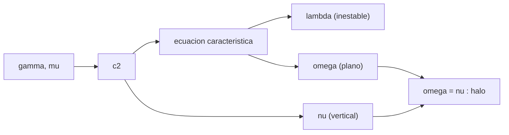

# B76-C04 — Órbitas halo

<!-- nav:top -->
[🏠 Programa](../../../../README.md) · [📚 Bloque B76](../../../tronco-comun/B76-dinamica-cislunar-y-operaciones-de-proximidad.md) · [← Anterior: B76-C03 — Órbitas alrededor de la Luna](../B76-C03-orbitas-alrededor-de-la-luna/CLASE.md) · [Siguiente: B76-C05 — Órbitas NRHO →](../B76-C05-orbitas-nrho/CLASE.md)
<!-- /nav -->

## 1. Ubicación, nivel y alcance

Clase 4 del bloque B76, nivel N3. Alrededor de `L1` y `L2` existen familias de órbitas periódicas; las halo son las que salen del plano. Aquí linealizas el problema en `L1` y `L2`, obtienes los modos (un pliegue inestable, una oscilación en el plano y otra vertical) y entiendes por qué las halo nacen cuando las dos frecuencias se igualan. Parte de [B76-C01](../B76-C01-sistema-tierra-luna/CLASE.md). La familia no lineal se construye en la clase 5.

## 2. Por qué esta clase existe

Una órbita halo no es un círculo: es un compromiso entre un modo inestable y dos oscilaciones. La decisión central: **¿qué dicen los modos lineales de `L2` sobre el tiempo de crecimiento de un error y sobre los periodos de la órbita?**

## 3. Lo que podrás hacer al terminar

1. Calcular `c2` en `L1` y `L2` y la frecuencia vertical `ν = √c2`.
2. Resolver la ecuación característica del plano y obtener `λ` y `ω`.
3. Convertir `λ`, `ω` y `ν` en tiempos de pliegue y periodos en días.
4. Verificar `Uxx = 1 + 2 c2` con una derivada numérica de la aceleración.
5. Explicar por qué la igualdad `ω = ν` marca el nacimiento de las halo.
6. Separar lo calculado en el modelo lineal de lo que requiere la familia no lineal.

La evidencia es la **ficha lineal de `L2`** del ejercicio 12 (sección 20).

## 4. Con qué llegas y cómo comprobarlo

1. ¿Qué es un punto de equilibrio?
2. ¿Qué es una linealización?
3. ¿Qué es un autovalor real positivo?
4. ¿Qué es una órbita periódica?
5. ¿Qué es una verificación por segunda vía?

<details>
<summary>Ver respuestas</summary>

1. Un punto donde la aceleración neta es cero en el marco que rota. 2. Aproximar las ecuaciones por una lineal cerca de un punto. 3. Un modo que crece exponencialmente. 4. Una trayectoria que se repite tras un periodo. 5. Calcular lo mismo con otro método y comparar.
</details>

Con cuatro o cinco aciertos, sigue; si no, repasa los prerrequisitos.

## 5. Un caso de contexto y casos de referencia

En `L2` (`64.515 km` tras la Luna) el modo inestable crece `e` veces cada `2,012 d`; la oscilación en el plano tiene periodo `14,648 d` y la vertical `15,275 d`, con `ω/ν = 1,0428`. En `L1` los tiempos son `1,481`, `11,688` y `12,026 d`. Es el **ejemplo conductor**.

## 6. Vocabulario

El coeficiente `c2` se calcula con la distancia `γ` al punto. La **ecuación característica** del plano es `λ⁴ + (2 − c2) λ² + (1 + 2 c2)(1 − c2) = 0`. `λ` es el **exponente inestable** real, `ω` la **frecuencia en el plano** y `ν = √c2` la **frecuencia vertical**. Una **halo** es una familia periódica que sale del plano.

## 7. Modelo mental: una silla de montar con dos giros



*Descripción textual:* la distancia `γ` da `c2`; `c2` da la ecuación característica, de la que salen `λ` y `ω`; `ν` sale directo de `c2`; cuando `ω` y `ν` se igualan nace la familia halo.

Analogía: una silla de montar deja rodar una bola hacia los costados (modo inestable) y hacia delante y atrás (oscilación). Límite: el modelo lineal solo vale para amplitudes pequeñas; las halo reales son no lineales.

## 8. La explicación, paso a paso

### 8.1 Coeficiente `c2`

Con `γ = 0,167833` (`L2`): `c2 = [μ + (1−μ) γ³/(1+γ)³]/γ³ = 3,19043`. En `L1` (`γ = 0,150934`): `c2 = 5,14759`.

### 8.2 Modos

`β1 = 2 − c2` y `β2 = (1 + 2 c2)(1 − c2)`; `λ² = [−β1 + √(β1² − 4 β2)]/2`, `ω² = [β1 + √(β1² − 4 β2)]/2`. En `L2`: `λ = 2,15867`, `ω = 1,86265`, `ν = 1,78618` (unidades `1/T_U`). El tiempo de pliegue es `T_U/λ = 2,012 d` y los periodos `2π T_U/ω = 14,648 d`, `2π T_U/ν = 15,275 d`.

### 8.3 Segunda vía

La derivada numérica de la aceleración en `x` da `Uxx = 7,380850` frente a `1 + 2 c2 = 7,380850`. En `L1`: `11,295189` en ambos casos. La constante de Jacobi en los puntos es `C(L1) = 3,188341` y `C(L2) = 3,172160`.

### 8.4 Nacimiento de las halo

Como `ω/ν = 1,0428` en `L2`, las dos frecuencias no coinciden a amplitud infinitesimal. Al crecer la amplitud, la frecuencia del plano baja hasta igualar a la vertical y se abre una familia que sale del plano: la halo. Esa bifurcación se trata en la literatura; aquí solo se calculan los modos lineales que la preparan.

## 9. Magnitudes, símbolos y unidades

| Símbolo | Qué es | Unidad | Valor / nota |
|---|---|---|---|
| `c2` | coeficiente lineal | — | 3,19043 (L2) |
| `λ` | exponente inestable | 1/T_U | 2,15867 |
| `ω` | frecuencia en el plano | 1/T_U | 1,86265 |
| `ν` | frecuencia vertical | 1/T_U | 1,78618 |
| `C(Li)` | constante de Jacobi en el punto | — | 3,188341; 3,172160 |

## 10. Convenciones y referencias

Constantes de `cislunar_lib.py` (JPL DE440, NASA/NSSDC). CR3BP circular, ejes sinódicos adimensionales; `T_U = 4,3425 d`. Análisis lineal; sin Sol.

## 11. De dónde sale lo que afirmamos

| ID | Fuente | Localizador | Respalda | Estado |
|---|---|---|---|---|
| S1 | NASA JPL SSD, Astrodynamic Parameters — https://ssd.jpl.nasa.gov/astro_par.html (consultada 2026-11-10) | tabla de GM y constantes | GM de la Tierra = 398600,435507 km³/s²; GM de la Luna = 4902,800118 km³/s² (DE440, Park et al. 2021); UA = 149597870700 m | Consultada |
| S2 | NASA/NSSDC, Moon Fact Sheet — https://nssdc.gsfc.nasa.gov/planetary/factsheet/moonfact.html (consultada 2026-11-10) | ficha completa leída | semieje mayor 0,3844×10⁶ km; periodo sideral 27,3217 d; periodo sinódico 29,53 d; excentricidad 0,0549; radio medio 1737,4 km; gravedad superficial 1,62 m/s² | Consultada |
| — | Relaciones estándar: linealización del CR3BP en los puntos colineales | — | las verifica el laboratorio con una derivada numérica | No consultada en una fuente concreta |

Límites: no se consultó el análisis de bifurcación de la familia halo ni su continuación; aquí solo hay modos lineales.

## 12. Cómo ver los modos de L2

| Magnitud | Valor |
|---|---|
| `λ` | 2,15867 (pliegue en 2,012 d) |
| `ω` | 1,86265 (P = 14,648 d) |
| `ν` | 1,78618 (P = 15,275 d) |
| `ω/ν` | 1,0428 |

Descripción larga: el modo inestable domina en unos dos días y las dos oscilaciones tienen periodos de unos quince días.

## 13. Ejemplo trabajado: el tiempo de pliegue en L2

**Paso 1 · Coeficientes.** `β1 = 2 − 3,19043 = −1,19043`; `β2 = 7,38086 × (−2,19043) = −16,1673`.

**Paso 2 · Raíz.** `√(β1² − 4 β2) = √(1,4171 + 64,669) = 8,1294`; `λ² = (1,19043 + 8,1294)/2 = 4,6599`.

**Paso 3 · Exponente.** `λ = 2,1587`.

**Paso 4 · Tiempo.** `T_U/λ = 4,3425/2,1587 = 2,012 d`.

## 14. Distintas formas de describir un modo

**Por exponente:** `λ`. **Por tiempo de pliegue:** `T_U/λ`. **Por frecuencia:** `ω`, `ν`. **Por periodo:** `2π T_U/ω`. **Por cociente:** `ω/ν`.

## 15. Práctica guiada

**Ejercicio 1 · con los pasos indicados.** Calcula `Uxx = 1 + 2 c2` en `L2`. *Pasos:* usa `c2 = 3,19043`.

<details><summary>Solución comentada</summary>

`1 + 6,38086 = 7,38086`; coincide con la derivada numérica.
</details>

**Ejercicio 2 · con una pista.** Calcula el tiempo de pliegue en `L2`. *Pista:* `T_U/λ`.

<details><summary>Solución comentada</summary>

`4,3425/2,15867 = 2,012 d`.
</details>

**Ejercicio 3 · casi autónomo.** Calcula el periodo vertical en `L2`.

<details><summary>Solución comentada</summary>

`2π × 4,3425/1,78618 = 15,275 d`.
</details>

## 16. Práctica autónoma, transferencia e integrador

**Ejercicio 4 · autónomo.** Comprueba la ecuación característica con `λ² = 4,6598`.

<details><summary>Solución comentada</summary>

`21,714 − 5,547 − 16,167 ≈ 0`: se anula dentro del redondeo.
</details>

**Ejercicio 5 · autónomo.** ¿Cuánto crece una perturbación inestable en 10 d en `L2`?

<details><summary>Solución comentada</summary>

`exp(10/2,012) = 144` veces.
</details>

**Ejercicio 6 · autónomo.** Compara los tiempos de pliegue de `L1` y `L2`.

<details><summary>Solución comentada</summary>

`1,481 d` frente a `2,012 d`: `L1` es más inestable.
</details>

**Ejercicio 7 · autónomo.** Calcula `C(L1) − C(L2)`.

<details><summary>Solución comentada</summary>

`3,188341 − 3,172160 = 0,016181`.
</details>

**Ejercicio 8 · autónomo.** Calcula `ν/ω` en `L2` y explica su significado.

<details><summary>Solución comentada</summary>

`0,9590`: el periodo del plano es un 4 % menor que el vertical.
</details>

**Ejercicio 9 · transferencia.** **Transferencia.** Un equipo quiere colocar un satélite exactamente en `L2` «sin gasto». ¿Qué objetas?

<details><summary>Solución comentada</summary>

El punto es inestable (`e` cada 2 d); mantenerlo requiere correcciones (clase 19).
</details>

**Ejercicio 10 · transferencia.** **Transferencia.** Se sugiere que una halo puede calcularse con los modos lineales a gran amplitud. ¿Qué respondes?

<details><summary>Solución comentada</summary>

La linealización solo vale para amplitud pequeña; una NRHO exige corrección diferencial (clase 5).
</details>

**Ejercicio 11 · transferencia.** **Transferencia.** Un informe da `λ = 2,16` sin unidad. ¿Qué falta?

<details><summary>Solución comentada</summary>

La unidad (`1/T_U`) y la conversión a días (`T_U = 4,3425 d`).
</details>

**Ejercicio 12 · integrador.** **Integrador.** Elabora tu *ficha lineal de `L2`*: `c2`, `λ`, `ω`, `ν`, tiempos y periodos y la verificación de `Uxx`, con fuentes.

<details><summary>Solución comentada</summary>

Secciones 8.1–8.4 y la salida del laboratorio.
</details>

## 17. Laboratorio: modos lineales en L1 y L2

El script [halo_lineal.py](halo_lineal.py) calcula `c2`, los exponentes y las frecuencias en `L1` y `L2` y verifica `Uxx` con una derivada numérica Usa la biblioteca común [cislunar_lib.py](../cislunar_lib.py) del bloque (**comprueba** `Uxx` numérica frente a `1 + 2 c2` < 1e-6 relativa).

**Datos:** `GM_T`, `GM_L` (JPL, DE440) y `a` (NASA/NSSDC) **consultados** el 2026-11-10; las fórmulas son estándar y las verifica el laboratorio. **Predice antes de ejecutar:** ¿qué punto tiene el modo inestable más rápido? (`L1`: `1,481 d`.) **Ejecución del 2026-11-10 (Python 3.12.9):**

```text
Python 3.12.9 (biblioteca estandar)
L1: x = 0.836915 ; gamma = 0.150934 (58019 km) ; c2 = 5.14759 ; C = 3.188341
    lambda = 2.93206 (e-pliegue 1.481 d) ; omega = 2.33439 (P = 11.688 d) ; nu = 2.26883 (P = 12.026 d)
    Uxx numerica = 11.295189 ; teorica 1+2c2 = 11.295189 ; omega/nu = 1.0289
L2: x = 1.155682 ; gamma = 0.167833 (64515 km) ; c2 = 3.19043 ; C = 3.172160
    lambda = 2.15867 (e-pliegue 2.012 d) ; omega = 1.86265 (P = 14.648 d) ; nu = 1.78618 (P = 15.275 d)
    Uxx numerica = 7.380850 ; teorica 1+2c2 = 7.380850 ; omega/nu = 1.0428
Pruebas superadas.
```

```bash
python programa/clases/B76/B76-C04-orbitas-halo/halo_lineal.py
```

**Límites:** Modelo lineal y circular; sin amplitud finita, sin Sol.

## 18. Errores frecuentes y cómo corregirlos

**Confundir `λ` con una frecuencia.** Es un exponente real. Se corrige con 8.2.

**Dar tiempos en unidades adimensionales sin convertir.** Se corrige con 8.2.

**Creer que una halo es un círculo alrededor de `L2`.** Se corrige con 8.4.

**Usar los modos lineales como órbita final.** Se corrige con la clase 5.

## 19. Cómo sabrás que vas bien

Tras la sección 8: ¿qué tiempo de pliegue esperabas en `L2` y cuál obtuviste? Si dudas, repasa el ejemplo 13. Tras el laboratorio: ¿qué comprueba `Uxx`? (ver la sección 17).

## 20. Qué entregas y cómo se evalúa

El producto es tu **ficha lineal de `L2`** (ejercicio 12).

| Criterio | Inicial | En desarrollo | Logrado | Destacado |
|---|---|---|---|---|
| Conceptos | Los confunde | Parciales | Distingue `λ`, `ω` y `ν` | Explica el nacimiento de la halo |
| Cálculo | Sin unidades | Con errores | Tablas completas con unidades | Calcula casos nuevos |
| Numérico | Sin comprobar | Un caso | Verifica `Uxx` con segunda vía | Interpreta las diferencias |
| Fuentes | Sin fuente | Sin fecha | Fuentes con fecha y estado | Declara lo no consultado |
| Límites | No los nombra | Uno | Tres | Discute qué falta de la linealización |

**Condiciones críticas (no se compensan con promedio):** rotular el análisis como lineal; no presentar un modo como una órbita; citar solo lo consultado.

## 21. Ética, seguridad y límites

Clase educativa: los modelos son simplificados y sus datos son sintéticos, ilustrativos o publicados con fuente; ningún resultado es una efeméride, una telemetría ni una recomendación operativa, y lo simulado nunca se presenta como observado.  Accesibilidad: tablas equivalentes a las gráficas, fórmulas en texto, ejercicios sin conexión.

## 22. Para cerrar y seguir

En `L2` un error crece `e` veces cada `2,012 d` y las oscilaciones duran unos `15 d`. Queda una pregunta: ¿cómo se construye de verdad una órbita periódica que sale del plano?

**Glosario español–inglés.** órbita halo · *halo orbit*; exponente inestable · *unstable exponent*; linealización · *linearization*; modo vertical · *vertical mode*; bifurcación · *bifurcation*.

**Continuidad.** [B76-C05](../B76-C05-orbitas-nrho/CLASE.md) construye una órbita NRHO.

**Referencias:** ver sección 11.

<!-- nav:bottom -->
---

[← Anterior: B76-C03 — Órbitas alrededor de la Luna](../B76-C03-orbitas-alrededor-de-la-luna/CLASE.md) · [📚 Bloque B76](../../../tronco-comun/B76-dinamica-cislunar-y-operaciones-de-proximidad.md) · [Siguiente: B76-C05 — Órbitas NRHO →](../B76-C05-orbitas-nrho/CLASE.md)
<!-- /nav -->
