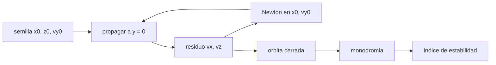

# B76-C05 — Órbitas NRHO

<!-- nav:top -->
[🏠 Programa](../../../../README.md) · [📚 Bloque B76](../../../tronco-comun/B76-dinamica-cislunar-y-operaciones-de-proximidad.md) · [← Anterior: B76-C04 — Órbitas halo](../B76-C04-orbitas-halo/CLASE.md) · [Siguiente: B76-C06 — Órbitas DRO — Dinámica cislunar y operaciones de proximidad →](../B76-C06-orbitas-dro-dinamica-cislunar-y-operaciones-de-proximidad/CLASE.md)
<!-- /nav -->

## 1. Ubicación, nivel y alcance

Clase 5 del bloque B76, nivel N3. Una órbita casi rectilínea de halo (NRHO) es una halo tan elongada que pasa a poco más de mil kilómetros de la Luna y se aleja `71.000 km`. Aquí la construyes: una suposición inicial, una corrección diferencial de Newton, su periodo, sus radios y su monodromia. Parte de [B76-C04](../B76-C04-orbitas-halo/CLASE.md). La comparación con la órbita publicada de Gateway se hace con cifras de un artículo de la NASA.

## 2. Por qué esta clase existe

La NRHO es la órbita de referencia publicada para la estación Gateway. La decisión central: **¿cómo se calcula una órbita periódica inestable y qué tan cerca queda un modelo simple de la referencia en un modelo de efemérides?**

## 3. Lo que podrás hacer al terminar

1. Plantear una órbita simétrica con `vx = vz = 0` en dos cruces de `y = 0`.
2. Aplicar la corrección diferencial de Newton sobre `x0` y `vy0`.
3. Obtener el periodo, el perilune y el apolune de la órbita.
4. Calcular la monodromia y el índice de estabilidad.
5. Comparar con el periodo y los radios publicados e interpretar las diferencias.
6. Rotular la semilla como ilustrativa y la comparación como orientativa.

La evidencia es la **ficha de una NRHO en el modelo CR3BP** del ejercicio 12 (sección 20).

## 4. Con qué llegas y cómo comprobarlo

1. ¿Qué es una órbita simétrica?
2. ¿Qué es el método de Newton?
3. ¿Qué es la matriz de monodromia?
4. ¿Qué indica un autovalor de módulo mayor que 1?
5. ¿Qué es un perilune?

<details>
<summary>Ver respuestas</summary>

1. Una que cruza perpendicularmente el plano de simetría en dos puntos. 2. Un esquema iterativo para anular una función usando su derivada. 3. La matriz de sensibilidad del estado tras un periodo. 4. Un modo que crece de revolución en revolución. 5. El punto de la órbita más cercano a la Luna.
</details>

Con cuatro o cinco aciertos, sigue; si no, repasa los prerrequisitos.

## 5. Un caso de contexto y casos de referencia

Con `z0 = −0,1818` y una semilla ilustrativa, la corrección converge a `x0 = 1,02159328`, `vy0 = −0,10232162`. La órbita tiene periodo `6,5375 d`, perilune `3184 km` de radio (`1447 km` de altitud), apolune `71.078 km` y un autovalor inestable `2,159`. La referencia publicada (modelo de efemérides) da `6,56 d`, `3366 km` y `71.100 km` de media. Es el **ejemplo conductor**.

## 6. Vocabulario

La **NRHO** es la parte casi rectilínea de la familia halo. El **perilune** y el **apolune** son los radios mínimo y máximo respecto de la Luna. La **corrección diferencial** ajusta el estado inicial hasta que la órbita se cierre. La **monodromia** `M` y el **índice de estabilidad** `ν = (λ + 1/λ)/2` miden el crecimiento del error por revolución.

## 7. Modelo mental: afinar una cuerda hasta que suene limpia



*Descripción textual:* se propaga la semilla hasta el segundo cruce de `y = 0`, se mide el residuo de `vx` y `vz`, Newton corrige `x0` y `vy0` hasta anularlo y con la órbita cerrada se calcula la monodromia.

Analogía: afinar una cuerda moviendo dos clavijas hasta que la nota no tenga batidos. Límite: la órbita del CR3BP es exactamente periódica; la real, con el Sol y la excentricidad, no lo es y necesita mantenimiento (clase 19).

## 8. La explicación, paso a paso

### 8.1 Condición de simetría

Se parte del apolune: `(x0, 0, z0, 0, vy0, 0)`. Por la simetría respecto de `y = 0`, la órbita se cierra si en el siguiente cruce de `y = 0` se cumple `vx = vz = 0`. Se fija `z0 = −0,1818` (sur) y se buscan `x0` y `vy0`.

### 8.2 Newton

Con la semilla ilustrativa `(1,0213, −0,1)` y paso de diferencias `10⁻⁷`, la corrección converge en pocas iteraciones a `x0 = 1,02159328`, `vy0 = −0,10232162` con residuo `< 10⁻¹¹`. El integrador es Dormand-Prince con tolerancia `10⁻¹²`.

### 8.3 Resultados

Periodo `6,5375 d`; resonancia `2 P_sin/T = 9,034`; perilune `3184 km` (`1447 km` de altitud); apolune `71.078 km`; `C = 3,046928` con deriva `4 × 10⁻⁹`; cierre `5,6 × 10⁻⁸ km` tras un periodo; `det(M) = 1,000000`.

### 8.4 Estabilidad

Los módulos de los autovalores de `M` son `2,159`, `1`, `1`, `1`, `0,9999`, `0,4633`: un par inestable recíproco (`2,159 × 0,4633 = 1,000`). El índice es `ν = 1,311 > 1`: los errores crecen `2,159` veces por revolución como máximo.

### 8.5 Comparación con la referencia

El periodo cae dentro del rango publicado `6,26–6,76 d` (media `6,56 d`). El apolune difiere `22 km` del medio `71.100 km`. El perilune de `3184 km` queda `11 km` por debajo del mínimo publicado `3195 km`: es esperable, porque el modelo publicado incluye el Sol y las efemérides y este no.

## 9. Magnitudes, símbolos y unidades

| Símbolo | Qué es | Unidad | Valor / nota |
|---|---|---|---|
| `x0`, `vy0` | estado inicial en el apolune | adim. | 1,02159328; −0,10232162 |
| `T` | periodo | d | 6,5375 |
| `r_per` | radio de perilune | km | 3184 |
| `r_apo` | radio de apolune | km | 71.078 |
| `λ` | mayor autovalor de `M` | — | 2,159 |
| `ν` | índice de estabilidad | — | 1,311 |

## 10. Convenciones y referencias

Constantes de `cislunar_lib.py` (consultadas). CR3BP circular, ejes sinódicos adimensionales; integración Dormand-Prince 5(4), tolerancia `10⁻¹²`; monodromia por diferencias finitas centrales de `10⁻⁶`; `numpy 2.4.4` solo para los autovalores. La semilla es ilustrativa. Sin Sol ni excentricidad.

## 11. De dónde sale lo que afirmamos

| ID | Fuente | Localizador | Respalda | Estado |
|---|---|---|---|---|
| S1 | Davis, Khoury, Howell y Sweeney, «Phase Control and Eclipse Avoidance in Near Rectilinear Halo Orbits», NASA NTRS 20200000733 — https://ntrs.nasa.gov/api/citations/20200000733/downloads/20200000733.pdf (PDF leído con PyMuPDF el 2026-11-10; la fecha de publicación no se consultó) | introducción, figura 1 y tabla 1 | NRHO sur de L2 de referencia de Gateway; resonancia 9:2 con el periodo sinódico lunar; periodo medio 6,56 d (6,26–6,76); radio de perilune 3.195–3.557 km (medio 3.366); radio de apolune 70.005–71.849 km (medio 71.100); eclipses lunares < 90 min | Consultada |
| S2 | NASA JPL SSD, Astrodynamic Parameters — https://ssd.jpl.nasa.gov/astro_par.html (consultada 2026-11-10) | tabla de GM y constantes | GM de la Tierra = 398600,435507 km³/s²; GM de la Luna = 4902,800118 km³/s² (DE440, Park et al. 2021); UA = 149597870700 m | Consultada |
| S3 | NASA/NSSDC, Moon Fact Sheet — https://nssdc.gsfc.nasa.gov/planetary/factsheet/moonfact.html (consultada 2026-11-10) | ficha completa leída | semieje mayor 0,3844×10⁶ km; periodo sideral 27,3217 d; periodo sinódico 29,53 d; excentricidad 0,0549; radio medio 1737,4 km; gravedad superficial 1,62 m/s² | Consultada |
| — | Relaciones estándar: corrección diferencial, monodromia, índice de estabilidad | — | las verifica el laboratorio (cierre, `det M = 1`, Jacobi) | No consultada en una fuente concreta |

Límites: la referencia publicada es de un modelo de efemérides con Sol; no se consultó la elección exacta de la órbita de Gateway ni su fecha de publicación; la comparación es orientativa.

## 12. Cómo ver la NRHO

| Magnitud | Valor |
|---|---|
| Periodo | 6,5375 d (publicado: 6,56 d, rango 6,26–6,76) |
| Perilune / apolune | 3184 km / 71.078 km |
| Mayor autovalor | 2,159 |
| Cierre tras un periodo | 5,6e-8 km |

Descripción larga: la órbita pasa a 1447 km de la Luna en el perilune y a 71.000 km en el apolune, con un modo inestable moderado.

## 13. Ejemplo trabajado: el índice de estabilidad

**Paso 1 · Monodromia.** Se propaga cada columna de la perturbación un periodo.

**Paso 2 · Autovalores.** El mayor módulo es `λ = 2,159` y su recíproco `0,4633`.

**Paso 3 · Índice.** `ν = (2,159 + 0,4632)/2 = 1,311`.

**Paso 4 · Lectura.** Un error de `1 km` en el apolune puede llegar a `2,2 km` tras una revolución si se proyecta por completo sobre el modo inestable.

## 14. Distintas formas de describir una NRHO

**Por estado inicial:** `(x0, z0, vy0)`. **Por periodo:** `T`. **Por radios:** perilune y apolune. **Por resonancia:** `9:2`. **Por estabilidad:** `λ`, `ν`. **Por energía:** `C`.

## 15. Práctica guiada

**Ejercicio 1 · con los pasos indicados.** Calcula la altitud de perilune. *Pasos:* resta el radio lunar al radio de perilune.

<details><summary>Solución comentada</summary>

`3184 − 1737,4 = 1446,6 km`.
</details>

**Ejercicio 2 · con una pista.** Comprueba que el periodo cae en el rango publicado. *Pista:* `6,26–6,76 d`.

<details><summary>Solución comentada</summary>

`6,5375` está dentro; difiere `0,02 d` de la media `6,56`.
</details>

**Ejercicio 3 · casi autónomo.** Calcula la razón de resonancia con el mes sinódico.

<details><summary>Solución comentada</summary>

`2 × 29,53/6,5375 = 9,034`.
</details>

## 16. Práctica autónoma, transferencia e integrador

**Ejercicio 4 · autónomo.** Calcula el índice de estabilidad con `λ = 2,159`.

<details><summary>Solución comentada</summary>

`(2,159 + 0,4632)/2 = 1,311`.
</details>

**Ejercicio 5 · autónomo.** ¿Cuánto crece un error en cuatro revoluciones en el peor caso?

<details><summary>Solución comentada</summary>

`2,159⁴ = 21,7` veces.
</details>

**Ejercicio 6 · autónomo.** Compara el apolune calculado con el publicado medio.

<details><summary>Solución comentada</summary>

`71.078` frente a `71.100 km`: `−22 km`, `0,03 %`.
</details>

**Ejercicio 7 · autónomo.** Compara el perilune calculado con el rango publicado.

<details><summary>Solución comentada</summary>

`3184` está `11 km` bajo el mínimo `3195 km` (`0,3 %`); la media publicada es `3366 km`.
</details>

**Ejercicio 8 · autónomo.** Expresa el cierre `5,6 × 10⁻⁸ km` en milímetros.

<details><summary>Solución comentada</summary>

`0,056 mm`.
</details>

**Ejercicio 9 · transferencia.** **Transferencia.** Un colega afirma que su CR3BP reproduce Gateway «al metro». ¿Qué objetas?

<details><summary>Solución comentada</summary>

El modelo publicado incluye Sol y efemérides; las diferencias en perilune son de decenas a cientos de km.
</details>

**Ejercicio 10 · transferencia.** **Transferencia.** Se propone fijar `z0 = −0,15` y repetir. ¿Qué esperas y cómo lo compruebas?

<details><summary>Solución comentada</summary>

Otro miembro de la familia con distinto periodo y radios; se verifica con el mismo cierre y el mismo `det(M)`.
</details>

**Ejercicio 11 · transferencia.** **Transferencia.** Un informe da un perilune de `1447 km` sin aclarar si es radio o altitud. ¿Qué falta?

<details><summary>Solución comentada</summary>

Precisar que son `3184 km` de radio y `1447 km` de altitud sobre el radio medio `1737,4 km`.
</details>

**Ejercicio 12 · integrador.** **Integrador.** Elabora tu *ficha de una NRHO en el modelo CR3BP*: estado inicial, periodo, radios, resonancia, monodromia y comparación con la referencia publicada, con fuentes.

<details><summary>Solución comentada</summary>

Secciones 8.1–8.5 y la salida del laboratorio, con la semilla rotulada ilustrativa.
</details>

## 17. Laboratorio: una NRHO por corrección diferencial

El script [nrho.py](nrho.py) corrige una semilla ilustrativa hasta una NRHO sur de `L2`, la muestrea y calcula su monodromia y su estabilidad Usa la biblioteca común [cislunar_lib.py](../cislunar_lib.py) del bloque (**comprueba** residuos `vx`, `vz` < 1e-11, Jacobi conservado, `det M = 1` y el periodo en el rango publicado).

**Datos:** Constantes **consultadas** el 2026-11-10 (JPL, NASA/NSSDC); referencia publicada de Davis et al. (NTRS 20200000733); la semilla `(1,0213; −0,1818; −0,1)` es **ilustrativa**. **Predice antes de ejecutar:** ¿quedará el periodo dentro del rango publicado? (sí, `6,54 d`.) **Ejecución del 2026-11-10 (Python 3.12.9, numpy 2.4.4):**

```text
Python 3.12.9 ; numpy 2.4.4
Semilla ILUSTRATIVA corregida: x0 = 1.02159328 ; z0 = -0.1818 ; vy0 = -0.10232162 (adimensional)
Periodo = 6.5375 d (publicado, modelo de efemerides: 6.56 d, rango 6.26-6.76)
Radio de perilune = 3184 km (publicado medio 3366 km) ; radio de apolune = 71078 km (publicado medio 71100 km)
Altitud de perilune sobre R_L = 1447 km
Resonancia: 2*P_sin/T = 9.034 revoluciones por dos meses sinodicos (9:2 si es 9)
Constante de Jacobi C = 3.046928 ; deriva maxima = 4.12e-09
Cierre de la orbita tras un periodo = 5.594e-08 km ; det(M) = 1.000000
|autovalores de M| = 2.159, 1, 1, 1, 0.9999, 0.4633 ; indice de estabilidad nu = 1.311
Pruebas superadas.
```

```bash
python programa/clases/B76/B76-C05-orbitas-nrho/nrho.py
```

**Límites:** CR3BP sin Sol; la NRHO publicada es de un modelo de efemérides; la comparación es orientativa.

## 18. Errores frecuentes y cómo corregirlos

**Confundir radio y altitud de perilune.** Se corrige con 8.3.

**Presentar la NRHO del CR3BP como la de Gateway.** Se corrige con 8.5.

**Creer que una órbita periódica inestable no necesita mantenimiento.** Se corrige con 8.4.

**Dar la semilla como un dato publicado.** Se corrige con la sección 10.

## 19. Cómo sabrás que vas bien

Tras la sección 8: ¿qué periodo esperabas y cuál obtuviste? Si dudas, repasa el ejemplo 13. Tras el laboratorio: ¿qué comprueba `det M`? (ver la sección 17).

## 20. Qué entregas y cómo se evalúa

El producto es tu **ficha de una NRHO en el modelo CR3BP** (ejercicio 12).

| Criterio | Inicial | En desarrollo | Logrado | Destacado |
|---|---|---|---|---|
| Conceptos | Los confunde | Parciales | Explica la corrección y la estabilidad | Explica las diferencias con el modelo publicado |
| Cálculo | Sin unidades | Con errores | Tabla completa con unidades | Calcula otro `z0` |
| Numérico | Sin comprobar | Un caso | Cierre, Jacobi y `det M` | Interpreta las diferencias |
| Fuentes | Sin fuente | Sin fecha | Fuentes con fecha y estado | Declara la semilla como ilustrativa |
| Límites | No los nombra | Uno | Tres | Discute qué aporta el modelo de efemérides |

**Condiciones críticas (no se compensan con promedio):** rotular la semilla como ilustrativa; no presentar la NRHO del CR3BP como la de una misión; citar solo lo consultado.

## 21. Ética, seguridad y límites

Clase educativa: los modelos son simplificados y sus datos son sintéticos, ilustrativos o publicados con fuente; ningún resultado es una efeméride, una telemetría ni una recomendación operativa, y lo simulado nunca se presenta como observado.  Accesibilidad: tablas equivalentes a las gráficas, fórmulas en texto, ejercicios sin conexión.

## 22. Para cerrar y seguir

Una NRHO de `6,54 d` con perilune a `1447 km` y apolune a `71.078 km` tiene un modo inestable de `2,159` por revolución. Queda una pregunta: ¿qué otra familia es estable y vive lejos de la Luna?

**Glosario español–inglés.** órbita casi rectilínea de halo · *near rectilinear halo orbit (NRHO)*; corrección diferencial · *differential correction*; monodromia · *monodromy matrix*; perilune · *perilune*; apolune · *apolune*.

**Continuidad.** [B76-C06](../B76-C06-orbitas-dro-dinamica-cislunar-y-operaciones-de-proximidad/CLASE.md) estudia las órbitas retrógradas distantes.

**Referencias:** ver sección 11.

<!-- nav:bottom -->
---

[← Anterior: B76-C04 — Órbitas halo](../B76-C04-orbitas-halo/CLASE.md) · [📚 Bloque B76](../../../tronco-comun/B76-dinamica-cislunar-y-operaciones-de-proximidad.md) · [Siguiente: B76-C06 — Órbitas DRO — Dinámica cislunar y operaciones de proximidad →](../B76-C06-orbitas-dro-dinamica-cislunar-y-operaciones-de-proximidad/CLASE.md)
<!-- /nav -->
