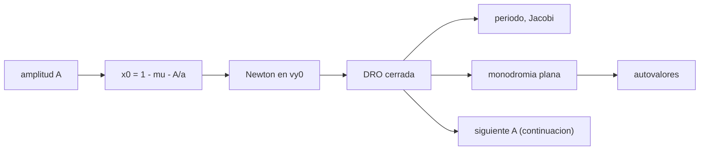

# B76-C06 — Órbitas DRO — Dinámica cislunar y operaciones de proximidad

<!-- nav:top -->
[🏠 Programa](../../../../README.md) · [📚 Bloque B76](../../../tronco-comun/B76-dinamica-cislunar-y-operaciones-de-proximidad.md) · [← Anterior: B76-C05 — Órbitas NRHO](../B76-C05-orbitas-nrho/CLASE.md) · [Siguiente: B76-C07 — Maniobras de inserción cislunar →](../B76-C07-maniobras-de-insercion-cislunar/CLASE.md)
<!-- /nav -->

## 1. Ubicación, nivel y alcance

Clase 6 del bloque B76, nivel N3. Una órbita retrógrada distante (DRO) gira alrededor de la Luna en sentido contrario al de la Luna y a decenas de miles de kilómetros, y es estable. Aquí calculas una familia por continuación, su periodo, su energía y su estabilidad plana. Parte de [B76-C05](../B76-C05-orbitas-nrho/CLASE.md) y reutiliza la corrección diferencial, ahora con un solo parámetro.

## 2. Por qué esta clase existe

La NRHO es inestable y exige mantenimiento; la DRO es estable. La decisión central: **¿qué se gana y qué se paga al elegir una órbita estable y lejana frente a una NRHO cercana?**

## 3. Lo que podrás hacer al terminar

1. Plantear una DRO simétrica con `x0` a una amplitud dada y Newton en `vy0`.
2. Seguir la familia por continuación en la amplitud.
3. Calcular el periodo y la constante de Jacobi de cada miembro.
4. Calcular la monodromia plana y evaluar la estabilidad.
5. Comparar el periodo sinódico con el kepleriano retrógrado.
6. Rotular las amplitudes y la semilla como ilustrativas.

La evidencia es la **ficha de una DRO** del ejercicio 12 (sección 20).

## 4. Con qué llegas y cómo comprobarlo

1. ¿Qué es una órbita retrógrada?
2. ¿Qué es la continuación?
3. ¿Qué es la estabilidad lineal?
4. ¿Qué es la constante de Jacobi?
5. ¿Qué es un dato ilustrativo?

<details>
<summary>Ver respuestas</summary>

1. Una que gira en sentido contrario al movimiento orbital del cuerpo principal. 2. Seguir una familia de soluciones variando un parámetro y usando la solución anterior como semilla. 3. Que los autovalores de la monodromia tengan módulo 1. 4. La integral de energía del CR3BP. 5. Un valor elegido para el ejemplo, no medido.
</details>

Con cuatro o cinco aciertos, sigue; si no, repasa los prerrequisitos.

## 5. Un caso de contexto y casos de referencia

Una DRO que cruza `y = 0` a `70.000 km` de la Luna tiene `vy0 = 0,519364` (adimensional), periodo `13,916 d` y `C = 2,92852`; su máxima separación al otro lado es `73.434 km`. El mayor módulo de autovalor es `1,0002`, que con la tolerancia de las diferencias finitas significa estable. Es el **ejemplo conductor**.

## 6. Vocabulario

Una **DRO** es una órbita periódica retrógrada y plana alrededor de la Luna. La **amplitud** `A` es la distancia a la Luna en el cruce inicial. La **continuación** sigue la familia en `A`. La **monodromia plana** `M` es la matriz `4 × 4` del estado `(x, y, vx, vy)`. Un **par doble en 1** es defectivo y las diferencias finitas lo separan unos `10⁻⁴`.

## 7. Modelo mental: un carrusel que gira al revés



*Descripción textual:* para cada amplitud se fija `x0`, Newton ajusta `vy0` hasta cerrar la órbita, se calculan periodo, Jacobi y monodromia, y la solución sirve de semilla de la siguiente amplitud.

Analogía: un carrusel pequeño que gira al revés del gran carrusel de la Luna se mantiene en equilibrio dinámico. Límite: la familia plana no incluye inclinación; el Sol y la excentricidad lunar alteran la estabilidad.

## 8. La explicación, paso a paso

### 8.1 Planteamiento

La órbita cruza el eje `x` perpendicularmente en `x0 = 1 − μ − A/a` con `vy0 > 0` (retrógrada en el marco sinódico). El siguiente cruce de `y = 0` es a medio periodo y debe tener `vx = 0`. Se resuelve solo `vy0`.

### 8.2 Continuación

Desde la semilla ilustrativa `vy0 = 0,486` a `30.000 km` se avanza de `10.000` en `10.000 km`, usando cada solución como semilla. Una búsqueda directa a `70.000 km` puede caer en otra solución; la continuación evita ese riesgo.

### 8.3 Familia

| `A` (km) | `vy0` | `P` (d) | este (km) | `C` | máx. módulo de λ |
|---|---|---|---|---|---|
| 30.000 | 0,486057 | 4,727 | 30.448 | 3,04582 | 1,000237 |
| 50.000 | 0,475002 | 9,271 | 51.676 | 2,96809 | 1,000216 |
| 70.000 | 0,519364 | 13,916 | 73.434 | 2,92852 | 1,000173 |
| 100.000 | 0,639857 | 19,625 | 105.859 | 2,88394 | 1,000066 |

### 8.4 Lectura

El periodo crece con la amplitud (de `4,7` a `19,6 d`) y `C` baja. El `det(M)` vale `1,000000` y el cierre es `< 2 × 10⁻⁶ km`. Todos los módulos quedan en `1` salvo `~2 × 10⁻⁴`, un efecto numérico del par defectivo: la familia es estable en este rango. Una DRO de `70.000 km` supera el radio de Hill (`61.274 km`) y permanece ligada porque es periódica y retrógrada.

### 8.5 Comparación con Kepler

A `30.000 km` el periodo kepleriano lunar es `5,40 d`; en el marco sinódico un giro retrógrado suma las velocidades angulares: `1/P = 1/5,40 + 1/27,32`, o sea `4,51 d`. La órbita calculada tiene `4,73 d`: la Tierra la alarga un `5 %`.

## 9. Magnitudes, símbolos y unidades

| Símbolo | Qué es | Unidad | Valor / nota |
|---|---|---|---|
| `A` | amplitud (distancia a la Luna) | km | 30.000–100.000 (ilustrativa) |
| `vy0` | velocidad inicial | adim. | 0,519364 (A = 70.000) |
| `P` | periodo sinódico | d | 13,916 (A = 70.000) |
| `C` | constante de Jacobi | — | 2,92852 |
| máx. módulo de λ | módulo de autovalor | — | 1,0002 |

## 10. Convenciones y referencias

Constantes de `cislunar_lib.py` (consultadas). CR3BP plano; Dormand-Prince 5(4), tolerancia `10⁻¹²`; monodromia por diferencias finitas centrales de `10⁻⁶`; `numpy 2.4.4` para los autovalores. Amplitudes y semilla ilustrativas.

## 11. De dónde sale lo que afirmamos

| ID | Fuente | Localizador | Respalda | Estado |
|---|---|---|---|---|
| S1 | NASA JPL SSD, Astrodynamic Parameters — https://ssd.jpl.nasa.gov/astro_par.html (consultada 2026-11-10) | tabla de GM y constantes | GM de la Tierra = 398600,435507 km³/s²; GM de la Luna = 4902,800118 km³/s² (DE440, Park et al. 2021); UA = 149597870700 m | Consultada |
| S2 | NASA/NSSDC, Moon Fact Sheet — https://nssdc.gsfc.nasa.gov/planetary/factsheet/moonfact.html (consultada 2026-11-10) | ficha completa leída | semieje mayor 0,3844×10⁶ km; periodo sideral 27,3217 d; periodo sinódico 29,53 d; excentricidad 0,0549; radio medio 1737,4 km; gravedad superficial 1,62 m/s² | Consultada |
| — | Relaciones estándar: DRO, continuación, estabilidad por monodromia | — | las verifica el laboratorio (cierre, `det M = 1`) | No consultada en una fuente concreta |

Límites: no se consultó ninguna DRO de una misión ni la literatura de estabilidad con perturbaciones; el modelo es plano y sin Sol.

## 12. Cómo ver la familia DRO

| Magnitud | Valor |
|---|---|
| `P` a 30.000 km | 4,727 d |
| `P` a 100.000 km | 19,625 d |
| `C` a 70.000 km | 2,92852 |
| `det(M)` | 1,000000 |

Descripción larga: el periodo crece con la amplitud y la constante de Jacobi decrece; todas las órbitas calculadas son estables en el rango.

## 13. Ejemplo trabajado: comparación con Kepler a 30.000 km

**Paso 1 · Periodo kepleriano.** `P_K = 2π √(r³/GM_L)` con `r = 30.000 km`: `466.300 s = 5,40 d`.

**Paso 2 · Marco sinódico.** `1/P = 1/5,40 + 1/27,32 = 0,2219 d⁻¹`.

**Paso 3 · Periodo.** `P = 4,51 d`.

**Paso 4 · Comparación.** El laboratorio da `4,727 d`: diferencia de `0,22 d` por la Tierra.

## 14. Distintas formas de describir una DRO

**Por amplitud:** `A`. **Por velocidad:** `vy0`. **Por periodo:** `P`. **Por energía:** `C`. **Por estabilidad:** los autovalores de `M`.

## 15. Práctica guiada

**Ejercicio 1 · con los pasos indicados.** Calcula `x0` para `A = 70.000 km`. *Pasos:* `1 − μ − A/a`.

<details><summary>Solución comentada</summary>

`1 − 0,01215058 − 0,18211 = 0,80574`.
</details>

**Ejercicio 2 · con una pista.** Calcula la razón de periodos entre `A = 100.000` y `30.000 km`. *Pista:* usa la tabla.

<details><summary>Solución comentada</summary>

`19,625/4,727 = 4,15`.
</details>

**Ejercicio 3 · casi autónomo.** ¿Cuánto baja `C` de `30.000` a `100.000 km`?

<details><summary>Solución comentada</summary>

`3,04582 − 2,88394 = 0,16188`.
</details>

## 16. Práctica autónoma, transferencia e integrador

**Ejercicio 4 · autónomo.** Calcula la asimetría este–oeste a `70.000 km`.

<details><summary>Solución comentada</summary>

`73.434 − 70.000 = 3434 km` (`4,9 %`).
</details>

**Ejercicio 5 · autónomo.** Calcula el periodo kepleriano a `r = 30.000 km`.

<details><summary>Solución comentada</summary>

`2π √(30.000³/4902,8) = 466.300 s = 5,40 d`.
</details>

**Ejercicio 6 · autónomo.** Calcula el periodo sinódico equivalente de una retrógrada con `P_K = 5,40 d`.

<details><summary>Solución comentada</summary>

`1/(1/5,40 + 1/27,32) = 4,51 d`.
</details>

**Ejercicio 7 · autónomo.** ¿Por qué el máximo `|λ| = 1,0002` no indica inestabilidad?

<details><summary>Solución comentada</summary>

El par doble en 1 es defectivo; las diferencias finitas lo separan ~`2 × 10⁻⁴`; la tolerancia es `10⁻³`.
</details>

**Ejercicio 8 · autónomo.** Compara el periodo de la DRO de `70.000 km` con el de la NRHO de la clase 5.

<details><summary>Solución comentada</summary>

`13,916` frente a `6,5375 d`: algo más del doble.
</details>

**Ejercicio 9 · transferencia.** **Transferencia.** Se propone iniciar la búsqueda directamente a `100.000 km` con `vy0 = 0,3`. ¿Qué riesgo hay?

<details><summary>Solución comentada</summary>

Newton puede converger a otra solución (hay varias); la continuación desde la familia conocida lo evita.
</details>

**Ejercicio 10 · transferencia.** **Transferencia.** Un equipo elige una DRO porque «no necesita mantenimiento». ¿Qué objetas?

<details><summary>Solución comentada</summary>

Es estable en el modelo plano sin Sol; con perturbaciones y excentricidad lunar sigue requiriendo seguimiento.
</details>

**Ejercicio 11 · transferencia.** **Transferencia.** Un informe da `P = 13,916 d` sin decir a qué amplitud. ¿Qué falta?

<details><summary>Solución comentada</summary>

Indicar `A = 70.000 km`, el modelo (CR3BP plano) y las constantes.
</details>

**Ejercicio 12 · integrador.** **Integrador.** Elabora tu *ficha de una DRO*: `A`, `vy0`, `P`, `C`, estabilidad y comparación con Kepler, con fuentes.

<details><summary>Solución comentada</summary>

Secciones 8.1–8.5 y la salida del laboratorio.
</details>

## 17. Laboratorio: familia de órbitas retrógradas distantes

El script [dro.py](dro.py) sigue una familia DRO plana por continuación de `30.000` a `100.000 km` y evalúa periodo, Jacobi y estabilidad en cuatro miembros Usa la biblioteca común [cislunar_lib.py](../cislunar_lib.py) del bloque (**comprueba** cierre < 1e-3 km, `det M = 1` y máx. `|λ|` < 1,001).

**Datos:** Constantes **consultadas** el 2026-11-10 (JPL, NASA/NSSDC); amplitudes y semilla `vy0 = 0,486` **ilustrativas**. **Predice antes de ejecutar:** ¿crecerá el periodo con la amplitud? (sí, de `4,7` a `19,6 d`.) **Ejecución del 2026-11-10 (Python 3.12.9, numpy 2.4.4):**

```text
Python 3.12.9 ; numpy 2.4.4
 A [km]    vy0 (adim)   P [d]    x este [km]   C         max|lambda|   det(M)     cierre [km]
  30000    0.486057    4.727        30448   3.04582   1.000237   1.000000  5.34e-07
  50000    0.475002    9.271        51676   2.96809   1.000216   1.000000  1.42e-07
  70000    0.519364   13.916        73434   2.92852   1.000173   1.000000  1.39e-06
 100000    0.639857   19.625       105859   2.88394   1.000066   1.000000  1.07e-06
Pruebas superadas.
```

```bash
python programa/clases/B76/B76-C06-orbitas-dro-dinamica-cislunar-y-operaciones-de-proximidad/dro.py
```

**Límites:** CR3BP plano, sin Sol; la tolerancia de estabilidad refleja el par defectivo.

## 18. Errores frecuentes y cómo corregirlos

**Buscar la DRO sin continuación.** Se corrige con 8.2.

**Confundir periodo sinódico con inercial.** Se corrige con 8.5.

**Leer `|λ| = 1,0002` como inestable.** Se corrige con 8.4.

**Creer que una DRO nunca necesita control.** Se corrige con la sección 21.

## 19. Cómo sabrás que vas bien

Tras la sección 8: ¿qué periodo esperabas a `70.000 km` y cuál obtuviste? Si dudas, repasa el ejemplo 13. Tras el laboratorio: ¿qué comprueba `det M`? (ver la sección 17).

## 20. Qué entregas y cómo se evalúa

El producto es tu **ficha de una DRO** (ejercicio 12).

| Criterio | Inicial | En desarrollo | Logrado | Destacado |
|---|---|---|---|---|
| Conceptos | Los confunde | Parciales | Explica DRO, continuación y estabilidad | Explica la diferencia con la NRHO |
| Cálculo | Sin unidades | Con errores | Tabla completa con unidades | Calcula otra amplitud |
| Numérico | Sin comprobar | Un caso | Cierre, `det M` y comparación con Kepler | Interpreta las diferencias |
| Fuentes | Sin fuente | Sin fecha | Fuentes con fecha y estado | Declara lo ilustrativo |
| Límites | No los nombra | Uno | Tres | Discute la estabilidad con Sol |

**Condiciones críticas (no se compensan con promedio):** rotular amplitudes y semilla como ilustrativas; no presentar la estabilidad plana como garantía operativa; citar solo lo consultado.

## 21. Ética, seguridad y límites

Clase educativa: los modelos son simplificados y sus datos son sintéticos, ilustrativos o publicados con fuente; ningún resultado es una efeméride, una telemetría ni una recomendación operativa, y lo simulado nunca se presenta como observado.  Accesibilidad: tablas equivalentes a las gráficas, fórmulas en texto, ejercicios sin conexión.

## 22. Para cerrar y seguir

Una DRO de `70.000 km` dura `13,9 d` y es estable en el modelo plano; el periodo crece de `4,7 d` a `19,6 d` al ampliarla. Queda una pregunta: ¿cuánto `Δv` cuesta llegar a esas órbitas?

**Glosario español–inglés.** órbita retrógrada distante · *distant retrograde orbit (DRO)*; continuación · *continuation*; estabilidad lineal · *linear stability*; constante de Jacobi · *Jacobi constant*; amplitud · *amplitude*.

**Continuidad.** [B76-C07](../B76-C07-maniobras-de-insercion-cislunar/CLASE.md) estudia las maniobras de inserción cislunar.

**Referencias:** ver sección 11.

<!-- nav:bottom -->
---

[← Anterior: B76-C05 — Órbitas NRHO](../B76-C05-orbitas-nrho/CLASE.md) · [📚 Bloque B76](../../../tronco-comun/B76-dinamica-cislunar-y-operaciones-de-proximidad.md) · [Siguiente: B76-C07 — Maniobras de inserción cislunar →](../B76-C07-maniobras-de-insercion-cislunar/CLASE.md)
<!-- /nav -->
