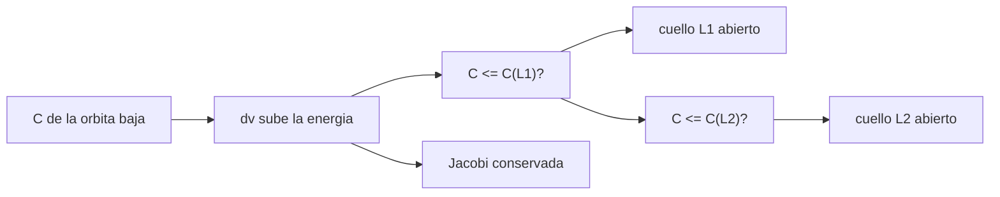

# B76-C08 — Transferencias de baja energía

<!-- nav:top -->
[🏠 Programa](../../../../README.md) · [📚 Bloque B76](../../../tronco-comun/B76-dinamica-cislunar-y-operaciones-de-proximidad.md) · [← Anterior: B76-C07 — Maniobras de inserción cislunar](../B76-C07-maniobras-de-insercion-cislunar/CLASE.md) · [Siguiente: B76-C09 — Dinámica relativa de Hill-Clohessy-Wiltshire →](../B76-C09-dinamica-relativa-de-hill-clohessy-wiltshire/CLASE.md)
<!-- /nav -->

## 1. Ubicación, nivel y alcance

Clase 8 del bloque B76, nivel N3. En el CR3BP la constante de Jacobi divide el espacio en regiones accesibles y prohibidas; una nave solo puede pasar de la región terrestre a la lunar cuando su energía abre el cuello en `L1`, y a la exterior cuando abre el de `L2`. Aquí calculas esos umbrales y el `Δv` mínimo desde la órbita baja terrestre. Parte de [B76-C04](../B76-C04-orbitas-halo/CLASE.md) y [B76-C07](../B76-C07-maniobras-de-insercion-cislunar/CLASE.md).

## 2. Por qué esta clase existe

Una transferencia de baja energía promete ahorrar propergol a cambio de tiempo, pero ¿qué ahorra y qué no? La decisión central: **¿qué energía hace falta para que una trayectoria pueda pasar por los cuellos de `L1` y `L2`, y qué no explica un modelo sin el Sol?**

## 3. Lo que podrás hacer al terminar

1. Calcular la constante de Jacobi en `L1`, `L2` y `L3`.
2. Convertir un estado en órbita baja terrestre en constante de Jacobi.
3. Hallar el `Δv` que lleva `C` al umbral de `L1` o de `L2`.
4. Verificar con una integración que `C` se conserva.
5. Comparar el umbral con un Hohmann hasta la distancia lunar.
6. Distinguir la condición necesaria (energía) de la suficiente (trayectoria) y lo que requiere el Sol.

La evidencia es la **ficha energética de una transferencia** del ejercicio 12 (sección 20).

## 4. Con qué llegas y cómo comprobarlo

1. ¿Qué es la constante de Jacobi?
2. ¿Qué es una región prohibida?
3. ¿Qué es el cuello de `L1`?
4. ¿Qué es una condición necesaria?
5. ¿Qué es una verificación por segunda vía?

<details>
<summary>Ver respuestas</summary>

1. La integral de energía del CR3BP en el marco rotante. 2. La zona donde `2Ω < C`, inaccesible para esa energía. 3. La abertura de la región accesible alrededor de `L1` entre las regiones terrestre y lunar. 4. Una que debe cumplirse, pero no basta por sí sola. 5. Calcular lo mismo con otro método y comparar.
</details>

Con cuatro o cinco aciertos, sigue; si no, repasa los prerrequisitos.

## 5. Un caso de contexto y casos de referencia

`C(L1) = 3,188341`, `C(L2) = 3,172160` y `C(L3) = 3,012147`. Desde una órbita baja terrestre de `200 km` basta un `Δv` de `3,0900 km/s` para llevar `C` al umbral de `L1` y `3,0908 km/s` para el de `L2`, frente a `3,1313 km/s` del Hohmann hasta la distancia lunar. Es el **ejemplo conductor**.

## 6. Vocabulario

La **constante de Jacobi** `C = 2Ω − v²` en el marco sinódico. Un **cuello** está abierto si `C ≤ C(Li)`. El **umbral** es `C(Li)`. El **ángulo de salida** `θ` es la posición de partida en la órbita baja. Una **transferencia de baja energía** aprovecha además la perturbación del Sol, que este modelo no incluye.

## 7. Modelo mental: el nivel de agua de un valle con dos pasos



*Descripción textual:* el impulso baja la constante de Jacobi; si llega a `C(L1)` se abre el paso a la región lunar y si llega a `C(L2)` el de la región exterior; en vuelo libre `C` se conserva.

Analogía: el agua de un valle solo puede pasar a otro si sube por encima del collado; subir el nivel es poner energía. Límite: pasar el collado no garantiza llegar a donde se quiere, y el Sol añade un empuje que este modelo no tiene.

## 8. La explicación, paso a paso

### 8.1 Umbrales

Sobre el eje `x` con velocidad nula, `C(L) = 2Ω(L)`: `C(L1) = 3,188341`, `C(L2) = 3,172160`, `C(L3) = 3,012147`. Cuanto menor `C`, más energía: abrir `L2` pide un poco más que abrir `L1` (`0,016181`).

### 8.2 Estado inicial

Se coloca la nave a `6578,137 km` de la Tierra con ángulo `θ` y velocidad inercial tangencial prógrada `v`. La velocidad sinódica es la inercial menos `ω × r`. Se barre `θ` de `0` a `359°` y se resuelve por bisección el `v` que da `C = C(Li)`.

### 8.3 Resultados

El mínimo está en `θ = 90°`: `Δv(L1) = 3,0900 km/s` y `Δv(L2) = 3,0908 km/s`. El Hohmann hasta la distancia lunar cuesta `3,1313 km/s`. La diferencia es de `41 m/s` para `L1`.

### 8.4 Comprobación

Con `v` un `0,05 %` mayor que el umbral de `L2`, la integración de `5 d` conserva `C` con deriva `1,6 × 10⁻¹²`.

### 8.5 Qué no dice

Este cálculo da una condición **necesaria** de energía. No dice si la trayectoria llega a la Luna, ni cuánto dura, ni el ahorro de las transferencias reales, que aprovechan al Sol; ese ahorro **no se consultó** y no se afirma.

## 9. Magnitudes, símbolos y unidades

| Símbolo | Qué es | Unidad | Valor / nota |
|---|---|---|---|
| `C(L1)` | umbral de L1 | — | 3,188341 |
| `C(L2)` | umbral de L2 | — | 3,172160 |
| `C(L3)` | umbral de L3 | — | 3,012147 |
| `Δv(L1)` | mínimo desde 200 km | km/s | 3,0900 |
| `Δv(L2)` | mínimo desde 200 km | km/s | 3,0908 |
| `θ` | ángulo de salida óptimo | grados | 90 |

## 10. Convenciones y referencias

Constantes de `cislunar_lib.py` (consultadas). CR3BP plano circular; órbita baja de `200 km` (ilustrativa), impulso tangencial prógrado; barrido de `θ` cada grado. Sin Sol. El `Δv` es mínimo para la energía, no una trayectoria diseñada.

## 11. De dónde sale lo que afirmamos

| ID | Fuente | Localizador | Respalda | Estado |
|---|---|---|---|---|
| S1 | NASA JPL SSD, Astrodynamic Parameters — https://ssd.jpl.nasa.gov/astro_par.html (consultada 2026-11-10) | tabla de GM y constantes | GM de la Tierra = 398600,435507 km³/s²; GM de la Luna = 4902,800118 km³/s² (DE440, Park et al. 2021); UA = 149597870700 m | Consultada |
| S2 | NASA/NSSDC, Moon Fact Sheet — https://nssdc.gsfc.nasa.gov/planetary/factsheet/moonfact.html (consultada 2026-11-10) | ficha completa leída | semieje mayor 0,3844×10⁶ km; periodo sideral 27,3217 d; periodo sinódico 29,53 d; excentricidad 0,0549; radio medio 1737,4 km; gravedad superficial 1,62 m/s² | Consultada |
| S3 | NASA/NSSDC, Earth Fact Sheet — https://nssdc.gsfc.nasa.gov/planetary/factsheet/earthfact.html (consultada 2026-11-10) | ficha leída | masa 5,9722×10²⁴ kg; radio medio volumétrico 6371,000 km; radio ecuatorial 6378,137 km | Consultada |
| — | Relaciones estándar: constante de Jacobi, regiones de Hill, puntos de Lagrange | — | las verifica el laboratorio (conservación de `C`) | No consultada en una fuente concreta |

Límites: no se consultó ninguna transferencia de baja energía publicada ni su ahorro; el modelo no incluye el Sol; el `Δv` es una cota de energía.

## 12. Cómo ver la energía

| Magnitud | Valor |
|---|---|
| `C(L1)`, `C(L2)` | 3,188341; 3,172160 |
| `Δv` para abrir `L1` | 3,0900 km/s |
| `Δv` para abrir `L2` | 3,0908 km/s |
| Hohmann a la distancia lunar | 3,1313 km/s |

Descripción larga: abrir los cuellos cuesta casi lo mismo que llegar a la distancia lunar con un Hohmann; la diferencia es pequeña.

## 13. Ejemplo trabajado: abrir el cuello de L1

**Paso 1 · Umbral.** `C(L1) = 3,188341`.

**Paso 2 · Estado.** Se parte de la órbita circular de `200 km` en `θ = 90°`.

**Paso 3 · Bisección.** Se busca la `v` que da `C = C(L1)`.

**Paso 4 · Impulso.** `Δv = v − v_circ = 3,0900 km/s`.

## 14. Distintas formas de expresar la energía

**Por Jacobi:** `C`. **Por umbral:** `C − C(Li)`. **Por impulso:** `Δv`. **Por región:** accesible o prohibida. **Por ángulo:** `θ`.

## 15. Práctica guiada

**Ejercicio 1 · con los pasos indicados.** Calcula la diferencia `C(L1) − C(L2)`. *Pasos:* resta los valores de 8.1.

<details><summary>Solución comentada</summary>

`3,188341 − 3,172160 = 0,016181`.
</details>

**Ejercicio 2 · con una pista.** ¿Qué cuello se abre antes al aumentar la energía? *Pista:* mira cuál `C` es mayor.

<details><summary>Solución comentada</summary>

`L1`, porque `C(L1) > C(L2)`: se abre con menos energía.
</details>

**Ejercicio 3 · casi autónomo.** Compara el `Δv` para `L1` con el Hohmann.

<details><summary>Solución comentada</summary>

`3,1313 − 3,0900 = 0,0413 km/s = 41 m/s` menos.
</details>

## 16. Práctica autónoma, transferencia e integrador

**Ejercicio 4 · autónomo.** ¿Por qué `θ = 90°` da el mínimo y `θ = 0°` no?

<details><summary>Solución comentada</summary>

Cambian el término de la Luna y la distancia al baricentro en la `C` inicial; el barrido numérico encuentra el mínimo en `90°` y separar esos términos para explicarlo a fondo no se hace aquí.
</details>

**Ejercicio 5 · autónomo.** ¿Qué indica una deriva de `C` de `1,6 × 10⁻¹²`?

<details><summary>Solución comentada</summary>

Que la integración numérica conserva la integral con precisión de máquina.
</details>

**Ejercicio 6 · autónomo.** Calcula `C(L3) − C(L2)` y explica el significado.

<details><summary>Solución comentada</summary>

`3,012147 − 3,172160 = −0,160013`: abrir el cuello de `L3` pide mucha más energía.
</details>

**Ejercicio 7 · autónomo.** ¿Qué pasa si `C > C(L1)`?

<details><summary>Solución comentada</summary>

Las regiones terrestre y lunar están separadas: la nave no puede pasar de una a otra.
</details>

**Ejercicio 8 · autónomo.** Estima el aumento de velocidad porcentual para pasar de `v_circ` a la necesaria para `L1`.

<details><summary>Solución comentada</summary>

`3,09/7,78 = 40 %` de la velocidad circular.
</details>

**Ejercicio 9 · transferencia.** **Transferencia.** Un equipo dice que su trayectoria «ahorra 20 % de `Δv`» y cita este cálculo. ¿Qué objetas?

<details><summary>Solución comentada</summary>

Este cálculo no incluye el Sol ni una trayectoria completa; no respalda ningún ahorro.
</details>

**Ejercicio 10 · transferencia.** **Transferencia.** Se propone abrir `L2` para ir a una órbita exterior. ¿Qué falta comprobar?

<details><summary>Solución comentada</summary>

Que la trayectoria pase por el cuello en el tiempo adecuado y que el Sol no la desvíe; la energía es solo necesaria.
</details>

**Ejercicio 11 · transferencia.** **Transferencia.** Un informe da `Δv = 3,09 km/s` sin ángulo ni altitud. ¿Qué falta?

<details><summary>Solución comentada</summary>

La órbita de partida (`200 km`), el ángulo (`90°`), el modelo (CR3BP) y el umbral usado.
</details>

**Ejercicio 12 · integrador.** **Integrador.** Elabora tu *ficha energética de una transferencia*: umbrales de Jacobi, `Δv` para `L1` y `L2`, comparación con el Hohmann y los límites, con fuentes.

<details><summary>Solución comentada</summary>

Secciones 8.1–8.5 y la salida del laboratorio.
</details>

## 17. Laboratorio: umbrales de Jacobi y Δv mínimo

El script [jacobi.py](jacobi.py) calcula los umbrales `C(Li)`, barre el ángulo de salida para hallar el `Δv` mínimo que los alcanza e integra para verificar la conservación Usa la biblioteca común [cislunar_lib.py](../cislunar_lib.py) del bloque (**comprueba** `C(L1) > C(L2) > C(L3)`, deriva de `C` < 1e-8 y `Δv(L1)` a menos de 0,1 km/s del Hohmann).

**Datos:** Constantes **consultadas** el 2026-11-10; la órbita de partida de `200 km` y el barrido de `θ` son **ilustrativos**. **Predice antes de ejecutar:** ¿cuesta más abrir `L1` o `L2`? (`L2`, por `0,8 m/s`.) **Ejecución del 2026-11-10 (Python 3.12.9):**

```text
Python 3.12.9 (biblioteca estandar)
C(L1) = 3.188341 ; C(L2) = 3.172160 ; C(L3) = 3.012147  (neck abierto si C <= C(Li))
Salida optima para abrir L1: theta = 90 grados ; dv desde LEO 200 km = 3.0900 km/s
Salida optima para abrir L2: theta = 90 grados ; dv desde LEO 200 km = 3.0908 km/s
Referencia Hohmann hasta la distancia lunar (C07) = 3.1313 km/s
Deriva de C en 5 d de integracion = 1.57e-12
Pruebas superadas.
```

```bash
python programa/clases/B76/B76-C08-transferencias-de-baja-energia/jacobi.py
```

**Límites:** CR3BP plano sin Sol; da una condición necesaria de energía, no una trayectoria.

## 18. Errores frecuentes y cómo corregirlos

**Tomar el umbral de energía como una trayectoria.** Se corrige con 8.5.

**Atribuir a este modelo el ahorro de las transferencias reales.** Se corrige con 8.5.

**Mezclar velocidad inercial y sinódica.** Se corrige con 8.2.

**Olvidar que menor `C` es mayor energía.** Se corrige con 8.1.

## 19. Cómo sabrás que vas bien

Tras la sección 8: ¿qué `Δv` esperabas para `L1` y cuál obtuviste? Si dudas, repasa el ejemplo 13. Tras el laboratorio: ¿qué comprueba la deriva de `C`? (ver la sección 17).

## 20. Qué entregas y cómo se evalúa

El producto es tu **ficha energética de una transferencia** (ejercicio 12).

| Criterio | Inicial | En desarrollo | Logrado | Destacado |
|---|---|---|---|---|
| Conceptos | Los confunde | Parciales | Relaciona `C`, cuellos y `Δv` | Explica por qué la energía es solo necesaria |
| Cálculo | Sin unidades | Con errores | Tabla con unidades | Calcula otras altitudes |
| Numérico | Sin comprobar | Un caso | Conservación de `C` y comparación con Hohmann | Interpreta las diferencias |
| Fuentes | Sin fuente | Sin fecha | Fuentes con fecha y estado | Declara lo no consultado |
| Límites | No los nombra | Uno | Tres | Discute el papel del Sol |

**Condiciones críticas (no se compensan con promedio):** no atribuir al modelo un ahorro de propergol; rotular la órbita de partida como ilustrativa; citar solo lo consultado.

## 21. Ética, seguridad y límites

Clase educativa: los modelos son simplificados y sus datos son sintéticos, ilustrativos o publicados con fuente; ningún resultado es una efeméride, una telemetría ni una recomendación operativa, y lo simulado nunca se presenta como observado.  Accesibilidad: tablas equivalentes a las gráficas, fórmulas en texto, ejercicios sin conexión.

## 22. Para cerrar y seguir

Abrir el cuello de `L1` pide `3,0900 km/s` desde una órbita de `200 km`, `41 m/s` menos que un Hohmann a la distancia lunar; es una condición de energía, no una trayectoria. Queda una pregunta: ¿cómo se mueve una nave cerca de otra?

**Glosario español–inglés.** constante de Jacobi · *Jacobi constant*; cuello · *neck*; región prohibida · *forbidden region*; transferencia de baja energía · *low-energy transfer*; umbral · *threshold*.

**Continuidad.** [B76-C09](../B76-C09-dinamica-relativa-de-hill-clohessy-wiltshire/CLASE.md) pasa a la dinámica relativa de Hill-Clohessy-Wiltshire.

**Referencias:** ver sección 11.

<!-- nav:bottom -->
---

[← Anterior: B76-C07 — Maniobras de inserción cislunar](../B76-C07-maniobras-de-insercion-cislunar/CLASE.md) · [📚 Bloque B76](../../../tronco-comun/B76-dinamica-cislunar-y-operaciones-de-proximidad.md) · [Siguiente: B76-C09 — Dinámica relativa de Hill-Clohessy-Wiltshire →](../B76-C09-dinamica-relativa-de-hill-clohessy-wiltshire/CLASE.md)
<!-- /nav -->
