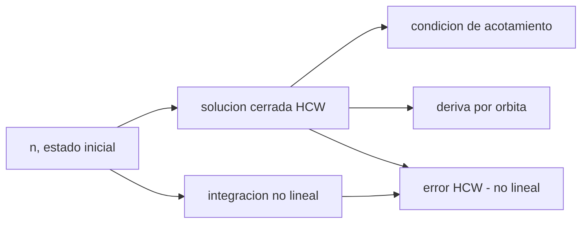

# B76-C09 — Dinámica relativa de Hill-Clohessy-Wiltshire

<!-- nav:top -->
[🏠 Programa](../../../../README.md) · [📚 Bloque B76](../../../tronco-comun/B76-dinamica-cislunar-y-operaciones-de-proximidad.md) · [← Anterior: B76-C08 — Transferencias de baja energía](../B76-C08-transferencias-de-baja-energia/CLASE.md) · [Siguiente: B76-C10 — Encuentro orbital →](../B76-C10-encuentro-orbital/CLASE.md)
<!-- /nav -->

## 1. Ubicación, nivel y alcance

Clase 9 del bloque B76, nivel N3. Cambia la escala: de miles de kilómetros a cientos de metros. Cuando dos naves están cerca, su movimiento relativo se linealiza en un marco que gira con la órbita (Hill-Clohessy-Wiltshire, HCW). Aquí obtienes la solución cerrada, la condición de órbita relativa acotada y el error frente a la integración no lineal. Es la base de las clases 10 a 20. La órbita de referencia es circular y los datos son sintéticos.

## 2. Por qué esta clase existe

Un controlador de encuentro necesita predecir dónde estará la otra nave sin integrar dos cuerpos cada vez. La decisión central: **¿hasta qué distancia y durante cuánto tiempo es válida la solución lineal de HCW, y qué movimientos son acotados?**

## 3. Lo que podrás hacer al terminar

1. Escribir las ecuaciones de HCW en el marco radial–a lo largo de la trayectoria–normal.
2. Evaluar la solución cerrada y la deriva `−12π x0` por órbita.
3. Aplicar la condición `ẏ0 = −2 n x0` para un movimiento acotado.
4. Comparar HCW con la integración no lineal y medir el error.
5. Reconocer que el error crece con el cuadrado de la separación y linealmente con el tiempo.
6. Rotular la órbita y los estados como sintéticos.

La evidencia es la **ficha de validez de HCW** del ejercicio 12 (sección 20).

## 4. Con qué llegas y cómo comprobarlo

1. ¿Qué es el movimiento medio `n`?
2. ¿Qué es un marco LVLH?
3. ¿Qué es linealizar?
4. ¿Qué es una órbita relativa acotada?
5. ¿Qué es un dato sintético?

<details>
<summary>Ver respuestas</summary>

1. `√(GM/r³)`, la velocidad angular de la órbita circular. 2. Un marco con el eje x radial, y a lo largo de la trayectoria y z normal. 3. Aproximar las ecuaciones por términos de primer orden en la separación. 4. Una cuya separación no crece con el tiempo. 5. Un dato generado para el ejemplo, no medido.
</details>

Con cuatro o cinco aciertos, sigue; si no, repasa los prerrequisitos.

## 5. Un caso de contexto y casos de referencia

Para un objetivo circular a `400 km` (`n = 1,131367 × 10⁻³ rad/s`, `P = 92,56 min`), un cuerpo a `100 m` radiales con velocidad relativa nula deriva `−3769,9 m` por órbita, que es `−12π × 100`. Con `ẏ0 = −2 n x0` la deriva es cero. La solución de HCW se separa de la no lineal `0,0139 m` en una órbita para una elipse de `100 m` y `1,39 m` para una de `1000 m`. Es el **ejemplo conductor**.

## 6. Vocabulario

Las **ecuaciones de HCW** son `ẍ = 3n²x + 2nẏ`, `ÿ = −2nẋ`, `z̈ = −n²z`. El eje `x` es radial saliente, `y` va a lo largo de la trayectoria y `z` es normal al plano. La **condición de acotamiento** es `ẏ0 = −2 n x0`. El **error de HCW** es la distancia entre la solución lineal y la no lineal.

## 7. Modelo mental: dos patinadores en un tiovivo



*Descripción textual:* del movimiento medio y el estado inicial sale la solución cerrada; de ella, la condición de acotamiento y la deriva; la comparación con la integración no lineal da el error de validez.

Analogía: dos patinadores en un tiovivo ven el movimiento del otro con una fuerza aparente que lo curva; para distancias pequeñas la curva es una fórmula simple. Límite: HCW supone referencia circular y separación mucho menor que el radio orbital; ignora el achatamiento terrestre y el arrastre.

## 8. La explicación, paso a paso

### 8.1 Marco y parámetros

Referencia circular de `6778,137 km` de radio (`400 km` de altitud): `n = 1,131367 × 10⁻³ rad/s`, `P = 92,560 min`. El marco LVLH gira con velocidad `n`.

### 8.2 Solución cerrada

Con `s = sin nt`, `c = cos nt`: `x = (4 − 3c) x0 + (s/n) ẋ0 + 2(1 − c) ẏ0/n`; `y = 6(s − nt) x0 + y0 − 2(1 − c) ẋ0/n + (4s − 3nt) ẏ0/n`; `z = z0 c + (ż0/n) s`. El movimiento fuera del plano es un oscilador de periodo `P`.

### 8.3 Acotamiento y deriva

Si `ẏ0 = −2 n x0`, el término secular se anula: `y` queda acotada (`0` tras 5 órbitas en la prueba). Si `ẏ0 = 0` con `x0 = 100 m`, `y` deriva `−12π x0 = −3769,911 m` por órbita.

### 8.4 Error frente al modelo no lineal

| Caso | 1 órbita (m) | 5 órbitas (m) |
|---|---|---|
| elipse 100 m | 0,0139 | 0,0695 |
| elipse 1000 m | 1,3899 | 6,9493 |
| V-bar 1000 m | 2,7809 | 13,9047 |
| deriva (x0 = 100 m) | 1,0961 | 26,2598 |

El error crece linealmente con el tiempo (×5 en 5 órbitas) y con el cuadrado de la separación (×100 entre `100` y `1000 m`).

### 8.5 Lectura

Para una elipse de `1000 m`, el error tras 5 órbitas es `0,7 %`. Para un maniobra de unos minutos entre naves a cientos de metros, HCW basta; para horas y kilómetros, hay que corregir o integrar.

## 9. Magnitudes, símbolos y unidades

| Símbolo | Qué es | Unidad | Valor / nota |
|---|---|---|---|
| `n` | movimiento medio | rad/s | 1,131367e-3 |
| `P` | periodo de la referencia | min | 92,560 |
| `x`, `y`, `z` | posición relativa LVLH | m | — |
| `−12π x0` | deriva por órbita | m | −3769,911 (x0 = 100 m) |
| error | HCW frente a no lineal | m | 0,0139–26,26 |

## 10. Convenciones y referencias

`GM_T` (JPL, DE440) y radio ecuatorial (NASA/NSSDC) consultados. Referencia circular de `400 km`; marco LVLH (x radial saliente, y a lo largo de la trayectoria, z normal). La «verdad» es dos cuerpos inerciales con RK4 de paso `1 s`. Estados relativos sintéticos.

## 11. De dónde sale lo que afirmamos

| ID | Fuente | Localizador | Respalda | Estado |
|---|---|---|---|---|
| S1 | NASA JPL SSD, Astrodynamic Parameters — https://ssd.jpl.nasa.gov/astro_par.html (consultada 2026-11-10) | tabla de GM y constantes | GM de la Tierra = 398600,435507 km³/s²; GM de la Luna = 4902,800118 km³/s² (DE440, Park et al. 2021); UA = 149597870700 m | Consultada |
| S2 | NASA/NSSDC, Earth Fact Sheet — https://nssdc.gsfc.nasa.gov/planetary/factsheet/earthfact.html (consultada 2026-11-10) | ficha leída | masa 5,9722×10²⁴ kg; radio medio volumétrico 6371,000 km; radio ecuatorial 6378,137 km | Consultada |
| — | Relaciones estándar: ecuaciones y solución de Hill-Clohessy-Wiltshire | — | las verifica el laboratorio con la integración no lineal | No consultada en una fuente concreta |

Límites: no se consultó el artículo original de Clohessy y Wiltshire ni el de Hill; el achatamiento terrestre y el arrastre no se modelan.

## 12. Cómo ver la validez de HCW

| Magnitud | Valor |
|---|---|
| Deriva por órbita (x0 = 100 m) | −3769,911 m |
| Error, elipse 100 m, 1 órbita | 0,0139 m |
| Error, elipse 1000 m, 1 órbita | 1,3899 m |
| `y` tras 5 órbitas acotadas | 0 m |

Descripción larga: el error es de centímetros para separaciones de cien metros y de metros para un kilómetro.

## 13. Ejemplo trabajado: la deriva por órbita

**Paso 1 · Estado.** `x0 = 100 m`, resto nulo.

**Paso 2 · Un periodo.** `nt = 2π`, `s = 0`, `c = 1`.

**Paso 3 · Posición.** `y = 6(0 − 2π) × 100 = −3769,9 m`.

**Paso 4 · Lectura.** La nave más alta se queda atrás `3,77 km` por órbita.

## 14. Distintas formas de describir el movimiento relativo

**Por coordenadas:** `(x, y, z)`. **Por constantes del movimiento:** centro `x_c = 4x0 + 2ẏ0/n`. **Por elipse:** semieje `ρ`. **Por deriva:** `−3π x_c` por órbita. **Por error:** HCW frente a no lineal.

## 15. Práctica guiada

**Ejercicio 1 · con los pasos indicados.** Calcula `n` para `r = 6778,137 km`. *Pasos:* `√(GM/r³)` con `GM` en m³/s².

<details><summary>Solución comentada</summary>

`1,131367 × 10⁻³ rad/s`; `P = 2π/n = 5553,6 s = 92,56 min`.
</details>

**Ejercicio 2 · con una pista.** Calcula la deriva por órbita para `x0 = 100 m`. *Pista:* `−12π x0`.

<details><summary>Solución comentada</summary>

`−3769,9 m`.
</details>

**Ejercicio 3 · casi autónomo.** ¿Qué `ẏ0` anula la deriva para `x0 = 100 m`?

<details><summary>Solución comentada</summary>

`−2 n x0 = −0,2263 m/s`.
</details>

## 16. Práctica autónoma, transferencia e integrador

**Ejercicio 4 · autónomo.** Compara el error de la elipse de 100 m a 5 y a 1 órbita.

<details><summary>Solución comentada</summary>

`0,0695/0,0139 = 5`: crece linealmente en el tiempo.
</details>

**Ejercicio 5 · autónomo.** Compara el error de las elipses de 1000 y 100 m a una órbita.

<details><summary>Solución comentada</summary>

`1,3899/0,0139 = 100`: crece como el cuadrado de la separación.
</details>

**Ejercicio 6 · autónomo.** ¿Cuánto deriva `y` en 5 órbitas con `x0 = 100 m` y `ẏ0 = 0`?

<details><summary>Solución comentada</summary>

`5 × (−3769,9) = −18.849,6 m`.
</details>

**Ejercicio 7 · autónomo.** ¿Cuál es el periodo del movimiento fuera del plano?

<details><summary>Solución comentada</summary>

`P = 92,56 min`, igual que el orbital.
</details>

**Ejercicio 8 · autónomo.** Expresa el error de la elipse de 1000 m a 5 órbitas como fracción de la separación.

<details><summary>Solución comentada</summary>

`6,9493/1000 = 0,7 %`.
</details>

**Ejercicio 9 · transferencia.** **Transferencia.** Un equipo usa HCW para predecir una separación de `50 km` a 10 órbitas. ¿Qué objetas?

<details><summary>Solución comentada</summary>

La linealización supone separación ≪ radio orbital; a `50 km` el error crece con el cuadrado y el tiempo, hay que integrar el modelo no lineal.
</details>

**Ejercicio 10 · transferencia.** **Transferencia.** Se afirma que «HCW ignora la gravedad». ¿Qué respondes?

<details><summary>Solución comentada</summary>

Incluye la gravedad linealizada: los términos `3n²x` y `2nẏ` vienen de la gravedad y de la rotación del marco.
</details>

**Ejercicio 11 · transferencia.** **Transferencia.** Un informe da un error de HCW de `1 m` sin decir la separación. ¿Qué falta?

<details><summary>Solución comentada</summary>

Separación, duración, altitud y verdad usada; el error depende de los tres.
</details>

**Ejercicio 12 · integrador.** **Integrador.** Elabora tu *ficha de validez de HCW*: tabla de error para tres separaciones y dos duraciones, condición de acotamiento y límites, con fuentes.

<details><summary>Solución comentada</summary>

Secciones 8.1–8.5 y la salida del laboratorio.
</details>

## 17. Laboratorio: HCW frente a la integración no lineal

El script [hcw.py](hcw.py) evalúa la solución de HCW, la deriva y la condición de acotamiento, y la compara con la integración de dos cuerpos en cuatro casos Usa la biblioteca común [cislunar_lib.py](../cislunar_lib.py) del bloque (**comprueba** deriva libre igual a `−12π x0` y `y` acotada < 1e-6 m con `ẏ0 = −2 n x0`).

**Datos:** `GM_T` y radio (JPL, NASA/NSSDC) **consultados** el 2026-11-10; la altitud de `400 km` y los estados relativos son **sintéticos**. **Predice antes de ejecutar:** ¿cuánto crece el error de una elipse de `100 m` entre una y cinco órbitas? (×5.) **Ejecución del 2026-11-10 (Python 3.12.9):**

```text
Python 3.12.9 (biblioteca estandar)
Referencia circular r = 6778.137 km ; n = 1.131367e-03 rad/s ; periodo = 92.560 min
 caso                     orbitas  |error HCW - no lineal| [m]   y_HCW [m]
elipse 100 m                 1           0.0139                         0.000
elipse 100 m                 5           0.0695                         0.000
elipse 1000 m                1           1.3899                         0.000
elipse 1000 m                5           6.9493                         0.000
v-bar 1000 m                 1           2.7809                     -1000.000
v-bar 1000 m                 5          13.9047                     -1000.000
deriva (x0=100 m, v=0)       1           1.0961                     -3769.911
deriva (x0=100 m, v=0)       5          26.2598                    -18849.556
Deriva en y tras 1 orbita con x0 = 100 m y velocidad nula = -3769.911 m (formula -12 pi x0 = -3769.911 m)
y tras 5 orbitas con ydot0 = -2 n x0 = 0.000e+00 m (acotado)
Pruebas superadas.
```

```bash
python programa/clases/B76/B76-C09-dinamica-relativa-de-hill-clohessy-wiltshire/hcw.py
```

**Límites:** Referencia circular, sin achatamiento ni arrastre; verdad RK4 de paso `1 s`.

## 18. Errores frecuentes y cómo corregirlos

**Aplicar HCW a separaciones de kilómetros durante horas.** Se corrige con 8.4.

**Olvidar la condición de acotamiento.** Se corrige con 8.3.

**Confundir los ejes `x` e `y`.** Se corrige con la sección 10.

**Presentar el estado sintético como una conjunción real.** Se corrige con la sección 10.

## 19. Cómo sabrás que vas bien

Tras la sección 8: ¿qué deriva esperabas para `x0 = 100 m` y cuál obtuviste? Si dudas, repasa el ejemplo 13. Tras el laboratorio: ¿qué comprueba la deriva? (ver la sección 17).

## 20. Qué entregas y cómo se evalúa

El producto es tu **ficha de validez de HCW** (ejercicio 12).

| Criterio | Inicial | En desarrollo | Logrado | Destacado |
|---|---|---|---|---|
| Conceptos | Los confunde | Parciales | Explica deriva y acotamiento | Explica el origen de cada término |
| Cálculo | Sin unidades | Con errores | Tabla con unidades | Calcula otras separaciones |
| Numérico | Sin comprobar | Un caso | Error frente al no lineal | Interpreta el escalado del error |
| Fuentes | Sin fuente | Sin fecha | Fuentes con fecha y estado | Declara lo no consultado |
| Límites | No los nombra | Uno | Tres | Discute qué falta del modelo |

**Condiciones críticas (no se compensan con promedio):** rotular los estados como sintéticos; no usar HCW fuera de su validez sin decirlo; citar solo lo consultado.

## 21. Ética, seguridad y límites

Clase educativa: los modelos son simplificados y sus datos son sintéticos, ilustrativos o publicados con fuente; ningún resultado es una efeméride, una telemetría ni una recomendación operativa, y lo simulado nunca se presenta como observado.  Accesibilidad: tablas equivalentes a las gráficas, fórmulas en texto, ejercicios sin conexión.

## 22. Para cerrar y seguir

Con `x0 = 100 m` y velocidad nula una nave deriva `3,77 km` por órbita; con `ẏ0 = −2 n x0` no deriva, y HCW acierta al centímetro para cien metros. Queda una pregunta: ¿cómo se llega a un objetivo desde lejos?

**Glosario español–inglés.** Hill-Clohessy-Wiltshire · *Hill-Clohessy-Wiltshire (HCW)*; marco LVLH · *LVLH frame*; órbita relativa acotada · *bounded relative orbit*; deriva · *drift*; linealización · *linearization*.

**Continuidad.** [B76-C10](../B76-C10-encuentro-orbital/CLASE.md) estudia el encuentro orbital.

**Referencias:** ver sección 11.

<!-- nav:bottom -->
---

[← Anterior: B76-C08 — Transferencias de baja energía](../B76-C08-transferencias-de-baja-energia/CLASE.md) · [📚 Bloque B76](../../../tronco-comun/B76-dinamica-cislunar-y-operaciones-de-proximidad.md) · [Siguiente: B76-C10 — Encuentro orbital →](../B76-C10-encuentro-orbital/CLASE.md)
<!-- /nav -->
