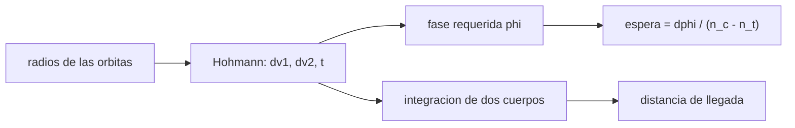

# B76-C10 — Encuentro orbital

<!-- nav:top -->
[🏠 Programa](../../../../README.md) · [📚 Bloque B76](../../../tronco-comun/B76-dinamica-cislunar-y-operaciones-de-proximidad.md) · [← Anterior: B76-C09 — Dinámica relativa de Hill-Clohessy-Wiltshire](../B76-C09-dinamica-relativa-de-hill-clohessy-wiltshire/CLASE.md) · [Siguiente: B76-C11 — Operaciones de aproximación →](../B76-C11-operaciones-de-aproximacion/CLASE.md)
<!-- /nav -->

## 1. Ubicación, nivel y alcance

Clase 10 del bloque B76, nivel N3. Un encuentro orbital lleva a un perseguidor a la posición de un objetivo en otra órbita. La parte lejana se resuelve con transferencias de Hohmann y con el ángulo de fase; la cercana, con HCW (clases 9 y 11). Aquí calculas la fase requerida, el `Δv` y el tiempo de espera, y los compruebas integrando dos cuerpos. Los datos son sintéticos y la geometría coplanar.

## 2. Por qué esta clase existe

Si la fase es incorrecta, la nave llega al lugar correcto cuando el objetivo ya pasó. La decisión central: **¿qué ángulo de fase debe haber al inicio y cuánto hay que esperar para lograrlo?**

## 3. Lo que podrás hacer al terminar

1. Calcular el `Δv` y el tiempo de una transferencia de Hohmann entre órbitas circulares.
2. Calcular el ángulo de fase requerido `φ = π − n_obj t`.
3. Calcular el tiempo de espera con el movimiento relativo `n_c − n_t`.
4. Verificar la llegada con una integración de dos cuerpos.
5. Distinguir el periodo sinódico del encuentro del periodo orbital.
6. Rotular las órbitas y la fase inicial como sintéticas.

La evidencia es la **plan de fases de un encuentro** del ejercicio 12 (sección 20).

## 4. Con qué llegas y cómo comprobarlo

1. ¿Qué es una transferencia de Hohmann?
2. ¿Qué es el ángulo de fase?
3. ¿Qué es el periodo sinódico entre dos naves?
4. ¿Qué es la velocidad relativa?
5. ¿Qué es un dato sintético?

<details>
<summary>Ver respuestas</summary>

1. La elipse tangente a dos órbitas circulares coplanares. 2. El ángulo entre las posiciones de dos naves vistas desde el cuerpo central. 3. El tiempo entre dos alineaciones iguales de ambas. 4. La diferencia de velocidades entre perseguidor y objetivo. 5. Un dato generado para el ejemplo, no medido.
</details>

Con cuatro o cinco aciertos, sigue; si no, repasa los prerrequisitos.

## 5. Un caso de contexto y casos de referencia

Un perseguidor en órbita circular de `300 km` debe alcanzar un objetivo a `400 km`. El Hohmann cuesta `28,65 + 28,55 = 57,20 m/s` y dura `45,77 min`. El objetivo debe ir `1,988°` por delante al partir. Si empieza `20°` por delante, hay que esperar `65,0 h`. La integración confirma una llegada a `0,000 m`. Es el **ejemplo conductor**.

## 6. Vocabulario

El **ángulo de fase** `φ` es la posición angular del objetivo menos la del perseguidor. La **fase requerida** es `φ = π − n_t t_T`. El **periodo sinódico** es `2π/(n_c − n_t)`. El **tiempo de espera** es el ángulo que falta dividido entre `n_c − n_t`.

## 7. Modelo mental: un corredor que alcanza a otro en una pista circular



*Descripción textual:* de los radios sale el Hohmann y su tiempo; con el tiempo y el movimiento del objetivo sale la fase requerida; la espera se calcula con la diferencia de movimientos medios y la integración comprueba la llegada.

Analogía: para alcanzar a un corredor en una pista circular hay que salir cuando está a cierta distancia por delante, calculada con la velocidad de ambos. Límite: se supone coplanar y circular; las perturbaciones, la excentricidad y la fase del plano añaden correcciones.

## 8. La explicación, paso a paso

### 8.1 Transferencia de Hohmann

Con `r_c = 6678,137 km` y `r_t = 6778,137 km` (GM de la Tierra consultado): `Δv1 = 28,65 m/s`, `Δv2 = 28,55 m/s`, total `57,20 m/s`, tiempo `45,77 min` (semi-periodo de la elipse).

### 8.2 Fase requerida

`n_c = 1,156874 × 10⁻³` y `n_t = 1,131367 × 10⁻³ rad/s`. `φ = π − n_t t_T = 3,14159 − 3,10690 = 0,03469 rad = 1,988°`. El objetivo debe estar `1,988°` por delante al partir.

### 8.3 Espera

El periodo sinódico es `2π/(n_c − n_t) = 68,426 h`. Desde `20°` por delante, el perseguidor debe ganar `341,988°` (módulo `360°`) a `2,5507 × 10⁻⁵ rad/s`: `65,002 h`.

### 8.4 Verificación

Se integra el perseguidor desde `(r_c, 0)` con `v1` tangencial durante `45,77 min`; el objetivo se coloca en el ángulo `φ + n_t t_T`. La distancia final es `0,000 m` y el error de radio `−0,000 m`. La velocidad relativa residual es `28,5475 m/s`, que el segundo impulso (`28,55 m/s`) anula.

## 9. Magnitudes, símbolos y unidades

| Símbolo | Qué es | Unidad | Valor / nota |
|---|---|---|---|
| `Δv1`, `Δv2` | impulsos de Hohmann | m/s | 28,65; 28,55 |
| `t_T` | tiempo de transferencia | min | 45,77 |
| `φ` | fase requerida | grados | 1,988 |
| `T_sin` | periodo sinódico | h | 68,426 |
| espera | desde 20° de fase | h | 65,002 |

## 10. Convenciones y referencias

`GM_T` (JPL, DE440) y radio ecuatorial (NASA/NSSDC) consultados. Órbitas circulares coplanares de `300` y `400 km` (sintéticas); fase inicial `20°` (sintética); impulsos instantáneos; verdad RK4 de paso `1 s`.

## 11. De dónde sale lo que afirmamos

| ID | Fuente | Localizador | Respalda | Estado |
|---|---|---|---|---|
| S1 | NASA JPL SSD, Astrodynamic Parameters — https://ssd.jpl.nasa.gov/astro_par.html (consultada 2026-11-10) | tabla de GM y constantes | GM de la Tierra = 398600,435507 km³/s²; GM de la Luna = 4902,800118 km³/s² (DE440, Park et al. 2021); UA = 149597870700 m | Consultada |
| S2 | NASA/NSSDC, Earth Fact Sheet — https://nssdc.gsfc.nasa.gov/planetary/factsheet/earthfact.html (consultada 2026-11-10) | ficha leída | masa 5,9722×10²⁴ kg; radio medio volumétrico 6371,000 km; radio ecuatorial 6378,137 km | Consultada |
| — | Relaciones estándar: Hohmann, ángulo de fase, periodo sinódico | — | las verifica el laboratorio con la integración | No consultada en una fuente concreta |

Límites: no se consultó ningún procedimiento operativo de encuentro; las órbitas son circulares, coplanares y sin perturbaciones.

## 12. Cómo ver el encuentro

| Magnitud | Valor |
|---|---|
| `Δv` total | 57,20 m/s |
| Fase requerida | 1,988° |
| Espera | 65,0 h |
| Distancia de llegada | 0,000 m |

Descripción larga: una diferencia de altitud de cien kilómetros cuesta unos cincuenta metros por segundo y exige una fase de pocos grados.

## 13. Ejemplo trabajado: la fase requerida

**Paso 1 · Tiempo.** `t_T = 45,77 min = 2746 s`.

**Paso 2 · Avance del objetivo.** `n_t t_T = 1,131367 × 10⁻³ × 2746 = 3,1069 rad`.

**Paso 3 · Fase.** `φ = π − 3,1069 = 0,0347 rad = 1,988°`.

**Paso 4 · Lectura.** El objetivo debe ir `1,988°` por delante.

## 14. Distintas formas de describir el encuentro

**Por impulsos:** `Δv1`, `Δv2`. **Por tiempo:** `t_T`. **Por fase:** `φ`. **Por espera:** `Δφ/(n_c − n_t)`. **Por verificación:** distancia de llegada.

## 15. Práctica guiada

**Ejercicio 1 · con los pasos indicados.** Calcula el semieje de la elipse de transferencia. *Pasos:* promedia los radios.

<details><summary>Solución comentada</summary>

`(6678,137 + 6778,137)/2 = 6728,137 km`.
</details>

**Ejercicio 2 · con una pista.** Calcula el periodo sinódico. *Pista:* `2π/(n_c − n_t)`.

<details><summary>Solución comentada</summary>

`n_c − n_t = 2,5507 × 10⁻⁵ rad/s`; `68,43 h`.
</details>

**Ejercicio 3 · casi autónomo.** Calcula `n_t t_T` si `t_T = 2746 s`.

<details><summary>Solución comentada</summary>

`1,131367 × 10⁻³ × 2746 = 3,1069 rad`.
</details>

## 16. Práctica autónoma, transferencia e integrador

**Ejercicio 4 · autónomo.** Calcula el `Δv` total.

<details><summary>Solución comentada</summary>

`28,65 + 28,55 = 57,20 m/s`.
</details>

**Ejercicio 5 · autónomo.** Si el objetivo empezara a `10°`, ¿cuánto hay que esperar?

<details><summary>Solución comentada</summary>

`(1,988° − 10°) mod 360° = 351,988°`; `6,144 rad/2,5507 × 10⁻⁵ = 240.900 s = 66,9 h`.
</details>

**Ejercicio 6 · autónomo.** ¿Por qué se espera más de dos días aunque el vuelo dura 46 min?

<details><summary>Solución comentada</summary>

Porque la diferencia de movimientos medios es pequeña: ganar casi una vuelta de fase lleva casi un periodo sinódico.
</details>

**Ejercicio 7 · autónomo.** Convierte la fase requerida a kilómetros de arco a `6778 km`.

<details><summary>Solución comentada</summary>

`0,03469 × 6778 = 235 km`.
</details>

**Ejercicio 8 · autónomo.** ¿Qué pasa con la fase requerida si el vuelo fuera más largo?

<details><summary>Solución comentada</summary>

El objetivo avanza más y `φ = π − n_t t_T` disminuye.
</details>

**Ejercicio 9 · transferencia.** **Transferencia.** Un equipo propone empezar con el objetivo `2°` por detrás. ¿Qué ocurre?

<details><summary>Solución comentada</summary>

El perseguidor llega al apogeo cuando el objetivo ya pasó: la distancia final sería de unos `4° × 6778 km` ≈ 470 km.
</details>

**Ejercicio 10 · transferencia.** **Transferencia.** Se afirma que el cálculo vale para cualquier inclinación. ¿Qué objetas?

<details><summary>Solución comentada</summary>

Es coplanar; un cambio de plano exige un impulso fuera del plano y fase adicional.
</details>

**Ejercicio 11 · transferencia.** **Transferencia.** Un informe da `φ = 1,988°` sin sentido. ¿Qué falta?

<details><summary>Solución comentada</summary>

Decir si el objetivo va por delante o por detrás y desde qué cuerpo se mide el ángulo.
</details>

**Ejercicio 12 · integrador.** **Integrador.** Elabora tu *plan de fases de un encuentro*: `Δv`, tiempo, fase requerida, espera y verificación numérica, con fuentes.

<details><summary>Solución comentada</summary>

Secciones 8.1–8.4 y la salida del laboratorio.
</details>

## 17. Laboratorio: fase y Hohmann para un encuentro coplanar

El script [encuentro.py](encuentro.py) calcula el Hohmann, la fase requerida, la espera y verifica la llegada con dos cuerpos Usa la biblioteca común [cislunar_lib.py](../cislunar_lib.py) del bloque (**comprueba** distancia de llegada < 1 km y velocidad relativa residual igual al segundo impulso).

**Datos:** `GM_T` y radio (JPL, NASA/NSSDC) **consultados** el 2026-11-10; las órbitas y la fase de `20°` son **sintéticas**. **Predice antes de ejecutar:** ¿cuántos grados por delante debe estar el objetivo? (`1,988°`.) **Ejecución del 2026-11-10 (Python 3.12.9):**

```text
Python 3.12.9 (biblioteca estandar)
n perseguidor = 1.156874e-03 rad/s ; n objetivo = 1.131367e-03 rad/s ; periodo sinodico = 68.426 h
Hohmann 300 -> 400 km: dv1 = 28.65 m/s ; dv2 = 28.55 m/s ; total = 57.20 m/s ; t = 45.77 min
Fase requerida (objetivo por delante) = 1.988 grados ; espera desde 20 grados = 65.002 h = 3900.1 min
Llegada integrada: error de radio = -0.000 m ; distancia al objetivo = 0.000 m ; velocidad relativa residual = 28.5475 m/s (antes del dv2 = 28.55 m/s)
Pruebas superadas.
```

```bash
python programa/clases/B76/B76-C10-encuentro-orbital/encuentro.py
```

**Límites:** Coplanar, circular, impulsos instantáneos y sin perturbaciones.

## 18. Errores frecuentes y cómo corregirlos

**Ignorar la fase.** Se corrige con 8.2.

**Esperar un periodo orbital en lugar de un sinódico.** Se corrige con 8.3.

**Dar la fase sin sentido ni referencia.** Se corrige con el ejercicio 11.

**Presentar el plan como procedimiento operativo.** Se corrige con la sección 21.

## 19. Cómo sabrás que vas bien

Tras la sección 8: ¿qué fase esperabas y cuál obtuviste? Si dudas, repasa el ejemplo 13. Tras el laboratorio: ¿qué comprueba la distancia de llegada? (ver la sección 17).

## 20. Qué entregas y cómo se evalúa

El producto es tu **plan de fases de un encuentro** (ejercicio 12).

| Criterio | Inicial | En desarrollo | Logrado | Destacado |
|---|---|---|---|---|
| Conceptos | Los confunde | Parciales | Explica fase, espera y Hohmann | Explica el efecto del plano |
| Cálculo | Sin unidades | Con errores | Tabla con unidades | Calcula otras alturas |
| Numérico | Sin comprobar | Un caso | Verificación por integración | Interpreta las diferencias |
| Fuentes | Sin fuente | Sin fecha | Fuentes con fecha y estado | Declara lo no consultado |
| Límites | No los nombra | Uno | Tres | Discute qué falta del modelo |

**Condiciones críticas (no se compensan con promedio):** rotular órbitas y fase como sintéticas; no presentar el plan como procedimiento operativo; citar solo lo consultado.

## 21. Ética, seguridad y límites

Clase educativa: los modelos son simplificados y sus datos son sintéticos, ilustrativos o publicados con fuente; ningún resultado es una efeméride, una telemetría ni una recomendación operativa, y lo simulado nunca se presenta como observado.  Accesibilidad: tablas equivalentes a las gráficas, fórmulas en texto, ejercicios sin conexión.

## 22. Para cerrar y seguir

Para subir de `300` a `400 km` hacen falta `57,2 m/s`, una fase de `1,988°` y unas `65 h` de espera. Queda una pregunta: ¿cómo se recorren los últimos kilómetros?

**Glosario español–inglés.** encuentro orbital · *orbital rendezvous*; ángulo de fase · *phase angle*; periodo sinódico · *synodic period*; transferencia de Hohmann · *Hohmann transfer*; perseguidor · *chaser*.

**Continuidad.** [B76-C11](../B76-C11-operaciones-de-aproximacion/CLASE.md) estudia las operaciones de aproximación.

**Referencias:** ver sección 11.

<!-- nav:bottom -->
---

[← Anterior: B76-C09 — Dinámica relativa de Hill-Clohessy-Wiltshire](../B76-C09-dinamica-relativa-de-hill-clohessy-wiltshire/CLASE.md) · [📚 Bloque B76](../../../tronco-comun/B76-dinamica-cislunar-y-operaciones-de-proximidad.md) · [Siguiente: B76-C11 — Operaciones de aproximación →](../B76-C11-operaciones-de-aproximacion/CLASE.md)
<!-- /nav -->
