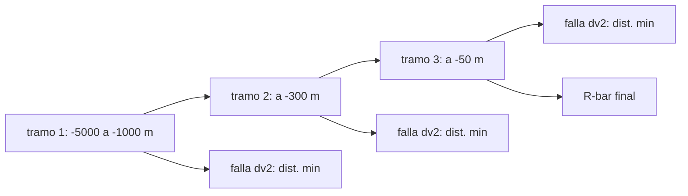

# B76-C11 — Operaciones de aproximación

<!-- nav:top -->
[🏠 Programa](../../../../README.md) · [📚 Bloque B76](../../../tronco-comun/B76-dinamica-cislunar-y-operaciones-de-proximidad.md) · [← Anterior: B76-C10 — Encuentro orbital](../B76-C10-encuentro-orbital/CLASE.md) · [Siguiente: B76-C12 — Guiado relativo →](../B76-C12-guiado-relativo/CLASE.md)
<!-- /nav -->

## 1. Ubicación, nivel y alcance

Clase 11 del bloque B76, nivel N3. La aproximación final se hace por tramos: cada uno es un salto de dos impulsos entre puntos sobre la trayectoria (V-bar) o sobre la vertical (R-bar), con una condición de seguridad si falla el segundo impulso. Aquí diseñas tres tramos V-bar y un tramo R-bar con HCW y mides su `Δv` y su seguridad pasiva. Parte de [B76-C09](../B76-C09-dinamica-relativa-de-hill-clohessy-wiltshire/CLASE.md) y [B76-C10](../B76-C10-encuentro-orbital/CLASE.md). Los tramos y la esfera de exclusión son ilustrativos.

## 2. Por qué esta clase existe

Una aproximación a baja velocidad no puede depender de que todos los impulsos se ejecuten. La decisión central: **¿cuántos tramos usar, cuánto cuestan y qué ocurre si el segundo impulso de un tramo falla?**

## 3. Lo que podrás hacer al terminar

1. Planificar un salto V-bar de dos impulsos entre dos puntos de la trayectoria.
2. Planificar una aproximación R-bar con velocidad final nula.
3. Calcular el `Δv` de cada tramo y el total.
4. Medir la distancia mínima al objetivo si falla el segundo impulso (seguridad pasiva).
5. Comparar el costo por metro de tramos de distinta duración.
6. Rotular la esfera de exclusión como hipótesis.

La evidencia es la **plan de aproximación por tramos** del ejercicio 12 (sección 20).

## 4. Con qué llegas y cómo comprobarlo

1. ¿Qué es V-bar?
2. ¿Qué es R-bar?
3. ¿Qué es la seguridad pasiva?
4. ¿Qué es un impulso de dos tramos?
5. ¿Qué es una esfera de exclusión?

<details>
<summary>Ver respuestas</summary>

1. El eje a lo largo de la trayectoria del objetivo. 2. El eje radial, desde el centro de la Tierra al objetivo. 3. Que la trayectoria no choque con el objetivo aunque no se ejecute una maniobra posterior. 4. Un impulso para salir y otro para detenerse al llegar. 5. Una región alrededor del objetivo que el perseguidor no debe invadir sin autorización.
</details>

Con cuatro o cinco aciertos, sigue; si no, repasa los prerrequisitos.

## 5. Un caso de contexto y casos de referencia

Un perseguidor a `−5000 m` sobre la trayectoria baja a `−1000`, `−300` y `−50 m` en tres tramos de `46,28`, `23,14` y `11,57 min`. Los `Δv` son `1,1314`, `0,5386` y `0,3836 m/s` por impulso (total `4,1072 m/s`). Si el segundo impulso del último tramo falla, la nave pasa a `35,7 m` del objetivo. Es el **ejemplo conductor**; los tramos son ilustrativos.

## 6. Vocabulario

El **salto V-bar** mueve la nave a lo largo de la trayectoria con dos impulsos. La **aproximación R-bar** va por la vertical. La **seguridad pasiva** exige que la deriva sin maniobras no entre en la **esfera de exclusión** (aquí `200 m`, hipótesis del autor). El **costo por metro** es el `Δv` entre el cambio de posición.

## 7. Modelo mental: bajar escalones en vez de una rampa



*Descripción textual:* tres escalones V-bar con una comprobación de seguridad cada uno (qué ocurre si no se ejecuta el segundo impulso) y una variante R-bar para la parte final.

Analogía: bajar una escalera con descansos; si se pierde un escalón se puede detener en el siguiente descanso. Límite: HCW es lineal; a escalas de kilómetros las desviaciones del no lineal importan y la simulación no modela errores de navegación.

## 8. La explicación, paso a paso

### 8.1 Salto V-bar

Para ir de `y0` a `yf` en `T` con velocidades nulas en ambos extremos se usa el guiado de dos impulsos de HCW (clase 12). Para `−5000 → −1000 m` en `0,5 P = 46,28 min`: `Δv1 = Δv2 = 1,1314 m/s` y el error de llegada es `8 × 10⁻¹³ m`.

### 8.2 Tres tramos

| Tramo (m) | `T` (min) | `Δv1` (m/s) | `Δv2` (m/s) | dist. mínima si falla `Δv2` (m) |
|---|---|---|---|---|
| −5000 → −1000 | 46,28 | 1,1314 | 1,1314 | 1000,0 |
| −1000 → −300 | 23,14 | 0,5386 | 0,5386 | 285,9 |
| −300 → −50 | 11,57 | 0,3836 | 0,3836 | 35,7 |

Total `4,1072 m/s` (suma de todos los impulsos).

### 8.3 Costo por metro

`1,1314/4000 = 2,83 × 10⁻⁴ s⁻¹`, `0,5386/700 = 7,69 × 10⁻⁴`, `0,3836/250 = 1,53 × 10⁻³`. Los tramos más cortos en tiempo cuestan más por metro.

### 8.4 Seguridad

Con la esfera de exclusión de `200 m`, los dos primeros tramos son pasivamente seguros (`1000` y `285,9 m`), pero el último no: si falla `Δv2`, el perseguidor pasa a `35,7 m`. Para el tramo final habría que cambiar la forma de la trayectoria.

### 8.5 R-bar

Desde `x = −200 m` hasta `−50 m` en un cuarto de periodo con velocidad final nula: `Δv1 = 0,4017 m/s` y `Δv2 = 0,1318 m/s`. La aproximación por R-bar tiene la ventaja de que la gravedad ayuda a frenar si falla un impulso.

## 9. Magnitudes, símbolos y unidades

| Símbolo | Qué es | Unidad | Valor / nota |
|---|---|---|---|
| `T` | duración del tramo | min | 46,28; 23,14; 11,57 |
| `Δv` | impulso por tramo | m/s | 1,1314; 0,5386; 0,3836 |
| total | suma de impulsos | m/s | 4,1072 |
| `d_min` | distancia mínima si falla el 2.º impulso | m | 1000,0; 285,9; 35,7 |
| exclusión | esfera de exclusión (hipótesis) | m | 200 |

## 10. Convenciones y referencias

`GM_T` y radio terrestre consultados; objetivo circular a `400 km`; marco LVLH; tramos y esfera de exclusión ilustrativos; la propagación de la falla usa HCW durante 3 periodos.

## 11. De dónde sale lo que afirmamos

| ID | Fuente | Localizador | Respalda | Estado |
|---|---|---|---|---|
| S1 | NASA JPL SSD, Astrodynamic Parameters — https://ssd.jpl.nasa.gov/astro_par.html (consultada 2026-11-10) | tabla de GM y constantes | GM de la Tierra = 398600,435507 km³/s²; GM de la Luna = 4902,800118 km³/s² (DE440, Park et al. 2021); UA = 149597870700 m | Consultada |
| S2 | NASA/NSSDC, Earth Fact Sheet — https://nssdc.gsfc.nasa.gov/planetary/factsheet/earthfact.html (consultada 2026-11-10) | ficha leída | masa 5,9722×10²⁴ kg; radio medio volumétrico 6371,000 km; radio ecuatorial 6378,137 km | Consultada |
| — | Relaciones estándar: HCW, saltos V-bar, aproximación R-bar | — | las verifica el laboratorio (error de llegada) | No consultada en una fuente concreta |

Límites: no se consultaron corredores de aproximación ni criterios de seguridad de ninguna agencia; la esfera de exclusión es una hipótesis.

## 12. Cómo ver la aproximación

| Magnitud | Valor |
|---|---|
| `Δv` total (3 tramos) | 4,1072 m/s |
| Distancia mínima tramo 3 si falla `Δv2` | 35,7 m |
| `Δv` R-bar (200 → 50 m) | 0,4017 + 0,1318 m/s |
| Error de llegada | < 1e-12 m |

Descripción larga: los tramos largos son baratos y seguros; el último tramo es el más caro por metro y el que no cumple la seguridad pasiva.

## 13. Ejemplo trabajado: el tramo -1000 a -300 m

**Paso 1 · Duración.** `T = 0,25 P = 23,14 min`.

**Paso 2 · Guiado.** Se aplica `Δv1 = 0,5386 m/s` hacia delante.

**Paso 3 · Llegada.** HCW coloca la nave en `y = −300 m` con error `6 × 10⁻¹⁴ m`.

**Paso 4 · Seguridad.** Si falla `Δv2`, la distancia mínima es `285,9 m` (> 200 m).

## 14. Distintas formas de describir un tramo

**Por geometría:** `y0 → yf`. **Por tiempo:** `T`. **Por impulsos:** `Δv1`, `Δv2`. **Por costo:** `Δv/Δy`. **Por seguridad:** distancia mínima sin el 2.º impulso.

## 15. Práctica guiada

**Ejercicio 1 · con los pasos indicados.** Calcula el cambio de posición de cada tramo. *Pasos:* resta `yf − y0`.

<details><summary>Solución comentada</summary>

`4000`, `700` y `250 m`.
</details>

**Ejercicio 2 · con una pista.** Calcula el costo por metro del tramo 1. *Pista:* `Δv1/Δy`.

<details><summary>Solución comentada</summary>

`1,1314/4000 = 2,83 × 10⁻⁴ s⁻¹`.
</details>

**Ejercicio 3 · casi autónomo.** Suma los seis impulsos.

<details><summary>Solución comentada</summary>

`2 × (1,1314 + 0,5386 + 0,3836) = 4,1072 m/s`.
</details>

## 16. Práctica autónoma, transferencia e integrador

**Ejercicio 4 · autónomo.** ¿Qué tramos cumplen la exclusión de 200 m si falla `Δv2`?

<details><summary>Solución comentada</summary>

Los dos primeros (`1000` y `285,9 m`); el tercero no (`35,7 m`).
</details>

**Ejercicio 5 · autónomo.** Compara el costo por metro de los tramos 2 y 3.

<details><summary>Solución comentada</summary>

`7,69 × 10⁻⁴` frente a `1,53 × 10⁻³`: el 3 cuesta el doble por metro.
</details>

**Ejercicio 6 · autónomo.** Calcula el `Δv` total R-bar.

<details><summary>Solución comentada</summary>

`0,4017 + 0,1318 = 0,5335 m/s`.
</details>

**Ejercicio 7 · autónomo.** Convierte `1,1314 m/s` en kilómetros por hora.

<details><summary>Solución comentada</summary>

`4,07 km/h`.
</details>

**Ejercicio 8 · autónomo.** ¿Cuánto vale el periodo de la referencia en segundos?

<details><summary>Solución comentada</summary>

`92,56 × 60 = 5553,6 s`.
</details>

**Ejercicio 9 · transferencia.** **Transferencia.** Un equipo quiere añadir un cuarto tramo de `−50` a `−10 m`. ¿Qué anticipas?

<details><summary>Solución comentada</summary>

Más costo por metro y menos margen: la seguridad pasiva debería evaluarse con la exclusión que se adopte.
</details>

**Ejercicio 10 · transferencia.** **Transferencia.** Se propone usar un solo tramo de `−5000` a `−50 m` en `0,5 P`. ¿Qué ventaja y riesgo hay?

<details><summary>Solución comentada</summary>

Menos impulsos, pero si falla el segundo la nave no se detiene en `−50 m`; la deriva puede acercarse mucho.
</details>

**Ejercicio 11 · transferencia.** **Transferencia.** Un informe da `Δv = 4,1 m/s` sin tramos. ¿Qué falta?

<details><summary>Solución comentada</summary>

Los tramos, las duraciones, el modelo (HCW) y la hipótesis de seguridad.
</details>

**Ejercicio 12 · integrador.** **Integrador.** Elabora tu *plan de aproximación por tramos*: tres saltos V-bar y un tramo R-bar con `Δv`, duración, seguridad pasiva y límites, con fuentes.

<details><summary>Solución comentada</summary>

Secciones 8.1–8.5 y la salida del laboratorio.
</details>

## 17. Laboratorio: saltos V-bar, R-bar y seguridad pasiva

El script [aproximacion.py](aproximacion.py) planifica tres saltos V-bar y un tramo R-bar con HCW y mide la distancia mínima si falla el segundo impulso Usa la biblioteca común [cislunar_lib.py](../cislunar_lib.py) del bloque (**comprueba** error de llegada < 1e-6 m y `Δv` total < 5 m/s).

**Datos:** `GM_T` y radio (JPL, NASA/NSSDC) **consultados** el 2026-11-10; tramos, duraciones y exclusión de `200 m` **ilustrativos**. **Predice antes de ejecutar:** ¿qué tramo viola la exclusión si falla el segundo impulso? (el tercero.) **Ejecución del 2026-11-10 (Python 3.12.9):**

```text
Python 3.12.9 (biblioteca estandar)
Orbita del objetivo: n = 1.131367e-03 rad/s ; periodo = 92.560 min ; esfera de exclusion ILUSTRATIVA = 200.0 m
 tramo y0 -> yf [m]    T [min]   dv1 [m/s]   dv2 [m/s]   error llegada [m]   dist. minima si falla dv2 [m]
  -5000 ->  -1000     46.28      1.1314      1.1314       7.96e-13         1000.0
  -1000 ->   -300     23.14      0.5386      0.5386       5.68e-14          285.9
   -300 ->    -50     11.57      0.3836      0.3836       3.18e-14           35.7
Delta-v total de los tres tramos = 4.1072 m/s
R-bar de x = -200 m a -50 m en un cuarto de periodo: dv1 = 0.4017 m/s ; dv2 = 0.1318 m/s
Pruebas superadas.
```

```bash
python programa/clases/B76/B76-C11-operaciones-de-aproximacion/aproximacion.py
```

**Límites:** HCW sin errores de navegación ni de ejecución; sin corredores de aproximación consultados.

## 18. Errores frecuentes y cómo corregirlos

**Suponer que todos los impulsos se ejecutan.** Se corrige con 8.4.

**Usar el mismo `T` para todos los tramos.** Se corrige con 8.3.

**Tomar la exclusión de 200 m como requisito real.** Se corrige con la sección 10.

**Confundir V-bar con R-bar.** Se corrige con la sección 6.

## 19. Cómo sabrás que vas bien

Tras la sección 8: ¿qué tramo esperabas que fuera inseguro? Si dudas, repasa el ejemplo 13. Tras el laboratorio: ¿qué comprueba el error de llegada? (ver la sección 17).

## 20. Qué entregas y cómo se evalúa

El producto es tu **plan de aproximación por tramos** (ejercicio 12).

| Criterio | Inicial | En desarrollo | Logrado | Destacado |
|---|---|---|---|---|
| Conceptos | Los confunde | Parciales | Distingue V-bar, R-bar y seguridad pasiva | Explica el costo por metro |
| Cálculo | Sin unidades | Con errores | Tabla con unidades | Diseña un tramo nuevo |
| Numérico | Sin comprobar | Un caso | Error de llegada y distancia mínima | Interpreta las diferencias |
| Fuentes | Sin fuente | Sin fecha | Fuentes con fecha y estado | Declara la exclusión como hipótesis |
| Límites | No los nombra | Uno | Tres | Discute qué falta del modelo |

**Condiciones críticas (no se compensan con promedio):** rotular tramos y exclusión como ilustrativos; no presentar el plan como procedimiento operativo; citar solo lo consultado.

## 21. Ética, seguridad y límites

Clase educativa: los modelos son simplificados y sus datos son sintéticos, ilustrativos o publicados con fuente; ningún resultado es una efeméride, una telemetría ni una recomendación operativa, y lo simulado nunca se presenta como observado.  Accesibilidad: tablas equivalentes a las gráficas, fórmulas en texto, ejercicios sin conexión.

## 22. Para cerrar y seguir

Tres saltos de `46`, `23` y `12 min` llevan de `−5000` a `−50 m` con `4,1 m/s`, pero el último no es pasivamente seguro. Queda una pregunta: ¿cómo se calculan esos impulsos en general?

**Glosario español–inglés.** V-bar · *V-bar*; R-bar · *R-bar*; seguridad pasiva · *passive safety*; esfera de exclusión · *keep-out sphere*; aproximación · *approach*.

**Continuidad.** [B76-C12](../B76-C12-guiado-relativo/CLASE.md) estudia el guiado relativo.

**Referencias:** ver sección 11.

<!-- nav:bottom -->
---

[← Anterior: B76-C10 — Encuentro orbital](../B76-C10-encuentro-orbital/CLASE.md) · [📚 Bloque B76](../../../tronco-comun/B76-dinamica-cislunar-y-operaciones-de-proximidad.md) · [Siguiente: B76-C12 — Guiado relativo →](../B76-C12-guiado-relativo/CLASE.md)
<!-- /nav -->
