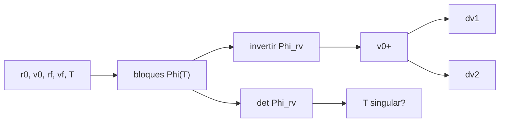

# B76-C12 — Guiado relativo

<!-- nav:top -->
[🏠 Programa](../../../../README.md) · [📚 Bloque B76](../../../tronco-comun/B76-dinamica-cislunar-y-operaciones-de-proximidad.md) · [← Anterior: B76-C11 — Operaciones de aproximación](../B76-C11-operaciones-de-aproximacion/CLASE.md) · [Siguiente: B76-C13 — Sensores de proximidad →](../B76-C13-sensores-de-proximidad/CLASE.md)
<!-- /nav -->

## 1. Ubicación, nivel y alcance

Clase 12 del bloque B76, nivel N3. El guiado de dos impulsos resuelve cualquier tramo: dado un estado inicial y un punto final, calcula el primer impulso que lleva la nave al punto en el tiempo `T` y el segundo que la detiene. Aquí lo derivas de la matriz de transición de HCW, lo aplicas a un estado fuera del plano y lo verificas con la integración no lineal. Parte de [B76-C09](../B76-C09-dinamica-relativa-de-hill-clohessy-wiltshire/CLASE.md) y [B76-C11](../B76-C11-operaciones-de-aproximacion/CLASE.md).

## 2. Por qué esta clase existe

El mismo algoritmo sirve para cientos de maniobras, pero falla en tiempos singulares. La decisión central: **¿cómo se calculan los impulsos y para qué duraciones el problema está mal condicionado?**

## 3. Lo que podrás hacer al terminar

1. Escribir los bloques `Φ_rr`, `Φ_rv`, `Φ_vr`, `Φ_vv` de la matriz de transición de HCW.
2. Calcular el primer impulso `v0⁺ = Φ_rv⁻¹ (r_f − Φ_rr r0)` y el segundo.
3. Construir la tabla de `Δv` frente a la duración `T`.
4. Reconocer las duraciones singulares (`det Φ_rv ≈ 0`).
5. Comparar el resultado con la integración no lineal.
6. Rotular el estado inicial como sintético.

La evidencia es la **tabla de `Δv` frente a duración** del ejercicio 12 (sección 20).

## 4. Con qué llegas y cómo comprobarlo

1. ¿Qué es una matriz de transición?
2. ¿Qué es un determinante casi nulo?
3. ¿Qué es un impulso instantáneo?
4. ¿Qué es HCW?
5. ¿Qué es una verificación por segunda vía?

<details>
<summary>Ver respuestas</summary>

1. La que lleva el estado inicial al estado en el tiempo `T`. 2. Una señal de que la matriz casi no es invertible. 3. Un cambio repentino de velocidad. 4. La dinámica relativa linealizada de la clase 9. 5. Calcular lo mismo con otro método y comparar.
</details>

Con cuatro o cinco aciertos, sigue; si no, repasa los prerrequisitos.

## 5. Un caso de contexto y casos de referencia

Desde `(0, −1000, 100) m` con velocidad nula hasta `(0, −100, 0)` con velocidad nula: con `T = 0,25 P` cuesta `0,6925 + 0,7017 = 1,3943 m/s` y con `T = 0,75 P`, solo `0,2558 m/s`. Para `T = 0,5 P`, `1 P`, `1,5 P` y `2 P` el problema está mal condicionado porque `sin nT ≈ 0` impide controlar el movimiento fuera del plano. Es el **ejemplo conductor**; el estado es sintético.

## 6. Vocabulario

Los **bloques de transición** son las cuatro submatrices `3 × 3` de la matriz `6 × 6` de HCW. El **primer impulso** es `Δv1 = v0⁺ − v0`. El **segundo** es `Δv2 = v_f − (Φ_vr r0 + Φ_vv v0⁺)`. Una **duración singular** es un `T` en que `det Φ_rv` es casi nulo.

## 7. Modelo mental: apuntar un tiro con efecto



*Descripción textual:* de los estados y la duración salen los bloques de la matriz; invertir `Φ_rv` da la velocidad necesaria y de ella los dos impulsos; el determinante avisa de las duraciones singulares.

Analogía: apuntar una bola de billar para que llegue a una tronera en un tiempo dado; hay tiempos en que ninguna dirección sirve. Límite: es un algoritmo sobre dinámica lineal; con errores de navegación la solución se recalcula en cada tramo.

## 8. La explicación, paso a paso

### 8.1 Algoritmo

Con la matriz de transición HCW en `T`: `r_f = Φ_rr r0 + Φ_rv v0⁺`, así que `v0⁺ = Φ_rv⁻¹ (r_f − Φ_rr r0)`. La velocidad al llegar es `Φ_vr r0 + Φ_vv v0⁺` y `Δv2 = v_f −` esa velocidad.

### 8.2 Tabla

Para `r0 = (0, −1000, 100) m`, `v0 = 0`, `r_f = (0, −100, 0)`, `v_f = 0`:

| `T/P` | `Δv1` (m/s) | `Δv2` (m/s) | total (m/s) | error HCW (m) | desvío no lineal (m) |
|---|---|---|---|---|---|
| 0,25 | 0,6925 | 0,7017 | 1,3943 | 1,8e-13 | 0,210 |
| 0,50 | mal condicionado | | | | |
| 0,75 | 0,1029 | 0,1529 | 0,2558 | 0 | 2,378 |
| 1,00 | mal condicionado | | | | |
| 1,50 | mal condicionado | | | | |
| 2,00 | mal condicionado | | | | |

### 8.3 Singularidades

`det Φ_rv` es `2,27 × 10⁹` en `0,25 P` y `−1,53 × 10¹⁰` en `0,75 P`, pero `1,4 × 10⁻⁶`, `−7,8 × 10⁻²²`, `4,1 × 10⁻⁶` y `−6,2 × 10⁻²¹` en los demás. El factor `sin nT / n` del bloque normal se anula en múltiplos de `P/2`: con `z0 ≠ 0` no se puede llegar a `z = 0`.

### 8.4 Qué ocurre sin z

En el plano, `T = 0,5 P` sí es resoluble (el determinante plano es `16/n²`), pero `T = 1 P` no: el bloque plano se vuelve singular porque ya no se puede cambiar la posición radial con un solo impulso.

### 8.5 Verificación

Aplicando el primer impulso en la integración no lineal de dos cuerpos, la posición final difiere de la de HCW en `0,210 m` (`0,25 P`) y `2,378 m` (`0,75 P`): el error crece con el tiempo, como en la clase 9.

## 9. Magnitudes, símbolos y unidades

| Símbolo | Qué es | Unidad | Valor / nota |
|---|---|---|---|
| `Φ_rr`, `Φ_rv`, `Φ_vr`, `Φ_vv` | bloques de transición | — | 3×3 |
| `Δv1`, `Δv2` | impulsos | m/s | 0,6925; 0,7017 (T = 0,25 P) |
| `det Φ_rv` | condicionamiento | s³ | 2,27e9; ≈ 0 en singulares |
| desvío no lineal | diferencia con dos cuerpos | m | 0,210; 2,378 |

## 10. Convenciones y referencias

`GM_T` y radio terrestre consultados. Referencia circular de `400 km`; marco LVLH. Estado inicial, punto final y duraciones sintéticos. Verdad: RK4 de paso `1 s`. Umbral de singularidad `|det| < 10⁻³ n⁻³`.

## 11. De dónde sale lo que afirmamos

| ID | Fuente | Localizador | Respalda | Estado |
|---|---|---|---|---|
| S1 | NASA JPL SSD, Astrodynamic Parameters — https://ssd.jpl.nasa.gov/astro_par.html (consultada 2026-11-10) | tabla de GM y constantes | GM de la Tierra = 398600,435507 km³/s²; GM de la Luna = 4902,800118 km³/s² (DE440, Park et al. 2021); UA = 149597870700 m | Consultada |
| S2 | NASA/NSSDC, Earth Fact Sheet — https://nssdc.gsfc.nasa.gov/planetary/factsheet/earthfact.html (consultada 2026-11-10) | ficha leída | masa 5,9722×10²⁴ kg; radio medio volumétrico 6371,000 km; radio ecuatorial 6378,137 km | Consultada |
| — | Relaciones estándar: matriz de transición de HCW y guiado de dos impulsos | — | las verifica el laboratorio con la integración no lineal | No consultada en una fuente concreta |

Límites: no se consultó ningún algoritmo de guiado de una misión; el umbral de singularidad es del autor.

## 12. Cómo ver el guiado

| Magnitud | Valor |
|---|---|
| `Δv` con `T = 0,25 P` | 1,3943 m/s |
| `Δv` con `T = 0,75 P` | 0,2558 m/s |
| Duraciones singulares | 0,5, 1, 1,5 y 2 P (con z ≠ 0) |
| Desvío no lineal máximo | 2,378 m |

Descripción larga: tardar más cuesta menos impulso, y hay duraciones en que el problema no tiene solución con z distinto de cero.

## 13. Ejemplo trabajado: el tramo de 0,75 P

**Paso 1 · Bloques.** Se evalúa `Φ(0,75 P)` con `n = 1,131367 × 10⁻³ rad/s`.

**Paso 2 · Velocidad.** `v0⁺ = Φ_rv⁻¹ (r_f − Φ_rr r0)`.

**Paso 3 · Impulsos.** `Δv1 = 0,1029 m/s`, `Δv2 = 0,1529 m/s`.

**Paso 4 · Comprobación.** HCW llega a `r_f` con error `0`; la integración no lineal, con `2,378 m` de desvío.

## 14. Distintas formas de expresar el guiado

**Por estados:** `(r0, v0) → (r_f, v_f)`. **Por duración:** `T/P`. **Por costo:** `Δv1 + Δv2`. **Por condicionamiento:** `det Φ_rv`. **Por verificación:** desvío no lineal.

## 15. Práctica guiada

**Ejercicio 1 · con los pasos indicados.** Escribe `r_f` en función de `v0⁺`. *Pasos:* usa el bloque superior de la matriz de transición.

<details><summary>Solución comentada</summary>

`r_f = Φ_rr r0 + Φ_rv v0⁺`.
</details>

**Ejercicio 2 · con una pista.** Escribe `Δv2` en función de `v_f`. *Pista:* velocidad de llegada.

<details><summary>Solución comentada</summary>

`Δv2 = v_f − (Φ_vr r0 + Φ_vv v0⁺)`.
</details>

**Ejercicio 3 · casi autónomo.** Compara el total de `0,25 P` y `0,75 P`.

<details><summary>Solución comentada</summary>

`1,3943/0,2558 = 5,45`: tardar el triple cuesta cinco veces menos.
</details>

## 16. Práctica autónoma, transferencia e integrador

**Ejercicio 4 · autónomo.** Calcula la suma de impulsos en `T = 0,75 P`.

<details><summary>Solución comentada</summary>

`0,1029 + 0,1529 = 0,2558 m/s`.
</details>

**Ejercicio 5 · autónomo.** ¿Por qué `T = 1 P` es singular incluso en el plano?

<details><summary>Solución comentada</summary>

En `nT = 2π`, `s = 0` y `c = 1`: el bloque plano se reduce a una sola dirección controlable.
</details>

**Ejercicio 6 · autónomo.** ¿Por qué `T = 0,5 P` es singular con `z0 = 100 m`?

<details><summary>Solución comentada</summary>

`sin nT = 0` hace que `z(T) = −z0` no dependa de la velocidad inicial.
</details>

**Ejercicio 7 · autónomo.** Estima el desvío no lineal relativo en `0,75 P`.

<details><summary>Solución comentada</summary>

`2,378/900 m = 0,26 %` de la separación inicial.
</details>

**Ejercicio 8 · autónomo.** ¿Qué mide el `det Φ_rv`?

<details><summary>Solución comentada</summary>

Qué tan bien se puede invertir la relación velocidad–posición; casi nulo significa que ningún impulso alcanza el punto.
</details>

**Ejercicio 9 · transferencia.** **Transferencia.** Un equipo exige `T = 1 P` para un tramo con z distinto de cero. ¿Qué objetas?

<details><summary>Solución comentada</summary>

El problema no tiene solución en un solo salto; hay que cambiar `T` o añadir un impulso intermedio.
</details>

**Ejercicio 10 · transferencia.** **Transferencia.** Se propone usar la solución de HCW sin comprobar el desvío no lineal «porque es exacta». ¿Qué respondes?

<details><summary>Solución comentada</summary>

Es exacta para la dinámica lineal; el desvío no lineal (`0,2–2,4 m`) debe estar dentro de la tolerancia de llegada.
</details>

**Ejercicio 11 · transferencia.** **Transferencia.** Un informe da `Δv = 0,26 m/s` sin `T`. ¿Qué falta?

<details><summary>Solución comentada</summary>

La duración, el estado inicial y final y el modelo; el costo depende fuertemente de `T`.
</details>

**Ejercicio 12 · integrador.** **Integrador.** Elabora tu *tabla de `Δv` frente a duración*: `T/P`, `Δv1`, `Δv2`, total, error HCW y desvío no lineal, y marca las duraciones singulares.

<details><summary>Solución comentada</summary>

Secciones 8.2–8.5 y la salida del laboratorio.
</details>

## 17. Laboratorio: guiado de dos impulsos y duraciones singulares

El script [guiado.py](guiado.py) calcula los dos impulsos de HCW para seis duraciones, detecta las singulares y verifica con la integración no lineal Usa la biblioteca común [cislunar_lib.py](../cislunar_lib.py) del bloque (**comprueba** error de llegada de HCW < 1e-6 m y `Δv` positivo en las duraciones regulares).

**Datos:** `GM_T` y radio (JPL, NASA/NSSDC) **consultados** el 2026-11-10; estado inicial y final y duraciones **sintéticos**. **Predice antes de ejecutar:** ¿qué duración cuesta menos? (`0,75 P`, de las regulares.) **Ejecución del 2026-11-10 (Python 3.12.9):**

```text
Python 3.12.9 (biblioteca estandar)
n = 1.131367e-03 rad/s ; P = 92.560 min ; inicial [0.0, -1000.0, 100.0] m -> final [0.0, -100.0, 0.0] m, velocidades nulas
 T/P    dv1 [m/s]   dv2 [m/s]   total [m/s]   error HCW [m]   desvio no lineal [m]   det(Phi_rv)
0.25      0.6925      0.7017       1.3943       1.82e-13            0.210   2.270e+09
0.50   mal condicionado (det = 1.353e-06)
0.75      0.1029      0.1529       0.2558       0.00e+00            2.378   -1.529e+10
1.00   mal condicionado (det = -7.809e-22)
1.50   mal condicionado (det = 4.059e-06)
2.00   mal condicionado (det = -6.247e-21)
Pruebas superadas.
```

```bash
python programa/clases/B76/B76-C12-guiado-relativo/guiado.py
```

**Límites:** Dinámica lineal; umbral de singularidad del autor; sin errores de navegación.

## 18. Errores frecuentes y cómo corregirlos

**No comprobar el condicionamiento.** Se corrige con 8.3.

**Pensar que más tiempo siempre cuesta menos.** Hay duraciones singulares. Se corrige con 8.2.

**Ignorar el movimiento fuera del plano.** Se corrige con 8.3 y 8.4.

**Tomar el estado sintético como real.** Se corrige con la sección 10.

## 19. Cómo sabrás que vas bien

Tras la sección 8: ¿qué duración esperabas más barata y cuál fue? Si dudas, repasa el ejemplo 13. Tras el laboratorio: ¿qué comprueba el error de HCW? (ver la sección 17).

## 20. Qué entregas y cómo se evalúa

El producto es tu **tabla de `Δv` frente a duración** (ejercicio 12).

| Criterio | Inicial | En desarrollo | Logrado | Destacado |
|---|---|---|---|---|
| Conceptos | Los confunde | Parciales | Deriva los impulsos y las singularidades | Explica la singularidad en el plano y fuera de él |
| Cálculo | Sin unidades | Con errores | Tabla con unidades | Calcula otras duraciones |
| Numérico | Sin comprobar | Un caso | Verifica con el no lineal | Interpreta el desvío |
| Fuentes | Sin fuente | Sin fecha | Fuentes con fecha y estado | Declara lo no consultado |
| Límites | No los nombra | Uno | Tres | Discute qué falta del modelo |

**Condiciones críticas (no se compensan con promedio):** marcar las duraciones singulares como tales; no presentar el desvío no lineal como error de HCW; citar solo lo consultado.

## 21. Ética, seguridad y límites

Clase educativa: los modelos son simplificados y sus datos son sintéticos, ilustrativos o publicados con fuente; ningún resultado es una efeméride, una telemetría ni una recomendación operativa, y lo simulado nunca se presenta como observado.  Accesibilidad: tablas equivalentes a las gráficas, fórmulas en texto, ejercicios sin conexión.

## 22. Para cerrar y seguir

Una misma maniobra cuesta `1,39 m/s` en `0,25 P` y `0,26 m/s` en `0,75 P`, y no tiene solución en `0,5 P`, `1 P`, `1,5 P` ni `2 P`. Queda una pregunta: ¿cómo se mide la posición relativa para ejecutarla?

**Glosario español–inglés.** matriz de transición · *state transition matrix*; guiado de dos impulsos · *two-impulse guidance*; duración singular · *singular duration*; condicionamiento · *conditioning*; velocidad requerida · *required velocity*.

**Continuidad.** [B76-C13](../B76-C13-sensores-de-proximidad/CLASE.md) estudia los sensores de proximidad.

**Referencias:** ver sección 11.

<!-- nav:bottom -->
---

[← Anterior: B76-C11 — Operaciones de aproximación](../B76-C11-operaciones-de-aproximacion/CLASE.md) · [📚 Bloque B76](../../../tronco-comun/B76-dinamica-cislunar-y-operaciones-de-proximidad.md) · [Siguiente: B76-C13 — Sensores de proximidad →](../B76-C13-sensores-de-proximidad/CLASE.md)
<!-- /nav -->
