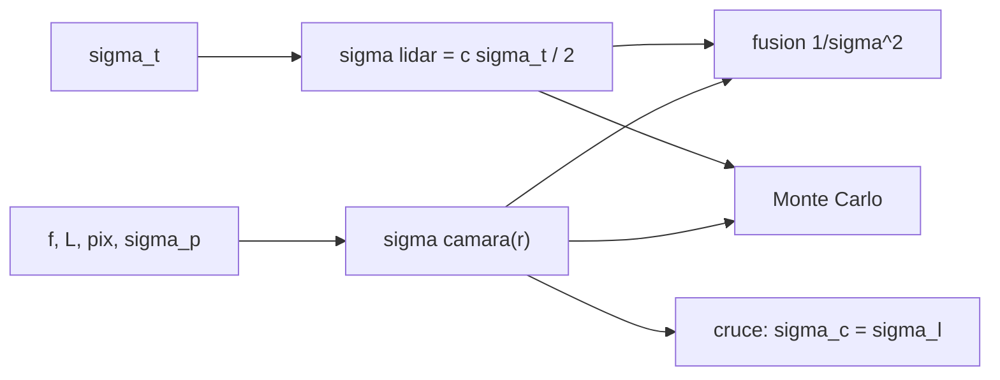

# B76-C13 — Sensores de proximidad

<!-- nav:top -->
[🏠 Programa](../../../../README.md) · [📚 Bloque B76](../../../tronco-comun/B76-dinamica-cislunar-y-operaciones-de-proximidad.md) · [← Anterior: B76-C12 — Guiado relativo](../B76-C12-guiado-relativo/CLASE.md) · [Siguiente: B76-C14 — Evasión de colisión →](../B76-C14-evasion-de-colision/CLASE.md)
<!-- /nav -->

## 1. Ubicación, nivel y alcance

Clase 13 del bloque B76, nivel N3. El guiado relativo (clase 12) necesita medir posición relativa. Aquí comparas dos sensores de proximidad con datos **sintéticos**: un telémetro láser, cuyo error de distancia no depende de la distancia, y una cámara de objeto conocido, cuyo error relativo depende del tamaño de la imagen. Los fusionas por inversa de la varianza y los verificas con Monte Carlo de semilla fija. No se usa ningún sensor real.

## 2. Por qué esta clase existe

Un sensor que funciona a diez metros puede ser inútil a quinientos. La decisión central: **¿a qué distancia conviene cada sensor y cuánto mejora combinarlos?**

## 3. Lo que podrás hacer al terminar

1. Calcular la incertidumbre de distancia de un telémetro de tiempo de vuelo.
2. Calcular la incertidumbre de distancia de una cámara a partir del tamaño del objeto en píxeles.
3. Fusionar dos medidas independientes por inversa de la varianza.
4. Verificar las fórmulas con un Monte Carlo de semilla fija.
5. Hallar la distancia en que ambos sensores empatan.
6. Rotular todos los parámetros del sensor como sintéticos.

La evidencia es la **presupuesto de error de un sensor** del ejercicio 12 (sección 20).

## 4. Con qué llegas y cómo comprobarlo

1. ¿Qué es una desviación estándar?
2. ¿Qué es el tiempo de vuelo?
3. ¿Qué es una medida independiente?
4. ¿Qué es una semilla aleatoria?
5. ¿Qué es un dato sintético?

<details>
<summary>Ver respuestas</summary>

1. Una medida de la dispersión de una variable. 2. El tiempo que tarda un pulso en ir y volver. 3. Una cuyo error no depende del de la otra. 4. El valor que fija una secuencia pseudoaleatoria para repetir el resultado. 5. Un dato generado para el ejemplo, no medido.
</details>

Con cuatro o cinco aciertos, sigue; si no, repasa los prerrequisitos.

## 5. Un caso de contexto y casos de referencia

Un telémetro con jitter de `1 ns` tiene `σ_r = c σ_t/2 = 0,1499 m`. Una cámara con focal `50 mm`, píxel de `5 µm` y un objeto de `4 m` ve `400 px` a `100 m` y `σ_r = 0,0250 m`, pero a `500 m` ve `80 px` y `σ_r = 0,625 m`. La fusión da `0,1458 m` a `500 m`. Ambos empatan a `244,9 m`. Es el **ejemplo conductor**; el sensor es sintético.

## 6. Vocabulario

El **telémetro** mide `r = c t/2`. La **incertidumbre de la cámara** es `σ_r/r = σ_p/p`, con `p = f L/(r · pix)` píxeles. La **fusión** pondera cada medida por `1/σ²`. El **Monte Carlo** repite la medida con ruido gaussiano y semilla fija.

## 7. Modelo mental: dos reglas de distinto largo



*Descripción textual:* el telémetro tiene un error fijo; el error de la cámara crece con la distancia; ambos se fusionan y se comprueban por Monte Carlo; existe una distancia de cruce.

Analogía: una regla de metal con error fijo de un milímetro y una estimación visual cuyo error crece con la distancia; de cerca manda la vista, de lejos la regla. Límite: se supone ruido gaussiano independiente y objeto conocido; los sensores reales tienen sesgos, saturación y rango máximo.

## 8. La explicación, paso a paso

### 8.1 Telémetro

`σ_r = c σ_t/2 = 299.792.458 × 10⁻⁹/2 = 0,1499 m`. En este modelo no depende de la distancia.

### 8.2 Cámara

El tamaño de la imagen es `p = f L/(r · pix) = 0,05 × 4/(r × 5 × 10⁻⁶)`: `400 px` a `100 m`, `200` a `200 m`, `80` a `500 m` y `40` a `1000 m`. Con error de centroide `σ_p = 0,1 px`: `σ_r = r σ_p/p`.

### 8.3 Tabla

| `r` (m) | píxeles | `σ` lidar | `σ` cámara | `σ` fusión | MC lidar | MC cámara | MC fusión |
|---|---|---|---|---|---|---|---|
| 100 | 400 | 0,1499 | 0,0250 | 0,0247 | 0,1495 | 0,0247 | 0,0243 |
| 200 | 200 | 0,1499 | 0,1000 | 0,0832 | 0,1495 | 0,0989 | 0,0819 |
| 500 | 80 | 0,1499 | 0,6250 | 0,1458 | 0,1495 | 0,6184 | 0,1448 |
| 1000 | 40 | 0,1499 | 2,5000 | 0,1496 | 0,1495 | 2,4737 | 0,1491 |

### 8.4 Cruce

`σ_cámara = σ_lidar` en `r = √(σ_lidar f L/(σ_p pix)) = 244,9 m`. Más cerca manda la cámara; más lejos, el telémetro.

### 8.5 Validez

La cámara solo es válida donde la imagen cabe en el sensor y es resoluble; por eso la tabla empieza en `100 m`. A `1000 m` el objeto ocupa `40 px`. El Monte Carlo coincide con la teoría dentro del `3 %` (telémetro) y del `6 %` (cámara y fusión).

## 9. Magnitudes, símbolos y unidades

| Símbolo | Qué es | Unidad | Valor / nota |
|---|---|---|---|
| `σ_t` | jitter de tiempo (sintético) | s | 1e-9 |
| `σ_lidar` | incertidumbre del telémetro | m | 0,1499 |
| `p` | tamaño de la imagen | px | 400 (100 m) |
| `σ_cámara` | incertidumbre de la cámara | m | 0,0250 (100 m) |
| `r*` | distancia de cruce | m | 244,9 |

## 10. Convenciones y referencias

`c = 299.792.458 m/s` (valor exacto del SI, no consultado en esta sesión). Sensor sintético: jitter `1 ns`, focal `50 mm`, píxel `5 µm`, objeto `4 m`, error de centroide `0,1 px`; ruido gaussiano independiente; semilla `76013`; `20.000` muestras.

## 11. De dónde sale lo que afirmamos

| ID | Fuente | Localizador | Respalda | Estado |
|---|---|---|---|---|
| — | Relaciones estándar: telémetro de tiempo de vuelo, cámara de objeto conocido, fusión por inversa de la varianza, Monte Carlo | — | las verifica el laboratorio por Monte Carlo | No consultada en una fuente concreta |
| — | Hoja de datos de un sensor de proximidad real | — | no se usó | No consultada |

Límites: ningún parámetro del sensor procede de un equipo real; no se consultó ninguna hoja de datos; el ruido real no es gaussiano ni independiente.

## 12. Cómo ver el error de los sensores

| Magnitud | Valor |
|---|---|
| Telémetro | 0,1499 m (constante) |
| Cámara a 100 m / 500 m | 0,0250 m / 0,625 m |
| Fusión a 500 m | 0,1458 m |
| Distancia de cruce | 244,9 m |

Descripción larga: la cámara gana de cerca, el telémetro de lejos y la fusión nunca es peor que el mejor de los dos.

## 13. Ejemplo trabajado: la fusión a 200 m

**Paso 1 · Varianzas.** `σ_l² = 0,02247`, `σ_c² = 0,01000` (m²).

**Paso 2 · Pesos.** `1/σ_l² = 44,5`, `1/σ_c² = 100`.

**Paso 3 · Fusión.** `σ_f = √(1/(44,5 + 100)) = 0,0832 m`.

**Paso 4 · Lectura.** Mejor que cualquiera de los dos por separado.

## 14. Distintas formas de describir un sensor

**Por error absoluto:** `σ_r`. **Por error relativo:** `σ_r/r`. **Por píxeles:** `p`. **Por cruce:** `r*`. **Por Monte Carlo:** desviación empírica.

## 15. Práctica guiada

**Ejercicio 1 · con los pasos indicados.** Calcula `σ_lidar` para `σ_t = 1 ns`. *Pasos:* `c σ_t/2`.

<details><summary>Solución comentada</summary>

`299.792.458 × 10⁻⁹/2 = 0,1499 m`.
</details>

**Ejercicio 2 · con una pista.** Calcula `p` a `100 m`. *Pista:* `f L/(r · pix)`.

<details><summary>Solución comentada</summary>

`0,05 × 4/(100 × 5 × 10⁻⁶) = 400 px`.
</details>

**Ejercicio 3 · casi autónomo.** Calcula `σ_cámara` a `200 m`.

<details><summary>Solución comentada</summary>

`200 × 0,1/200 = 0,1 m`.
</details>

## 16. Práctica autónoma, transferencia e integrador

**Ejercicio 4 · autónomo.** Calcula la fusión de `0,1499` y `0,0250` m.

<details><summary>Solución comentada</summary>

`1/√(44,5 + 1600) = 0,0247 m`.
</details>

**Ejercicio 5 · autónomo.** Si `σ_t` baja a `0,5 ns`, ¿cuál es la nueva distancia de cruce?

<details><summary>Solución comentada</summary>

`σ_l = 0,0749 m`; `r* = √(0,0749 × 0,05 × 4/(0,1 × 5 × 10⁻⁶)) = 173 m`.
</details>

**Ejercicio 6 · autónomo.** ¿Cuántos píxeles ve la cámara a `500 m`?

<details><summary>Solución comentada</summary>

`0,05 × 4/(500 × 5 × 10⁻⁶) = 80 px`.
</details>

**Ejercicio 7 · autónomo.** Compara el Monte Carlo y la teoría de la cámara a `1000 m`.

<details><summary>Solución comentada</summary>

`2,4737` frente a `2,5000 m`: `−1,1 %`.
</details>

**Ejercicio 8 · autónomo.** ¿Qué pasa con `σ_cámara` si el objeto fuera de `8 m`?

<details><summary>Solución comentada</summary>

A igual distancia `p` se duplica y `σ_cámara` se divide por 2.
</details>

**Ejercicio 9 · transferencia.** **Transferencia.** Un equipo elige solo la cámara para una aproximación de `1000` a `50 m`. ¿Qué objetas?

<details><summary>Solución comentada</summary>

A `1000 m` el error es `2,5 m` y la imagen es de `40 px`; un telémetro lo mejora por un factor 17.
</details>

**Ejercicio 10 · transferencia.** **Transferencia.** Se propone fusionar sin comprobar la independencia. ¿Qué riesgo hay?

<details><summary>Solución comentada</summary>

Si los errores están correlacionados, la `σ` fusionada es optimista.
</details>

**Ejercicio 11 · transferencia.** **Transferencia.** Un informe da `σ = 0,1 m` sin decir de qué sensor. ¿Qué falta?

<details><summary>Solución comentada</summary>

El sensor, la distancia, el modelo de ruido y si el dato es sintético o medido.
</details>

**Ejercicio 12 · integrador.** **Integrador.** Elabora tu *presupuesto de error de un sensor*: `σ` de telémetro y cámara en cuatro distancias, fusión, cruce y verificación Monte Carlo, con fuentes.

<details><summary>Solución comentada</summary>

Secciones 8.1–8.5 y la salida del laboratorio.
</details>

## 17. Laboratorio: telémetro, cámara y fusión con datos sintéticos

El script [sensores.py](sensores.py) calcula la incertidumbre de un telémetro y de una cámara en cuatro distancias, las fusiona y las verifica por Monte Carlo Usa la biblioteca común [cislunar_lib.py](../cislunar_lib.py) del bloque (**comprueba** Monte Carlo frente a teoría < 3 % (telémetro) y < 6 % (cámara y fusión)).

**Datos:** `c` es exacto del SI; **todos los parámetros del sensor son sintéticos**; semilla `76013`. **Predice antes de ejecutar:** ¿a qué distancia empatan los sensores? (`244,9 m`.) **Ejecución del 2026-11-10 (Python 3.12.9):**

```text
Python 3.12.9 (biblioteca estandar) ; semilla 76013 ; datos SINTETICOS
Telemetro: sigma_r = c*sigma_t/2 = 0.1499 m (independiente de la distancia en este modelo)
 r [m]   tamano [px]  s_lidar[m]  s_camara[m]  s_fusion[m]  MC lidar   MC camara   MC fusion
   100       400.0     0.1499      0.0250      0.0247     0.1495      0.0247     0.0243
   200       200.0     0.1499      0.1000      0.0832     0.1495      0.0989     0.0819
   500        80.0     0.1499      0.6250      0.1458     0.1495      0.6184     0.1448
  1000        40.0     0.1499      2.5000      0.1496     0.1495      2.4737     0.1491
Distancia en que ambos sensores empatan = 244.9 m
Pruebas superadas.
```

```bash
python programa/clases/B76/B76-C13-sensores-de-proximidad/sensores.py
```

**Límites:** Ruido gaussiano independiente, sin sesgos ni saturación, objeto conocido y sin rango máximo.

## 18. Errores frecuentes y cómo corregirlos

**Suponer que el error de la cámara es constante.** Se corrige con 8.2.

**Fusionar medidas correlacionadas como si fueran independientes.** Se corrige con el ejercicio 10.

**Presentar los parámetros sintéticos como los de un sensor real.** Se corrige con la sección 10.

**Usar la cámara donde la imagen no cabe en el sensor.** Se corrige con 8.5.

## 19. Cómo sabrás que vas bien

Tras la sección 8: ¿qué sensor esperabas mejor a `500 m`? Si dudas, repasa el ejemplo 13. Tras el laboratorio: ¿qué comprueba el Monte Carlo? (ver la sección 17).

## 20. Qué entregas y cómo se evalúa

El producto es tu **presupuesto de error de un sensor** (ejercicio 12).

| Criterio | Inicial | En desarrollo | Logrado | Destacado |
|---|---|---|---|---|
| Conceptos | Los confunde | Parciales | Explica error fijo y error creciente | Explica la fusión y su supuesto |
| Cálculo | Sin unidades | Con errores | Tabla con unidades | Calcula otros parámetros |
| Numérico | Sin comprobar | Un caso | Monte Carlo con semilla | Interpreta las diferencias |
| Fuentes | Sin fuente | Sin fecha | Fuentes con fecha y estado | Declara todo como sintético |
| Límites | No los nombra | Uno | Tres | Discute sesgos y correlación |

**Condiciones críticas (no se compensan con promedio):** rotular el sensor como sintético; no presentar un resultado de Monte Carlo como medición; citar solo lo consultado.

## 21. Ética, seguridad y límites

Clase educativa: los modelos son simplificados y sus datos son sintéticos, ilustrativos o publicados con fuente; ningún resultado es una efeméride, una telemetría ni una recomendación operativa, y lo simulado nunca se presenta como observado.  Accesibilidad: tablas equivalentes a las gráficas, fórmulas en texto, ejercicios sin conexión.

## 22. Para cerrar y seguir

Un telémetro de `0,15 m` y una cámara que pasa de `2,5 cm` a `2,5 m` se cruzan a `245 m`, y fusionados nunca son peores que el mejor. Queda una pregunta: ¿qué hacer cuando la medida revela un riesgo de choque?

**Glosario español–inglés.** telémetro láser · *laser rangefinder*; tiempo de vuelo · *time of flight*; fusión de sensores · *sensor fusion*; Monte Carlo · *Monte Carlo*; incertidumbre · *uncertainty*.

**Continuidad.** [B76-C14](../B76-C14-evasion-de-colision/CLASE.md) estudia la evasión de colisión.

**Referencias:** ver sección 11.

<!-- nav:bottom -->
---

[← Anterior: B76-C12 — Guiado relativo](../B76-C12-guiado-relativo/CLASE.md) · [📚 Bloque B76](../../../tronco-comun/B76-dinamica-cislunar-y-operaciones-de-proximidad.md) · [Siguiente: B76-C14 — Evasión de colisión →](../B76-C14-evasion-de-colision/CLASE.md)
<!-- /nav -->
