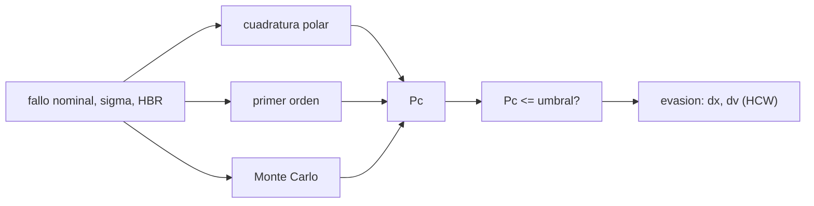

# B76-C14 — Evasión de colisión

<!-- nav:top -->
[🏠 Programa](../../../../README.md) · [📚 Bloque B76](../../../tronco-comun/B76-dinamica-cislunar-y-operaciones-de-proximidad.md) · [← Anterior: B76-C13 — Sensores de proximidad](../B76-C13-sensores-de-proximidad/CLASE.md) · [Siguiente: B76-C15 — Control de formación satelital →](../B76-C15-control-de-formacion-satelital/CLASE.md)
<!-- /nav -->

## 1. Ubicación, nivel y alcance

Clase 14 del bloque B76, nivel N3. Cuando dos objetos pasan cerca, la incertidumbre de sus posiciones se traduce en una probabilidad de colisión. Aquí la calculas en el plano del encuentro con tres vías (cuadratura, aproximación de primer orden y Monte Carlo) y diseñas una maniobra de evasión con HCW. Todo es **sintético**: no hay ningún mensaje de conjunción real. Parte de [B76-C09](../B76-C09-dinamica-relativa-de-hill-clohessy-wiltshire/CLASE.md) y [B76-C13](../B76-C13-sensores-de-proximidad/CLASE.md).

## 2. Por qué esta clase existe

Una distancia de fallo pequeña no basta para decidir: importa cuánto vale frente a la incertidumbre. La decisión central: **¿cuál es la probabilidad de colisión y cuánto impulso cuesta bajarla de un umbral?**

## 3. Lo que podrás hacer al terminar

1. Plantear la probabilidad de colisión como la integral gaussiana 2D sobre el disco del radio duro.
2. Calcularla por cuadratura polar y por la aproximación de primer orden.
3. Verificarla con un Monte Carlo de semilla fija.
4. Calcular el fallo necesario para un umbral de probabilidad.
5. Convertir ese fallo en un impulso con HCW.
6. Rotular el umbral y los datos como sintéticos.

La evidencia es la **ficha de un encuentro con probabilidad de colisión** del ejercicio 12 (sección 20).

## 4. Con qué llegas y cómo comprobarlo

1. ¿Qué es una distribución gaussiana 2D?
2. ¿Qué es el radio duro combinado?
3. ¿Qué es la distancia de fallo?
4. ¿Qué es una cuadratura numérica?
5. ¿Qué es un umbral?

<details>
<summary>Ver respuestas</summary>

1. Una densidad con dos desviaciones estándar y forma de campana. 2. La suma de los radios de los dos objetos. 3. La separación entre los centros en el punto de mayor acercamiento. 4. Una integral calculada como suma ponderada. 5. Un valor límite de aceptación.
</details>

Con cuatro o cinco aciertos, sigue; si no, repasa los prerrequisitos.

## 5. Un caso de contexto y casos de referencia

Un encuentro con fallo nominal de `120 m`, `σ = (80, 40) m` y radio duro de `10 m` tiene `Pc = 5,05 × 10⁻³` por cuadratura, `5,07 × 10⁻³` en primer orden y `4,96 × 10⁻³` por Monte Carlo (`1985` impactos de `400.000`). Para bajar a `10⁻⁶` hace falta un fallo de `351,6 m`, o sea `231,6 m` más: un impulso de `65,5 mm/s` medio periodo antes. Es el **ejemplo conductor**; todo es sintético.

## 6. Vocabulario

La **probabilidad de colisión** `Pc` es la integral de la densidad gaussiana sobre el disco de radio `HBR` centrado en el origen del plano. La **aproximación de primer orden** es `π HBR² × densidad(0)`. El **fallo** es la distancia nominal entre centros. El **umbral** `10⁻⁶` es ilustrativo.

## 7. Modelo mental: un dardo que cae en una nube de puntos



*Descripción textual:* con el fallo, la covarianza y el radio duro se calcula `Pc` por tres vías; si supera el umbral, se calcula el fallo necesario y el impulso con HCW.

Analogía: lanzar dardos a una diana pequeña con un tiembla de mano conocido; la probabilidad de acertar depende de lo cerca que apuntes del centro frente a lo que tiembla. Límite: encuentro corto, recto y gaussiano; las colas, la correlación y los encuentros largos exigen otros métodos.

## 8. La explicación, paso a paso

### 8.1 Probabilidad de colisión

`Pc = ∬_{x²+y²≤HBR²} N(x, y; m, Σ) dx dy`, con `m = (120, 0) m`, `Σ = diag(80², 40²) m²` y `HBR = 10 m`.

### 8.2 Tres vías

| Vía | `Pc` |
|---|---|
| Cuadratura polar 400 × 400 | 5,0457e-3 |
| Primer orden `π HBR² N(0)` | 5,0727e-3 |
| Monte Carlo (400.000, semilla 76014) | 4,9625e-3 |

La aproximación difiere `0,5 %` de la cuadratura y el Monte Carlo `1,6 %` (`1985` impactos: error estadístico `2,2 %`).

### 8.3 Sensibilidad

| fallo (m) | `Pc` (aprox.) |
|---|---|
| 0 | 1,562e-2 |
| 60 | 1,179e-2 |
| 120 | 5,073e-3 |
| 240 | 1,736e-4 |
| 400 | 5,823e-8 |

### 8.4 Evasión

Para `Pc ≤ 10⁻⁶` se necesita un fallo de `351,6 m`, o sea `231,6 m` más. Un impulso a lo largo de la trayectoria medio periodo antes desplaza la posición radial `x = 4 Δv/n` (HCW), así que `Δv = 231,6 × n/4 = 65,50 mm/s`. HCW lo confirma: `231,6 m`. La `Pc` posterior es `4,6 × 10⁻¹²`.

### 8.5 Límites

El umbral `10⁻⁶` es ilustrativo, no un criterio operativo. No se consultaron mensajes de conjunción ni la práctica de ninguna agencia.

## 9. Magnitudes, símbolos y unidades

| Símbolo | Qué es | Unidad | Valor / nota |
|---|---|---|---|
| `m` | fallo nominal | m | 120 |
| `σ_x`, `σ_y` | incertidumbre combinada | m | 80; 40 |
| `HBR` | radio duro combinado | m | 10 |
| `Pc` | probabilidad de colisión | — | 5,05e-3 |
| `Δv` | impulso de evasión | mm/s | 65,50 |

## 10. Convenciones y referencias

Datos sintéticos; encuentro corto en el plano ortogonal a la velocidad relativa; covarianza diagonal; `GM_T` (JPL, DE440) y radio terrestre (NASA/NSSDC) consultados para `n`; umbral `10⁻⁶` ilustrativo; semilla `76014`.

## 11. De dónde sale lo que afirmamos

| ID | Fuente | Localizador | Respalda | Estado |
|---|---|---|---|---|
| S1 | NASA JPL SSD, Astrodynamic Parameters — https://ssd.jpl.nasa.gov/astro_par.html (consultada 2026-11-10) | tabla de GM y constantes | GM de la Tierra = 398600,435507 km³/s²; GM de la Luna = 4902,800118 km³/s² (DE440, Park et al. 2021); UA = 149597870700 m | Consultada |
| S2 | NASA/NSSDC, Earth Fact Sheet — https://nssdc.gsfc.nasa.gov/planetary/factsheet/earthfact.html (consultada 2026-11-10) | ficha leída | masa 5,9722×10²⁴ kg; radio medio volumétrico 6371,000 km; radio ecuatorial 6378,137 km | Consultada |
| — | Relaciones estándar: probabilidad de colisión 2D, aproximación de primer orden, Monte Carlo, HCW | — | las verifica el laboratorio con tres vías | No consultada en una fuente concreta |
| — | Mensajes de conjunción y criterios operativos | — | no se usaron | No consultada |

Límites: ningún dato procede de un catálogo ni de un mensaje de conjunción real; el umbral no es operativo; no se modelan colas, correlaciones ni encuentros largos.

## 12. Cómo ver la probabilidad

| Magnitud | Valor |
|---|---|
| `Pc` (cuadratura) | 5,0457e-3 |
| Fallo para `Pc ≤ 1e-6` | 351,6 m |
| `Δv` de evasión | 65,50 mm/s |
| `Pc` posterior | 4,6e-12 |

Descripción larga: duplicar el fallo reduce la probabilidad en dos órdenes de magnitud; la evasión cuesta centímetros por segundo.

## 13. Ejemplo trabajado: la aproximación de primer orden

**Paso 1 · Densidad en el origen.** `N(0) = exp(−½ (120/80)²)/(2π × 80 × 40) = 0,3247/20106 = 1,615 × 10⁻⁵ m⁻²`.

**Paso 2 · Área.** `π HBR² = 314,16 m²`.

**Paso 3 · Probabilidad.** `Pc ≈ 314,16 × 1,615 × 10⁻⁵ = 5,07 × 10⁻³`.

**Paso 4 · Comparación.** La cuadratura da `5,05 × 10⁻³`.

## 14. Distintas formas de expresar el riesgo

**Por probabilidad:** `Pc`. **Por fallo normalizado:** `m/σ`. **Por área:** `π HBR²`. **Por umbral:** `Pc ≤ 10⁻⁶`. **Por costo:** `Δv`.

## 15. Práctica guiada

**Ejercicio 1 · con los pasos indicados.** Calcula `exp(−½ (m/σ_x)²)` para `m = 120 m`. *Pasos:* `m/σ_x = 1,5`.

<details><summary>Solución comentada</summary>

`exp(−1,125) = 0,3247`.
</details>

**Ejercicio 2 · con una pista.** Calcula `π HBR²`. *Pista:* `HBR = 10 m`.

<details><summary>Solución comentada</summary>

`314,16 m²`.
</details>

**Ejercicio 3 · casi autónomo.** Calcula `2π σ_x σ_y`.

<details><summary>Solución comentada</summary>

`2π × 3200 = 20.106 m²`.
</details>

## 16. Práctica autónoma, transferencia e integrador

**Ejercicio 4 · autónomo.** Calcula la `Pc` de primer orden con fallo nulo.

<details><summary>Solución comentada</summary>

`314,16/20.106 = 1,562 × 10⁻²`.
</details>

**Ejercicio 5 · autónomo.** ¿Cuánto cae `Pc` al pasar de `120` a `240 m`?

<details><summary>Solución comentada</summary>

`5,073 × 10⁻³/1,736 × 10⁻⁴ = 29` veces.
</details>

**Ejercicio 6 · autónomo.** Calcula el error estadístico relativo de `1985` impactos.

<details><summary>Solución comentada</summary>

`1/√1985 = 2,2 %`.
</details>

**Ejercicio 7 · autónomo.** Calcula el desplazamiento por un impulso de `65,5 mm/s` medio periodo antes.

<details><summary>Solución comentada</summary>

`4 Δv/n = 4 × 0,0655/1,131367 × 10⁻³ = 231,6 m`.
</details>

**Ejercicio 8 · autónomo.** ¿Qué `Δv` hace falta si el impulso se aplica un cuarto de periodo antes (`x = 2(1 − cos nT)/n Δv`)?

<details><summary>Solución comentada</summary>

`2(1 − cos 90°)/n = 2/n`: `Δv = 231,6 × n/2 = 131 mm/s`, el doble.
</details>

**Ejercicio 9 · transferencia.** **Transferencia.** Un equipo reporta `Pc = 5 × 10⁻³` y dice «riesgo despreciable». ¿Qué objetas?

<details><summary>Solución comentada</summary>

Sin un umbral operativo consultado no se puede calificar; con el umbral ilustrativo de `10⁻⁶` es `5000` veces mayor.
</details>

**Ejercicio 10 · transferencia.** **Transferencia.** Se propone usar covarianza isotrópica `σ = 80 m` «para simplificar». ¿Qué cambia?

<details><summary>Solución comentada</summary>

`Pc` baja a la mitad aproximadamente (`σ_y` de `40` a `80 m`), subestimando el riesgo en el eje corto.
</details>

**Ejercicio 11 · transferencia.** **Transferencia.** Un informe da `Pc` sin radio duro ni covarianza. ¿Qué falta?

<details><summary>Solución comentada</summary>

`HBR`, `Σ`, fallo, modelo y si los datos son reales o sintéticos.
</details>

**Ejercicio 12 · integrador.** **Integrador.** Elabora tu *ficha de un encuentro con probabilidad de colisión*: tres vías de `Pc`, sensibilidad al fallo, evasión con HCW y límites, con fuentes.

<details><summary>Solución comentada</summary>

Secciones 8.1–8.5 y la salida del laboratorio.
</details>

## 17. Laboratorio: probabilidad de colisión y evasión

El script [colision.py](colision.py) calcula la probabilidad de colisión de un encuentro sintético por cuadratura, primer orden y Monte Carlo y dimensiona la evasión con HCW Usa la biblioteca común [cislunar_lib.py](../cislunar_lib.py) del bloque (**comprueba** cuadratura frente a Monte Carlo < 5 %, primer orden frente a cuadratura < 2 % y desplazamiento de HCW).

**Datos:** `GM_T` y radio (JPL, NASA/NSSDC) **consultados** el 2026-11-10; fallo, covarianza, radio duro y umbral **sintéticos**; semilla `76014`. **Predice antes de ejecutar:** ¿cuántas veces menor será `Pc` con fallo de `240 m`? (unas 29.) **Ejecución del 2026-11-10 (Python 3.12.9):**

```text
Python 3.12.9 (biblioteca estandar) ; semilla 76014 ; datos SINTETICOS
Encuentro: fallo nominal 120 m, sigma = (80, 40) m, HBR = 10 m
Pc cuadratura polar = 5.0457e-03 ; aproximacion de primer orden = 5.0727e-03 ; Monte Carlo = 4.9625e-03 (1985 impactos de 400000)
 fallo [m]   Pc (aprox.)
       0   1.562e-02
      60   1.179e-02
     120   5.073e-03
     240   1.736e-04
     400   5.823e-08
Fallo necesario para Pc <= 1e-6 (ILUSTRATIVO) = 351.6 m ; desplazamiento adicional = 231.6 m
Impulso a lo largo de la trayectoria medio periodo antes: dv = 65.50 mm/s ; desplazamiento HCW = 231.6 m
Pc tras la maniobra (cuadratura) = 4.614e-12
Pruebas superadas.
```

```bash
python programa/clases/B76/B76-C14-evasion-de-colision/colision.py
```

**Límites:** Encuentro corto y gaussiano, covarianza diagonal; sin colas ni correlaciones.

## 18. Errores frecuentes y cómo corregirlos

**Comparar la distancia de fallo sin la incertidumbre.** Se corrige con 8.1.

**Tomar el umbral ilustrativo como criterio operativo.** Se corrige con 8.5.

**Olvidar que el impulso depende del instante.** Se corrige con el ejercicio 8.

**Presentar el encuentro sintético como real.** Se corrige con la sección 10.

## 19. Cómo sabrás que vas bien

Tras la sección 8: ¿qué `Pc` esperabas con fallo de `240 m`? Si dudas, repasa el ejemplo 13. Tras el laboratorio: ¿qué comprueba el Monte Carlo? (ver la sección 17).

## 20. Qué entregas y cómo se evalúa

El producto es tu **ficha de un encuentro con probabilidad de colisión** (ejercicio 12).

| Criterio | Inicial | En desarrollo | Logrado | Destacado |
|---|---|---|---|---|
| Conceptos | Los confunde | Parciales | Define `Pc`, fallo e `HBR` | Explica la evasión con HCW |
| Cálculo | Sin unidades | Con errores | Tabla con unidades | Calcula otros umbrales |
| Numérico | Sin comprobar | Un caso | Tres vías comparadas | Interpreta las diferencias |
| Fuentes | Sin fuente | Sin fecha | Fuentes con fecha y estado | Declara todo como sintético |
| Límites | No los nombra | Uno | Tres | Discute colas y correlaciones |

**Condiciones críticas (no se compensan con promedio):** rotular el encuentro y el umbral como sintético e ilustrativo; no presentar `Pc` como criterio de decisión real; citar solo lo consultado.

## 21. Ética, seguridad y límites

Clase educativa: los modelos son simplificados y sus datos son sintéticos, ilustrativos o publicados con fuente; ningún resultado es una efeméride, una telemetría ni una recomendación operativa, y lo simulado nunca se presenta como observado.  Accesibilidad: tablas equivalentes a las gráficas, fórmulas en texto, ejercicios sin conexión.

## 22. Para cerrar y seguir

Con fallo de `120 m` y `σ = (80, 40) m` la probabilidad es `5 × 10⁻³`; subir el fallo a `352 m` la lleva a `10⁻⁶` con `65 mm/s`. Queda una pregunta: ¿cómo se mantienen varias naves en una geometría relativa?

**Glosario español–inglés.** probabilidad de colisión · *probability of collision*; radio duro · *hard-body radius*; distancia de fallo · *miss distance*; covarianza · *covariance*; evasión · *avoidance maneuver*.

**Continuidad.** [B76-C15](../B76-C15-control-de-formacion-satelital/CLASE.md) estudia el control de formación satelital.

**Referencias:** ver sección 11.

<!-- nav:bottom -->
---

[← Anterior: B76-C13 — Sensores de proximidad](../B76-C13-sensores-de-proximidad/CLASE.md) · [📚 Bloque B76](../../../tronco-comun/B76-dinamica-cislunar-y-operaciones-de-proximidad.md) · [Siguiente: B76-C15 — Control de formación satelital →](../B76-C15-control-de-formacion-satelital/CLASE.md)
<!-- /nav -->
