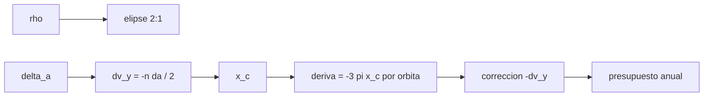

# B76-C15 — Control de formación satelital

<!-- nav:top -->
[🏠 Programa](../../../../README.md) · [📚 Bloque B76](../../../tronco-comun/B76-dinamica-cislunar-y-operaciones-de-proximidad.md) · [← Anterior: B76-C14 — Evasión de colisión](../B76-C14-evasion-de-colision/CLASE.md) · [Siguiente: B76-C16 — Acoplamiento y captura →](../B76-C16-acoplamiento-y-captura/CLASE.md)
<!-- /nav -->

## 1. Ubicación, nivel y alcance

Clase 15 del bloque B76, nivel N3. Una formación mantiene varias naves en una geometría relativa fija o cíclica. Con HCW esa geometría es una elipse relativa 2:1 y su enemigo es la diferencia de semieje mayor, que provoca una deriva. Aquí diseñas una elipse, mides la deriva de un error de semieje de `1 m` y calculas la corrección y su presupuesto. Parte de [B76-C09](../B76-C09-dinamica-relativa-de-hill-clohessy-wiltshire/CLASE.md). Los números son sintéticos.

## 2. Por qué esta clase existe

Un error de un metro en el semieje parece nada y deriva nueve metros por órbita. La decisión central: **¿cuánto se desvía una formación por un error de inserción y cuánto `Δv` cuesta mantenerla?**

## 3. Lo que podrás hacer al terminar

1. Construir las condiciones iniciales de una elipse relativa 2:1.
2. Calcular el centro radial `x_c = 4 x0 + 2 ẏ0/n` de un movimiento relativo.
3. Calcular la deriva por órbita `−3π x_c` y compararla con HCW.
4. Convertir un error de semieje en un error de velocidad.
5. Calcular el impulso de corrección y su presupuesto anual.
6. Rotular la altitud, el tamaño y el error como sintéticos.

La evidencia es la **diseño de una formación** del ejercicio 12 (sección 20).

## 4. Con qué llegas y cómo comprobarlo

1. ¿Qué es una elipse relativa?
2. ¿Qué es el semieje mayor?
3. ¿Qué es una deriva secular?
4. ¿Qué es un presupuesto de `Δv`?
5. ¿Qué es un dato sintético?

<details>
<summary>Ver respuestas</summary>

1. La trayectoria que describe una nave respecto de otra en el marco LVLH. 2. La mitad del eje largo de una órbita; fija el periodo. 3. Un desplazamiento que crece linealmente con el tiempo. 4. La suma de impulsos necesarios en un periodo. 5. Un dato generado para el ejemplo, no medido.
</details>

Con cuatro o cinco aciertos, sigue; si no, repasa los prerrequisitos.

## 5. Un caso de contexto y casos de referencia

Una elipse de semieje menor `ρ = 250 m` alrededor de un jefe a `700 km` (`P = 98,77 min`) se cierra tras una órbita. Con un error de semieje de `1 m` (`Δv_y = −0,5301 mm/s`), el centro radial queda en `x_c = −1,0 m` y la deriva es `9,4248 m` por órbita, `94,25 m` en 10 órbitas. Corregir cada 10 órbitas cuesta `0,282 m/s` al año. Es el **ejemplo conductor**; todo es sintético.

## 6. Vocabulario

La **elipse 2:1** es `x = ρ cos nt`, `y = −2ρ sin nt`. El **centro radial** `x_c = 4x0 + 2ẏ0/n` es constante del movimiento. La **deriva por órbita** es `−3π x_c`. Un **error de semieje** `δa` equivale a un error de velocidad a lo largo de la trayectoria `Δv_y = −n δa/2`.

## 7. Modelo mental: dos relojes con una pequeña diferencia de marcha



*Descripción textual:* una elipse de radio `ρ` se cierra sola; un error de semieje equivale a un error de velocidad que desplaza el centro radial y crea una deriva por órbita; un impulso opuesto la anula y su suma anual es el presupuesto.

Analogía: dos relojes que difieren una fracción de segundo por día se separan cada vez más; la formación pierde la posición relativa como los relojes pierden la hora. Límite: HCW no incluye el achatamiento terrestre ni el arrastre diferencial, que son los principales perturbadores reales.

## 8. La explicación, paso a paso

### 8.1 Elipse libre

Con estado inicial `(ρ, 0, 0, 0, −2nρ, 0)`, `x` y `y` describen una elipse de eje `2ρ × 4ρ`. Con `ρ = 250 m` la amplitud en `y` es `500,00 m` y tras una órbita el cierre es `0 m`.

### 8.2 Error de semieje

Un `δa = 1,0 m` equivale a `Δv_y = −n δa/2 = −0,5301 mm/s` (con `n = 1,060206 × 10⁻³ rad/s`). El centro radial pasa a `x_c = 4x0 + 2ẏ0/n = −1,0000 m`.

### 8.3 Deriva

HCW da una deriva en `y` de `9,4248 m` por órbita, igual a `−3π x_c = 9,4248 m`. En 10 órbitas: `94,248 m`.

### 8.4 Corrección

Un impulso `−Δv_y = +0,5301 mm/s` restablece el centro y la deriva en 10 órbitas es `0`. Si se repite cada 10 órbitas durante un año (≈ 5320 repeticiones), la suma es `0,282 m/s`.

### 8.5 Qué falta

El presupuesto es de un solo error repetido; en una misión real los perturbadores (achatamiento, arrastre) generan derivas propias y el control debe medirse y estimarse. Esos presupuestos **no se consultaron**.

## 9. Magnitudes, símbolos y unidades

| Símbolo | Qué es | Unidad | Valor / nota |
|---|---|---|---|
| `ρ` | semieje menor de la elipse | m | 250 |
| `n` | movimiento medio del jefe | rad/s | 1,060206e-3 |
| `δa` | error de semieje | m | 1,0 |
| `Δv_y` | error de velocidad | mm/s | −0,5301 |
| deriva | por órbita | m | 9,4248 |

## 10. Convenciones y referencias

`GM_T` y radio terrestre consultados; jefe circular a `700 km`; marco LVLH; HCW. Elipse, error de semieje y repeticiones sintéticos o ilustrativos.

## 11. De dónde sale lo que afirmamos

| ID | Fuente | Localizador | Respalda | Estado |
|---|---|---|---|---|
| S1 | NASA JPL SSD, Astrodynamic Parameters — https://ssd.jpl.nasa.gov/astro_par.html (consultada 2026-11-10) | tabla de GM y constantes | GM de la Tierra = 398600,435507 km³/s²; GM de la Luna = 4902,800118 km³/s² (DE440, Park et al. 2021); UA = 149597870700 m | Consultada |
| S2 | NASA/NSSDC, Earth Fact Sheet — https://nssdc.gsfc.nasa.gov/planetary/factsheet/earthfact.html (consultada 2026-11-10) | ficha leída | masa 5,9722×10²⁴ kg; radio medio volumétrico 6371,000 km; radio ecuatorial 6378,137 km | Consultada |
| — | Relaciones estándar: elipse relativa 2:1, centro `x_c`, deriva `−3π x_c` | — | las verifica el laboratorio con HCW | No consultada en una fuente concreta |

Límites: no se consultaron presupuestos de mantenimiento de formaciones reales ni modelos de perturbación diferencial.

## 12. Cómo ver la formación

| Magnitud | Valor |
|---|---|
| Amplitud en `y` | 500,00 m |
| Deriva por órbita (δa = 1 m) | 9,4248 m |
| Corrección | 0,5301 mm/s |
| Presupuesto anual (ilustrativo) | 0,282 m/s |

Descripción larga: un metro de error en el semieje exige medio milímetro por segundo de corrección y cuesta unos treinta centímetros por segundo al año.

## 13. Ejemplo trabajado: la deriva por órbita

**Paso 1 · Velocidad.** `Δv_y = −n δa/2 = −1,060206 × 10⁻³ × 1,0/2 = −5,301 × 10⁻⁴ m/s`.

**Paso 2 · Centro.** `x_c = 4 × 250 + 2 × (−2 n × 250 + Δv_y)/n = −1,0 m`.

**Paso 3 · Deriva.** `−3π x_c = 9,4248 m`.

**Paso 4 · Corrección.** `+5,301 × 10⁻⁴ m/s` la anula.

## 14. Distintas formas de describir una formación

**Por elipse:** `ρ`. **Por centro:** `x_c`. **Por deriva:** `−3π x_c` por órbita. **Por semieje:** `δa`. **Por corrección:** `Δv`.

## 15. Práctica guiada

**Ejercicio 1 · con los pasos indicados.** Calcula `Δv_y` para `δa = 1 m`. *Pasos:* `−n δa/2`.

<details><summary>Solución comentada</summary>

`−1,060206 × 10⁻³ × 1/2 = −0,5301 mm/s`.
</details>

**Ejercicio 2 · con una pista.** Calcula la deriva por órbita para `x_c = −1 m`. *Pista:* `−3π x_c`.

<details><summary>Solución comentada</summary>

`9,4248 m`.
</details>

**Ejercicio 3 · casi autónomo.** ¿Cuánta deriva hay en 10 órbitas?

<details><summary>Solución comentada</summary>

`94,248 m`.
</details>

## 16. Práctica autónoma, transferencia e integrador

**Ejercicio 4 · autónomo.** ¿Qué amplitud en `y` tiene una elipse con `ρ = 250 m`?

<details><summary>Solución comentada</summary>

`2ρ = 500 m`.
</details>

**Ejercicio 5 · autónomo.** Si `δa = 2 m`, ¿cuál es la deriva por órbita?

<details><summary>Solución comentada</summary>

`18,85 m` (lineal en `δa`).
</details>

**Ejercicio 6 · autónomo.** Calcula el número de repeticiones en un año con corrección cada 10 órbitas.

<details><summary>Solución comentada</summary>

`365,25 × 86400/(10 × 98,773 × 60) = 532`.
</details>

**Ejercicio 7 · autónomo.** Verifica el presupuesto anual con 532 repeticiones.

<details><summary>Solución comentada</summary>

`532 × 0,5301 mm/s = 0,282 m/s`.
</details>

**Ejercicio 8 · autónomo.** ¿Qué pasa con la deriva si el jefe orbita más alto, a igual `δa`?

<details><summary>Solución comentada</summary>

`n` baja, `Δv_y` y el presupuesto bajan en la misma proporción.
</details>

**Ejercicio 9 · transferencia.** **Transferencia.** Un equipo corrige cada órbita «para estar tranquilo». ¿Qué cambia?

<details><summary>Solución comentada</summary>

El impulso por corrección es el mismo, así que el presupuesto anual se multiplica por 10; hay un compromiso entre deriva permitida y cantidad de maniobras.
</details>

**Ejercicio 10 · transferencia.** **Transferencia.** Se afirma que la deriva es cero si `ρ` es muy pequeña. ¿Qué respondes?

<details><summary>Solución comentada</summary>

La deriva depende de `x_c`, no de `ρ`; una elipse pequeña con error de semieje deriva igual.
</details>

**Ejercicio 11 · transferencia.** **Transferencia.** Un informe da `0,282 m/s` como «el costo de mantener la formación». ¿Qué falta?

<details><summary>Solución comentada</summary>

Las perturbaciones reales, el error de ejecución y el modelo; es el costo de un solo error repetido.
</details>

**Ejercicio 12 · integrador.** **Integrador.** Elabora tu *diseño de una formación*: elipse, error de semieje, deriva, corrección y presupuesto, con fuentes.

<details><summary>Solución comentada</summary>

Secciones 8.1–8.5 y la salida del laboratorio.
</details>

## 17. Laboratorio: elipse relativa, deriva y corrección

El script [formacion.py](formacion.py) construye una elipse relativa 2:1, introduce un error de semieje y mide la deriva y la corrección con HCW Usa la biblioteca común [cislunar_lib.py](../cislunar_lib.py) del bloque (**comprueba** cierre de la elipse < 1e-6 m, deriva frente a `−3π x_c` < 1e-6 m y deriva corregida < 1e-6 m).

**Datos:** `GM_T` y radio (JPL, NASA/NSSDC) **consultados** el 2026-11-10; altitud de `700 km`, `ρ`, `δa` y repeticiones **sintéticos o ilustrativos**. **Predice antes de ejecutar:** ¿cuánto deriva la formación por órbita con `δa = 1 m`? (`9,42 m`.) **Ejecución del 2026-11-10 (Python 3.12.9):**

```text
Python 3.12.9 (biblioteca estandar)
Jefe a 700 km: n = 1.060206e-03 rad/s ; P = 98.773 min
Elipse 2:1 con rho = 250 m: amplitud en y = 500.00 m ; cierre tras 1 orbita = 0.00e+00 m
Error de semieje 1.0 m -> dv_y = -0.5301 mm/s ; centro radial x_c = -1.0000 m
Deriva en y por orbita (HCW) = 9.4248 m ; formula -3 pi x_c = 9.4248 m
Deriva en 10 orbitas = 94.248 m ; con la correccion de dv = 0.5301 mm/s = 0.00e+00 m
Presupuesto si se repite cada 10 orbitas durante un anio (ILUSTRATIVO) = 0.282 m/s
Pruebas superadas.
```

```bash
python programa/clases/B76/B76-C15-control-de-formacion-satelital/formacion.py
```

**Límites:** HCW sin achatamiento ni arrastre; un solo error repetido.

## 18. Errores frecuentes y cómo corregirlos

**Creer que una elipse pequeña no deriva.** Se corrige con el ejercicio 10.

**Confundir `δa` con una diferencia de altitud.** Es de semieje mayor. Se corrige con 8.2.

**Tomar el presupuesto como el de una misión real.** Se corrige con 8.5.

**Presentar la formación sintética como existente.** Se corrige con la sección 10.

## 19. Cómo sabrás que vas bien

Tras la sección 8: ¿qué deriva esperabas por órbita? Si dudas, repasa el ejemplo 13. Tras el laboratorio: ¿qué comprueba el cierre de la elipse? (ver la sección 17).

## 20. Qué entregas y cómo se evalúa

El producto es tu **diseño de una formación** (ejercicio 12).

| Criterio | Inicial | En desarrollo | Logrado | Destacado |
|---|---|---|---|---|
| Conceptos | Los confunde | Parciales | Explica elipse, centro y deriva | Explica el compromiso de la frecuencia de corrección |
| Cálculo | Sin unidades | Con errores | Tabla con unidades | Calcula otros `δa` |
| Numérico | Sin comprobar | Un caso | Deriva frente a la fórmula | Interpreta las diferencias |
| Fuentes | Sin fuente | Sin fecha | Fuentes con fecha y estado | Declara lo no consultado |
| Límites | No los nombra | Uno | Tres | Discute las perturbaciones reales |

**Condiciones críticas (no se compensan con promedio):** rotular la formación y el error como sintéticos; no presentar el presupuesto como el de una misión; citar solo lo consultado.

## 21. Ética, seguridad y límites

Clase educativa: los modelos son simplificados y sus datos son sintéticos, ilustrativos o publicados con fuente; ningún resultado es una efeméride, una telemetría ni una recomendación operativa, y lo simulado nunca se presenta como observado.  Accesibilidad: tablas equivalentes a las gráficas, fórmulas en texto, ejercicios sin conexión.

## 22. Para cerrar y seguir

Un metro de error de semieje deriva `9,42 m` por órbita y se corrige con `0,53 mm/s`; repetido cada 10 órbitas suma `0,28 m/s` al año. Queda una pregunta: ¿qué pasa cuando las naves por fin se tocan?

**Glosario español–inglés.** formación satelital · *satellite formation*; elipse relativa · *relative ellipse*; deriva · *drift*; semieje mayor · *semi-major axis*; presupuesto de Δv · *delta-v budget*.

**Continuidad.** [B76-C16](../B76-C16-acoplamiento-y-captura/CLASE.md) estudia el acoplamiento y la captura.

**Referencias:** ver sección 11.

<!-- nav:bottom -->
---

[← Anterior: B76-C14 — Evasión de colisión](../B76-C14-evasion-de-colision/CLASE.md) · [📚 Bloque B76](../../../tronco-comun/B76-dinamica-cislunar-y-operaciones-de-proximidad.md) · [Siguiente: B76-C16 — Acoplamiento y captura →](../B76-C16-acoplamiento-y-captura/CLASE.md)
<!-- /nav -->
