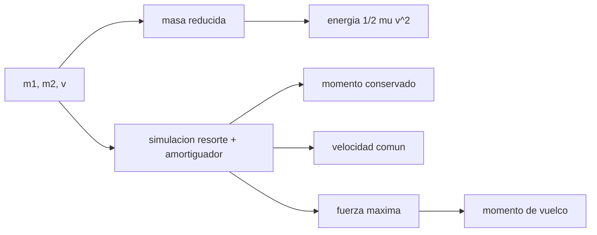

# B76-C16 — Acoplamiento y captura

<!-- nav:top -->
[🏠 Programa](../../../../README.md) · [📚 Bloque B76](../../../tronco-comun/B76-dinamica-cislunar-y-operaciones-de-proximidad.md) · [← Anterior: B76-C15 — Control de formación satelital](../B76-C15-control-de-formacion-satelital/CLASE.md) · [Siguiente: B76-C17 — Sistemas de referencia relativos →](../B76-C17-sistemas-de-referencia-relativos/CLASE.md)
<!-- /nav -->

## 1. Ubicación, nivel y alcance

Clase 16 del bloque B76, nivel N3. El final de la aproximación es un contacto: la captura blanda absorbe la energía relativa con un resorte y un amortiguador y deja las dos naves unidas con una velocidad común. Aquí simulas ese contacto en una dimensión con datos **sintéticos**, compruebas la conservación del momento y de la energía y estimas la fuerza máxima y el momento de vuelco por una desalineación. Los estándares de acoplamiento no se consultaron.

## 2. Por qué esta clase existe

A velocidades de centímetros por segundo, la captura se decide por la masa, la rigidez y el amortiguamiento. La decisión central: **¿cuánta energía hay que disipar y qué fuerzas aparecen en el contacto?**

## 3. Lo que podrás hacer al terminar

1. Calcular la masa reducida y la energía a disipar en una captura.
2. Simular una captura con resorte y amortiguador por RK4.
3. Verificar la conservación del momento y la velocidad común final.
4. Comparar la energía disipada con `½ μ v²`.
5. Estimar la fuerza máxima y el momento por una desalineación lateral.
6. Rotular masas, rigidez y desalineación como sintéticas.

La evidencia es la **ficha de captura de un acoplamiento** del ejercicio 12 (sección 20).

## 4. Con qué llegas y cómo comprobarlo

1. ¿Qué es el momento lineal?
2. ¿Qué es la masa reducida?
3. ¿Qué es el amortiguamiento relativo `ζ`?
4. ¿Qué es una colisión perfectamente inelástica?
5. ¿Qué es un dato sintético?

<details>
<summary>Ver respuestas</summary>

1. El producto de la masa por la velocidad. 2. `m1 m2/(m1 + m2)`, la masa efectiva de dos cuerpos que interactúan. 3. `c/(2√(k μ))`; mayor que 1 es sobreamortiguado. 4. Una tras la cual los cuerpos se mueven juntos. 5. Un dato generado para el ejemplo, no medido.
</details>

Con cuatro o cinco aciertos, sigue; si no, repasa los prerrequisitos.

## 5. Un caso de contexto y casos de referencia

Un perseguidor de `7000 kg` se acerca a `0,10 m/s` a un objetivo de `15.000 kg` en reposo. La masa reducida es `4772,73 kg` y la energía a disipar `23,86 J`. Con `k = 2,0 × 10⁵ N/m` y `c = 1,2 × 10⁵ N s/m` (`ζ = 1,94`), ambos quedan a `0,031818 m/s`, el momento se conserva a `3 × 10⁻¹⁴` y la fuerza máxima es `12.000 N`. Es el **ejemplo conductor**; todo es sintético.

## 6. Vocabulario

La **captura blanda** une las naves con baja velocidad relativa y energía disipada. La **masa reducida** `μ = m1 m2/(m1 + m2)`. La **energía disipada** es `½ μ v²`. La **velocidad común** es `m1 v/(m1 + m2)`. El **momento de vuelco** es la fuerza por la desalineación lateral.

## 7. Modelo mental: un vagón que engancha a otro



*Descripción textual:* las masas y la velocidad dan la masa reducida y la energía; la simulación confirma la conservación del momento, la velocidad común y la fuerza máxima, que con la desalineación da el momento de vuelco.

Analogía: un vagón que engancha a otro con un acoplador de resorte: al final ruedan juntos y la energía se va en calor. Límite: la simulación es unidimensional, sin rotación, holguras ni fricción de los pestillos.

## 8. La explicación, paso a paso

### 8.1 Energía y velocidad final

`μ = 7000 × 15.000/22.000 = 4772,73 kg`. La energía disipada es `½ μ v² = 23,86 J`. La velocidad común es `7000 × 0,10/22.000 = 0,031818 m/s`.

### 8.2 Simulación

Un resorte `k = 2,0 × 10⁵ N/m` y un amortiguador `c = 1,2 × 10⁵ N s/m` actúan mientras hay compresión. RK4 con paso `1 ms` durante `20 s` da velocidades finales `0,031818 m/s` en ambas naves.

### 8.3 Conservación

El error de momento es `3,18 × 10⁻¹⁴` y la energía disipada coincide con `½ μ v²` (`23,8636 J`).

### 8.4 Fuerzas

Sin amortiguador, la fuerza máxima sería `v √(k μ) = 3089,6 N` con compresión `15,4 mm`. Con `ζ = 1,94` el amortiguador impone el pico inicial `c v = 12.000 N`. Un desalineo de `5 cm` produce un momento `12.000 × 0,05 = 600 N m`; el ángulo es `atan(0,05/1,2) = 2,39°`.

### 8.5 Qué falta

La simulación es 1D. La captura real tiene seis grados de libertad, holguras, pestillos y márgenes de actitud que **no se consultaron**.

## 9. Magnitudes, símbolos y unidades

| Símbolo | Qué es | Unidad | Valor / nota |
|---|---|---|---|
| `m1`, `m2` | masas | kg | 7000; 15.000 (sintéticas) |
| `v` | velocidad de cierre | m/s | 0,10 |
| `μ` | masa reducida | kg | 4772,73 |
| `E` | energía disipada | J | 23,86 |
| `v_f` | velocidad común | m/s | 0,031818 |
| `F_max` | fuerza máxima | N | 12.000 |

## 10. Convenciones y referencias

Todos los datos son sintéticos (masas, `k`, `c`, velocidad, desalineación, brazo). Sin constantes consultadas en esta clase. Modelo 1D con resorte-amortiguador lineal activo solo en compresión; RK4 de paso `1 ms`.

## 11. De dónde sale lo que afirmamos

| ID | Fuente | Localizador | Respalda | Estado |
|---|---|---|---|---|
| — | Relaciones estándar: conservación del momento, masa reducida, resorte-amortiguador | — | las verifica el laboratorio con la simulación | No consultada en una fuente concreta |
| — | Estándares de sistemas de acoplamiento | — | no se usaron | No consultada |

Límites: ningún parámetro procede de un mecanismo real; no se consultó ningún estándar de acoplamiento; el modelo es unidimensional.

## 12. Cómo ver la captura

| Magnitud | Valor |
|---|---|
| Masa reducida | 4772,73 kg |
| Energía disipada | 23,8636 J |
| Velocidad común | 0,031818 m/s |
| Error de momento | 3,2e-14 |

Descripción larga: casi toda la energía cinética relativa se disipa, y el momento total se conserva.

## 13. Ejemplo trabajado: la velocidad común

**Paso 1 · Momento.** `p = 7000 × 0,10 = 700 kg m/s`.

**Paso 2 · Masa total.** `22.000 kg`.

**Paso 3 · Velocidad.** `v_f = 700/22.000 = 0,031818 m/s`.

**Paso 4 · Energía.** `½ × 7000 × 0,10² − ½ × 22.000 × 0,031818² = 35 − 11,14 = 23,86 J`.

## 14. Distintas formas de describir la captura

**Por momento:** `p`. **Por energía:** `½ μ v²`. **Por velocidad final:** `m1 v/(m1 + m2)`. **Por fuerza:** `F_max`. **Por geometría:** momento de vuelco.

## 15. Práctica guiada

**Ejercicio 1 · con los pasos indicados.** Calcula la masa reducida. *Pasos:* `m1 m2/(m1 + m2)`.

<details><summary>Solución comentada</summary>

`7000 × 15.000/22.000 = 4772,73 kg`.
</details>

**Ejercicio 2 · con una pista.** Calcula la velocidad común. *Pista:* conserva el momento.

<details><summary>Solución comentada</summary>

`700/22.000 = 0,031818 m/s`.
</details>

**Ejercicio 3 · casi autónomo.** Calcula la energía disipada.

<details><summary>Solución comentada</summary>

`½ × 4772,73 × 0,01 = 23,86 J`.
</details>

## 16. Práctica autónoma, transferencia e integrador

**Ejercicio 4 · autónomo.** Calcula el amortiguamiento relativo `ζ`.

<details><summary>Solución comentada</summary>

`1,2 × 10⁵/(2 √(2,0 × 10⁵ × 4772,73)) = 1,94`.
</details>

**Ejercicio 5 · autónomo.** Calcula la fuerza máxima sin amortiguar.

<details><summary>Solución comentada</summary>

`0,10 √(2,0 × 10⁵ × 4772,73) = 3089,6 N`.
</details>

**Ejercicio 6 · autónomo.** Calcula la compresión sin amortiguar.

<details><summary>Solución comentada</summary>

`v √(μ/k) = 0,10 √(4772,73/2,0 × 10⁵) = 15,4 mm`.
</details>

**Ejercicio 7 · autónomo.** Calcula el momento de vuelco con desalineación de `5 cm`.

<details><summary>Solución comentada</summary>

`12.000 × 0,05 = 600 N m`.
</details>

**Ejercicio 8 · autónomo.** Si la velocidad de cierre se duplica, ¿cuánto sube la energía?

<details><summary>Solución comentada</summary>

Cuatro veces: `95,5 J`.
</details>

**Ejercicio 9 · transferencia.** **Transferencia.** Un equipo reduce la rigidez a la mitad «para suavizar». ¿Qué cambia?

<details><summary>Solución comentada</summary>

`F_max` sin amortiguar baja `√2` y la compresión sube `√2`; con `ζ` mayor, el pico lo fija el amortiguador.
</details>

**Ejercicio 10 · transferencia.** **Transferencia.** Se afirma que la energía disipada depende solo de la masa del objetivo. ¿Qué objetas?

<details><summary>Solución comentada</summary>

Depende de la masa reducida y de la velocidad: `½ μ v²`.
</details>

**Ejercicio 11 · transferencia.** **Transferencia.** Un informe da `23,86 J` sin masas ni velocidad. ¿Qué falta?

<details><summary>Solución comentada</summary>

Las masas, la velocidad de cierre y el modelo; y rotular que son datos sintéticos.
</details>

**Ejercicio 12 · integrador.** **Integrador.** Elabora tu *ficha de captura de un acoplamiento*: masa reducida, energía, velocidad común, fuerza máxima, momento de vuelco y límites, con fuentes.

<details><summary>Solución comentada</summary>

Secciones 8.1–8.5 y la salida del laboratorio.
</details>

## 17. Laboratorio: captura blanda con resorte y amortiguador

El script [captura.py](captura.py) simula una captura 1D, verifica el momento y la energía y estima la fuerza máxima y el momento de vuelco Usa la biblioteca común [cislunar_lib.py](../cislunar_lib.py) del bloque (**comprueba** momento < 1e-9, energía disipada frente a `½ μ v²` < 1e-6 y velocidad común).

**Datos:** **Todos los datos son sintéticos**; sin constantes consultadas en esta clase. **Predice antes de ejecutar:** ¿qué velocidad común quedará? (`0,0318 m/s`.) **Ejecución del 2026-11-10 (Python 3.12.9):**

```text
Python 3.12.9 (biblioteca estandar) ; datos SINTETICOS
Masa reducida = 4772.73 kg ; amortiguamiento relativo zeta = 1.942
Velocidad final: perseguidor = 0.031818 m/s ; objetivo = 0.031818 m/s ; comun teorica = 0.031818 m/s
Error de momento = 3.18e-14
Energia disipada = 23.8636 J ; 1/2 mu v^2 = 23.8636 J
Fuerza maxima simulada = 12000.0 N ; v sqrt(k mu) (sin amortiguar) = 3089.6 N ; compresion sin amortiguar = 15.4 mm
Momento de vuelco por desalineacion de 5 cm con la fuerza maxima = 600.0 N m ; angulo = 2.39 grados
Pruebas superadas.
```

```bash
python programa/clases/B76/B76-C16-acoplamiento-y-captura/captura.py
```

**Límites:** 1D, sin rotación, holguras ni fricción; no representa un mecanismo real.

## 18. Errores frecuentes y cómo corregirlos

**Usar la masa de una sola nave en la energía.** Se corrige con 8.1.

**Olvidar que el pico lo fija el amortiguador.** Se corrige con 8.4.

**Tomar el modelo 1D como análisis de un acoplamiento real.** Se corrige con 8.5.

**Presentar las masas sintéticas como las de una nave.** Se corrige con la sección 10.

## 19. Cómo sabrás que vas bien

Tras la sección 8: ¿qué velocidad final esperabas? Si dudas, repasa el ejemplo 13. Tras el laboratorio: ¿qué comprueba el momento? (ver la sección 17).

## 20. Qué entregas y cómo se evalúa

El producto es tu **ficha de captura de un acoplamiento** (ejercicio 12).

| Criterio | Inicial | En desarrollo | Logrado | Destacado |
|---|---|---|---|---|
| Conceptos | Los confunde | Parciales | Explica momento, energía y masa reducida | Explica el papel del amortiguador |
| Cálculo | Sin unidades | Con errores | Tabla con unidades | Calcula casos nuevos |
| Numérico | Sin comprobar | Un caso | Momento y energía comprobados | Interpreta las diferencias |
| Fuentes | Sin fuente | Sin fecha | Fuentes con fecha y estado | Declara todo como sintético |
| Límites | No los nombra | Uno | Tres | Discute los seis grados de libertad |

**Condiciones críticas (no se compensan con promedio):** rotular masas y rigideces como sintéticas; no presentar el modelo como diseño de un acoplamiento; citar solo lo consultado.

## 21. Ética, seguridad y límites

Clase educativa: los modelos son simplificados y sus datos son sintéticos, ilustrativos o publicados con fuente; ningún resultado es una efeméride, una telemetría ni una recomendación operativa, y lo simulado nunca se presenta como observado.  Accesibilidad: tablas equivalentes a las gráficas, fórmulas en texto, ejercicios sin conexión.

## 22. Para cerrar y seguir

Dos naves de `7000` y `15.000 kg` a `0,10 m/s` quedan unidas a `0,0318 m/s` tras disipar `23,9 J`, con un pico de `12.000 N`. Queda una pregunta: ¿en qué marco se expresan todas esas posiciones y velocidades?

**Glosario español–inglés.** captura blanda · *soft capture*; masa reducida · *reduced mass*; amortiguador · *damper*; acoplamiento · *docking*; momento de vuelco · *overturning moment*.

**Continuidad.** [B76-C17](../B76-C17-sistemas-de-referencia-relativos/CLASE.md) estudia los sistemas de referencia relativos.

**Referencias:** ver sección 11.

<!-- nav:bottom -->
---

[← Anterior: B76-C15 — Control de formación satelital](../B76-C15-control-de-formacion-satelital/CLASE.md) · [📚 Bloque B76](../../../tronco-comun/B76-dinamica-cislunar-y-operaciones-de-proximidad.md) · [Siguiente: B76-C17 — Sistemas de referencia relativos →](../B76-C17-sistemas-de-referencia-relativos/CLASE.md)
<!-- /nav -->
