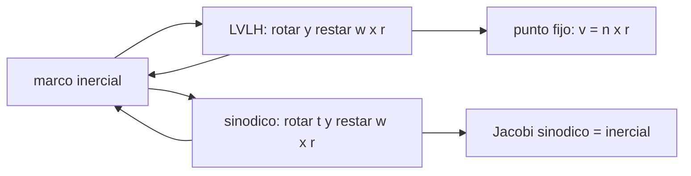

# B76-C17 — Sistemas de referencia relativos

<!-- nav:top -->
[🏠 Programa](../../../../README.md) · [📚 Bloque B76](../../../tronco-comun/B76-dinamica-cislunar-y-operaciones-de-proximidad.md) · [← Anterior: B76-C16 — Acoplamiento y captura](../B76-C16-acoplamiento-y-captura/CLASE.md) · [Siguiente: B76-C18 — Restricciones de iluminación →](../B76-C18-restricciones-de-iluminacion/CLASE.md)
<!-- /nav -->

## 1. Ubicación, nivel y alcance

Clase 17 del bloque B76, nivel N3. Casi todos los errores de proximidad son errores de marco: un signo, un eje, una velocidad inercial usada como relativa. Aquí construyes las transformaciones inercial–LVLH y inercial–sinódico, las verificas por ida y vuelta y con invariantes (la velocidad `n × r` de un punto fijo en LVLH y la constante de Jacobi en dos formas). No se usa SPICE ni ninguna efeméride; los estados son sintéticos. Parte de [B76-C09](../B76-C09-dinamica-relativa-de-hill-clohessy-wiltshire/CLASE.md) y [B76-C01](../B76-C01-sistema-tierra-luna/CLASE.md).

## 2. Por qué esta clase existe

Una posición correcta en el marco equivocado es una colisión. La decisión central: **¿cómo se convierten posición y velocidad entre los marcos de la misión y cómo se comprueba la conversión?**

## 3. Lo que podrás hacer al terminar

1. Convertir un estado relativo LVLH a inercial y de vuelta.
2. Aplicar el término `ω × r` al cambiar de marco.
3. Convertir un estado sinódico del CR3BP a inercial y de vuelta.
4. Comprobar la conversión con invariantes (velocidad de un punto fijo, Jacobi).
5. Reconocer el sentido de los ejes `x`, `y`, `z`.
6. Rotular los estados como sintéticos.

La evidencia es la **tabla de transformaciones verificada** del ejercicio 12 (sección 20).

## 4. Con qué llegas y cómo comprobarlo

1. ¿Qué es un marco inercial?
2. ¿Qué es un marco rotante?
3. ¿Qué es `ω × r`?
4. ¿Qué es una matriz de rotación?
5. ¿Qué es una verificación por ida y vuelta?

<details>
<summary>Ver respuestas</summary>

1. Uno sin aceleración ni rotación. 2. Uno que gira respecto de un marco inercial. 3. La velocidad de arrastre de un punto fijo en un marco que gira. 4. Una matriz ortogonal que cambia las componentes de un vector entre ejes. 5. Convertir y volver y comprobar que se recupera el valor.
</details>

Con cuatro o cinco aciertos, sigue; si no, repasa los prerrequisitos.

## 5. Un caso de contexto y casos de referencia

Un estado relativo de `(120, −800, 40) m` y `(0,05; −0,3; 0,01) m/s` a `400 km` se convierte a inercial y vuelve con error `6 × 10⁻¹³`. Un punto fijo en LVLH a `(120, −800)` tiene velocidad inercial relativa `(0,905093; 0,135764) m/s`, que es `n × r`. Un estado cislunar convertido a inercial recupera su valor con error `10⁻¹⁶` y la constante de Jacobi coincide en las dos formas (`3,0007976884`). Es el **ejemplo conductor**; los estados son sintéticos.

## 6. Vocabulario

El **marco LVLH** tiene `x` radial saliente, `y` a lo largo de la trayectoria y `z` normal. El **marco sinódico** gira con la Luna a `n`. La **velocidad de arrastre** es `ω × r`. El **Jacobi inercial** es `−2(E_in − h_z)` con `E_in = ½ v² − (1−μ)/r1 − μ/r2`.

## 7. Modelo mental: el mismo viaje visto desde un tiovivo y desde el suelo



*Descripción textual:* se convierte entre el marco inercial y los rotantes (LVLH y sinódico) rotando y restando la velocidad de arrastre; dos invariantes (la velocidad de un punto fijo y Jacobi) comprueban cada conversión.

Analogía: una pelota quieta sobre un tiovivo se mueve en círculo vista desde el suelo; la conversión suma o resta ese giro. Límite: se asumen marcos con eje de giro constante y referencia circular; con excentricidad, `ω` varía.

## 8. La explicación, paso a paso

### 8.1 LVLH

Con referencia en `(R0, 0, 0)` y velocidad `(0, n R0, 0)`, un estado relativo `(x, y, z, u, v, w)` da el cuerpo `(R0 + x, y, z, u − n y, n R0 + v + n x, w)`. La vuelta usa la matriz de rotación del ángulo de la referencia y suma `n` por la posición. El error de ida y vuelta es `5,92 × 10⁻¹³`.

### 8.2 Invariante de un punto fijo

Un punto quieto en LVLH en `(120, −800, 40)` se mueve en el marco inercial con velocidad relativa a la referencia `n × r = (0,905093; 0,135764; 0) m/s`: coincide con el resultado de la conversión.

### 8.3 Sinódico

`X = x cos t − y sin t`, `Y = x sin t + y cos t`, `V = R(v_s + ω × r)`. El estado `(0,9; 0,1; 0,05; −0,2; 0,3; 0,1)` en `t = 0,7` pasa a `(0,623936; 0,656280; 0,050000; −1,002514; 0,724545; 0,100000)` y vuelve con error `1,1 × 10⁻¹⁶`.

### 8.4 Jacobi

La forma sinódica `C = x² + y² + 2(1−μ)/r1 + 2μ/r2 − v²` y la inercial `−2(½ V² − (1−μ)/r1 − μ/r2 − h_z)` dan `3,0007976884` y `3,0007976884` (diferencia `4,4 × 10⁻¹⁶`). La Luna, quieta en el marco sinódico, se mueve a `1,0121 km/s` en el inercial.

## 9. Magnitudes, símbolos y unidades

| Símbolo | Qué es | Unidad | Valor / nota |
|---|---|---|---|
| `(x, y, z)` | posición relativa LVLH | m | — |
| `ω × r` | velocidad de arrastre | m/s | 0,905093; 0,135764 |
| `t` | tiempo adimensional | — | 0,7 |
| `C` | constante de Jacobi | — | 3,0007976884 |
| `v_Luna` | velocidad inercial lunar | km/s | 1,0121 |

## 10. Convenciones y referencias

`GM_T`, `GM_L`, `a` y radio terrestre consultados (JPL, NASA/NSSDC). Referencia circular de `400 km` con ejes inerciales iguales al LVLH en `t = 0`; sinódico adimensional con origen en el baricentro. Estados sintéticos. No se usa SPICE.

## 11. De dónde sale lo que afirmamos

| ID | Fuente | Localizador | Respalda | Estado |
|---|---|---|---|---|
| S1 | NASA JPL SSD, Astrodynamic Parameters — https://ssd.jpl.nasa.gov/astro_par.html (consultada 2026-11-10) | tabla de GM y constantes | GM de la Tierra = 398600,435507 km³/s²; GM de la Luna = 4902,800118 km³/s² (DE440, Park et al. 2021); UA = 149597870700 m | Consultada |
| S2 | NASA/NSSDC, Earth Fact Sheet — https://nssdc.gsfc.nasa.gov/planetary/factsheet/earthfact.html (consultada 2026-11-10) | ficha leída | masa 5,9722×10²⁴ kg; radio medio volumétrico 6371,000 km; radio ecuatorial 6378,137 km | Consultada |
| S3 | NASA/NSSDC, Moon Fact Sheet — https://nssdc.gsfc.nasa.gov/planetary/factsheet/moonfact.html (consultada 2026-11-10) | ficha completa leída | semieje mayor 0,3844×10⁶ km; periodo sideral 27,3217 d; periodo sinódico 29,53 d; excentricidad 0,0549; radio medio 1737,4 km; gravedad superficial 1,62 m/s² | Consultada |
| — | Relaciones estándar: marcos LVLH y sinódico, velocidad de arrastre, integral de Jacobi | — | las verifica el laboratorio con invariantes | No consultada en una fuente concreta |
| — | Convenciones de marcos de SPICE e IERS | — | no se usaron | No consultada |

Límites: no se consultaron las convenciones de SPICE ni de IERS; los marcos son idealizados (referencia circular, `ω` constante).

## 12. Cómo ver las transformaciones

| Magnitud | Valor |
|---|---|
| Ida y vuelta LVLH | 5,9e-13 |
| Ida y vuelta sinódico | 1,1e-16 |
| `n × r` de un punto fijo | (0,905093; 0,135764) m/s |
| Diferencia entre las dos formas de Jacobi | 4,4e-16 |

Descripción larga: las transformaciones recuperan el estado y los invariantes coinciden a precisión de máquina.

## 13. Ejemplo trabajado: la velocidad de un punto fijo en LVLH

**Paso 1 · Punto.** `r = (120, −800, 40) m`.

**Paso 2 · Producto vectorial.** `n ẑ × r = n (−y, x, 0) = 1,131367 × 10⁻³ × (800, 120, 0)`.

**Paso 3 · Resultado.** `(0,905093; 0,135764; 0) m/s`.

**Paso 4 · Comparación.** Coincide con la velocidad inercial relativa que da la conversión.

## 14. Distintas formas de expresar un estado

**Por marco:** inercial, LVLH, sinódico. **Por coordenadas:** cartesianas. **Por unidades:** SI o adimensionales. **Por invariantes:** `n × r`, Jacobi.

## 15. Práctica guiada

**Ejercicio 1 · con los pasos indicados.** Calcula `n × r` para `r = (100, 0, 0) m`. *Pasos:* `n (−y, x, 0)`.

<details><summary>Solución comentada</summary>

`(0, 0,113 m/s, 0)`.
</details>

**Ejercicio 2 · con una pista.** Escribe la posición del cuerpo en inercial para `x = 50 m` y `y = 0`. *Pista:* referencia en `(R0, 0, 0)`.

<details><summary>Solución comentada</summary>

`(R0 + 50, 0, 0)`.
</details>

**Ejercicio 3 · casi autónomo.** ¿Cuál es el sentido del eje `y` de LVLH?

<details><summary>Solución comentada</summary>

A lo largo de la velocidad de la referencia (prógrado).
</details>

## 16. Práctica autónoma, transferencia e integrador

**Ejercicio 4 · autónomo.** Calcula `ω × r` en el sinódico adimensional para `r = (1, 0, 0)`.

<details><summary>Solución comentada</summary>

`(0, 1, 0)` (con `ω = 1`).
</details>

**Ejercicio 5 · autónomo.** ¿Qué velocidad inercial tiene la Luna en unidades adimensionales?

<details><summary>Solución comentada</summary>

`1 − μ = 0,98785`, que son `1,0121 km/s`.
</details>

**Ejercicio 6 · autónomo.** Convierte `0,98785` a km/s.

<details><summary>Solución comentada</summary>

`0,98785 × 1,02455 = 1,0121 km/s`.
</details>

**Ejercicio 7 · autónomo.** ¿Por qué la ida y vuelta no basta para validar una conversión?

<details><summary>Solución comentada</summary>

Un error de signo simétrico en ambas direcciones se cancela; hacen falta invariantes.
</details>

**Ejercicio 8 · autónomo.** ¿Qué invariante comprueba el término `ω × r`?

<details><summary>Solución comentada</summary>

La velocidad `n × r` de un punto quieto en el marco rotante.
</details>

**Ejercicio 9 · transferencia.** **Transferencia.** Un equipo usa la velocidad inercial relativa como si fuera LVLH. ¿Qué error comete?

<details><summary>Solución comentada</summary>

Se equivoca en `n × r`: `0,9 m/s` en el ejemplo, que a 5 min son `270 m`.
</details>

**Ejercicio 10 · transferencia.** **Transferencia.** Se afirma que el Jacobi sinódico y el inercial son distintas energías. ¿Qué respondes?

<details><summary>Solución comentada</summary>

Son la misma integral escrita en dos marcos; el laboratorio las iguala a `10⁻¹⁶`.
</details>

**Ejercicio 11 · transferencia.** **Transferencia.** Un informe da una velocidad sin decir el marco. ¿Qué falta?

<details><summary>Solución comentada</summary>

El marco, el origen, los ejes y si la velocidad es inercial o relativa.
</details>

**Ejercicio 12 · integrador.** **Integrador.** Elabora tu *tabla de transformaciones verificada*: LVLH, sinódico, errores de ida y vuelta e invariantes, con fuentes.

<details><summary>Solución comentada</summary>

Secciones 8.1–8.4 y la salida del laboratorio.
</details>

## 17. Laboratorio: transformaciones de marco con invariantes

El script [marcos.py](marcos.py) convierte entre inercial, LVLH y sinódico, comprueba la ida y vuelta y verifica `n × r` y la constante de Jacobi en dos formas Usa la biblioteca común [cislunar_lib.py](../cislunar_lib.py) del bloque (**comprueba** ida y vuelta < 1e-9, `n × r` < 1e-9 y Jacobi en dos formas < 1e-12).

**Datos:** `GM_T`, `GM_L`, `a` y radio **consultados** el 2026-11-10; los estados relativos y cislunar son **sintéticos**. **Predice antes de ejecutar:** ¿qué velocidad tiene un punto quieto en LVLH en el marco inercial? (`n × r`.) **Ejecución del 2026-11-10 (Python 3.12.9):**

```text
Python 3.12.9 (biblioteca estandar)
LVLH <-> inercial: error de ida y vuelta = 5.92e-13
Punto fijo en LVLH: velocidad inercial relativa = (0.905093, 0.135764, 0.000000) m/s ; n x r = (0.905093, 0.135764, 0.000000) m/s
Sinodico <-> inercial: error de ida y vuelta = 1.11e-16
Estado inercial = (0.623936, 0.656280, 0.050000, -1.002514, 0.724545, 0.100000)
Jacobi sinodico = 3.0007976884 ; Jacobi inercial = 3.0007976884 ; diferencia = 4.44e-16
Velocidad inercial de la Luna (quieta en el marco sinodico) = 1.0121 km/s
Pruebas superadas.
```

```bash
python programa/clases/B76/B76-C17-sistemas-de-referencia-relativos/marcos.py
```

**Límites:** Marcos idealizados, `ω` constante; sin SPICE ni IERS.

## 18. Errores frecuentes y cómo corregirlos

**Olvidar `ω × r` al pasar de inercial a rotante.** Se corrige con 8.2.

**Validar solo con la ida y vuelta.** Se corrige con el ejercicio 7.

**Dar una velocidad sin marco.** Se corrige con el ejercicio 11.

**Presentar los estados sintéticos como efemérides.** Se corrige con la sección 10.

## 19. Cómo sabrás que vas bien

Tras la sección 8: ¿qué velocidad esperabas para el punto fijo? Si dudas, repasa el ejemplo 13. Tras el laboratorio: ¿qué comprueban los invariantes? (ver la sección 17).

## 20. Qué entregas y cómo se evalúa

El producto es tu **tabla de transformaciones verificada** (ejercicio 12).

| Criterio | Inicial | En desarrollo | Logrado | Destacado |
|---|---|---|---|---|
| Conceptos | Los confunde | Parciales | Distingue marcos y velocidad de arrastre | Explica los invariantes de validación |
| Cálculo | Sin unidades | Con errores | Tabla con unidades | Calcula casos nuevos |
| Numérico | Sin comprobar | Un caso | Ida y vuelta e invariantes | Interpreta las diferencias |
| Fuentes | Sin fuente | Sin fecha | Fuentes con fecha y estado | Declara SPICE e IERS como no consultados |
| Límites | No los nombra | Uno | Tres | Discute órbitas excéntricas |

**Condiciones críticas (no se compensan con promedio):** decir siempre el marco de cada vector; no usar la ida y vuelta como única validación; citar solo lo consultado.

## 21. Ética, seguridad y límites

Clase educativa: los modelos son simplificados y sus datos son sintéticos, ilustrativos o publicados con fuente; ningún resultado es una efeméride, una telemetría ni una recomendación operativa, y lo simulado nunca se presenta como observado.  Accesibilidad: tablas equivalentes a las gráficas, fórmulas en texto, ejercicios sin conexión.

## 22. Para cerrar y seguir

Un punto quieto en LVLH tiene `0,905 m/s` de velocidad inercial relativa y la integral de Jacobi vale lo mismo en dos marcos hasta `10⁻¹⁶`. Queda una pregunta: ¿cuándo hay luz para ver lo que se aproxima?

**Glosario español–inglés.** marco inercial · *inertial frame*; marco sinódico · *synodic frame*; LVLH · *local vertical, local horizontal*; velocidad de arrastre · *transport velocity*; matriz de rotación · *rotation matrix*.

**Continuidad.** [B76-C18](../B76-C18-restricciones-de-iluminacion/CLASE.md) estudia las restricciones de iluminación.

**Referencias:** ver sección 11.

<!-- nav:bottom -->
---

[← Anterior: B76-C16 — Acoplamiento y captura](../B76-C16-acoplamiento-y-captura/CLASE.md) · [📚 Bloque B76](../../../tronco-comun/B76-dinamica-cislunar-y-operaciones-de-proximidad.md) · [Siguiente: B76-C18 — Restricciones de iluminación →](../B76-C18-restricciones-de-iluminacion/CLASE.md)
<!-- /nav -->
