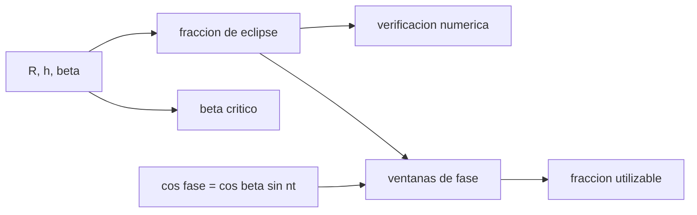

# B76-C18 — Restricciones de iluminación

<!-- nav:top -->
[🏠 Programa](../../../../README.md) · [📚 Bloque B76](../../../tronco-comun/B76-dinamica-cislunar-y-operaciones-de-proximidad.md) · [← Anterior: B76-C17 — Sistemas de referencia relativos](../B76-C17-sistemas-de-referencia-relativos/CLASE.md) · [Siguiente: B76-C19 — Órbitas de mantenimiento →](../B76-C19-orbitas-de-mantenimiento/CLASE.md)
<!-- /nav -->

## 1. Ubicación, nivel y alcance

Clase 18 del bloque B76, nivel N3. Los sensores ópticos necesitan luz y no deben mirar al Sol de frente. Aquí calculas la fracción de órbita en eclipse con la sombra cilíndrica, el ángulo `β` que lo anula y la fase solar de una cámara que mira desde atrás a un objetivo (V-bar). Parte de [B76-C13](../B76-C13-sensores-de-proximidad/CLASE.md). Los umbrales de fase son hipótesis del autor y la sombra es cilíndrica, sin penumbra.

## 2. Por qué esta clase existe

Una aproximación planificada de noche, o con el Sol detrás del objetivo, puede dejar ciego al sensor. La decisión central: **¿qué fracción de la órbita está al sol y con buena fase, según el ángulo `β`?**

## 3. Lo que podrás hacer al terminar

1. Calcular la fracción de eclipse con la fórmula de la sombra cilíndrica.
2. Calcular el ángulo `β` crítico sin eclipse.
3. Verificar la fórmula con una cuenta numérica de la órbita.
4. Calcular el ángulo de fase en una aproximación V-bar.
5. Obtener las fracciones de órbita utilizables según un umbral de fase.
6. Rotular los umbrales como hipótesis.

La evidencia es la **calendario sintético de luz** del ejercicio 12 (sección 20).

## 4. Con qué llegas y cómo comprobarlo

1. ¿Qué es el ángulo `β`?
2. ¿Qué es una sombra cilíndrica?
3. ¿Qué es el ángulo de fase?
4. ¿Qué es el contraluz?
5. ¿Qué es un umbral?

<details>
<summary>Ver respuestas</summary>

1. El ángulo entre la dirección al Sol y el plano orbital. 2. La aproximación de la sombra como un cilindro de radio igual al del cuerpo. 3. El ángulo en el objetivo entre el Sol y el observador. 4. Observar con el Sol detrás del objetivo, que lo oscurece o deslumbra. 5. Un valor límite de aceptación.
</details>

Con cuatro o cinco aciertos, sigue; si no, repasa los prerrequisitos.

## 5. Un caso de contexto y casos de referencia

En una órbita de `400 km` con `β = 0` el eclipse dura `39,0 %` (`36,1 min`); con `β = 70°` solo `4,6 %`; el `β` crítico es `70,22°`. En una órbita lunar de `100 km` el eclipse es `39,5 %` con `β = 0`. En una aproximación V-bar con `β = 0`, el `30,5 %` de la órbita está al sol con fase `≤ 90°`. Es el **ejemplo conductor**; los umbrales son hipótesis.

## 6. Vocabulario

La **fracción de eclipse** es `f = (1/π) arccos(√(h² + 2Rh)/((R + h) cos β))` para `|β|` menor que `β* = asin(R/(R + h))`. La **fase** `φ` cumple `cos φ = cos β sin(nt)` en la aproximación V-bar con el perseguidor detrás. El **contraluz** es una fase mayor que `120°` (hipótesis).

## 7. Modelo mental: una linterna y un farol que gira



*Descripción textual:* la geometría da la fracción de eclipse y el `β` crítico, que se verifican numéricamente; la fase de la aproximación V-bar y el eclipse dan la fracción de órbita utilizable.

Analogía: un faro que gira ilumina un objeto solo en parte de cada vuelta; hay posiciones sin luz y posiciones con el sol de frente. Límite: la sombra cilíndrica ignora la penumbra, la atmósfera y la forma real del objetivo; los umbrales de fase son del autor.

## 8. La explicación, paso a paso

### 8.1 Fracción de eclipse

Para `R = 6378,137 km`, `h = 400 km`: `f(β = 0) = 0,39010`; `f(30°) = 0,37220`; `f(60°) = 0,26333`; `f(70°) = 0,04607`. Para la Luna (`R = 1737,4 km`, `h = 100 km`): `0,39450`, `0,37739`, `0,27443` y `0,09963`.

### 8.2 Beta crítico

`β* = asin(R/(R + h))`: `70,22°` en la Tierra y `71,01°` en la Luna. Por encima no hay eclipse. Los periodos circulares son `92,56 min` y `117,79 min`.

### 8.3 Verificación numérica

Contando `200.000` posiciones de la órbita, la fracción coincide con la fórmula a menos de `10⁻⁵` en los ocho casos.

### 8.4 Fase en V-bar

Con el perseguidor detrás y el Sol fijo en inercial: `cos φ = cos β sin(nt)`. Para la órbita terrestre de `400 km`:

| `β` | al sol | fase ≤ 120° | fase ≤ 90° |
|---|---|---|---|
| 0° | 0,610 | 0,388 | 0,305 |
| 30° | 0,628 | 0,412 | 0,314 |
| 60° | 0,737 | 0,737 | 0,368 |
| 70° | 0,954 | 0,954 | 0,477 |

### 8.5 Lectura

Con `β = 0` solo el `30,5 %` de la órbita está al sol con buena fase; con `β` alto hay más sol pero el contraluz deja de ser el límite y la fase se limita por `β`. El punto de aproximación se elige para la franja de luz y no al revés.

## 9. Magnitudes, símbolos y unidades

| Símbolo | Qué es | Unidad | Valor / nota |
|---|---|---|---|
| `f` | fracción de eclipse | — | 0,39010 (β = 0, 400 km) |
| `β*` | beta crítico | grados | 70,22 (Tierra); 71,01 (Luna) |
| `φ` | ángulo de fase | grados | — |
| fracción útil | al sol y fase ≤ 90° | — | 0,305 (β = 0) |
| `P` | periodo | min | 92,56; 117,79 |

## 10. Convenciones y referencias

Radio ecuatorial terrestre (NASA/NSSDC) y radio medio lunar (JPL) consultados; `GM` (JPL) para los periodos. Sombra cilíndrica; Sol a distancia infinita; órbita circular; umbrales de fase `90°` y `120°` hipótesis del autor; altitudes `400` y `100 km` sintéticas.

## 11. De dónde sale lo que afirmamos

| ID | Fuente | Localizador | Respalda | Estado |
|---|---|---|---|---|
| S1 | NASA/NSSDC, Earth Fact Sheet — https://nssdc.gsfc.nasa.gov/planetary/factsheet/earthfact.html (consultada 2026-11-10) | ficha leída | masa 5,9722×10²⁴ kg; radio medio volumétrico 6371,000 km; radio ecuatorial 6378,137 km | Consultada |
| S2 | NASA JPL SSD, Planetary Satellite Physical Parameters — https://ssd.jpl.nasa.gov/sats/phys_par/ (consultada 2026-11-10) | fila de la Luna (301) | GM = 4902,800 ± 0,001 km³/s² (DE440); radio medio 1737,4 ± 0,1 km (Archinal et al. 2018) | Consultada |
| S3 | NASA JPL SSD, Astrodynamic Parameters — https://ssd.jpl.nasa.gov/astro_par.html (consultada 2026-11-10) | tabla de GM y constantes | GM de la Tierra = 398600,435507 km³/s²; GM de la Luna = 4902,800118 km³/s² (DE440, Park et al. 2021); UA = 149597870700 m | Consultada |
| — | Relaciones estándar: sombra cilíndrica, ángulo beta, ángulo de fase | — | las verifica el laboratorio con una cuenta numérica | No consultada en una fuente concreta |
| — | Requisitos de iluminación de sensores reales | — | no se usaron | No consultada |

Límites: no se consultaron requisitos de iluminación de sensores ni efemérides del Sol; sin penumbra ni atmósfera.

## 12. Cómo ver la luz

| Magnitud | Valor |
|---|---|
| Eclipse (400 km, β = 0) | 39,0 % |
| Eclipse (β = 70°) | 4,6 % |
| Beta crítico (Tierra) | 70,22° |
| Útil en V-bar (β = 0) | 30,5 % |

Descripción larga: el eclipse cae de casi 40 % a menos de 5 % al subir `β` y la ventana útil de fase es menor que la de sol.

## 13. Ejemplo trabajado: el beta crítico

**Paso 1 · Radio.** `R/(R + h) = 6378,137/6778,137 = 0,94099`.

**Paso 2 · Arco seno.** `β* = asin(0,94099) = 70,22°`.

**Paso 3 · Consecuencia.** Con `β > 70,22°` la órbita nunca entra en la sombra.

**Paso 4 · Contraste.** La fórmula da `f = 0` ahí; el cálculo numérico también.

## 14. Distintas formas de describir la luz

**Por eclipse:** `f`. **Por ángulo:** `β`. **Por fase:** `φ`. **Por tiempo:** minutos de sombra. **Por ventana:** fracción útil.

## 15. Práctica guiada

**Ejercicio 1 · con los pasos indicados.** Calcula el tiempo de eclipse a `β = 0` en la Tierra. *Pasos:* `f × P`.

<details><summary>Solución comentada</summary>

`0,39010 × 92,56 = 36,1 min`.
</details>

**Ejercicio 2 · con una pista.** Calcula `β*` para la Luna. *Pista:* `asin(R/(R + h))`.

<details><summary>Solución comentada</summary>

`asin(1737,4/1837,4) = 71,01°`.
</details>

**Ejercicio 3 · casi autónomo.** ¿Qué fracción de la órbita está al sol con `β = 0`?

<details><summary>Solución comentada</summary>

`1 − 0,39010 = 0,610`.
</details>

## 16. Práctica autónoma, transferencia e integrador

**Ejercicio 4 · autónomo.** Compara el eclipse terrestre y lunar a `β = 70°`.

<details><summary>Solución comentada</summary>

`0,04607` frente a `0,09963`: el lunar es 2,2 veces mayor.
</details>

**Ejercicio 5 · autónomo.** ¿Cómo cambia la fracción útil de `β = 0` a `β = 60°` con fase ≤ 90°?

<details><summary>Solución comentada</summary>

`0,305 → 0,368`.
</details>

**Ejercicio 6 · autónomo.** ¿Qué fase hay cuando `sin(nt) = 0` con `β = 0`?

<details><summary>Solución comentada</summary>

`cos φ = 0`: `90°`.
</details>

**Ejercicio 7 · autónomo.** ¿Cuándo es la fase mínima en V-bar con `β = 0`?

<details><summary>Solución comentada</summary>

Cuando `sin(nt) = 1`: `φ = 0°`, con el Sol detrás del observador.
</details>

**Ejercicio 8 · autónomo.** ¿Por qué la fracción útil con fase ≤ 120° vale lo mismo que la de sol a `β = 60°`?

<details><summary>Solución comentada</summary>

`cos β = 0,5`, así que `cos φ ≥ −0,5`: siempre `φ ≤ 120°`.
</details>

**Ejercicio 9 · transferencia.** **Transferencia.** Un equipo planifica la aproximación final en la parte de eclipse «para ahorrar tiempo». ¿Qué objetas?

<details><summary>Solución comentada</summary>

Con `39 %` de la órbita en sombra a `β = 0`, el sensor óptico queda sin luz; hay que planificar ventanas o usar un sensor activo.
</details>

**Ejercicio 10 · transferencia.** **Transferencia.** Se propone usar `β` constante durante toda la campaña. ¿Qué objetas?

<details><summary>Solución comentada</summary>

`β` varía con la estación y el plano orbital; se debe calcular para cada fecha.
</details>

**Ejercicio 11 · transferencia.** **Transferencia.** Un informe da «40 % de eclipse» sin altitud ni `β`. ¿Qué falta?

<details><summary>Solución comentada</summary>

`h`, `β`, el modelo de sombra y el cuerpo.
</details>

**Ejercicio 12 · integrador.** **Integrador.** Elabora tu *calendario sintético de luz*: eclipse y fracción útil para cuatro `β`, con hipótesis de fase y límites, con fuentes.

<details><summary>Solución comentada</summary>

Secciones 8.1–8.5 y la salida del laboratorio.
</details>

## 17. Laboratorio: eclipse cilíndrico y fase en V-bar

El script [luz.py](luz.py) calcula la fracción de eclipse para la Tierra y la Luna en cuatro ángulos beta y las ventanas de fase de una aproximación V-bar Usa la biblioteca común [cislunar_lib.py](../cislunar_lib.py) del bloque (**comprueba** fórmula frente a cuenta numérica < 1e-5 y sol más eclipse igual a 1 para `β = 0`).

**Datos:** Radios (NASA/NSSDC, JPL) y `GM` **consultados** el 2026-11-10; altitudes, ángulos beta y umbrales de fase **ilustrativos**. **Predice antes de ejecutar:** ¿cuánto dura el eclipse a `β = 0` en `400 km`? (unos `36 min`.) **Ejecución del 2026-11-10 (Python 3.12.9):**

```text
Python 3.12.9 (biblioteca estandar)
Periodos circulares: Tierra 400 km = 92.56 min ; Luna 100 km = 117.79 min
Beta critico (sin eclipse): Tierra 400 km = 70.22 grados ; Luna 100 km = 71.01 grados
 beta   eclipse Tierra (formula / numerico)   eclipse Luna (formula / numerico)   al sol   fase<=120   fase<=90
   0    0.39010 /  0.39010               0.39450 /  0.39450               0.610      0.388      0.305
  30    0.37220 /  0.37220               0.37739 /  0.37739               0.628      0.412      0.314
  60    0.26333 /  0.26333               0.27443 /  0.27443               0.737      0.737      0.368
  70    0.04607 /  0.04607               0.09963 /  0.09963               0.954      0.954      0.477
Pruebas superadas.
```

```bash
python programa/clases/B76/B76-C18-restricciones-de-iluminacion/luz.py
```

**Límites:** Sombra cilíndrica, sin penumbra, Sol infinito y órbita circular.

## 18. Errores frecuentes y cómo corregirlos

**Olvidar `β` al calcular el eclipse.** Se corrige con 8.1.

**Tomar el umbral de fase como requisito de un sensor.** Se corrige con la sección 10.

**Confundir sol con fase buena.** Se corrige con 8.4.

**Dar el eclipse sin altitud.** Se corrige con el ejercicio 11.

## 19. Cómo sabrás que vas bien

Tras la sección 8: ¿qué fracción de eclipse esperabas a `β = 70°`? Si dudas, repasa el ejemplo 13. Tras el laboratorio: ¿qué comprueba la cuenta numérica? (ver la sección 17).

## 20. Qué entregas y cómo se evalúa

El producto es tu **calendario sintético de luz** (ejercicio 12).

| Criterio | Inicial | En desarrollo | Logrado | Destacado |
|---|---|---|---|---|
| Conceptos | Los confunde | Parciales | Distingue eclipse, β y fase | Explica por qué la ventana útil es menor que la de sol |
| Cálculo | Sin unidades | Con errores | Tabla con unidades | Calcula otras altitudes |
| Numérico | Sin comprobar | Un caso | Fórmula frente a cuenta | Interpreta las diferencias |
| Fuentes | Sin fuente | Sin fecha | Fuentes con fecha y estado | Declara los umbrales como hipótesis |
| Límites | No los nombra | Uno | Tres | Discute penumbra y atmósfera |

**Condiciones críticas (no se compensan con promedio):** rotular los umbrales de fase como hipótesis; no presentar el calendario como efeméride; citar solo lo consultado.

## 21. Ética, seguridad y límites

Clase educativa: los modelos son simplificados y sus datos son sintéticos, ilustrativos o publicados con fuente; ningún resultado es una efeméride, una telemetría ni una recomendación operativa, y lo simulado nunca se presenta como observado.  Accesibilidad: tablas equivalentes a las gráficas, fórmulas en texto, ejercicios sin conexión.

## 22. Para cerrar y seguir

En `400 km` con `β = 0` el `39 %` de la órbita es sombra y solo el `30,5 %` ofrece sol con fase `≤ 90°`; el eclipse desaparece con `β > 70,22°`. Queda una pregunta: ¿cómo se mantiene una órbita inestable durante meses?

**Glosario español–inglés.** eclipse · *eclipse*; ángulo beta · *beta angle*; ángulo de fase · *phase angle*; sombra cilíndrica · *cylindrical shadow*; contraluz · *backlighting*.

**Continuidad.** [B76-C19](../B76-C19-orbitas-de-mantenimiento/CLASE.md) estudia las órbitas de mantenimiento.

**Referencias:** ver sección 11.

<!-- nav:bottom -->
---

[← Anterior: B76-C17 — Sistemas de referencia relativos](../B76-C17-sistemas-de-referencia-relativos/CLASE.md) · [📚 Bloque B76](../../../tronco-comun/B76-dinamica-cislunar-y-operaciones-de-proximidad.md) · [Siguiente: B76-C19 — Órbitas de mantenimiento →](../B76-C19-orbitas-de-mantenimiento/CLASE.md)
<!-- /nav -->
