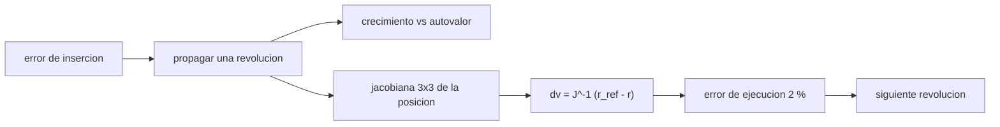

# B76-C19 — Órbitas de mantenimiento

<!-- nav:top -->
[🏠 Programa](../../../../README.md) · [📚 Bloque B76](../../../tronco-comun/B76-dinamica-cislunar-y-operaciones-de-proximidad.md) · [← Anterior: B76-C18 — Restricciones de iluminación](../B76-C18-restricciones-de-iluminacion/CLASE.md) · [Siguiente: B76-C20 — Simulación de encuentro seguro →](../B76-C20-simulacion-de-encuentro-seguro/CLASE.md)
<!-- /nav -->

## 1. Ubicación, nivel y alcance

Clase 19 del bloque B76, nivel N3. Una NRHO es inestable: un error pequeño crece de revolución en revolución y hay que corregirlo. Aquí mides ese crecimiento en el modelo CR3BP, lo comparas con el mayor autovalor de la monodromia (clase 5) y diseñas una corrección por apuntamiento a la posición de referencia de la revolución siguiente. Los errores de insersión y de ejecución son **sintéticos**; los presupuestos reales de mantenimiento no se consultaron.

## 2. Por qué esta clase existe

Una órbita periódica inestable no se mantiene sola. La decisión central: **¿con qué frecuencia y qué impulso hay que corregir para que el error no crezca?**

## 3. Lo que podrás hacer al terminar

1. Propagar un error de inserción en una NRHO y medir su crecimiento por revolución.
2. Comparar el crecimiento con el mayor autovalor de la monodromia.
3. Calcular un impulso 3D que lleva la posición a la de referencia en la revolución siguiente.
4. Simular una campaña de cuatro correcciones con error de ejecución.
5. Calcular el `Δv` total y la desviación con y sin control.
6. Rotular errores y semilla como sintéticos.

La evidencia es la **ficha de una campaña de mantenimiento** del ejercicio 12 (sección 20).

## 4. Con qué llegas y cómo comprobarlo

1. ¿Qué es una NRHO?
2. ¿Qué es la monodromia?
3. ¿Qué es un apuntamiento (targeting)?
4. ¿Qué es una jacobiana?
5. ¿Qué es un dato sintético?

<details>
<summary>Ver respuestas</summary>

1. Una órbita casi rectilínea de halo (clase 5). 2. La matriz de sensibilidad del estado tras un periodo. 3. Calcular un impulso para alcanzar un estado objetivo más adelante. 4. La matriz de derivadas de una función. 5. Un dato generado para el ejemplo, no medido.
</details>

Con cuatro o cinco aciertos, sigue; si no, repasa los prerrequisitos.

## 5. Un caso de contexto y casos de referencia

Con un error de inserción de `1 km` y `1 mm/s` por eje en el apolune (desviación inicial `1,732 km`), la NRHO de la clase 5 (autovalor `2,1585`) deja el error en `7,0 km` tras cuatro revoluciones sin control. Con una corrección en cada apolune (con `2 %` de error de ejecución) la desviación baja a `0,02 km` con `0,116 m/s` en total. Es el **ejemplo conductor**; no es un presupuesto de misión.

## 6. Vocabulario

El **mantenimiento** es el conjunto de maniobras que mantiene la órbita cerca de la referencia. El **apuntamiento** resuelve `J Δv = r_ref − r(T)`, con `J` la jacobiana de la posición final respecto de la velocidad. El **error de ejecución** es el error del impulso aplicado. El **cociente de desviaciones** es la desviación de una revolución entre la de la anterior.

## 7. Modelo mental: mantener el equilibrio sobre una bicicleta



*Descripción textual:* el error de inserción se propaga una revolución; su crecimiento se compara con el autovalor; la jacobiana de la posición permite calcular el impulso que lo corrige, con un error de ejecución, y se repite cada revolución.

Analogía: mantener el equilibrio en bicicleta requiere pequeñas correcciones constantes; si se deja de corregir, el error crece. Límite: el CR3BP no incluye el Sol ni la excentricidad lunar, los mayores perturbadores reales, ni la navegación.

## 8. La explicación, paso a paso

### 8.1 Referencia

La NRHO de la clase 5 tiene periodo `6,5375 d` y mayor autovalor de la monodromia `2,1585`. Se parte del apolune, cuyo estado es el estado inicial de la órbita periódica.

### 8.2 Sin control

Un error de `(1,0, 1,0, 1,0) km` y `(1,0, 1,0, 1,0) mm/s` da una desviación inicial de `1,732 km`. Tras cada revolución: `2,654`, `3,500`, `5,909` y `7,017 km`. Los cocientes sucesivos son `1,53`, `1,32`, `1,69` y `1,19`, todos menores que `2,1585` porque el error no se proyecta por completo sobre el modo inestable.

### 8.3 Con control

En cada apolune se calcula la jacobiana `3 × 3` de la posición final respecto de la velocidad (diferencias finitas de `10⁻⁶`) y se resuelve `Δv = J⁻¹ (r_ref − r(T))`. Se añade un error de ejecución del `2 %`. Los impulsos son `50,08`, `52,99`, `9,97` y `2,99 mm/s`; las desviaciones tras cada revolución, `0,516`, `0,516`, `0,095` y `0,019 km`.

### 8.4 Presupuesto

`Δv` total `0,116 m/s` en cuatro correcciones. El primer impulso es grande porque corrige el error de inserción; los siguientes bajan a los del error de ejecución.

### 8.5 Límites

Mantener la posición en un solo punto cada revolución no controla la velocidad ni la fase; las campañas reales fijan otros objetivos (fase, eclipses) y usan navegación imperfecta. Los presupuestos de misiones **no se consultaron**.

## 9. Magnitudes, símbolos y unidades

| Símbolo | Qué es | Unidad | Valor / nota |
|---|---|---|---|
| `λ` | mayor autovalor de la monodromia | — | 2,1585 |
| `T` | periodo | d | 6,5375 |
| `d₀` | desviación inicial | km | 1,732 |
| `d₄` | desviación a 4 revoluciones | km | 7,017 (sin); 0,019 (con) |
| `Δv` | total de 4 correcciones | m/s | 0,116 |

## 10. Convenciones y referencias

Constantes de `cislunar_lib.py` consultadas; NRHO de B76-C05 (CR3BP). Errores iniciales y de ejecución, semilla `76019` y número de revoluciones sintéticos. Dormand-Prince tolerancia `10⁻¹³`; `numpy 2.4.4`. Sin Sol, sin navegación.

## 11. De dónde sale lo que afirmamos

| ID | Fuente | Localizador | Respalda | Estado |
|---|---|---|---|---|
| S1 | Davis, Khoury, Howell y Sweeney, «Phase Control and Eclipse Avoidance in Near Rectilinear Halo Orbits», NASA NTRS 20200000733 — https://ntrs.nasa.gov/api/citations/20200000733/downloads/20200000733.pdf (PDF leído con PyMuPDF el 2026-11-10; la fecha de publicación no se consultó) | introducción, figura 1 y tabla 1 | NRHO sur de L2 de referencia de Gateway; resonancia 9:2 con el periodo sinódico lunar; periodo medio 6,56 d (6,26–6,76); radio de perilune 3.195–3.557 km (medio 3.366); radio de apolune 70.005–71.849 km (medio 71.100); eclipses lunares < 90 min | Consultada |
| S2 | NASA JPL SSD, Astrodynamic Parameters — https://ssd.jpl.nasa.gov/astro_par.html (consultada 2026-11-10) | tabla de GM y constantes | GM de la Tierra = 398600,435507 km³/s²; GM de la Luna = 4902,800118 km³/s² (DE440, Park et al. 2021); UA = 149597870700 m | Consultada |
| S3 | NASA/NSSDC, Moon Fact Sheet — https://nssdc.gsfc.nasa.gov/planetary/factsheet/moonfact.html (consultada 2026-11-10) | ficha completa leída | semieje mayor 0,3844×10⁶ km; periodo sideral 27,3217 d; periodo sinódico 29,53 d; excentricidad 0,0549; radio medio 1737,4 km; gravedad superficial 1,62 m/s² | Consultada |
| — | Relaciones estándar: apuntamiento por jacobiana, crecimiento de error por autovalores | — | las verifica el laboratorio (cociente < autovalor) | No consultada en una fuente concreta |
| — | Presupuestos de mantenimiento de NRHO en misiones | — | no se usaron | No consultada |

Límites: no se consultaron presupuestos reales de mantenimiento ni las estrategias de control de fase del artículo citado más allá de su descripción general; el modelo no incluye el Sol.

## 12. Cómo ver el mantenimiento

| Magnitud | Valor |
|---|---|
| Desviación sin control a 4 rev. | 7,017 km |
| Desviación con control a 4 rev. | 0,019 km |
| `Δv` total | 0,116 m/s |
| Cocientes sin control | 1,53; 1,32; 1,69; 1,19 |

Descripción larga: sin control el error se cuadruplica en cuatro revoluciones; con una corrección por revolución se reduce a decenas de metros.

## 13. Ejemplo trabajado: una corrección

**Paso 1 · Propagar.** Se integra el estado con error una revolución y se obtiene `r(T)`.

**Paso 2 · Jacobiana.** Se perturba cada componente de velocidad en `10⁻⁶` y se propaga.

**Paso 3 · Impulso.** `Δv = J⁻¹ (r_ref − r(T)) = 50,08 mm/s` (primera corrección).

**Paso 4 · Ejecución.** Se añade un `2 %` de error aleatorio y se propaga la revolución siguiente.

## 14. Distintas formas de describir el mantenimiento

**Por desviación:** km en cada apolune. **Por crecimiento:** cociente entre revoluciones. **Por costo:** `Δv` por revolución. **Por autovalor:** `λ`. **Por estrategia:** apuntamiento a posición.

## 15. Práctica guiada

**Ejercicio 1 · con los pasos indicados.** Calcula el cociente `7,017/5,909`. *Pasos:* divide la desviación final por la anterior.

<details><summary>Solución comentada</summary>

`1,19`.
</details>

**Ejercicio 2 · con una pista.** Comprueba que todos los cocientes son menores que `λ = 2,1585`. *Pista:* mira la sección 8.2.

<details><summary>Solución comentada</summary>

`1,53`, `1,32`, `1,69` y `1,19` son menores.
</details>

**Ejercicio 3 · casi autónomo.** Calcula el factor de crecimiento total sin control.

<details><summary>Solución comentada</summary>

`7,017/1,732 = 4,05`.
</details>

## 16. Práctica autónoma, transferencia e integrador

**Ejercicio 4 · autónomo.** Calcula la suma de impulsos en mm/s.

<details><summary>Solución comentada</summary>

`50,08 + 52,99 + 9,97 + 2,99 = 116,0 mm/s`.
</details>

**Ejercicio 5 · autónomo.** Estima el `Δv` anual si cada revolución costara `3 mm/s`.

<details><summary>Solución comentada</summary>

`365,25/6,5375 = 55,9` revoluciones; `167 mm/s`.
</details>

**Ejercicio 6 · autónomo.** ¿Por qué los últimos impulsos son menores?

<details><summary>Solución comentada</summary>

El error de inserción ya se corrigió; solo queda el error de ejecución.
</details>

**Ejercicio 7 · autónomo.** ¿Qué indica `0,516 km` tras la primera corrección?

<details><summary>Solución comentada</summary>

El efecto del `2 %` de error de ejecución sobre un impulso de `50 mm/s` y de la no linealidad.
</details>

**Ejercicio 8 · autónomo.** ¿Cuánto crecería el error en 10 revoluciones con crecimiento constante de `1,4` por revolución?

<details><summary>Solución comentada</summary>

`1,4¹⁰ = 29` veces.
</details>

**Ejercicio 9 · transferencia.** **Transferencia.** Un equipo propone corregir cada dos revoluciones. ¿Qué anticipas?

<details><summary>Solución comentada</summary>

Menos maniobras, pero el error crece por el modo inestable entre ellas y el impulso necesario es mayor.
</details>

**Ejercicio 10 · transferencia.** **Transferencia.** Se afirma que `0,116 m/s` es el costo de mantener Gateway. ¿Qué objetas?

<details><summary>Solución comentada</summary>

Es una campaña sintética de cuatro revoluciones en un modelo sin Sol; no es un presupuesto de misión.
</details>

**Ejercicio 11 · transferencia.** **Transferencia.** Un informe da una desviación de `0,019 km` sin decir si es posición o estado. ¿Qué falta?

<details><summary>Solución comentada</summary>

Que es la desviación de posición en el apolune, tras la cuarta revolución, con error de ejecución del `2 %`.
</details>

**Ejercicio 12 · integrador.** **Integrador.** Elabora tu *ficha de una campaña de mantenimiento*: crecimiento sin control, impulsos, desviación con control y límites, con fuentes.

<details><summary>Solución comentada</summary>

Secciones 8.1–8.5 y la salida del laboratorio.
</details>

## 17. Laboratorio: crecimiento de error y mantenimiento de una NRHO

El script [mantenimiento.py](mantenimiento.py) propaga un error de inserción en la NRHO de B76-C05 con y sin correcciones por apuntamiento y compara el crecimiento con el autovalor de la monodromia Usa la biblioteca común [cislunar_lib.py](../cislunar_lib.py) del bloque (**comprueba** cada cociente sin control menor que el mayor autovalor y desviación con control menor que sin control).

**Datos:** Constantes **consultadas** el 2026-11-10; la NRHO es la de B76-C05 (CR3BP); errores iniciales, error de ejecución y semilla `76019` **sintéticos**. **Predice antes de ejecutar:** ¿cuántas veces crece el error en cuatro revoluciones sin control? (`≈ 4`.) **Ejecución del 2026-11-10 (Python 3.12.9, numpy 2.4.4):**

```text
Python 3.12.9 ; numpy 2.4.4 ; semilla 76019 ; datos SINTETICOS
NRHO de B76-C05: periodo = 6.5375 d ; mayor autovalor de la monodromia = 2.1585
Desviacion de posicion respecto a la referencia en cada apolune [km]:
 rev   sin control   con control   dv aplicado antes de la rev [m/s]
  0         1.732        1.7321   0.05008
  1         2.654        0.5155   0.05299
  2         3.500        0.5163   0.00997
  3         5.909        0.0954   0.00299
  4         7.017        0.0194   -
Cociente de desviaciones sucesivas sin control = 1.53, 1.32, 1.69, 1.19
Delta-v total de 4 correcciones = 0.11603 m/s
Pruebas superadas.
```

```bash
python programa/clases/B76/B76-C19-orbitas-de-mantenimiento/mantenimiento.py
```

**Límites:** CR3BP sin Sol ni navegación; la corrección controla solo la posición; no es un presupuesto de misión.

## 18. Errores frecuentes y cómo corregirlos

**Esperar que el error crezca siempre como el autovalor.** Se corrige con 8.2.

**Tomar el `Δv` total como presupuesto de misión.** Se corrige con 8.5.

**Controlar solo la posición y olvidar la fase.** Se corrige con 8.5.

**Presentar la campaña sintética como real.** Se corrige con la sección 10.

## 19. Cómo sabrás que vas bien

Tras la sección 8: ¿qué crecimiento esperabas sin control? Si dudas, repasa el ejemplo 13. Tras el laboratorio: ¿qué comprueba el cociente? (ver la sección 17).

## 20. Qué entregas y cómo se evalúa

El producto es tu **ficha de una campaña de mantenimiento** (ejercicio 12).

| Criterio | Inicial | En desarrollo | Logrado | Destacado |
|---|---|---|---|---|
| Conceptos | Los confunde | Parciales | Explica crecimiento y apuntamiento | Explica por qué los cocientes son menores que el autovalor |
| Cálculo | Sin unidades | Con errores | Tabla con unidades | Calcula otras frecuencias de corrección |
| Numérico | Sin comprobar | Un caso | Cocientes y desviaciones comparados | Interpreta las diferencias |
| Fuentes | Sin fuente | Sin fecha | Fuentes con fecha y estado | Declara los presupuestos reales como no consultados |
| Límites | No los nombra | Uno | Tres | Discute el Sol y la navegación |

**Condiciones críticas (no se compensan con promedio):** rotular errores y campaña como sintéticos; no presentar el `Δv` como presupuesto real; citar solo lo consultado.

## 21. Ética, seguridad y límites

Clase educativa: los modelos son simplificados y sus datos son sintéticos, ilustrativos o publicados con fuente; ningún resultado es una efeméride, una telemetría ni una recomendación operativa, y lo simulado nunca se presenta como observado.  Accesibilidad: tablas equivalentes a las gráficas, fórmulas en texto, ejercicios sin conexión.

## 22. Para cerrar y seguir

Sin control un error de `1,7 km` llega a `7 km` en cuatro revoluciones; con una corrección por apolune queda en `19 m` con `0,116 m/s`. Queda una pregunta: ¿cómo se juntan todas las piezas en un encuentro seguro?

**Glosario español–inglés.** mantenimiento orbital · *station-keeping*; apuntamiento · *targeting*; jacobiana · *Jacobian*; error de ejecución · *execution error*; crecimiento de error · *error growth*.

**Continuidad.** [B76-C20](../B76-C20-simulacion-de-encuentro-seguro/CLASE.md) integra el bloque en una simulación de encuentro seguro.

**Referencias:** ver sección 11.

<!-- nav:bottom -->
---

[← Anterior: B76-C18 — Restricciones de iluminación](../B76-C18-restricciones-de-iluminacion/CLASE.md) · [📚 Bloque B76](../../../tronco-comun/B76-dinamica-cislunar-y-operaciones-de-proximidad.md) · [Siguiente: B76-C20 — Simulación de encuentro seguro →](../B76-C20-simulacion-de-encuentro-seguro/CLASE.md)
<!-- /nav -->
