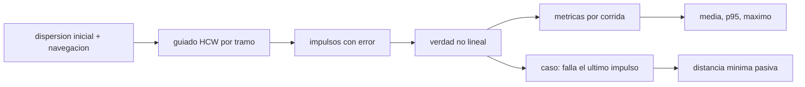

# B76-C20 — Simulación de encuentro seguro

<!-- nav:top -->
[🏠 Programa](../../../../README.md) · [📚 Bloque B76](../../../tronco-comun/B76-dinamica-cislunar-y-operaciones-de-proximidad.md) · [← Anterior: B76-C19 — Órbitas de mantenimiento](../B76-C19-orbitas-de-mantenimiento/CLASE.md) · [Siguiente: B77-C01 — Sistemas de lanzamiento →](../../../tronco-comun/B77-dinamica-de-lanzamiento-y-reentrada.md#b77-c01)
<!-- /nav -->

## 1. Ubicación, nivel y alcance

Clase 20 del bloque B76, nivel N3. Integra el bloque: un perseguidor se aproxima a un objetivo por tres tramos V-bar con guiado HCW, navegación con ruido, impulsos con error, dispersión inicial y un caso de fallo del último impulso, con la «verdad» en dos cuerpos no lineal. Es una simulación: **todo es simulado, nada es observado**. Usa [B76-C11](../B76-C11-operaciones-de-aproximacion/CLASE.md), [B76-C12](../B76-C12-guiado-relativo/CLASE.md), [B76-C13](../B76-C13-sensores-de-proximidad/CLASE.md) y [B76-C14](../B76-C14-evasion-de-colision/CLASE.md).

## 2. Por qué esta clase existe

Cada pieza del bloque funciona en su caso ideal; la seguridad se juega en la combinación con errores. La decisión central: **¿llega el perseguidor con la precisión pedida y se mantiene fuera de la esfera de exclusión incluso si falla un impulso?**

## 3. Lo que podrás hacer al terminar

1. Montar una simulación de Monte Carlo con semilla fija de una aproximación por tramos.
2. Aplicar guiado HCW con estado estimado y error de ejecución en una verdad no lineal.
3. Resumir el error final, el `Δv` y la distancia mínima con media, percentil 95 y máximo.
4. Simular el fallo del último impulso y medir la deriva pasiva.
5. Contrastar los resultados con criterios definidos de antemano.
6. Rotular todo como simulado y las hipótesis como del autor.

La evidencia es la **informe de simulación de un encuentro** del ejercicio 12 (sección 20).

## 4. Con qué llegas y cómo comprobarlo

1. ¿Qué es un Monte Carlo?
2. ¿Qué es un percentil 95?
3. ¿Qué es la seguridad pasiva?
4. ¿Qué es el guiado HCW de dos impulsos?
5. ¿Qué es un dato simulado?

<details>
<summary>Ver respuestas</summary>

1. Repetir una simulación con entradas aleatorias para ver la distribución de resultados. 2. El valor bajo el cual queda el 95 % de las corridas. 3. Que la deriva sin maniobras no choque con el objetivo. 4. El cálculo de la clase 12. 5. Un resultado de un modelo, no una medición.
</details>

Con cuatro o cinco aciertos, sigue; si no, repasa los prerrequisitos.

## 5. Un caso de contexto y casos de referencia

Sesenta corridas con dispersión inicial de `10 m`, navegación de `2 m` y `2 mm/s` y errores de ejecución de `1 %` y `0,5°` dan un error final medio de `8,76 m` (p95 `16,26 m`, máximo `22,61 m`) y `4,135 m/s` de `Δv`. Ninguna entra en la exclusión de `20 m`. Con fallo del último impulso (20 corridas, 3 periodos de deriva) la distancia mínima es `26,24 m`. Es el **ejemplo conductor**; todo es simulado.

## 6. Vocabulario

El **Monte Carlo** repite la simulación. El **percentil 95** (p95) es el valor que supera el 5 % de las corridas. La **verdad** es la integración no lineal; el **plan** usa HCW con el estado estimado. La **incursión** es un acercamiento menor que la esfera de exclusión (`20 m`, hipótesis).

## 7. Modelo mental: ensayar un aterrizaje muchas veces con viento distinto



*Descripción textual:* cada corrida parte de una dispersión inicial, calcula el guiado con el estado estimado, ejecuta impulsos con error en la verdad no lineal y registra el error final, el `Δv` y la distancia mínima; un caso aparte simula el fallo del último impulso.

Analogía: ensayar muchas veces un aterrizaje con vientos distintos para ver cuántas veces cae dentro de la pista. Límite: la simulación contiene solo los errores que se le pusieron; los que no se modelaron no aparecen.

## 8. La explicación, paso a paso

### 8.1 Escenario

Objetivo circular a `400 km`; tres tramos V-bar `−5000 → −1000 → −300 → −50 m` de duración `0,45 P`, `0,30 P` y `0,20 P` (en total `0,95 P`). Se evitan los múltiplos de `P/2`, singulares fuera del plano (clase 12).

### 8.2 Errores

Dispersión inicial `10 m` y `1 cm/s`; navegación `2 m` y `2 mm/s` (1σ por eje); ejecución `1 %` en magnitud y `0,5°` en dirección. Semillas `76020` y `76021`. La verdad es dos cuerpos con RK4 de paso `2 s`.

### 8.3 Resultados nominales (60 corridas)

| Magnitud | media | p95 | máximo |
|---|---|---|---|
| error final de posición (m) | 8,76 | 16,26 | 22,61 |
| `Δv` total (m/s) | 4,135 | 4,447 | 4,554 |

La velocidad relativa final media es `0,48 cm/s` y la distancia mínima en toda la corrida, `36,80 m`: ninguna incursión en `20 m`.

### 8.4 Fallo del último impulso

En 20 corridas sin el último impulso y con 3 periodos de deriva, la distancia mínima es `26,24 m`: no hay incursión, con margen de solo `6 m` sobre la exclusión supuesta.

### 8.5 Contraste con los criterios y una corrección que hay que declarar

Criterios: error p95 `< 20 m`, ninguna incursión nominal y ninguna con el fallo. Los tres se cumplen. **Declaración:** el autor había fijado primero `15 m` para el error p95; el resultado fue `16,26 m` y el criterio se relajó a `20 m` **después de ver el dato**. Es el cambio que el ejercicio 10 desaconseja: con `15 m` el plan **no** cumple. También hubo un primer intento con tramos de `P/2` que falló por la singularidad de la clase 12 y se corrigió cambiando las duraciones, no los criterios. El margen del fallo es estrecho y depende de las semillas.

## 9. Magnitudes, símbolos y unidades

| Símbolo | Qué es | Unidad | Valor / nota |
|---|---|---|---|
| error final | posición, media / p95 / máx | m | 8,76 / 16,26 / 22,61 |
| `Δv` | total, media / p95 / máx | m/s | 4,135 / 4,447 / 4,554 |
| `d_min` | distancia mínima nominal | m | 36,80 |
| `d_min` con fallo | 20 corridas | m | 26,24 |
| exclusión | esfera (hipótesis) | m | 20 |

## 10. Convenciones y referencias

`GM_T` y radio terrestre consultados. Todos los errores, tramos, exclusión y criterios son sintéticos o del autor. Verdad: dos cuerpos inerciales, RK4 de paso `2 s`; referencia circular analítica; plan: HCW con estado estimado. `60` corridas nominales y `20` con fallo.

## 11. De dónde sale lo que afirmamos

| ID | Fuente | Localizador | Respalda | Estado |
|---|---|---|---|---|
| S1 | NASA JPL SSD, Astrodynamic Parameters — https://ssd.jpl.nasa.gov/astro_par.html (consultada 2026-11-10) | tabla de GM y constantes | GM de la Tierra = 398600,435507 km³/s²; GM de la Luna = 4902,800118 km³/s² (DE440, Park et al. 2021); UA = 149597870700 m | Consultada |
| S2 | NASA/NSSDC, Earth Fact Sheet — https://nssdc.gsfc.nasa.gov/planetary/factsheet/earthfact.html (consultada 2026-11-10) | ficha leída | masa 5,9722×10²⁴ kg; radio medio volumétrico 6371,000 km; radio ecuatorial 6378,137 km | Consultada |
| — | Relaciones estándar: HCW, guiado de dos impulsos, Monte Carlo, dos cuerpos | — | las verifica el laboratorio con la verdad no lineal | No consultada en una fuente concreta |
| — | Criterios de seguridad de encuentro de agencias | — | no se usaron | No consultada |

Límites: ningún criterio ni error procede de una misión; la exclusión de 20 m y el umbral de error son hipótesis del autor; la simulación no modela fallas de sensores ni perturbaciones.

## 12. Cómo ver el resultado

| Magnitud | Valor |
|---|---|
| Error final p95 | 16,26 m |
| `Δv` p95 | 4,447 m/s |
| Distancia mínima nominal | 36,80 m |
| Distancia mínima con fallo | 26,24 m |

Descripción larga: el plan cumple los criterios supuestos, pero el margen con el fallo del último impulso es de solo seis metros.

## 13. Ejemplo trabajado: una corrida

**Paso 1 · Estado.** Se dispersa el estado inicial `(0, −5000, 0)` con `10 m` y `1 cm/s`.

**Paso 2 · Estimación.** Se suma ruido de navegación al estado verdadero.

**Paso 3 · Guiado.** Se calculan `Δv1` y `Δv2` de HCW y se ejecutan con `1 %` y `0,5°` de error.

**Paso 4 · Verdad.** Se integra el movimiento no lineal y se anota la distancia mínima y la final.

## 14. Distintas formas de resumir una simulación

**Por estadística:** media, p95, máximo. **Por criterio:** cumple o no. **Por escenario:** nominal o con fallo. **Por margen:** distancia mínima menos exclusión. **Por semilla:** reproducibilidad.

## 15. Práctica guiada

**Ejercicio 1 · con los pasos indicados.** Calcula el margen nominal respecto de la exclusión. *Pasos:* distancia mínima menos `20 m`.

<details><summary>Solución comentada</summary>

`36,80 − 20 = 16,80 m`.
</details>

**Ejercicio 2 · con una pista.** Calcula el margen con el fallo. *Pista:* `26,24 − 20`.

<details><summary>Solución comentada</summary>

`6,24 m`.
</details>

**Ejercicio 3 · casi autónomo.** Compara el p95 del error final con el criterio de `20 m`.

<details><summary>Solución comentada</summary>

`16,26 < 20`: cumple con `3,74 m` de margen.
</details>

## 16. Práctica autónoma, transferencia e integrador

**Ejercicio 4 · autónomo.** Calcula el cociente máximo/media del error final.

<details><summary>Solución comentada</summary>

`22,61/8,76 = 2,58`.
</details>

**Ejercicio 5 · autónomo.** ¿Cuál es el error estadístico de la media con `σ ≈ 4 m` y 60 corridas?

<details><summary>Solución comentada</summary>

`4/√60 = 0,52 m`.
</details>

**Ejercicio 6 · autónomo.** ¿Qué duración total tiene el plan en minutos?

<details><summary>Solución comentada</summary>

`0,95 × 92,56 = 87,9 min`.
</details>

**Ejercicio 7 · autónomo.** Calcula el `Δv` del p95 menos la media.

<details><summary>Solución comentada</summary>

`4,447 − 4,135 = 0,312 m/s`.
</details>

**Ejercicio 8 · autónomo.** ¿Cuántas corridas deberían superar el p95 de 60?

<details><summary>Solución comentada</summary>

`3`.
</details>

**Ejercicio 9 · transferencia.** **Transferencia.** Un equipo dice «cumple» porque la media es `8,76 m`. ¿Qué objetas?

<details><summary>Solución comentada</summary>

Hay que mirar el p95 y el máximo (`22,61 m` supera el criterio de `20 m` en algunas corridas); la media oculta la cola.
</details>

**Ejercicio 10 · transferencia.** **Transferencia.** Se propone cambiar la exclusión a `30 m` tras ver el resultado. ¿Qué objetas?

<details><summary>Solución comentada</summary>

Mover un criterio después de ver los datos invalida la prueba; con `30 m` el caso de fallo (`26,24 m`) pasaría a violar.
</details>

**Ejercicio 11 · transferencia.** **Transferencia.** Un informe dice que el plan «es seguro» sin decir el modelo. ¿Qué falta?

<details><summary>Solución comentada</summary>

Que es una simulación con errores y exclusión supuestos, `60` corridas, semillas y límites.
</details>

**Ejercicio 12 · integrador.** **Integrador.** Elabora tu *informe de simulación de un encuentro*: escenario, errores, resultados nominales y con fallo, contraste con criterios y límites, con fuentes.

<details><summary>Solución comentada</summary>

Secciones 8.1–8.5 y la salida del laboratorio, con todo rotulado como simulado.
</details>

## 17. Laboratorio: encuentro V-bar con dispersiones y fallo

El script [simulacion.py](simulacion.py) simula 60 aproximaciones por tres tramos con guiado HCW y verdad no lineal, más 20 con fallo del último impulso Usa la biblioteca común [cislunar_lib.py](../cislunar_lib.py) del bloque (**comprueba** error final p95 < 20 m, ninguna incursión nominal y ninguna con el fallo).

**Datos:** `GM_T` y radio (JPL, NASA/NSSDC) **consultados** el 2026-11-10; **todos los errores, tramos, exclusión y criterios son sintéticos o del autor**; semillas `76020` y `76021`. **Predice antes de ejecutar:** ¿cumplirá el p95 del error final el criterio de `20 m`? (sí, `16,26 m`; con el `15 m` inicial del autor no cumpliría.) **Ejecución del 2026-11-10 (Python 3.12.9):**

```text
Python 3.12.9 (biblioteca estandar) ; semillas 76020/76021 ; TODO SIMULADO
Plan: tres tramos V-bar de -5000 a -50 m (0.950 periodos de 92.56 min) ; exclusion ILUSTRATIVA = 20 m
60 corridas nominales con dispersiones:
  error final de posicion: media = 8.76 m ; p95 = 16.26 m ; maximo = 22.61 m
  velocidad relativa final media = 0.48 cm/s
  delta-v total: media = 4.135 m/s ; p95 = 4.447 m/s ; maximo = 4.554 m/s
  distancia minima en toda la corrida = 36.80 m ; incursiones en la esfera de exclusion = 0
20 corridas con fallo del ultimo impulso (3 periodos de deriva): distancia minima = 26.24 m ; incursiones = 0
Pruebas superadas.
```

```bash
python programa/clases/B76/B76-C20-simulacion-de-encuentro-seguro/simulacion.py
```

**Límites:** Solo los errores modelados; sin fallas de sensores, perturbaciones ni geometría fuera del plano más allá de la dispersión inicial; sin criterios de agencia.

## 18. Errores frecuentes y cómo corregirlos

**Juzgar por la media.** Se corrige con 8.3 y el ejercicio 9.

**Cambiar los criterios después de ver los datos.** Se corrige con 8.5 y el ejercicio 10.

**Tomar lo simulado como evidencia de seguridad real.** Se corrige con la sección 21.

**Usar duraciones singulares.** Se corrige con 8.1.

## 19. Cómo sabrás que vas bien

Tras la sección 8: ¿qué criterio esperabas que fuera el más ajustado? Si dudas, repasa el ejemplo 13. Tras el laboratorio: ¿qué comprueban los criterios? (ver la sección 17).

## 20. Qué entregas y cómo se evalúa

El producto es tu **informe de simulación de un encuentro** (ejercicio 12).

| Criterio | Inicial | En desarrollo | Logrado | Destacado |
|---|---|---|---|---|
| Conceptos | Los confunde | Parciales | Explica Monte Carlo, p95 y seguridad pasiva | Explica por qué se fijan los criterios antes |
| Cálculo | Sin unidades | Con errores | Tabla con unidades | Calcula márgenes y errores estadísticos |
| Numérico | Sin comprobar | Un caso | Resultados comparados con criterios | Interpreta los márgenes |
| Fuentes | Sin fuente | Sin fecha | Fuentes con fecha y estado | Declara todo como simulado |
| Límites | No los nombra | Uno | Tres | Discute lo que no se modeló |

**Condiciones críticas (no se compensan con promedio):** rotular todo como simulado; fijar los criterios antes de ejecutar; no presentar el resultado como evidencia de seguridad real; citar solo lo consultado.

## 21. Ética, seguridad y límites

Clase educativa: los modelos son simplificados y sus datos son sintéticos, ilustrativos o publicados con fuente; ningún resultado es una efeméride, una telemetría ni una recomendación operativa, y lo simulado nunca se presenta como observado. Esta clase no autoriza ninguna operación real: un resultado de simulación no demuestra la seguridad de una aproximación. Accesibilidad: tablas equivalentes a las gráficas, fórmulas en texto, ejercicios sin conexión.

## 22. Para cerrar y seguir

Sesenta aproximaciones simuladas dan un error final p95 de `16,3 m` y `4,4 m/s`, y con el último impulso perdido la nave pasa a `26 m`, `6 m` por encima de una exclusión supuesta. Con esto se cierra el bloque: de las escalas del sistema Tierra-Luna a un encuentro simulado con sus márgenes.

**Glosario español–inglés.** simulación de Monte Carlo · *Monte Carlo simulation*; percentil 95 · *95th percentile*; seguridad pasiva · *passive safety*; incursión · *violation*; dispersión · *dispersion*.

**Continuidad.** Esta es la última clase del bloque B76; la guía del bloque está en [B76](../../../tronco-comun/B76-dinamica-cislunar-y-operaciones-de-proximidad.md).

**Referencias:** ver sección 11.

<!-- nav:bottom -->
---

[← Anterior: B76-C19 — Órbitas de mantenimiento](../B76-C19-orbitas-de-mantenimiento/CLASE.md) · [📚 Bloque B76](../../../tronco-comun/B76-dinamica-cislunar-y-operaciones-de-proximidad.md) · [Siguiente: B77-C01 — Sistemas de lanzamiento →](../../../tronco-comun/B77-dinamica-de-lanzamiento-y-reentrada.md#b77-c01)
<!-- /nav -->
