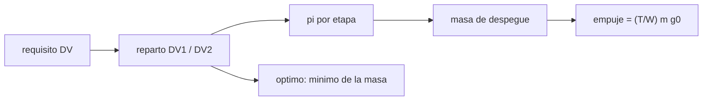

# B77-C01 — Sistemas de lanzamiento

<!-- nav:top -->
[🏠 Programa](../../../../README.md) · [📚 Bloque B77](../../../tronco-comun/B77-dinamica-de-lanzamiento-y-reentrada.md) · [← Anterior: B76-C20 — Simulación de encuentro seguro](../../B76/B76-C20-simulacion-de-encuentro-seguro/CLASE.md) · [Siguiente: B77-C02 — Movimiento en atmósfera →](../B77-C02-movimiento-en-atmosfera/CLASE.md)
<!-- /nav -->

## 1. Ubicación, nivel y alcance

Clase 1 del bloque B77. Nivel N3. Un sistema de lanzamiento es un conjunto de etapas, motores y estructura que convierte masa de propelente en velocidad. Aquí lo dimensionas a nivel de masas con la ecuación de cohete ideal (que se estudia a fondo en [C05](../B77-C05-ecuacion-de-cohete-ideal/CLASE.md)) y ves por qué casi todo lo que despega es propelente. El lanzador es sintético y no corresponde a ningún vehículo real.

## 2. Por qué esta clase existe

Un requisito de velocidad no dice cuánto pesa el vehículo. La decisión central: **¿cómo se reparte la velocidad entre dos etapas para que la masa de despegue sea mínima, y qué parte de esa masa es carga útil?**

## 3. Lo que podrás hacer al terminar

1. Describir un lanzador como cadena de etapas con propelente, estructura y carga útil.
2. Calcular la razón de carga útil de una etapa con el coeficiente estructural.
3. Dimensionar la masa de despegue de un lanzador de dos etapas.
4. Encontrar el reparto de velocidad que minimiza la masa de despegue.
5. Obtener el empuje de despegue a partir de la relación empuje–peso.
6. Separar lo consultado (g₀, ecuación) de lo ilustrativo (requisito, Isp, estructura).

La evidencia es la **ficha de dimensionamiento de un lanzador de dos etapas** del ejercicio 12 (sección 20).

## 4. Con qué llegas y cómo comprobarlo

1. ¿Qué es la velocidad característica ΔV?
2. ¿Qué es el impulso específico?
3. ¿Qué es una razón de masas?
4. ¿Qué es la relación empuje–peso?
5. ¿Qué es un dato sintético?

<details>
<summary>Ver respuestas</summary>

1. El cambio de velocidad que el vehículo puede dar con su propelente, en m/s. 2. El empuje por unidad de peso de propelente consumido por segundo, en segundos. 3. El cociente entre la masa inicial y la final. 4. El empuje dividido por el peso del vehículo. 5. Un dato generado para el ejemplo, no medido.
</details>

Con cuatro o cinco aciertos, sigue; si no, repasa los prerrequisitos.

## 5. Un caso de contexto y casos de referencia

Un lanzador sintético de dos etapas debe dar `ΔV = 9400 m/s` (valor **ilustrativo**: órbita baja más pérdidas) a una carga de `1000 kg`, con `Isp = 300 s` y `350 s` y coeficientes estructurales `0,08` y `0,10`. El reparto óptimo es `ΔV₁ = 4314,3 m/s` y `ΔV₂ = 5085,7 m/s`, con una masa de despegue de `43165,7 kg`; el reparto 50/50 pide `43851,3 kg`. Es el **ejemplo conductor**; ninguna cifra describe un vehículo real.

## 6. Vocabulario

Una **etapa** es un bloque de motor, tanque y estructura que se descarta al agotarse. El **coeficiente estructural** `ε = m_est/(m_est + m_prop)` mide cuánta masa de la etapa no es propelente. La **razón de carga útil** de una etapa es `π = (e^(−ΔV/c) − ε)/(1 − ε)`, con `c = Isp·g₀`. La **masa de despegue** (GLOW) es la masa total en el instante de ignición. La **relación empuje–peso** `T/W` compara el empuje con el peso inicial.

## 7. Modelo mental



*Descripción textual:* el requisito de velocidad se reparte entre las etapas; de cada reparto salen la razón de carga útil, la masa de despegue y el empuje; el óptimo es el mínimo de la masa.

Analogía: una carrera de relevos: cada corredor aporta una parte de la distancia y cada uno carga con el peso del siguiente. Límite: el modelo supone `Isp` y `ε` constantes y sin pérdidas; en un vehículo real dependen del motor y del tamaño.

## 8. La explicación, paso a paso

### 8.1 Una etapa

Con `c = Isp·g₀` y `g₀ = 9,80665 m/s²`, la etapa 2 (`Isp = 350 s`) tiene `c = 3432,3 m/s`. Para `ΔV₂ = 5085,7 m/s`: `π₂ = (e^(−ΔV₂/c) − 0,10)/0,90 = 0,1414`. La masa inicial de la etapa 2 es `1000/π₂ = 7072,5 kg`.

### 8.2 Dos etapas

La etapa 1 carga con la etapa 2: `m₀₁ = m₀₂/π₁ = 43165,7 kg`. Propelente y estructura de cada etapa:

| Etapa | Propelente (kg) | Estructura (kg) |
|---|---|---|
| 1 | 33205,7 | 2887,5 |
| 2 | 5465,3 | 607,3 |

La carga útil es `2,32 %` de la masa de despegue.

### 8.3 El reparto óptimo

La masa de despegue depende de cómo se reparta `ΔV`. Un mínimo numérico (búsqueda de la sección áurea) da `ΔV₁ = 4314,3 m/s`. El reparto 50/50 cuesta `685,6 kg` más. La etapa de mayor `Isp` conviene cargarla con más `ΔV`, así que el óptimo no es el reparto igual.

### 8.4 Empuje de despegue

Con `T/W = 1,3`, `F = 1,3 · m₀₁ · g₀ = 550,3 kN`. El empuje debe superar el peso, o el vehículo no se despega.

## 9. Magnitudes, símbolos y unidades

| Símbolo | Qué es | Unidad | Valor / nota |
|---|---|---|---|
| `ΔV` | velocidad característica | m/s | 9400 (ilustrativo) |
| `Isp` | impulso específico | s | 300; 350 (ilustrativo) |
| `g₀` | aceleración estándar | m/s² | 9,80665 (NIST) |
| `ε` | coeficiente estructural | — | 0,08; 0,10 (ilustrativo) |
| `π` | razón de carga útil de una etapa | — | 0,1638; 0,1414 |
| `m₀₁` | masa de despegue | kg | 43165,7 |

## 10. Convenciones y referencias

`g₀ = 9,80665 m/s²` (NIST, exacto). Masas en kg, velocidades en m/s. Sin sistema de referencia espacial: solo balance de masas. Requisito, `Isp`, `ε`, carga útil y `T/W` son ilustrativos.

## 11. De dónde sale lo que afirmamos

| ID | Fuente | Localizador | Respalda | Estado |
|---|---|---|---|---|
| S1 | NASA Glenn, Ideal Rocket Equation — https://www1.grc.nasa.gov/beginners-guide-to-aeronautics/ideal-rocket-equation/ (consultada 2026-11-10) | página completa | ecuación de cohete ideal, masa de propelente en función de ΔV e Isp | Consultada |
| S2 | NIST, CODATA 2022, standard acceleration of gravity — https://physics.nist.gov/cgi-bin/cuu/Value?gn (consultada 2026-11-10) | entrada gn | g₀ = 9,80665 m/s² (exacto) | Consultada |
| — | Coeficiente estructural, razón de carga útil y optimización del reparto (relaciones estándar de dimensionamiento) | — | las verifica el laboratorio con una segunda vía | No consultada en una fuente concreta |

Límites: el requisito de ΔV, los `Isp`, las fracciones estructurales y la carga son sintéticos; no se consultó ficha de ningún lanzador real.

## 12. Cómo ver el resultado

| Magnitud | Valor |
|---|---|
| `ΔV₁` óptimo | 4314,3 m/s |
| masa de despegue óptima | 43165,7 kg |
| masa de despegue 50/50 | 43851,3 kg |
| carga útil / despegue | 2,32 % |
| error del balance de masas | 0,0e+00 |

Descripción larga: más del 97 % de la masa de despegue es propelente y estructura; repartir el ΔV de forma óptima ahorra unos 700 kg respecto del reparto igual.

## 13. Ejemplo trabajado: la razón de carga útil de la etapa 2

**Paso 1 · Velocidad de escape.** `c = 350 × 9,80665 = 3432,3 m/s`.

**Paso 2 · Exponencial.** `e^(−5085,7/3432,3) = 0,2272`.

**Paso 3 · Razón.** `π₂ = (0,2272 − 0,10)/0,90 = 0,1414`.

**Paso 4 · Masa.** `m₀₂ = 1000/π₂ = 7072,5 kg`.

## 14. Distintas formas de describir el resultado

**Por masas:** propelente, estructura, carga. **Por velocidad:** `ΔV` por etapa. **Por fracciones:** `π`, `ε`. **Por empuje:** `T/W`. **Por masa total:** GLOW.

## 15. Práctica guiada

**Ejercicio 1 · con los pasos indicados.** Calcula `c` para `Isp = 300 s`. *Pasos:* multiplica por `g₀`.

<details><summary>Solución comentada</summary>

`300 × 9,80665 = 2942,0 m/s`.
</details>

**Ejercicio 2 · con una pista.** ¿Qué fracción de la masa de despegue es carga útil? *Pista:* divide 1000 kg por la masa de despegue.

<details><summary>Solución comentada</summary>

`1000/43165,7 = 2,32 %`.
</details>

**Ejercicio 3 · casi autónomo.** ¿Por qué el reparto óptimo no es 50/50?

<details><summary>Solución comentada</summary>

Las dos etapas tienen `Isp` y `ε` distintos; cada kg de la etapa 1 pesa más porque carga con la etapa 2.
</details>

## 16. Práctica autónoma, transferencia e integrador

**Ejercicio 4 · autónomo.** Masa de propelente total del reparto óptimo.

<details><summary>Solución comentada</summary>

`33205,7 + 5465,3 = 38671,0 kg`.
</details>

**Ejercicio 5 · autónomo.** Empuje de despegue si `T/W = 1,5`.

<details><summary>Solución comentada</summary>

`1,5 × 43165,7 × 9,80665 = 635,0 kN`.
</details>

**Ejercicio 6 · autónomo.** Si `ε₁` sube a 0,10, ¿la masa de despegue sube o baja?

<details><summary>Solución comentada</summary>

Sube: hay más estructura por kg de propelente y `π₁` baja.
</details>

**Ejercicio 7 · autónomo.** ¿Qué pasa con `π` si `ΔV` crece sin cota?

<details><summary>Solución comentada</summary>

`e^(−ΔV/c)` tiende a 0 y `π` se vuelve negativa en cuanto `e^(−ΔV/c) < ε`: ese `ΔV` es inalcanzable con esa etapa.
</details>

**Ejercicio 8 · autónomo.** Estructura total del vehículo como fracción del despegue.

<details><summary>Solución comentada</summary>

`(2887,5 + 607,3)/43165,7 = 8,10 %`.
</details>

**Ejercicio 9 · transferencia.** **Transferencia.** Un folleto da la masa de despegue de un lanzador real. ¿Basta para deducir su `ΔV`?

<details><summary>Solución comentada</summary>

No: faltan `Isp`, masa de propelente y carga; además `ΔV` incluye pérdidas que dependen de la trayectoria.
</details>

**Ejercicio 10 · transferencia.** **Transferencia.** Un colega usa el mismo `ε` para una etapa pequeña y una grande. ¿Qué riesgo corre?

<details><summary>Solución comentada</summary>

La estructura no escala linealmente con el tamaño; el `ε` de una etapa pequeña suele ser mayor.
</details>

**Ejercicio 11 · transferencia.** **Transferencia.** Un requisito baja de 9400 a 8500 m/s. ¿Qué efecto cualitativo tiene sobre la carga útil con la misma masa de despegue?

<details><summary>Solución comentada</summary>

Aumenta, porque `π` crece al disminuir `ΔV`; el valor exacto exige repetir el dimensionamiento.
</details>

**Ejercicio 12 · integrador.** **Integrador.** Elabora tu *ficha de dimensionamiento de un lanzador de dos etapas*: reparto de `ΔV`, `π`, masas por etapa, empuje de despegue y lista de qué es consultado e ilustrativo.

<details><summary>Solución comentada</summary>

Secciones 8.1–8.4 y la salida del laboratorio.
</details>

## 17. Laboratorio: dimensionamiento de un lanzador de dos etapas

El script [lanzador.py](lanzador.py) dimensiona las masas de un lanzador sintético, busca el reparto óptimo de `ΔV` y contrasta la masa final de la etapa 2 con una integración numérica del consumo (**comprueba** balance de masas < 1e-9, integración frente a analítica < 1e-5 y óptimo ≤ 50/50).

**Datos:** `g₀` y la ecuación de cohete consultados; requisito, `Isp`, `ε` y carga **ilustrativos**. **Predice antes de ejecutar:** ¿`ΔV₁` mayor o menor que 4700 m/s en el óptimo? (menor: 4314,3 m/s, porque la etapa 2 tiene mejor `Isp`.) **Ejecución del 2026-11-10 (Python 3.12.9):**

```text
Python 3.12.9 (biblioteca estandar)
Lanzador SINTETICO: DV_total = 9400 m/s, Isp = (300.0, 350.0) s, eps = (0.08, 0.1), carga util = 1000 kg
[reparto optimo] DV1 = 4314.3 m/s, DV2 = 5085.7 m/s; pi1 = 0.1638, pi2 = 0.1414
   masa de despegue = 43165.7 kg; etapa 1: prop 33205.7 + est 2887.5; etapa 2: prop 5465.3 + est 607.3
[reparto 50/50] DV1 = 4700.0 m/s, DV2 = 4700.0 m/s; pi1 = 0.1330, pi2 = 0.1714
   masa de despegue = 43851.3 kg; etapa 1: prop 34976.2 + est 3041.4; etapa 2: prop 4350.3 + est 483.4
Balance de masas (optimo): error relativo = 0.00e+00
Empuje de despegue con T/W = 1.3: 550.3 kN
Etapa 2: DV integrado = 5085.634 m/s; analitico = 5085.657 m/s; masa final 1607.255 vs 1607.255 kg
Pruebas superadas.
```

```bash
python programa/clases/B77/B77-C01-sistemas-de-lanzamiento/lanzador.py
```

**Límites:** `Isp` y `ε` constantes; sin pérdidas ni masa de separación; Euler fino para la integración (error ~5e-6).

## 18. Errores frecuentes y cómo corregirlos

**Repartir el `ΔV` en partes iguales por costumbre.** Se corrige con 8.3.

**Olvidar que la etapa 1 carga con la etapa 2.** Se corrige con 8.2.

**Tomar la masa de despegue sintética por la de un vehículo real.** Se corrige con la sección 10.

**Confundir `ε` con la fracción de carga útil.** Se corrige con el vocabulario (sección 6).

## 19. Cómo sabrás que vas bien

Tras la sección 8: ¿qué masa de despegue esperabas y cuál obtuviste? Si dudas, repasa el ejemplo 13. Tras el laboratorio: ¿qué comprueba? (ver la sección 17).

## 20. Qué entregas y cómo se evalúa

El producto es tu **ficha de dimensionamiento de un lanzador de dos etapas** (ejercicio 12).

| Criterio | Inicial | En desarrollo | Logrado | Destacado |
|---|---|---|---|---|
| Conceptos | Los confunde | Parciales | Aplica el modelo con sus supuestos | Explica los límites |
| Cálculo | Sin unidades | Con errores | Tablas completas con unidades | Calcula casos nuevos |
| Numérico | Sin comprobar | Un caso | Contraste con una segunda vía | Interpreta las diferencias |
| Fuentes | Sin fuente | Sin fecha | Fuentes con fecha y estado | Declara lo ilustrativo y lo no consultado |
| Límites | No los nombra | Uno | Tres | Discute qué falta del modelo |

**Condiciones críticas (no se compensan con promedio):** rotular el requisito y las fracciones como ilustrativos; no presentar el lanzador como un vehículo real; citar solo lo consultado.

## 21. Ética, seguridad y límites

Clase educativa: los modelos son simplificados y sus datos son sintéticos o ilustrativos; ningún resultado describe un vehículo real ni sustituye al análisis de seguridad, a la certificación o a los documentos del operador. Nada de lo simulado se presenta como observado ni como datos de vuelo. Accesibilidad: tablas equivalentes a las gráficas, fórmulas en texto, ejercicios sin conexión.

## 22. Para cerrar y seguir

Un lanzador sintético de `ΔV = 9400 m/s` pesa `43165,7 kg` para llevar `1000 kg` si el reparto es óptimo. Queda una pregunta: ¿qué fuerzas actúan sobre él mientras atraviesa el aire?

**Glosario español–inglés.** etapa · *stage*; impulso específico · *specific impulse*; coeficiente estructural · *structural coefficient*; razón de carga útil · *payload ratio*; masa de despegue · *gross lift-off mass*.

**Continuidad.** [siguiente]

**Referencias:** ver sección 11.

<!-- nav:bottom -->
---

[← Anterior: B76-C20 — Simulación de encuentro seguro](../../B76/B76-C20-simulacion-de-encuentro-seguro/CLASE.md) · [📚 Bloque B77](../../../tronco-comun/B77-dinamica-de-lanzamiento-y-reentrada.md) · [Siguiente: B77-C02 — Movimiento en atmósfera →](../B77-C02-movimiento-en-atmosfera/CLASE.md)
<!-- /nav -->
