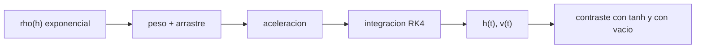

# B77-C02 — Movimiento en atmósfera

<!-- nav:top -->
[🏠 Programa](../../../../README.md) · [📚 Bloque B77](../../../tronco-comun/B77-dinamica-de-lanzamiento-y-reentrada.md) · [← Anterior: B77-C01 — Sistemas de lanzamiento](../B77-C01-sistemas-de-lanzamiento/CLASE.md) · [Siguiente: B77-C03 — Fuerzas aerodinámicas →](../B77-C03-fuerzas-aerodinamicas/CLASE.md)
<!-- /nav -->

## 1. Ubicación, nivel y alcance

Clase 2 del bloque B77. Nivel N3. Un vehículo que sube o cae por el aire obedece la segunda ley de Newton con la gravedad y el arrastre como fuerzas. Aquí integras el movimiento vertical de un cuerpo en una atmósfera exponencial, lo contrastas con la solución analítica de densidad constante y ves cuánto recorta el aire un apogeo. Usas [C01](../B77-C01-sistemas-de-lanzamiento/CLASE.md) solo como contexto. El cuerpo es sintético.

## 2. Por qué esta clase existe

El aire frena un cuerpo de forma distinta a cada altitud porque la densidad cambia. La decisión central: **¿qué modelo de atmósfera y de integración basta para predecir el movimiento, y cómo se comprueba?**

## 3. Lo que podrás hacer al terminar

1. Escribir las ecuaciones de movimiento vertical con gravedad y arrastre.
2. Modelar la densidad con una atmósfera exponencial `ρ = ρ₀ e^(−h/H)`.
3. Calcular la velocidad terminal con densidad constante.
4. Integrar el movimiento con Runge–Kutta de cuarto orden y contrastarlo con la solución analítica.
5. Estimar cuánto reduce el arrastre el apogeo respecto del vacío.
6. Separar lo consultado (ρ₀, H, g) de lo ilustrativo (cuerpo y arrastre).

La evidencia es la **ficha de movimiento con arrastre** del ejercicio 12 (sección 20).

## 4. Con qué llegas y cómo comprobarlo

1. ¿Qué dice la segunda ley de Newton?
2. ¿Qué es la densidad del aire y en qué unidades se mide?
3. ¿Qué es un método de integración de paso fijo?
4. ¿Qué es la velocidad terminal?
5. ¿Qué es una solución analítica?

<details>
<summary>Ver respuestas</summary>

1. La fuerza neta es la masa por la aceleración. 2. Masa por unidad de volumen, en kg/m³. 3. Uno que avanza el estado en pasos de tiempo iguales. 4. La velocidad en que arrastre y peso se igualan. 5. Una expresión cerrada que sirve de referencia para comprobar el código.
</details>

Con cuatro o cinco aciertos, sigue; si no, repasa los prerrequisitos.

## 5. Un caso de contexto y casos de referencia

Un cuerpo sintético de `100 kg`, `Cd = 0,3` y `A = 0,05 m²` se lanza hacia arriba a `300 m/s`. Sin aire sube `4588,7 m`; con la atmósfera exponencial sube `3444,3 m` y vuelve a `227,7 m/s`. Con densidad constante su velocidad terminal es `327,8 m/s`. Es el **ejemplo conductor**; es **ilustrativo**.

## 6. Vocabulario

El **arrastre** es `D = Cd·(ρV²/2)·A`. El **coeficiente balístico** `β = m/(Cd·A)` agrupa las propiedades del cuerpo. La **altura de escala** `H` es la altitud en la que la densidad cae un factor `e`. La **atmósfera exponencial** es `ρ(h) = ρ₀ e^(−h/H)`. La **velocidad terminal** es `v_t = √(2mg/(ρ Cd A))`.

## 7. Modelo mental



*Descripción textual:* el peso y el arrastre (que usa la densidad exponencial) dan la aceleración; el integrador produce altitud y velocidad, que se contrastan con la solución analítica y con el vacío.

Analogía: un paracaidista que sube y baja: cuanto más rápido, más lo frena el aire, y arriba el aire es más fino. Límite: el modelo es vertical, de gravedad constante y sin viento; no vale para trayectorias largas.

## 8. La explicación, paso a paso

### 8.1 Ecuación de movimiento

Con eje vertical hacia arriba: `dv/dt = −g − sgn(v)·(ρ(h)·Cd·A/(2m))·v²` y `dh/dt = v`. El arrastre siempre se opone a la velocidad, por eso aparece `sgn(v)`.

### 8.2 Velocidad terminal

Con densidad constante `ρ₀ = 1,217 kg/m³`: `v_t = √(2·100·9,80665/(1,217·0,3·0,05)) = 327,781 m/s`. La caída cumple `v = −v_t·tanh(g t/v_t)`; a los 20 s la integración da `-175,653242 m/s`, igual que la fórmula (error `5,4e-14`).

### 8.3 Apogeo con y sin aire

Sin arrastre `h_max = v₀²/(2g) = 4588,7 m`. Con la atmósfera exponencial el apogeo baja a `3444,3 m` (un `24,9 %` menos) y se alcanza a los `25,43 s`.

### 8.4 Qué cambia con el modelo

La densidad constante exagera el arrastre en altura. Con `β = 6667 kg/m²`, un cuerpo más pesado por área pierde menos velocidad. La atmósfera exponencial es una aproximación local; las tablas estándar (U.S. Standard Atmosphere 1976) describen la variación real con la altitud.

## 9. Magnitudes, símbolos y unidades

| Símbolo | Qué es | Unidad | Valor / nota |
|---|---|---|---|
| `ρ₀` | densidad en superficie | kg/m³ | 1,217 (NASA/NSSDC) |
| `H` | altura de escala | m | 8500 (NASA/NSSDC) |
| `g` | aceleración de caída | m/s² | 9,80665 (NIST) |
| `β` | coeficiente balístico | kg/m² | 6666,7 (ilustrativo) |
| `v_t` | velocidad terminal | m/s | 327,78 |
| `h_max` | apogeo | m | 3444,3 |

## 10. Convenciones y referencias

Eje vertical local, hacia arriba, altitud sobre el suelo; Tierra plana con `g` constante. `ρ₀` y `H` de la ficha de la NASA/NSSDC; masa, `Cd`, `A` y `v₀` ilustrativos.

## 11. De dónde sale lo que afirmamos

| ID | Fuente | Localizador | Respalda | Estado |
|---|---|---|---|---|
| S1 | NASA/NSSDC, Earth Fact Sheet — https://nssdc.gsfc.nasa.gov/planetary/factsheet/earthfact.html (consultada 2026-11-10) | ficha completa leída | ρ₀ = 1,217 kg/m³ y altura de escala 8,5 km | Consultada |
| S2 | NIST, CODATA 2022, standard acceleration of gravity — https://physics.nist.gov/cgi-bin/cuu/Value?gn (consultada 2026-11-10) | entrada gn | g = 9,80665 m/s² | Consultada |
| S3 | NASA Glenn, Drag Coefficient — https://www1.grc.nasa.gov/beginners-guide-to-aeronautics/drag-coefficient/ (consultada 2026-11-10) | página completa | D = Cd·q·A con q = ρV²/2 | Consultada |
| S4 | U.S. Standard Atmosphere, 1976 (NASA-TM-X-74335) — registro NTRS https://ntrs.nasa.gov/citations/19770009539 (consultado 2026-11-10) | registro y descripción | existencia y alcance del modelo estándar de atmósfera (solo el registro) | Consultada (solo el registro; las tablas no se leyeron) |
| — | Solución analítica de caída con densidad constante y método de Runge–Kutta de cuarto orden | — | las verifica el laboratorio con una segunda vía | No consultada en una fuente concreta |

Límites: la atmósfera exponencial no reproduce la real por encima de unos 100 km; no se leyeron las tablas de la atmósfera estándar; el cuerpo es sintético.

## 12. Cómo ver el resultado

| Magnitud | Valor |
|---|---|
| velocidad terminal | 327,781 m/s |
| error frente a `tanh` | 5,4e-14 |
| apogeo sin aire | 4588,7 m |
| apogeo con aire | 3444,3 m |
| velocidad de retorno | 227,7 m/s |

Descripción larga: el aire recorta el apogeo cerca de una cuarta parte y el cuerpo vuelve más lento que la velocidad de lanzamiento.

## 13. Ejemplo trabajado: la velocidad terminal

**Paso 1 · Producto.** `ρ·Cd·A = 1,217 × 0,3 × 0,05 = 0,018255 kg/m`.

**Paso 2 · Cociente.** `2mg = 2 × 100 × 9,80665 = 1961,33 N`.

**Paso 3 · Raíz.** `v_t = √(1961,33/0,018255) = 327,781 m/s`.

## 14. Distintas formas de describir el resultado

**Por ecuaciones:** `dv/dt` y `dh/dt`. **Por tabla:** `t`, `h`, `v`. **Por parámetro:** `β`. **Por comparación:** apogeo con aire frente a vacío. **Por límite:** `v_t`.

## 15. Práctica guiada

**Ejercicio 1 · con los pasos indicados.** Calcula `β` para `m = 100 kg`, `Cd = 0,3` y `A = 0,05 m²`. *Pasos:* divide `m` por `Cd·A`.

<details><summary>Solución comentada</summary>

`100/0,015 = 6666,7 kg/m²`.
</details>

**Ejercicio 2 · con una pista.** Calcula el apogeo sin aire para `v₀ = 300 m/s`. *Pista:* `v₀²/(2g)`.

<details><summary>Solución comentada</summary>

`90000/19,6133 = 4588,7 m`.
</details>

**Ejercicio 3 · casi autónomo.** ¿Por qué aparece `sgn(v)` en la ecuación?

<details><summary>Solución comentada</summary>

El arrastre se opone a la velocidad; al subir resta a la caída libre y al bajar la frena, pero siempre con signo contrario a `v`.
</details>

## 16. Práctica autónoma, transferencia e integrador

**Ejercicio 4 · autónomo.** Si `A` se duplica, ¿cómo cambia `v_t`?

<details><summary>Solución comentada</summary>

Se divide por `√2`: `v_t ∝ A^(−1/2)`.
</details>

**Ejercicio 5 · autónomo.** Densidad del aire a 5 km con el modelo exponencial.

<details><summary>Solución comentada</summary>

`1,217·e^(−5/8,5) = 0,676 kg/m³`.
</details>

**Ejercicio 6 · autónomo.** ¿Cuánta densidad queda a 25 km?

<details><summary>Solución comentada</summary>

`1,217·e^(−25/8,5) = 0,064 kg/m³`, un 5,3 % de la de superficie.
</details>

**Ejercicio 7 · autónomo.** ¿Qué cuerpo sube más, uno con `β` mayor o menor, a igual `v₀`?

<details><summary>Solución comentada</summary>

El de `β` mayor, porque el arrastre por unidad de masa es menor.
</details>

**Ejercicio 8 · autónomo.** ¿Qué paso `dt` usarías para vigilar el error del integrador?

<details><summary>Solución comentada</summary>

Repetir con `dt` a la mitad y comprobar que el apogeo cambia menos que la tolerancia.
</details>

**Ejercicio 9 · transferencia.** **Transferencia.** Un artículo da el apogeo de una sonda real. ¿Basta este modelo para reproducirlo?

<details><summary>Solución comentada</summary>

No: faltan `Cd(M)`, empuje, viento y atmósfera real; el modelo es solo una aproximación didáctica.
</details>

**Ejercicio 10 · transferencia.** **Transferencia.** Un colega usa `ρ₀` constante para un vuelo de 30 km. ¿Qué error comete?

<details><summary>Solución comentada</summary>

Sobreestima mucho el arrastre en altura, donde la densidad real es una fracción pequeña de `ρ₀`.
</details>

**Ejercicio 11 · transferencia.** **Transferencia.** ¿Qué cambia si el cuerpo se lanza desde 3 km de altitud?

<details><summary>Solución comentada</summary>

`ρ₀` efectiva baja a `1,217·e^(−3/8,5) = 0,855 kg/m³` y el arrastre inicial es menor.
</details>

**Ejercicio 12 · integrador.** **Integrador.** Elabora tu *ficha de movimiento con arrastre*: ecuaciones, `v_t`, apogeo con y sin aire, comparación con `tanh` y lista de qué es consultado e ilustrativo.

<details><summary>Solución comentada</summary>

Secciones 8.1–8.4 y la salida del laboratorio.
</details>

## 17. Laboratorio: movimiento vertical con arrastre

El script [atmosfera.py](atmosfera.py) integra con RK4 el movimiento vertical, lo contrasta con la solución `tanh` de densidad constante y compara el apogeo con y sin aire (**comprueba** error < 1e-6 frente a `tanh` y apogeo en vacío < 1e-5).

**Datos:** `ρ₀`, `H` y `g` consultados; cuerpo y `Cd` **ilustrativos**. **Predice antes de ejecutar:** ¿cuánto vale el apogeo con aire frente a 4589 m del vacío? (menor, 3444 m.) **Ejecución del 2026-11-10 (Python 3.12.9):**

```text
Python 3.12.9 (biblioteca estandar)
Cuerpo SINTETICO: m = 100.0 kg, Cd = 0.3, A = 0.05 m2, beta = 6666.7 kg/m2, v0 = 300.0 m/s (vertical)
Velocidad terminal a nivel del mar (rho = 1.217 kg/m3): 327.781 m/s
Caida a densidad constante, t = 20 s: v numerica = -175.653242; analitica = -175.653242; error relativo = 5.42e-14
Apogeo sin arrastre: 4588.723 m (analitico 4588.723 m)
Apogeo en atmosfera exponencial: 3444.3 m en t = 25.43 s; vuelo total 53.04 s; velocidad de retorno -227.69 m/s
Pruebas superadas.
```

```bash
python programa/clases/B77/B77-C02-movimiento-en-atmosfera/atmosfera.py
```

**Límites:** Tierra plana, `g` constante, sin viento ni rotación; atmósfera exponencial.

## 18. Errores frecuentes y cómo corregirlos

**Olvidar el signo del arrastre al bajar.** Se corrige con 8.1.

**Usar densidad constante para toda la altitud.** Se corrige con 8.4.

**Confundir velocidad terminal con velocidad de impacto.** Se corrige con 8.2 y la tabla de la sección 12.

**Dar el apogeo como el de un vuelo real.** Se corrige con la sección 10.

## 19. Cómo sabrás que vas bien

Tras la sección 8: ¿qué apogeo esperabas con aire y cuál obtuviste? Si dudas, repasa el ejemplo 13. Tras el laboratorio: ¿qué comprueba? (ver la sección 17).

## 20. Qué entregas y cómo se evalúa

El producto es tu **ficha de movimiento con arrastre** (ejercicio 12).

| Criterio | Inicial | En desarrollo | Logrado | Destacado |
|---|---|---|---|---|
| Conceptos | Los confunde | Parciales | Aplica el modelo con sus supuestos | Explica los límites |
| Cálculo | Sin unidades | Con errores | Tablas completas con unidades | Calcula casos nuevos |
| Numérico | Sin comprobar | Un caso | Contraste con una segunda vía | Interpreta las diferencias |
| Fuentes | Sin fuente | Sin fecha | Fuentes con fecha y estado | Declara lo ilustrativo y lo no consultado |
| Límites | No los nombra | Uno | Tres | Discute qué falta del modelo |

**Condiciones críticas (no se compensan con promedio):** rotular el cuerpo y el arrastre como ilustrativos; no presentar la atmósfera exponencial como la real; citar solo lo consultado.

## 21. Ética, seguridad y límites

Clase educativa: los modelos son simplificados y sus datos son sintéticos o ilustrativos; ningún resultado describe un vehículo real ni sustituye al análisis de seguridad, a la certificación o a los documentos del operador. Nada de lo simulado se presenta como observado ni como datos de vuelo. Accesibilidad: tablas equivalentes a las gráficas, fórmulas en texto, ejercicios sin conexión.

## 22. Para cerrar y seguir

Un cuerpo sintético de `β = 6667 kg/m²` sube `3444 m` con aire frente a `4589 m` sin él. Queda una pregunta: ¿qué fuerzas aerodinámicas, además del arrastre, aparecen cuando el cuerpo no apunta a la velocidad?

**Glosario español–inglés.** arrastre · *drag*; coeficiente balístico · *ballistic coefficient*; altura de escala · *scale height*; velocidad terminal · *terminal velocity*; atmósfera exponencial · *exponential atmosphere*.

**Continuidad.** [siguiente]

**Referencias:** ver sección 11.

<!-- nav:bottom -->
---

[← Anterior: B77-C01 — Sistemas de lanzamiento](../B77-C01-sistemas-de-lanzamiento/CLASE.md) · [📚 Bloque B77](../../../tronco-comun/B77-dinamica-de-lanzamiento-y-reentrada.md) · [Siguiente: B77-C03 — Fuerzas aerodinámicas →](../B77-C03-fuerzas-aerodinamicas/CLASE.md)
<!-- /nav -->
