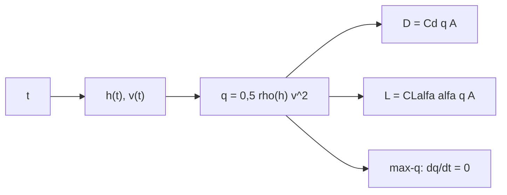

# B77-C03 — Fuerzas aerodinámicas

<!-- nav:top -->
[🏠 Programa](../../../../README.md) · [📚 Bloque B77](../../../tronco-comun/B77-dinamica-de-lanzamiento-y-reentrada.md) · [← Anterior: B77-C02 — Movimiento en atmósfera](../B77-C02-movimiento-en-atmosfera/CLASE.md) · [Siguiente: B77-C04 — Coeficientes de arrastre y sustentación →](../B77-C04-coeficientes-de-arrastre-y-sustentacion/CLASE.md)
<!-- /nav -->

## 1. Ubicación, nivel y alcance

Clase 3 del bloque B77. Nivel N3. Las fuerzas aerodinámicas dependen de la presión dinámica `q = ρV²/2`, que crece con la velocidad y decae con la altitud. Aquí sigues `q` a lo largo de un ascenso sintético, localizas su máximo (max-q) con una fórmula cerrada y calculas arrastre y sustentación en ese instante. Usas [C02](../B77-C02-movimiento-en-atmosfera/CLASE.md) para la atmósfera exponencial.

## 2. Por qué esta clase existe

El momento de mayor carga aerodinámica no es el de mayor velocidad ni el de menor altitud. La decisión central: **¿cuándo ocurre el máximo de la presión dinámica y qué fuerzas produce?**

## 3. Lo que podrás hacer al terminar

1. Calcular la presión dinámica `q` a partir de `ρ` y `V`.
2. Calcular arrastre y sustentación con coeficientes y área de referencia.
3. Deducir el instante de max-q en un ascenso de aceleración constante.
4. Contrastar la fórmula con un barrido numérico.
5. Interpretar por qué max-q ocurre a una altitud igual a la altura de escala en este modelo.
6. Separar lo consultado (ρ₀, H, definiciones) de lo ilustrativo (ascenso, coeficientes).

La evidencia es la **ficha de cargas aerodinámicas en max-q** del ejercicio 12 (sección 20).

## 4. Con qué llegas y cómo comprobarlo

1. ¿Qué es la presión dinámica?
2. ¿Qué es el arrastre?
3. ¿Qué es la sustentación?
4. ¿Cómo se halla el máximo de una función?
5. ¿Qué es un dato sintético?

<details>
<summary>Ver respuestas</summary>

1. La energía cinética del flujo por unidad de volumen, `ρV²/2`, en Pa. 2. La componente de la fuerza aerodinámica opuesta a la velocidad. 3. La componente perpendicular a la velocidad. 4. Anulando su derivada. 5. Un dato generado para el ejemplo, no medido.
</details>

Con cuatro o cinco aciertos, sigue; si no, repasa los prerrequisitos.

## 5. Un caso de contexto y casos de referencia

Un ascenso vertical sintético con aceleración constante de `20 m/s²` tiene su máximo de presión dinámica a los `29,155 s`, a `8500 m` y `583,1 m/s`, con `q = 76111 Pa`. Con `A = 10 m²`, `Cd = 0,3` y `α = 2°` el arrastre es `228,3 kN` y la sustentación `53,1 kN`. Es el **ejemplo conductor**; todo es **ilustrativo** (ningún cohete real acelera así).

## 6. Vocabulario

La **presión dinámica** es `q = ρV²/2`. La **fuerza aerodinámica** se descompone en **arrastre** `D = Cd·q·A` y **sustentación** `L = CL·q·A`. **Max-q** es el instante en que `q` es máximo. El **ángulo de ataque** `α` es el que forman el eje del vehículo y la velocidad relativa al aire. El **área de referencia** `A` debe indicarse siempre con el coeficiente.

## 7. Modelo mental



*Descripción textual:* el tiempo da altitud y velocidad; de ahí sale la presión dinámica, con la que se calculan arrastre, sustentación y el máximo de `q`.

Analogía: sacar la mano por la ventanilla de un coche: la fuerza crece con la velocidad al cuadrado, pero en la cumbre de una montaña el aire es más fino. Límite: el ascenso de aceleración constante es una simplificación; en un cohete real la aceleración cambia con el empuje y la masa.

## 8. La explicación, paso a paso

### 8.1 Presión dinámica

Con `ρ(h) = ρ₀ e^(−h/H)`, `ρ₀ = 1,217 kg/m³` y `H = 8500 m`: `q = 0,5·ρ₀·e^(−h/H)·v²`. En el ascenso sintético `h = at²/2` y `v = at`.

### 8.2 Max-q en forma cerrada

`ln q = const − at²/(2H) + 2 ln t`. Su derivada es `−at/H + 2/t`, que se anula en `t* = √(2H/a) = 29,1548 s`. A ese instante `h = a t*²/2 = H = 8500 m`: en este modelo max-q ocurre justo a una altura de escala. El valor es `q* = 0,5·ρ₀·a²·t*²·e^(−1) = 76110,6 Pa`.

### 8.3 Verificación numérica

Un barrido de `q(t)` con paso de 1 ms da `t = 29,155 s` y `q = 76110,6 Pa`, iguales a la fórmula.

### 8.4 Fuerzas en max-q

Con `A = 10 m²`: `D = 0,3 × 76111 × 10 = 228,33 kN`. Con `CL_α = 2,0 /rad` y `α = 2° = 0,0349 rad`: `L = 2,0 × 0,0349 × 76111 × 10 = 53,14 kN`. Una sustentación pequeña ya carga la estructura de forma lateral.

## 9. Magnitudes, símbolos y unidades

| Símbolo | Qué es | Unidad | Valor / nota |
|---|---|---|---|
| `q` | presión dinámica | Pa | 76111 en max-q |
| `ρ₀`, `H` | densidad y altura de escala | kg/m³, m | 1,217; 8500 (NASA/NSSDC) |
| `Cd` | coeficiente de arrastre | — | 0,3 (ilustrativo) |
| `CL_α` | pendiente de sustentación | 1/rad | 2,0 (ilustrativo) |
| `A` | área de referencia | m² | 10 (ilustrativo) |
| `t*` | instante de max-q | s | 29,155 |

## 10. Convenciones y referencias

Eje vertical local, ascenso con `a = 20 m/s²`; fuerzas en ejes del viento. `ρ₀` y `H` de la ficha de la NASA/NSSDC; el ascenso, los coeficientes y el área son ilustrativos.

## 11. De dónde sale lo que afirmamos

| ID | Fuente | Localizador | Respalda | Estado |
|---|---|---|---|---|
| S1 | NASA Glenn, Drag Coefficient — https://www1.grc.nasa.gov/beginners-guide-to-aeronautics/drag-coefficient/ (consultada 2026-11-10) | página completa | D = Cd·q·A y q = ρV²/2; el área de referencia debe indicarse | Consultada |
| S2 | NASA/NSSDC, Earth Fact Sheet — https://nssdc.gsfc.nasa.gov/planetary/factsheet/earthfact.html (consultada 2026-11-10) | ficha completa leída | ρ₀ = 1,217 kg/m³ y altura de escala 8,5 km | Consultada |
| — | Descomposición de la fuerza aerodinámica en arrastre y sustentación y condición de máximo dq/dt = 0 | — | las verifica el laboratorio con una segunda vía | No consultada en una fuente concreta |

Límites: el ascenso de aceleración constante y los coeficientes son sintéticos; la atmósfera exponencial no es la real; no se consultó ningún perfil de vuelo real.

## 12. Cómo ver el resultado

| Magnitud | Valor |
|---|---|
| `t*` analítico | 29,1548 s |
| `t*` numérico | 29,155 s |
| `h` en max-q | 8500 m |
| `q*` | 76110,6 Pa |
| `D` / `L` | 228,3 kN / 53,1 kN |

Descripción larga: la presión dinámica sube, alcanza un máximo cuando el aire ya es más fino y vuelve a caer aunque la velocidad siga subiendo.

## 13. Ejemplo trabajado: el instante de max-q

**Paso 1 · Derivada.** `d(ln q)/dt = −at/H + 2/t`.

**Paso 2 · Cero.** `t*² = 2H/a = 2×8500/20 = 850 s²`.

**Paso 3 · Instante.** `t* = 29,1548 s`.

**Paso 4 · Altitud.** `h = 0,5×20×850 = 8500 m`.

## 14. Distintas formas de describir el resultado

**Por tiempo:** `q(t)`. **Por altitud:** `q(h)`. **Por fuerzas:** `D` y `L`. **Por tabla:** `t`, `h`, `v`, `q`. **Por condición:** `dq/dt = 0`.

## 15. Práctica guiada

**Ejercicio 1 · con los pasos indicados.** Calcula `q` a 400 m/s con `ρ = 0,5 kg/m³`. *Pasos:* `0,5·ρ·V²`.

<details><summary>Solución comentada</summary>

`0,5 × 0,5 × 160000 = 40000 Pa`.
</details>

**Ejercicio 2 · con una pista.** Calcula `D` con `Cd = 0,3` y `A = 10 m²` si `q = 40000 Pa`. *Pista:* `D = Cd q A`.

<details><summary>Solución comentada</summary>

`0,3 × 40000 × 10 = 120 kN`.
</details>

**Ejercicio 3 · casi autónomo.** ¿Por qué `q` baja después de max-q aunque `v` aumente?

<details><summary>Solución comentada</summary>

Porque `ρ` cae exponencialmente más rápido de lo que `v²` crece.
</details>

## 16. Práctica autónoma, transferencia e integrador

**Ejercicio 4 · autónomo.** ¿Cuánto vale `t*` si `a = 30 m/s²`?

<details><summary>Solución comentada</summary>

`√(2×8500/30) = 23,81 s`.
</details>

**Ejercicio 5 · autónomo.** Altitud de max-q si `a = 30 m/s²`.

<details><summary>Solución comentada</summary>

Sigue siendo `H = 8500 m` en este modelo.
</details>

**Ejercicio 6 · autónomo.** Sustentación con `α = 4°` en max-q.

<details><summary>Solución comentada</summary>

Se duplica respecto de 2°: `106,3 kN`.
</details>

**Ejercicio 7 · autónomo.** `q` a los 20 s del ascenso sintético.

<details><summary>Solución comentada</summary>

`60 814 Pa` (tabla del laboratorio).
</details>

**Ejercicio 8 · autónomo.** ¿Cómo cambia `q*` si `ρ₀` se reduce a la mitad?

<details><summary>Solución comentada</summary>

Se reduce a la mitad, porque `q* ∝ ρ₀`.
</details>

**Ejercicio 9 · transferencia.** **Transferencia.** Un cohete real alcanza max-q a 12 km. ¿Contradice el modelo?

<details><summary>Solución comentada</summary>

No: el modelo es un caso sintético de aceleración constante; en un vuelo real `a` cambia con el tiempo.
</details>

**Ejercicio 10 · transferencia.** **Transferencia.** Un colega da `Cd = 0,3` sin área. ¿Qué falta?

<details><summary>Solución comentada</summary>

El área de referencia: sin ella `Cd` no permite calcular la fuerza.
</details>

**Ejercicio 11 · transferencia.** **Transferencia.** ¿Qué pasa con `D` si el vehículo gira y aumenta `α`?

<details><summary>Solución comentada</summary>

En general `Cd` también cambia con `α`; el modelo de `Cd` constante deja de valer.
</details>

**Ejercicio 12 · integrador.** **Integrador.** Elabora tu *ficha de cargas aerodinámicas en max-q*: `t*`, `h`, `v`, `q`, `D`, `L`, comparación numérica y lista de qué es consultado e ilustrativo.

<details><summary>Solución comentada</summary>

Secciones 8.1–8.4 y la salida del laboratorio.
</details>

## 17. Laboratorio: presión dinámica y max-q

El script [presion_dinamica.py](presion_dinamica.py) tabula `q(t)` en un ascenso sintético, halla max-q por barrido y por fórmula y calcula `D` y `L` (**comprueba** `t*` < 1e-3 y `q*` < 1e-5 frente al análisis, y el factor `e` en `q`).

**Datos:** `ρ₀` y `H` consultados; ascenso, coeficientes y área **ilustrativos**. **Predice antes de ejecutar:** ¿a qué altitud ocurre max-q? (a `H = 8500 m`.) **Ejecución del 2026-11-10 (Python 3.12.9):**

```text
Python 3.12.9 (biblioteca estandar)
Ascenso SINTETICO: a = 20.0 m/s2 constante, Cd = 0.3, CLalfa = 2.0/rad, alfa = 2 grados, A = 10.0 m2
  t [s]   h [m]    v [m/s]   q [Pa]
   10.0      1000    200.0    21638.5
   20.0      4000    400.0    60814.4
   30.0      9000    600.0    75984.0
   40.0     16000    800.0    59285.0
   50.0     25000   1000.0    32131.0
   60.0     36000   1200.0    12684.1
Max-q analitico: t* = 29.1548 s, h = 8500.0 m, v = 583.10 m/s, q = 76110.6 Pa
Max-q numerico : t* = 29.155 s, q = 76110.6 Pa
En max-q: arrastre D = 228.33 kN; sustentacion L = 53.14 kN (alfa = 2 grados)
q sin el factor exp(-h/H) en t*: 206890 Pa (el aire fino ya ha reducido q en un factor e)
Pruebas superadas.
```

```bash
python programa/clases/B77/B77-C03-fuerzas-aerodinamicas/presion_dinamica.py
```

**Límites:** aceleración constante, atmósfera exponencial, `Cd` y `CL_α` constantes; sin viento ni número de Mach.

## 18. Errores frecuentes y cómo corregirlos

**Pensar que max-q es el instante de mayor velocidad.** Se corrige con 8.2.

**Dar `Cd` sin su área de referencia.** Se corrige con el vocabulario (sección 6).

**Presentar el ascenso sintético como el de un cohete real.** Se corrige con la sección 10.

**Confundir `q` (Pa) con una fuerza.** Se corrige con 8.4.

## 19. Cómo sabrás que vas bien

Tras la sección 8: ¿qué `t*` esperabas y cuál obtuviste? Si dudas, repasa el ejemplo 13. Tras el laboratorio: ¿qué comprueba? (ver la sección 17).

## 20. Qué entregas y cómo se evalúa

El producto es tu **ficha de cargas aerodinámicas en max-q** (ejercicio 12).

| Criterio | Inicial | En desarrollo | Logrado | Destacado |
|---|---|---|---|---|
| Conceptos | Los confunde | Parciales | Aplica el modelo con sus supuestos | Explica los límites |
| Cálculo | Sin unidades | Con errores | Tablas completas con unidades | Calcula casos nuevos |
| Numérico | Sin comprobar | Un caso | Contraste con una segunda vía | Interpreta las diferencias |
| Fuentes | Sin fuente | Sin fecha | Fuentes con fecha y estado | Declara lo ilustrativo y lo no consultado |
| Límites | No los nombra | Uno | Tres | Discute qué falta del modelo |

**Condiciones críticas (no se compensan con promedio):** rotular el ascenso y los coeficientes como ilustrativos; no presentar el resultado como un perfil de vuelo real; citar solo lo consultado.

## 21. Ética, seguridad y límites

Clase educativa: los modelos son simplificados y sus datos son sintéticos o ilustrativos; ningún resultado describe un vehículo real ni sustituye al análisis de seguridad, a la certificación o a los documentos del operador. Nada de lo simulado se presenta como observado ni como datos de vuelo. Accesibilidad: tablas equivalentes a las gráficas, fórmulas en texto, ejercicios sin conexión.

## 22. Para cerrar y seguir

En un ascenso sintético la presión dinámica llega a `76111 Pa` a los `29,2 s` y a `8500 m`. Queda una pregunta: ¿de qué dependen `Cd` y `CL`, que aquí tomamos constantes?

**Glosario español–inglés.** presión dinámica · *dynamic pressure*; arrastre · *drag*; sustentación · *lift*; ángulo de ataque · *angle of attack*; área de referencia · *reference area*.

**Continuidad.** [siguiente]

**Referencias:** ver sección 11.

<!-- nav:bottom -->
---

[← Anterior: B77-C02 — Movimiento en atmósfera](../B77-C02-movimiento-en-atmosfera/CLASE.md) · [📚 Bloque B77](../../../tronco-comun/B77-dinamica-de-lanzamiento-y-reentrada.md) · [Siguiente: B77-C04 — Coeficientes de arrastre y sustentación →](../B77-C04-coeficientes-de-arrastre-y-sustentacion/CLASE.md)
<!-- /nav -->
