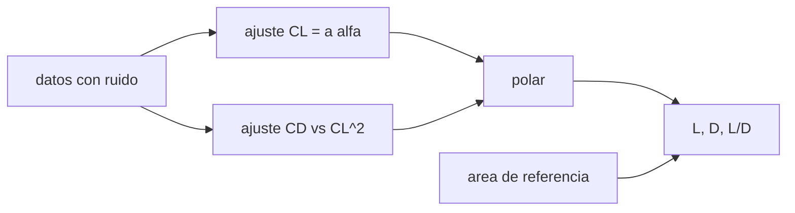

# B77-C04 — Coeficientes de arrastre y sustentación

<!-- nav:top -->
[🏠 Programa](../../../../README.md) · [📚 Bloque B77](../../../tronco-comun/B77-dinamica-de-lanzamiento-y-reentrada.md) · [← Anterior: B77-C03 — Fuerzas aerodinámicas](../B77-C03-fuerzas-aerodinamicas/CLASE.md) · [Siguiente: B77-C05 — Ecuación de cohete ideal →](../B77-C05-ecuacion-de-cohete-ideal/CLASE.md)
<!-- /nav -->

## 1. Ubicación, nivel y alcance

Clase 4 del bloque B77. Nivel N3. Los coeficientes de arrastre y sustentación resumen la forma, la inclinación y el régimen de flujo en un número adimensional. Aquí ajustas esos coeficientes a datos **sintéticos** de túnel con mínimos cuadrados, construyes la polar de arrastre y ves por qué un coeficiente sin su área de referencia no sirve. Usas [C03](../B77-C03-fuerzas-aerodinamicas/CLASE.md) para las fuerzas. Ningún dato proviene de un túnel real.

## 2. Por qué esta clase existe

Un coeficiente se mide en un túnel y se usa en vuelo. La decisión central: **¿cómo se obtienen y se declaran `Cd` y `CL` para que las fuerzas calculadas sean reproducibles y de qué dependen?**

## 3. Lo que podrás hacer al terminar

1. Definir `Cd` y `CL` con presión dinámica y área de referencia.
2. Ajustar `CL_α` por mínimos cuadrados a datos con ruido.
3. Ajustar la polar de arrastre `CD = CD₀ + k·CL²`.
4. Calcular `L`, `D` y la eficiencia `L/D` en un ángulo de ataque.
5. Comprobar que la fuerza no depende del área de referencia elegida.
6. Separar lo consultado (definición de `Cd`) de lo sintético (datos, polar y `Cd(M)`).

La evidencia es la **ficha de coeficientes aerodinámicos** del ejercicio 12 (sección 20).

## 4. Con qué llegas y cómo comprobarlo

1. ¿Qué es un coeficiente adimensional?
2. ¿Qué son los mínimos cuadrados?
3. ¿Qué es el ángulo de ataque?
4. ¿Qué es la presión dinámica?
5. ¿Qué es una semilla aleatoria?

<details>
<summary>Ver respuestas</summary>

1. Un cociente sin unidades que normaliza una magnitud. 2. Un método que ajusta una recta minimizando la suma de residuos al cuadrado. 3. El ángulo entre el eje del cuerpo y la velocidad relativa al aire. 4. `ρV²/2`, en Pa. 5. El valor que fija una secuencia pseudoaleatoria para repetir el cálculo.
</details>

Con cuatro o cinco aciertos, sigue; si no, repasa los prerrequisitos.

## 5. Un caso de contexto y casos de referencia

Con `13` puntos sintéticos (semilla 7, `σ = 0,003`) el ajuste recupera `CL_α = 2,3987 ± 0,0101 /rad` (entrada: 2,4), `CD₀ = 0,2976 ± 0,0010` (0,30) y `k = 0,8785 ± 0,0300` (0,8). A `α = 4°` y `q = 20 000 Pa`, con `A = 10 m²`: `L = 33,51 kN` y `D = 64,49 kN`. Es el **ejemplo conductor**; los datos **no son medidos**.

## 6. Vocabulario

El **coeficiente de arrastre** es `Cd = D/(q·A)` y el de **sustentación** `CL = L/(q·A)`. La **polar de arrastre** modela `CD = CD₀ + k·CL²`. La **eficiencia aerodinámica** es `L/D`. El **número de Mach** `M` es la velocidad entre la del sonido y cambia `Cd`. El **área de referencia** `A` es la superficie con la que se normaliza.

## 7. Modelo mental



*Descripción textual:* los datos con ruido alimentan dos ajustes lineales que forman la polar; con la polar, la presión dinámica y el área se obtienen `L`, `D` y `L/D`.

Analogía: la tabla de calorías por porción: el número sirve solo si se sabe qué porción se usó como referencia. Límite: la polar parabólica y los coeficientes constantes solo valen en un rango de `α` y de Mach.

## 8. La explicación, paso a paso

### 8.1 Coeficientes

`CL = L/(q·A)` y `Cd = D/(q·A)`. Si cambias `A`, cambia el coeficiente, no la fuerza.

### 8.2 Ajuste lineal

La recta `CL = a·α` por mínimos cuadrados da `a = 2,3987 ± 0,0101 /rad`. Al ajustar `CD` frente a `CL²` se obtienen `CD₀ = 0,2976` y `k = 0,8785`. Los tres valores de entrada quedan dentro de 3 `σ` del ajuste; `k` y `CD₀` quedan a unos 2,6 y 2,4 `σ`: el ajuste de `CD` frente a un `CL` ruidoso sesga ligeramente la pendiente.

### 8.3 Fuerzas y eficiencia

A `α = 4°`: `CL = 0,1676`, `CD = 0,3225`, `L/D = 0,520`. El máximo de la polar es `L/D = 1/(2√(CD₀k)) = 1,021` con `CL = √(CD₀/k) = 0,6124`. Un cuerpo romo de lanzador tiene `L/D` pequeña.

### 8.4 El área de referencia y el Mach

Si `A` pasa de 10 a 4 m², `Cd` pasa de 0,3225 a 0,8061 y `D` no cambia (diferencia relativa 1e-16). El coeficiente sintético `Cd(M)` sube en el régimen transónico (`M ≈ 1,1`) y baja en supersónico: ese pico existe en los vehículos reales, pero esta curva es inventada.

## 9. Magnitudes, símbolos y unidades

| Símbolo | Qué es | Unidad | Valor / nota |
|---|---|---|---|
| `Cd`, `CL` | coeficientes de arrastre y sustentación | — | 0,3225; 0,1676 a 4° |
| `CL_α` | pendiente de sustentación | 1/rad | 2,399 (sintético) |
| `CD₀`, `k` | parámetros de la polar | — | 0,298; 0,878 (sintéticos) |
| `q` | presión dinámica | Pa | 20 000 (ilustrativo) |
| `A` | área de referencia | m² | 10 y 4 (ilustrativo) |
| `L/D` | eficiencia aerodinámica | — | 0,520 a 4° |

## 10. Convenciones y referencias

Ejes del viento, SI. Datos de túnel **sintéticos** (semilla 7); la definición de `Cd` es de la NASA Glenn. `CL_α`, `CD₀`, `k`, `q`, áreas y la curva `Cd(M)` son ilustrativos.

## 11. De dónde sale lo que afirmamos

| ID | Fuente | Localizador | Respalda | Estado |
|---|---|---|---|---|
| S1 | NASA Glenn, Drag Coefficient — https://www1.grc.nasa.gov/beginners-guide-to-aeronautics/drag-coefficient/ (consultada 2026-11-10) | página completa | Cd = D/(q·A) y el área de referencia debe declararse | Consultada |
| — | Polar parabólica de arrastre, ajuste por mínimos cuadrados y eficiencia máxima 1/(2√(CD₀k)) | — | las verifica el laboratorio con una segunda vía | No consultada en una fuente concreta |

Límites: los datos son generados por el laboratorio; ningún coeficiente es de un vehículo real; no se consultó ningún informe de túnel.

## 12. Cómo ver el resultado

| Magnitud | Valor |
|---|---|
| `CL_α` ajustado | 2,3987 /rad |
| `CD₀`, `k` ajustados | 0,2976; 0,8785 |
| `L`, `D` a 4° | 33,51 kN; 64,49 kN |
| `L/D` máximo | 1,021 |
| dif. de `D` al cambiar `A` | 1e-16 |

Descripción larga: el ajuste recupera los parámetros de entrada con incertidumbres pequeñas; cambiar el área cambia el coeficiente pero no la fuerza.

## 13. Ejemplo trabajado: la fuerza de arrastre a 4°

**Paso 1 · Sustentación.** `CL = 2,4 × 0,0698 = 0,1676`.

**Paso 2 · Polar.** `CD = 0,30 + 0,8 × 0,1676² = 0,3225`.

**Paso 3 · Fuerza.** `D = 0,3225 × 20 000 × 10 = 64,49 kN`.

## 14. Distintas formas de describir el resultado

**Por tabla:** `α`, `CL`, `CD`. **Por polar:** `CD` frente a `CL`. **Por fuerza:** `L` y `D`. **Por eficiencia:** `L/D`. **Por Mach:** `Cd(M)`.

## 15. Práctica guiada

**Ejercicio 1 · con los pasos indicados.** Calcula `CL` a 2° con `CL_α = 2,4 /rad`. *Pasos:* convierte a radianes y multiplica.

<details><summary>Solución comentada</summary>

`2° = 0,03491 rad`; `CL = 0,0838`.
</details>

**Ejercicio 2 · con una pista.** Calcula `D` si `Cd = 0,3`, `q = 20 000 Pa` y `A = 10 m²`. *Pista:* `D = Cd q A`.

<details><summary>Solución comentada</summary>

`60 kN`.
</details>

**Ejercicio 3 · casi autónomo.** ¿Por qué el ajuste de `CD` frente a `CL²` sesga la pendiente cuando `CL` tiene ruido?

<details><summary>Solución comentada</summary>

Porque el ruido en la variable explicativa atenúa o distorsiona la pendiente; es el problema de errores en las variables.
</details>

## 16. Práctica autónoma, transferencia e integrador

**Ejercicio 4 · autónomo.** `Cd` equivalente si `A` pasa de 10 a 5 m² con `D` fijo.

<details><summary>Solución comentada</summary>

Se duplica: `Cd₂ = Cd₁·A₁/A₂`.
</details>

**Ejercicio 5 · autónomo.** `L/D` máximo si `CD₀ = 0,2` y `k = 0,5`.

<details><summary>Solución comentada</summary>

`1/(2√0,1) = 1,581`.
</details>

**Ejercicio 6 · autónomo.** `CL` de máxima eficiencia en ese caso.

<details><summary>Solución comentada</summary>

`√(0,2/0,5) = 0,632`.
</details>

**Ejercicio 7 · autónomo.** ¿Cuántos grados de ataque dan `CL = 0,6124` con `CL_α = 2,4`?

<details><summary>Solución comentada</summary>

`0,6124/2,4 = 0,2552 rad = 14,6°`.
</details>

**Ejercicio 8 · autónomo.** `D` a `M = 1,1` con `q = 20 000 Pa` y `A = 10 m²` según la curva sintética.

<details><summary>Solución comentada</summary>

`0,55 × 20 000 × 10 = 110 kN`.
</details>

**Ejercicio 9 · transferencia.** **Transferencia.** Un colega compara `Cd` de dos vehículos con áreas distintas. ¿Es válido?

<details><summary>Solución comentada</summary>

Solo si se normalizan con la misma referencia; si no, se comparan `Cd·A`.
</details>

**Ejercicio 10 · transferencia.** **Transferencia.** Un informe da `Cd = 0,3` para un lanzador sin Mach. ¿Qué falta?

<details><summary>Solución comentada</summary>

El número de Mach y el ángulo de ataque, porque `Cd` varía mucho con ambos.
</details>

**Ejercicio 11 · transferencia.** **Transferencia.** ¿Qué cambia si el ruido sube a `σ = 0,01`?

<details><summary>Solución comentada</summary>

Las incertidumbres del ajuste aumentan en la misma proporción y los parámetros recuperados se alejan más de la entrada.
</details>

**Ejercicio 12 · integrador.** **Integrador.** Elabora tu *ficha de coeficientes aerodinámicos*: ajuste de `CL_α`, `CD₀` y `k` con incertidumbre, `L`, `D` y `L/D` en un ángulo, efecto del área y lista de qué es consultado, sintético e ilustrativo.

<details><summary>Solución comentada</summary>

Secciones 8.1–8.4 y la salida del laboratorio.
</details>

## 17. Laboratorio: coeficientes aerodinámicos a partir de datos sintéticos

El script [polar.py](polar.py) genera datos sintéticos con ruido (semilla 7), los ajusta por mínimos cuadrados y calcula `L`, `D` y `L/D` (**comprueba** que los tres parámetros de entrada quedan dentro de 3 `σ` y que `D` es invariante al cambiar el área con 1e-12).

**Datos:** la definición de `Cd` es consultada; datos, polar y `Cd(M)` son **sintéticos** (no medidos). **Predice antes de ejecutar:** ¿cuánto vale `Cd` si el área baja de 10 a 4 m²? (sube a 0,8061 con `D` constante.) **Ejecución del 2026-11-10 (Python 3.12.9):**

```text
Python 3.12.9 (biblioteca estandar)
Datos SINTETICOS de tunel (semilla 7, 13 puntos, sigma = 0.003); verdad de entrada CL_alfa = 2.4, CD0 = 0.3, k = 0.8
Ajuste CL_alfa = 2.3987 +- 0.0101 /rad
Ajuste CD0 = 0.2976 +- 0.0010; k = 0.8785 +- 0.0300
A alfa = 4 grados: CL = 0.1676, CD = 0.3225, L = 33.51 kN, D = 64.49 kN, L/D = 0.520
L/D maximo de la polar = 1.021 con CL = 0.6124
Cambio de area de referencia 10 -> 4 m2: Cd pasa de 0.3225 a 0.8061; D identica (dif. relativa 1.1e-16)
Cd(M) sintetico: M0.5=0.300, M0.9=0.320, M1.0=0.435, M1.1=0.550, M1.5=0.483, M2.0=0.400, M3.0=0.375
Pruebas superadas.
```

```bash
python programa/clases/B77/B77-C04-coeficientes-de-arrastre-y-sustentacion/polar.py
```

**Límites:** polar parabólica, sin Mach en el ajuste, `α` pequeño; errores en las variables sin corregir.

## 18. Errores frecuentes y cómo corregirlos

**Comparar `Cd` sin comparar el área de referencia.** Se corrige con 8.4.

**Tomar los parámetros ajustados como verdad exacta.** Se corrige con 8.2.

**Tratar los datos sintéticos como datos de túnel.** Se corrige con la sección 10.

**Usar un `Cd` subsónico en régimen transónico.** Se corrige con 8.4.

## 19. Cómo sabrás que vas bien

Tras la sección 8: ¿qué `D` esperabas a 4° y cuál obtuviste? Si dudas, repasa el ejemplo 13. Tras el laboratorio: ¿qué comprueba? (ver la sección 17).

## 20. Qué entregas y cómo se evalúa

El producto es tu **ficha de coeficientes aerodinámicos** (ejercicio 12).

| Criterio | Inicial | En desarrollo | Logrado | Destacado |
|---|---|---|---|---|
| Conceptos | Los confunde | Parciales | Aplica el modelo con sus supuestos | Explica los límites |
| Cálculo | Sin unidades | Con errores | Tablas completas con unidades | Calcula casos nuevos |
| Numérico | Sin comprobar | Un caso | Contraste con una segunda vía | Interpreta las diferencias |
| Fuentes | Sin fuente | Sin fecha | Fuentes con fecha y estado | Declara lo ilustrativo y lo no consultado |
| Límites | No los nombra | Uno | Tres | Discute qué falta del modelo |

**Condiciones críticas (no se compensan con promedio):** rotular los datos como sintéticos y no como medidos; declarar siempre el área de referencia; citar solo lo consultado.

## 21. Ética, seguridad y límites

Clase educativa: los modelos son simplificados y sus datos son sintéticos o ilustrativos; ningún resultado describe un vehículo real ni sustituye al análisis de seguridad, a la certificación o a los documentos del operador. Nada de lo simulado se presenta como observado ni como datos de vuelo. Accesibilidad: tablas equivalentes a las gráficas, fórmulas en texto, ejercicios sin conexión.

## 22. Para cerrar y seguir

Con datos sintéticos se recuperan `CL_α = 2,399`, `CD₀ = 0,298` y `k = 0,878`, y un coeficiente cambia con el área pero la fuerza no. Queda una pregunta: ¿cuánta velocidad da el propelente, sin importar el aire?

**Glosario español–inglés.** coeficiente de arrastre · *drag coefficient*; coeficiente de sustentación · *lift coefficient*; polar de arrastre · *drag polar*; eficiencia aerodinámica · *lift-to-drag ratio*; número de Mach · *Mach number*.

**Continuidad.** [siguiente]

**Referencias:** ver sección 11.

<!-- nav:bottom -->
---

[← Anterior: B77-C03 — Fuerzas aerodinámicas](../B77-C03-fuerzas-aerodinamicas/CLASE.md) · [📚 Bloque B77](../../../tronco-comun/B77-dinamica-de-lanzamiento-y-reentrada.md) · [Siguiente: B77-C05 — Ecuación de cohete ideal →](../B77-C05-ecuacion-de-cohete-ideal/CLASE.md)
<!-- /nav -->
