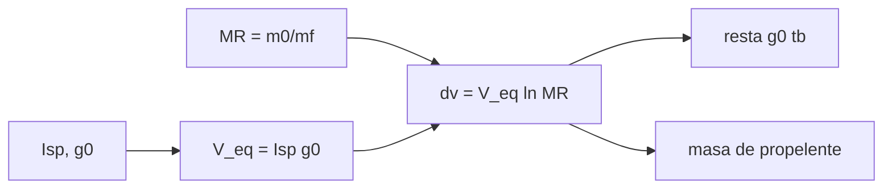

# B77-C05 — Ecuación de cohete ideal

<!-- nav:top -->
[🏠 Programa](../../../../README.md) · [📚 Bloque B77](../../../tronco-comun/B77-dinamica-de-lanzamiento-y-reentrada.md) · [← Anterior: B77-C04 — Coeficientes de arrastre y sustentación](../B77-C04-coeficientes-de-arrastre-y-sustentacion/CLASE.md) · [Siguiente: B77-C06 — Relación masa-impulso →](../../../tronco-comun/B77-dinamica-de-lanzamiento-y-reentrada.md#b77-c06)
<!-- /nav -->

## 1. Ubicación, nivel y alcance

Clase 5 del bloque B77. Nivel N3. La ecuación de cohete ideal relaciona el cambio de velocidad con la velocidad de escape y la razón de masas. Es el cimiento de todo dimensionamiento de lanzadores: [C01](../B77-C01-sistemas-de-lanzamiento/CLASE.md) la usó sin derivarla y aquí la derivas, la integras numéricamente y la contrastas con el ejemplo de la NASA. El cohete es sintético.

## 2. Por qué esta clase existe

El propelente es casi toda la masa de un lanzador porque la velocidad crece solo con el logaritmo de la razón de masas. La decisión central: **¿qué razón de masas y qué `Isp` hacen falta para un `ΔV` dado, y qué parte se pierde por gravedad?**

## 3. Lo que podrás hacer al terminar

1. Escribir y despejar `Δv = Isp·g₀·ln(MR)`.
2. Calcular la razón de masas necesaria para un `Δv`.
3. Integrar numéricamente la aceleración con masa variable y compararla con la forma cerrada.
4. Incluir la pérdida `g₀·t_b` de un ascenso vertical.
5. Reproducir el ejemplo de la página de la NASA y comparar.
6. Separar lo consultado (ecuación, `g₀`) de lo ilustrativo (cohete).

La evidencia es la **ficha de la ecuación de cohete** del ejercicio 12 (sección 20).

## 4. Con qué llegas y cómo comprobarlo

1. ¿Qué es el logaritmo natural?
2. ¿Qué es el impulso específico?
3. ¿Qué es la conservación de la cantidad de movimiento?
4. ¿Qué es la razón de masas?
5. ¿Qué es una integración numérica?

<details>
<summary>Ver respuestas</summary>

1. La función inversa de la exponencial de base e. 2. El empuje por unidad de peso de propelente por segundo, en s. 3. Que la cantidad de movimiento total de un sistema aislado no cambia. 4. La masa inicial dividida por la final. 5. Sumar pasos pequeños para aproximar una integral o una ecuación diferencial.
</details>

Con cuatro o cinco aciertos, sigue; si no, repasa los prerrequisitos.

## 5. Un caso de contexto y casos de referencia

Un cohete sintético de `Isp = 350 s` pasa de `100 000 kg` a `10 000 kg` (`MR = 10`). Su `Δv` ideal es `7903,2 m/s`; con empuje de `1,5 MN` quema `205,9 s` y la gravedad le quita `2019,6 m/s`, por lo que gana `5883,6 m/s`. Es el **ejemplo conductor**; es **ilustrativo**.

## 6. Vocabulario

La **velocidad de escape equivalente** es `V_eq = Isp·g₀`. La **razón de masas** `MR = m_inicial/m_final`. El **cambio de velocidad ideal** es `Δv = V_eq·ln(MR)`. La **masa de propelente** es `m_p = m₀(1 − 1/MR)`. El **tiempo de combustión** `t_b` es la masa de propelente dividida por el gasto másico.

## 7. Modelo mental



*Descripción textual:* el impulso específico da la velocidad equivalente de escape; con la razón de masas se obtiene el `Δv` ideal, al que se resta la pérdida por gravedad y del que sale la masa de propelente.

Analogía: un patinador que lanza ladrillos hacia atrás: cada ladrillo lo impulsa, pero el siguiente empuja a un patinador algo más ligero. Límite: la ecuación ideal ignora el aire, la gravedad variable y el empuje real.

## 8. La explicación, paso a paso

### 8.1 La ecuación

Para un cohete que expulsa masa a velocidad constante `V_eq`, la conservación de la cantidad de movimiento da `dv = −V_eq·dm/m`. Integrando entre `m₀` y `m_f`: `Δv = V_eq·ln(m₀/m_f)`. Con `Isp = 350 s`: `V_eq = 3432,33 m/s`, y con `MR = 10`: `Δv = 7903,226 m/s`.

### 8.2 Con gravedad

En vertical, `dv/dt = F/m − g₀` y el término de gravedad se integra en el tiempo: `Δv = V_eq·ln(MR) − g₀·t_b`. Con `t_b = (100000 − 10000)/(F/V_eq) = 205,94 s` la pérdida es `2019,58 m/s` y el `Δv` queda en `5883,648 m/s`. La integración RK4 da `5883,648 m/s` (error `2,8e-15`).

### 8.3 Cuánto da cada parámetro

| `Isp` (s) | `Δv` con `MR = 10` (m/s) |
|---|---|
| 250 | 5645 |
| 300 | 6774 |
| 350 | 7903 |
| 450 | 10161 |

| `MR` | `Δv` con `Isp = 350 s` (m/s) |
|---|---|
| 2 | 2379 |
| 5 | 5524 |
| 10 | 7903 |
| 20 | 10282 |

Duplicar `MR` de 10 a 20 añade solo `2379 m/s`.

### 8.4 El ejemplo de la NASA

La página de la NASA Glenn usa `Isp ≈ 350 s` y `Δu ≈ 25 000 ft/s` (`7620 m/s`) y concluye `MR ≈ 10`. El cálculo da `MR = 9,21`; la página redondea. Eso implica que el propelente es `89,1 %` de la masa de despegue.

## 9. Magnitudes, símbolos y unidades

| Símbolo | Qué es | Unidad | Valor / nota |
|---|---|---|---|
| `Isp` | impulso específico | s | 350 (ilustrativo) |
| `g₀` | aceleración estándar | m/s² | 9,80665 (NIST) |
| `V_eq` | velocidad de escape equivalente | m/s | 3432,33 |
| `MR` | razón de masas | — | 10 |
| `Δv` | cambio de velocidad | m/s | 7903,2 (ideal) |
| `t_b` | tiempo de combustión | s | 205,9 |

## 10. Convenciones y referencias

`g₀ = 9,80665 m/s²` (NIST). Eje vertical local, `g` constante, sin aire. La ecuación y el ejemplo de 25 000 ft/s son de la NASA Glenn. Masas, `Isp` y empuje ilustrativos.

## 11. De dónde sale lo que afirmamos

| ID | Fuente | Localizador | Respalda | Estado |
|---|---|---|---|---|
| S1 | NASA Glenn, Ideal Rocket Equation — https://www1.grc.nasa.gov/beginners-guide-to-aeronautics/ideal-rocket-equation/ (consultada 2026-11-10) | página completa | Δu = V_eq·ln(m_f/m_e), forma con Isp·g₀ y con gravedad; ejemplo Isp ≈ 350 s, Δu ≈ 25 000 ft/s, MR ≈ 10 | Consultada |
| S2 | NIST, CODATA 2022, standard acceleration of gravity — https://physics.nist.gov/cgi-bin/cuu/Value?gn (consultada 2026-11-10) | entrada gn | g₀ = 9,80665 m/s² (exacto) | Consultada |
| — | Derivación por conservación de la cantidad de movimiento e integración RK4 | — | las verifica el laboratorio con una segunda vía | No consultada en una fuente concreta |

Límites: el cohete es sintético; la ecuación supone `V_eq` constante, masa vacía fija y sin aire; no se consultó la derivación original en un libro de texto.

## 12. Cómo ver el resultado

| Magnitud | Valor |
|---|---|
| `Δv` ideal | 7903,226 m/s |
| `t_b` | 205,94 s |
| pérdida `g₀ t_b` | 2019,58 m/s |
| `Δv` con gravedad | 5883,648 m/s |
| error de integración | 2,8e-15 |

Descripción larga: la gravedad quita más de la cuarta parte del `Δv` ideal en un ascenso vertical con `T/W` bajo; la integración numérica coincide con la forma cerrada.

## 13. Ejemplo trabajado: el Δv ideal con MR = 10

**Paso 1 · Velocidad de escape.** `V_eq = 350 × 9,80665 = 3432,33 m/s`.

**Paso 2 · Logaritmo.** `ln 10 = 2,302585`.

**Paso 3 · Producto.** `Δv = 3432,33 × 2,302585 = 7903,2 m/s`.

## 14. Distintas formas de describir el resultado

**Por fórmula:** `Δv = V_eq ln MR`. **Por tabla:** `Isp` y `MR`. **Por masa:** `m_p`. **Por tiempo:** `t_b`. **Por pérdida:** `g₀ t_b`.

## 15. Práctica guiada

**Ejercicio 1 · con los pasos indicados.** Calcula `V_eq` para `Isp = 450 s`. *Pasos:* multiplica por `g₀`.

<details><summary>Solución comentada</summary>

`450 × 9,80665 = 4412,99 m/s`.
</details>

**Ejercicio 2 · con una pista.** Calcula `MR` para `Δv = 9000 m/s` con `Isp = 350 s`. *Pista:* `exp(Δv/V_eq)`.

<details><summary>Solución comentada</summary>

`exp(9000/3432,33) = 13,76`.
</details>

**Ejercicio 3 · casi autónomo.** ¿Por qué duplicar `MR` no duplica `Δv`?

<details><summary>Solución comentada</summary>

Porque `Δv` crece con `ln MR`: cada duplicación suma `V_eq·ln 2`.
</details>

## 16. Práctica autónoma, transferencia e integrador

**Ejercicio 4 · autónomo.** Suma de `Δv` al duplicar `MR` con `Isp = 350 s`.

<details><summary>Solución comentada</summary>

`3432,33 × 0,6931 = 2379 m/s`.
</details>

**Ejercicio 5 · autónomo.** Propelente como fracción de la masa para `MR = 5`.

<details><summary>Solución comentada</summary>

`1 − 1/5 = 80 %`.
</details>

**Ejercicio 6 · autónomo.** `t_b` si `F = 3 MN` con los mismos datos.

<details><summary>Solución comentada</summary>

`90000 × 3432,33/3e6 = 103,0 s`.
</details>

**Ejercicio 7 · autónomo.** Pérdida por gravedad con `t_b` de la pregunta anterior.

<details><summary>Solución comentada</summary>

`9,80665 × 103,0 = 1010 m/s`.
</details>

**Ejercicio 8 · autónomo.** ¿Qué `Δv` ideal da `Isp = 250 s` con `MR = 10`?

<details><summary>Solución comentada</summary>

`5645 m/s` (tabla de 8.3).
</details>

**Ejercicio 9 · transferencia.** **Transferencia.** Un artículo da `MR = 9,2` y `Isp = 350 s`. ¿Qué `Δv` reproduce?

<details><summary>Solución comentada</summary>

`3432,33 × ln 9,2 = 7617 m/s`, cerca de los 7620 m/s del ejemplo de la NASA.
</details>

**Ejercicio 10 · transferencia.** **Transferencia.** Un colega usa `Isp` en el vacío para un ascenso con aire. ¿Qué sesgo hay?

<details><summary>Solución comentada</summary>

El `Isp` a nivel del mar es menor, así que el `Δv` real es menor que el calculado.
</details>

**Ejercicio 11 · transferencia.** **Transferencia.** ¿Qué pasa si la masa final incluye la carga y esta aumenta?

<details><summary>Solución comentada</summary>

`MR` baja y el `Δv` disminuye; la ecuación no distingue estructura de carga.
</details>

**Ejercicio 12 · integrador.** **Integrador.** Elabora tu *ficha de la ecuación de cohete*: tabla de `Δv` frente a `Isp` y `MR`, pérdida por gravedad, comparación con el ejemplo de la NASA y lista de qué es consultado e ilustrativo.

<details><summary>Solución comentada</summary>

Secciones 8.1–8.4 y la salida del laboratorio.
</details>

## 17. Laboratorio: ecuación de cohete ideal e integración numérica

El script [cohete_ideal.py](cohete_ideal.py) calcula `Δv` ideal y con gravedad, lo contrasta con la integración RK4 de `dv/dt = F/m − g` y reproduce el ejemplo de la NASA (**comprueba** integración < 1e-9 e ida y vuelta de `MR` < 1e-12).

**Datos:** la ecuación, `g₀` y el ejemplo de 25 000 ft/s son consultados; cohete **ilustrativo**. **Predice antes de ejecutar:** ¿gana el cohete más o menos `Δv` que 7903 m/s en vertical? (menos: 5883,6 m/s.) **Ejecución del 2026-11-10 (Python 3.12.9):**

```text
Python 3.12.9 (biblioteca estandar)
Cohete SINTETICO: Isp = 350.0 s (c = 3432.33 m/s), m0 = 100000 kg, mf = 10000 kg (MR = 10.0), F = 1.5 MN
Delta_v ideal = 7903.226 m/s; tiempo de combustion = 205.94 s; perdida g0 tb = 2019.58 m/s
Delta_v con gravedad (cerrada) = 5883.648 m/s; integracion RK4 = 5883.648 m/s; error relativo = 2.78e-15
Delta_v ideal para MR = 10 segun Isp: 250 s -> 5645 m/s; 300 s -> 6774 m/s; 350 s -> 7903 m/s; 450 s -> 10161 m/s
Delta_v ideal para Isp = 350 s segun MR: MR 2 -> 2379 m/s; MR 5 -> 5524 m/s; MR 10 -> 7903 m/s; MR 20 -> 10282 m/s
Ejemplo de la pagina: Delta_u = 25000 ft/s = 7620 m/s con Isp = 350 s da MR = 9.21 (la pagina dice ~10); propelente = 89.1 % de la masa inicial
Ida y vuelta Delta_v -> MR: error relativo = 1.8e-16
Pruebas superadas.
```

```bash
python programa/clases/B77/B77-C05-ecuacion-de-cohete-ideal/cohete_ideal.py
```

**Límites:** vuelo vertical, `g` constante, `Isp` y empuje constantes, sin aire.

## 18. Errores frecuentes y cómo corregirlos

**Usar `log` decimal en lugar de `ln`.** Se corrige con 8.1.

**Olvidar la pérdida por gravedad en un ascenso.** Se corrige con 8.2.

**Esperar que `Δv` sea proporcional a `MR`.** Se corrige con 8.3.

**Tomar el cohete sintético como uno real.** Se corrige con la sección 10.

## 19. Cómo sabrás que vas bien

Tras la sección 8: ¿qué `Δv` esperabas con gravedad y cuál obtuviste? Si dudas, repasa el ejemplo 13. Tras el laboratorio: ¿qué comprueba? (ver la sección 17).

## 20. Qué entregas y cómo se evalúa

El producto es tu **ficha de la ecuación de cohete** (ejercicio 12).

| Criterio | Inicial | En desarrollo | Logrado | Destacado |
|---|---|---|---|---|
| Conceptos | Los confunde | Parciales | Aplica el modelo con sus supuestos | Explica los límites |
| Cálculo | Sin unidades | Con errores | Tablas completas con unidades | Calcula casos nuevos |
| Numérico | Sin comprobar | Un caso | Contraste con una segunda vía | Interpreta las diferencias |
| Fuentes | Sin fuente | Sin fecha | Fuentes con fecha y estado | Declara lo ilustrativo y lo no consultado |
| Límites | No los nombra | Uno | Tres | Discute qué falta del modelo |

**Condiciones críticas (no se compensan con promedio):** rotular el cohete como ilustrativo; no confundir el `Δv` ideal con el real; citar solo lo consultado.

## 21. Ética, seguridad y límites

Clase educativa: los modelos son simplificados y sus datos son sintéticos o ilustrativos; ningún resultado describe un vehículo real ni sustituye al análisis de seguridad, a la certificación o a los documentos del operador. Nada de lo simulado se presenta como observado ni como datos de vuelo. Accesibilidad: tablas equivalentes a las gráficas, fórmulas en texto, ejercicios sin conexión.

## 22. Para cerrar y seguir

Con `Isp = 350 s` y `MR = 10` el `Δv` ideal es `7903 m/s`, y en vertical la gravedad le quita `2020 m/s`. Queda una pregunta: ¿cómo se relacionan el empuje, el consumo y el impulso total?

**Glosario español–inglés.** ecuación de cohete · *rocket equation*; velocidad de escape equivalente · *effective exhaust velocity*; razón de masas · *mass ratio*; tiempo de combustión · *burn time*; propelente · *propellant*.

**Continuidad.** [siguiente]

**Referencias:** ver sección 11.

<!-- nav:bottom -->
---

[← Anterior: B77-C04 — Coeficientes de arrastre y sustentación](../B77-C04-coeficientes-de-arrastre-y-sustentacion/CLASE.md) · [📚 Bloque B77](../../../tronco-comun/B77-dinamica-de-lanzamiento-y-reentrada.md) · [Siguiente: B77-C06 — Relación masa-impulso →](../../../tronco-comun/B77-dinamica-de-lanzamiento-y-reentrada.md#b77-c06)
<!-- /nav -->
