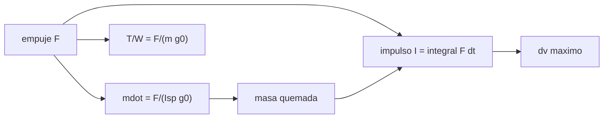

# B77-C06 — Relación masa-impulso

<!-- nav:top -->
[🏠 Programa](../../../../README.md) · [📚 Bloque B77](../../../tronco-comun/B77-dinamica-de-lanzamiento-y-reentrada.md) · [← Anterior: B77-C05 — Ecuación de cohete ideal](../B77-C05-ecuacion-de-cohete-ideal/CLASE.md) · [Siguiente: B77-C07 — Separación de etapas conceptual →](../B77-C07-separacion-de-etapas-conceptual/CLASE.md)
<!-- /nav -->

## 1. Ubicación, nivel y alcance

Clase 6 del bloque B77. Nivel N3. El empuje, el gasto de propelente y el impulso total están ligados por el impulso específico. Aquí conviertes masa de propelente en impulso, integras un perfil de empuje y calculas la relación empuje–peso de despegue y el `Δv` máximo con carga nula. Usas [C05](../B77-C05-ecuacion-de-cohete-ideal/CLASE.md) para `Δv = V_eq·ln MR`. El motor es sintético.

## 2. Por qué esta clase existe

Con el mismo propelente, un motor de empuje alto lo quema rápido y uno de empuje bajo lo quema lento, pero el impulso total es el mismo. La decisión central: **¿cuánto impulso entrega una masa de propelente y qué empuje hace falta para despegar?**

## 3. Lo que podrás hacer al terminar

1. Relacionar empuje, gasto másico e impulso específico con `F = ṁ·Isp·g₀`.
2. Calcular el impulso total `I = m_p·Isp·g₀`.
3. Integrar un perfil de empuje trapezoidal y comprobar el impulso.
4. Calcular la relación empuje–peso de despegue.
5. Calcular el `Δv` máximo con carga nula en función de `Isp` y `ε`.
6. Separar lo consultado (`Isp`, `g₀`) de lo ilustrativo (motor y perfil).

La evidencia es la **ficha masa–impulso de un motor** del ejercicio 12 (sección 20).

## 4. Con qué llegas y cómo comprobarlo

1. ¿Qué es el impulso de una fuerza?
2. ¿Qué es el gasto másico?
3. ¿Qué es la regla del trapecio?
4. ¿Qué es el coeficiente estructural?
5. ¿Qué es la relación empuje–peso?

<details>
<summary>Ver respuestas</summary>

1. La integral de la fuerza en el tiempo, en N·s. 2. La masa que sale por segundo, en kg/s. 3. Una integración numérica que aproxima el área bajo una curva con trapecios. 4. La masa estructural dividida por la suma de estructura y propelente de la etapa. 5. El empuje dividido por el peso del vehículo.
</details>

Con cuatro o cinco aciertos, sigue; si no, repasa los prerrequisitos.

## 5. Un caso de contexto y casos de referencia

Un motor sintético de `Isp = 300 s` y pico `2,0 MN` quema `60 000 kg` con un perfil trapezoidal en `98,07 s`. Entrega `176,520 MN·s` (la integración da el mismo valor, error `7e-13`). Con `80 000 kg` de masa inicial su `T/W` es `2,549`; con `160 000 kg`, `1,275`, apenas por encima de 1. Es el **ejemplo conductor**; es **ilustrativo**.

## 6. Vocabulario

El **gasto másico** es `ṁ = F/(Isp·g₀)`. El **impulso total** es `I = ∫F dt = m_p·Isp·g₀`. El **impulso específico** `Isp = I/(m_p g₀)` mide la eficiencia del propelente. El **perfil de empuje** es la forma de `F(t)`. La **relación empuje–peso** es `T/W = F/(m g₀)`.

## 7. Modelo mental



*Descripción textual:* el empuje y el `Isp` dan el gasto másico; integrados dan la masa quemada y el impulso; el empuje frente al peso da `T/W`, y el impulso fija el `Δv` máximo.

Analogía: un grifo y un balde: el caudal es el gasto, el agua total es la masa y el balde lleno es el impulso. Límite: el `Isp` se supone constante, aunque cambia con la presión ambiente.

## 8. La explicación, paso a paso

### 8.1 Empuje, gasto e impulso

`F = ṁ·V_eq` con `V_eq = Isp·g₀ = 2941,99 m/s`. Con `F = 2,0 MN`: `ṁ = 679,81 kg/s`. Quemar `60 000 kg` a ese gasto tardaría `88,26 s` y entregaría `I = m_p·V_eq = 176,520 MN·s`.

### 8.2 Un perfil de empuje

Si el empuje sube en el 10 % inicial, se mantiene y baja en el 10 % final, la integral de la forma vale `0,9·t_b`, así que `t_b = 98,07 s`. La regla del trapecio da `I = 176,520 MN·s` y masa quemada `60000,000 kg`; el empuje medio es `1,80 MN`. El impulso depende de la masa y del `Isp`, no de la forma del perfil.

### 8.3 Empuje–peso

`T/W = F/(m·g₀)`: `2,549` con 80 t, `1,700` con 120 t y `1,275` con 160 t. Con `T/W` cercano a 1 el despegue es lento y la gravedad cobra mucho (ver [C08](../B77-C08-perdidas-gravitacionales/CLASE.md)).

### 8.4 Límite de `Δv` por estructura

Aun con carga nula, `MR_max = 1/ε` limita el `Δv`: `Δv_max = Isp·g₀·ln(1/ε)` (m/s):

| `Isp` (s) | `ε = 0,06` | `ε = 0,10` | `ε = 0,14` |
|---|---|---|---|
| 250 | 6898 | 5645 | 4820 |
| 300 | 8277 | 6774 | 5784 |
| 350 | 9657 | 7903 | 6748 |
| 450 | 12416 | 10161 | 8676 |

Con `Isp = 300 s`, `ε = 0,10` y `Δv = 4000 m/s`, la razón de carga útil es `π = 0,1742`.

## 9. Magnitudes, símbolos y unidades

| Símbolo | Qué es | Unidad | Valor / nota |
|---|---|---|---|
| `F` | empuje | N | 2,0·10⁶ (pico, ilustrativo) |
| `ṁ` | gasto másico | kg/s | 679,81 |
| `I` | impulso total | N·s | 1,765e+08 |
| `Isp` | impulso específico | s | 300 (ilustrativo) |
| `m_p` | masa de propelente | kg | 60 000 |
| `T/W` | empuje–peso | — | 2,549 (80 t) |

## 10. Convenciones y referencias

`g₀ = 9,80665 m/s²` (NIST). Escalares, SI. Definición de `V_eq = Isp·g₀` de la NASA Glenn. Motor, perfil, masas y `ε` ilustrativos.

## 11. De dónde sale lo que afirmamos

| ID | Fuente | Localizador | Respalda | Estado |
|---|---|---|---|---|
| S1 | NASA Glenn, Ideal Rocket Equation — https://www1.grc.nasa.gov/beginners-guide-to-aeronautics/ideal-rocket-equation/ (consultada 2026-11-10) | página completa | V_eq = Isp·g₀ y su relación con Δv | Consultada |
| S2 | NIST, CODATA 2022, standard acceleration of gravity — https://physics.nist.gov/cgi-bin/cuu/Value?gn (consultada 2026-11-10) | entrada gn | g₀ = 9,80665 m/s² (exacto) | Consultada |
| — | Impulso total I = m_p·Isp·g₀ y regla del trapecio | — | las verifica el laboratorio con una segunda vía | No consultada en una fuente concreta |

Límites: el `Isp` constante no recoge su variación con la presión; el motor y el perfil son sintéticos; no se consultó ningún dato de motor real.

## 12. Cómo ver el resultado

| Magnitud | Valor |
|---|---|
| gasto nominal | 679,81 kg/s |
| impulso total | 176,520 MN·s |
| error del impulso numérico | 6,8e-13 |
| `t_b` del perfil | 98,07 s |
| `T/W` (80 t; 160 t) | 2,549; 1,275 |

Descripción larga: el impulso depende de la masa de propelente y del `Isp`, no del perfil; la relación empuje–peso depende de la masa inicial.

## 13. Ejemplo trabajado: el impulso total de 60 t de propelente

**Paso 1 · Velocidad de escape.** `V_eq = 300 × 9,80665 = 2941,99 m/s`.

**Paso 2 · Impulso.** `I = 60 000 × 2941,99 = 1,765e+08 N·s`.

**Paso 3 · Tiempo.** Con `F = 2,0 MN` constante, `t = I/F = 88,26 s`.

## 14. Distintas formas de describir el resultado

**Por fórmula:** `I = m_p V_eq`. **Por perfil:** `F(t)`. **Por tabla:** `T/W`. **Por límite:** `Δv_max`. **Por gasto:** `ṁ`.

## 15. Práctica guiada

**Ejercicio 1 · con los pasos indicados.** Calcula `ṁ` para `F = 1 MN` y `Isp = 280 s`. *Pasos:* `F/(Isp g₀)`.

<details><summary>Solución comentada</summary>

`1e6/(280 × 9,80665) = 364,2 kg/s`.
</details>

**Ejercicio 2 · con una pista.** Calcula el impulso de 10 t con `Isp = 300 s`. *Pista:* `m_p V_eq`.

<details><summary>Solución comentada</summary>

`10 000 × 2941,99 = 29,42 MN·s`.
</details>

**Ejercicio 3 · casi autónomo.** ¿Por qué el perfil de empuje no cambia el impulso si el propelente es el mismo?

<details><summary>Solución comentada</summary>

Porque `I = ∫F dt = V_eq∫ṁ dt = V_eq·m_p`.
</details>

## 16. Práctica autónoma, transferencia e integrador

**Ejercicio 4 · autónomo.** `T/W` con 100 t y `F = 2,0 MN`.

<details><summary>Solución comentada</summary>

`2e6/(1e5 × 9,80665) = 2,039`.
</details>

**Ejercicio 5 · autónomo.** Empuje mínimo para `T/W = 1,3` con 100 t.

<details><summary>Solución comentada</summary>

`1,3 × 1e5 × 9,80665 = 1,275 MN`.
</details>

**Ejercicio 6 · autónomo.** `Δv_max` con `Isp = 350 s` y `ε = 0,08`.

<details><summary>Solución comentada</summary>

`3432,33 × ln 12,5 = 8669 m/s`.
</details>

**Ejercicio 7 · autónomo.** ¿Qué `ε` da `Δv_max = 9000 m/s` con `Isp = 400 s`?

<details><summary>Solución comentada</summary>

`ε = e^(−9000/3922,66) = 0,1008`.
</details>

**Ejercicio 8 · autónomo.** Tiempo de combustión con empuje medio de 1,8 MN.

<details><summary>Solución comentada</summary>

`1,765e+08/1,8e6 = 98,07 s`.
</details>

**Ejercicio 9 · transferencia.** **Transferencia.** Un motor tiene `Isp = 330 s` en el vacío y 290 s a nivel del mar. ¿Cuál usar en un ascenso?

<details><summary>Solución comentada</summary>

Ninguno solo: el `Isp` va de 290 s a 330 s según sube; un promedio ponderado es una aproximación.
</details>

**Ejercicio 10 · transferencia.** **Transferencia.** Un colega mide `T/W = 0,9` en el banco de un motor. ¿Despega el vehículo?

<details><summary>Solución comentada</summary>

No: el empuje no supera el peso; necesita `T/W > 1`.
</details>

**Ejercicio 11 · transferencia.** **Transferencia.** ¿Qué cambia si el perfil tiene rampas de 20 % en lugar de 10 %?

<details><summary>Solución comentada</summary>

Cambia `t_b` (aumenta) y el empuje medio, pero el impulso total sigue siendo el mismo.
</details>

**Ejercicio 12 · integrador.** **Integrador.** Elabora tu *ficha masa–impulso de un motor*: `ṁ`, `I`, `t_b`, `T/W`, tabla de `Δv_max` y lista de qué es consultado e ilustrativo.

<details><summary>Solución comentada</summary>

Secciones 8.1–8.4 y la salida del laboratorio.
</details>

## 17. Laboratorio: masa, impulso y empuje de un motor sintético

El script [masa_impulso.py](masa_impulso.py) integra un perfil trapezoidal de empuje, calcula `T/W` y la tabla de `Δv_max` (**comprueba** impulso y masa quemada < 1e-9 frente a `m_p·Isp·g₀` y `m_p`).

**Datos:** `V_eq = Isp·g₀` y `g₀` consultados; motor, perfil y `ε` **ilustrativos**. **Predice antes de ejecutar:** ¿cambia el impulso si el perfil es trapezoidal en vez de constante? (no: 176,52 MN·s.) **Ejecución del 2026-11-10 (Python 3.12.9):**

```text
Python 3.12.9 (biblioteca estandar)
Motor SINTETICO: Isp = 300.0 s (c = 2941.99 m/s), F0 = 2.0 MN, m_prop = 60000 kg
Gasto nominal = 679.81 kg/s; tb nominal = 88.26 s; impulso total analitico = 176.520 MN s
Perfil trapezoidal: tb = 98.07 s; impulso integrado = 176.520 MN s; masa quemada = 60000.000 kg
Errores relativos: impulso 6.80e-13; masa 2.10e-12; empuje medio = 1.800 MN
T/W de despegue segun masa inicial: 80000 kg -> 2.549; 120000 kg -> 1.700; 160000 kg -> 1.275
DV maximo con carga nula (c ln(1/eps)) [m/s]:
  Isp [s]   eps=0.06   eps=0.10   eps=0.14
     250       6898       5645       4820
     300       8277       6774       5784
     350       9657       7903       6748
     450      12416      10161       8676
Razon de carga util pi para dv = 4000 m/s, Isp = 300 s, eps = 0.10: 0.1742
Pruebas superadas.
```

```bash
python programa/clases/B77/B77-C06-relacion-masa-impulso/masa_impulso.py
```

**Límites:** `Isp` constante, sin variación con la presión; perfil inventado.

## 18. Errores frecuentes y cómo corregirlos

**Creer que más empuje da más impulso con el mismo propelente.** Se corrige con 8.2.

**Confundir `T/W` con aceleración.** Se corrige con 8.3: la aceleración es `g₀(T/W − 1)` en vertical.

**Usar un solo `Isp` para todo el vuelo.** Se corrige con el ejercicio 9.

**Tomar el motor sintético por uno real.** Se corrige con la sección 10.

## 19. Cómo sabrás que vas bien

Tras la sección 8: ¿qué impulso esperabas y cuál obtuviste? Si dudas, repasa el ejemplo 13. Tras el laboratorio: ¿qué comprueba? (ver la sección 17).

## 20. Qué entregas y cómo se evalúa

El producto es tu **ficha masa–impulso de un motor** (ejercicio 12).

| Criterio | Inicial | En desarrollo | Logrado | Destacado |
|---|---|---|---|---|
| Conceptos | Los confunde | Parciales | Aplica el modelo con sus supuestos | Explica los límites |
| Cálculo | Sin unidades | Con errores | Tablas completas con unidades | Calcula casos nuevos |
| Numérico | Sin comprobar | Un caso | Contraste con una segunda vía | Interpreta las diferencias |
| Fuentes | Sin fuente | Sin fecha | Fuentes con fecha y estado | Declara lo ilustrativo y lo no consultado |
| Límites | No los nombra | Uno | Tres | Discute qué falta del modelo |

**Condiciones críticas (no se compensan con promedio):** rotular el motor y el perfil como ilustrativos; no presentar el impulso como medido; citar solo lo consultado.

## 21. Ética, seguridad y límites

Clase educativa: los modelos son simplificados y sus datos son sintéticos o ilustrativos; ningún resultado describe un vehículo real ni sustituye al análisis de seguridad, a la certificación o a los documentos del operador. Nada de lo simulado se presenta como observado ni como datos de vuelo. Accesibilidad: tablas equivalentes a las gráficas, fórmulas en texto, ejercicios sin conexión.

## 22. Para cerrar y seguir

Con `60 t` de propelente y `Isp = 300 s` el impulso es `176,5 MN·s`, sea cual sea el perfil. Queda una pregunta: ¿cómo se descarta la estructura que ya no sirve?

**Glosario español–inglés.** gasto másico · *mass flow rate*; impulso total · *total impulse*; relación empuje–peso · *thrust-to-weight ratio*; perfil de empuje · *thrust profile*; velocidad de escape · *exhaust velocity*.

**Continuidad.** [siguiente]

**Referencias:** ver sección 11.

<!-- nav:bottom -->
---

[← Anterior: B77-C05 — Ecuación de cohete ideal](../B77-C05-ecuacion-de-cohete-ideal/CLASE.md) · [📚 Bloque B77](../../../tronco-comun/B77-dinamica-de-lanzamiento-y-reentrada.md) · [Siguiente: B77-C07 — Separación de etapas conceptual →](../B77-C07-separacion-de-etapas-conceptual/CLASE.md)
<!-- /nav -->
