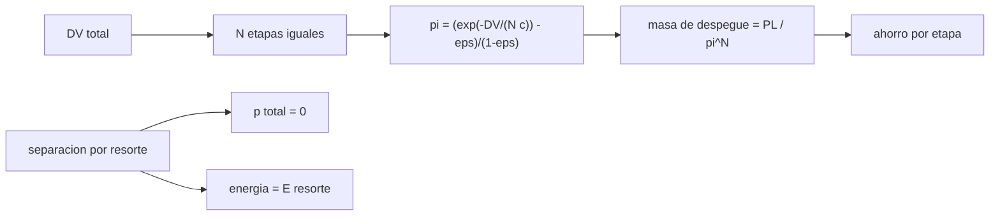

# B77-C07 — Separación de etapas conceptual

<!-- nav:top -->
[🏠 Programa](../../../../README.md) · [📚 Bloque B77](../../../tronco-comun/B77-dinamica-de-lanzamiento-y-reentrada.md) · [← Anterior: B77-C06 — Relación masa-impulso](../B77-C06-relacion-masa-impulso/CLASE.md) · [Siguiente: B77-C08 — Pérdidas gravitacionales →](../B77-C08-perdidas-gravitacionales/CLASE.md)
<!-- /nav -->

## 1. Ubicación, nivel y alcance

Clase 7 del bloque B77. Nivel N3. Descartar la estructura vacía mejora la razón de masas, pero cada separación añade complejidad. Aquí estudias, a nivel conceptual, cuánto ahorra cada etapa adicional y qué dicen la cantidad de movimiento y la energía sobre una separación por resorte. Usas [C05](../B77-C05-ecuacion-de-cohete-ideal/CLASE.md) y [C06](../B77-C06-relacion-masa-impulso/CLASE.md). No se describen mecanismos reales ni pirotecnia.

## 2. Por qué esta clase existe

Un `ΔV` alto es inalcanzable con una sola etapa de estructura moderada, pero cada etapa extra rinde menos. La decisión central: **¿cuántas etapas conviene y qué ocurre mecánicamente al separarlas?**

## 3. Lo que podrás hacer al terminar

1. Calcular la masa de despegue de un lanzador de `N` etapas iguales.
2. Identificar cuándo un `ΔV` es inalcanzable con pocas etapas.
3. Medir el ahorro marginal de añadir una etapa.
4. Aplicar conservación de la cantidad de movimiento a una separación 1D.
5. Calcular las velocidades de retroceso con la energía de un resorte.
6. Separar lo consultado (ecuación, `g₀`) de lo ilustrativo (vehículo y resorte).

La evidencia es la **ficha de escalonamiento y separación** del ejercicio 12 (sección 20).

## 4. Con qué llegas y cómo comprobarlo

1. ¿Qué es una etapa?
2. ¿Qué dice la conservación de la cantidad de movimiento?
3. ¿Qué es la energía elástica?
4. ¿Qué es el coeficiente estructural?
5. ¿Qué es un marco inercial?

<details>
<summary>Ver respuestas</summary>

1. Un bloque de motor y tanques que se descarta al agotarse. 2. Que sin fuerzas externas la cantidad de movimiento total no cambia. 3. La energía almacenada en un resorte comprimido. 4. La estructura dividida por estructura más propelente. 5. Un sistema de referencia sin aceleración.
</details>

Con cuatro o cinco aciertos, sigue; si no, repasa los prerrequisitos.

## 5. Un caso de contexto y casos de referencia

Para `ΔV = 9400 m/s`, `Isp = 330 s` y `ε = 0,08`, una etapa no basta; dos etapas iguales piden `35677 kg` de despegue para `1000 kg` de carga, tres `28910 kg` y seis `25500 kg`. Al separar un cuerpo de `5000 kg` de otro de `8000 kg` con `3000 J` de resorte, se alejan a `1,396 m/s`. Es el **ejemplo conductor**; es **ilustrativo**.

## 6. Vocabulario

El **escalonamiento** es la división del `ΔV` entre etapas. La **separación** es el instante en que dos cuerpos dejan de estar unidos. La **velocidad relativa de separación** es la diferencia de velocidades tras soltarse. La **cantidad de movimiento** es `p = m·v`. La **masa de despegue** es la masa total al inicio.

## 7. Modelo mental



*Descripción textual:* el `ΔV` se reparte en `N` etapas iguales; de la razón de carga útil sale la masa de despegue y el ahorro por etapa; la separación se rige por la conservación de la cantidad de movimiento y la energía del resorte.

Analogía: soltar lastre de un globo: al botar peso el resto sube más fácil, pero cada saco extra pesa menos que el anterior. Límite: aquí cada etapa es idéntica, y en la realidad las etapas son distintas y la separación genera cargas e incertidumbres.

## 8. La explicación, paso a paso

### 8.1 Masa de despegue y número de etapas

Con `c = 330 × 9,80665 = 3236,2 m/s`, `N` etapas iguales con `ΔV/N` cada una: `π = (e^(−ΔV/(N c)) − ε)/(1 − ε)` y masa de despegue `1000/π^N`.

| `N` | `π` por etapa | Masa de despegue (kg) |
|---|---|---|
| 1 | — | inalcanzable |
| 2 | 0,1674 | 35676,9 |
| 3 | 0,3258 | 28909,6 |
| 4 | 0,4389 | 26955,5 |
| 6 | 0,5829 | 25499,9 |

### 8.2 Rendimientos decrecientes

Pasar de 2 a 3 etapas ahorra `6767 kg`; de 3 a 4, `1954 kg`; de 4 a 6, `1456 kg`. Cada etapa añade costo, masa de separación y fallos posibles, por eso los lanzadores reales usan pocas.

### 8.3 La separación como choque inverso

Antes de separar, el marco del centro de masa es inercial y la cantidad de movimiento total vale 0. Tras soltarse: `m₁v₁ + m₂v₂ = 0` y `½m₁v₁² + ½m₂v₂² = E`. Con `m₁ = 5000 kg`, `m₂ = 8000 kg` y `E = 3000 J`: `v₁ = -0,8593 m/s`, `v₂ = 0,5371 m/s`. El cuerpo ligero se mueve más rápido.

### 8.4 Verificación

La cantidad de movimiento total sale `0,0e+00` y la energía `3000,0000 J`, iguales a la entrada. En un caso real hay además rotación, holguras y fuerzas del aire, que este modelo ignora.

## 9. Magnitudes, símbolos y unidades

| Símbolo | Qué es | Unidad | Valor / nota |
|---|---|---|---|
| `N` | número de etapas | — | 1 a 6 |
| `π` | razón de carga útil por etapa | — | 0,1674 (N=2) |
| `c` | velocidad de escape equivalente | m/s | 3236,2 |
| `m₁`, `m₂` | masas que se separan | kg | 5000; 8000 (ilustrativas) |
| `E` | energía del resorte | J | 3000 (ilustrativa) |
| `v_rel` | velocidad relativa tras separar | m/s | 1,396 |

## 10. Convenciones y referencias

`g₀ = 9,80665 m/s²` (NIST). Marco inercial del centro de masa antes de separar, eje 1D, sin aire ni gravedad en la separación. `Isp`, `ε`, masas y energía ilustrativos.

## 11. De dónde sale lo que afirmamos

| ID | Fuente | Localizador | Respalda | Estado |
|---|---|---|---|---|
| S1 | NASA Glenn, Ideal Rocket Equation — https://www1.grc.nasa.gov/beginners-guide-to-aeronautics/ideal-rocket-equation/ (consultada 2026-11-10) | página completa | ecuación de cohete ideal con razón de masas | Consultada |
| S2 | NIST, CODATA 2022, standard acceleration of gravity — https://physics.nist.gov/cgi-bin/cuu/Value?gn (consultada 2026-11-10) | entrada gn | g₀ = 9,80665 m/s² | Consultada |
| — | Escalonamiento en etapas iguales y conservación de la cantidad de movimiento y la energía | — | las verifica el laboratorio con una segunda vía | No consultada en una fuente concreta |

Límites: vehículo y separación sintéticos; no se consultó ningún mecanismo ni especificación de separación de lanzadores reales.

## 12. Cómo ver el resultado

| Magnitud | Valor |
|---|---|
| etapas necesarias | al menos 2 |
| despegue con 2 etapas | 35676,9 kg |
| despegue con 3 etapas | 28909,6 kg |
| `v_rel` de separación | 1,3964 m/s |
| error de energía | 0e+00 |

Descripción larga: la masa de despegue baja con el número de etapas pero con rendimientos decrecientes; la separación reparte la energía del resorte en proporción inversa a las masas.

## 13. Ejemplo trabajado: la separación de dos cuerpos

**Paso 1 · Cantidad de movimiento.** `v₁ = −(m₂/m₁)·v₂ = −1,6·v₂`.

**Paso 2 · Energía.** `3000 = ½·8000·v₂²·(1 + 1,6) = 10400·v₂²`.

**Paso 3 · Velocidades.** `v₂ = 0,5371 m/s` y `v₁ = -0,8593 m/s`.

## 14. Distintas formas de describir el resultado

**Por tabla:** `N` y masa de despegue. **Por ahorro:** diferencia entre `N` y `N+1`. **Por conservación:** `p` y `E`. **Por velocidad relativa:** `v₂ − v₁`.

## 15. Práctica guiada

**Ejercicio 1 · con los pasos indicados.** Calcula `c` para `Isp = 330 s`. *Pasos:* multiplica por `g₀`.

<details><summary>Solución comentada</summary>

`3236,2 m/s`.
</details>

**Ejercicio 2 · con una pista.** `π` de una etapa con `ΔV = 4700 m/s`, `c = 3236,2` y `ε = 0,08`. *Pista:* aplica la fórmula.

<details><summary>Solución comentada</summary>

`(e^(−1,4523) − 0,08)/0,92 = 0,1674`.
</details>

**Ejercicio 3 · casi autónomo.** ¿Por qué una sola etapa no llega a 9400 m/s?

<details><summary>Solución comentada</summary>

Porque `e^(−ΔV/c) = 0,0547` es menor que `ε = 0,08`: `π` sería negativa.
</details>

## 16. Práctica autónoma, transferencia e integrador

**Ejercicio 4 · autónomo.** Masa de despegue con 2 etapas.

<details><summary>Solución comentada</summary>

`35676,9 kg`.
</details>

**Ejercicio 5 · autónomo.** Ahorro de pasar de 3 a 6 etapas.

<details><summary>Solución comentada</summary>

`3410 kg`.
</details>

**Ejercicio 6 · autónomo.** Velocidad de retroceso de un cuerpo de 1000 kg que se separa de otro de 1000 kg con 400 J.

<details><summary>Solución comentada</summary>

`½·1000·v²·2 = 400` → `v = 0,632 m/s` cada uno, en sentidos opuestos.
</details>

**Ejercicio 7 · autónomo.** Si el resorte entrega el doble de energía, ¿cómo cambia `v_rel`?

<details><summary>Solución comentada</summary>

Se multiplica por `√2`.
</details>

**Ejercicio 8 · autónomo.** ¿Qué cuerpo se mueve más rápido tras separar, el ligero o el pesado?

<details><summary>Solución comentada</summary>

El ligero, porque `v ∝ 1/m` con cantidad de movimiento total nula.
</details>

**Ejercicio 9 · transferencia.** **Transferencia.** Un lanzador real tiene 3 etapas. ¿Prueba esto que 3 sea óptimo?

<details><summary>Solución comentada</summary>

No: la elección depende de costo, fiabilidad y estructura; el modelo solo muestra la masa.
</details>

**Ejercicio 10 · transferencia.** **Transferencia.** Un colega ignora la masa de los mecanismos de separación. ¿Qué sesgo introduce?

<details><summary>Solución comentada</summary>

Subestima la masa de despegue, porque cada mecanismo suma masa a la estructura.
</details>

**Ejercicio 11 · transferencia.** **Transferencia.** ¿Qué cambia si la separación ocurre con el vehículo girando?

<details><summary>Solución comentada</summary>

Aparece momento angular y la dinámica de actitud, que este modelo 1D no cubre.
</details>

**Ejercicio 12 · integrador.** **Integrador.** Elabora tu *ficha de escalonamiento y separación*: tabla de `N`, ahorro por etapa, velocidades de separación y lista de qué es consultado e ilustrativo.

<details><summary>Solución comentada</summary>

Secciones 8.1–8.4 y la salida del laboratorio.
</details>

## 17. Laboratorio: número de etapas y separación 1D

El script [etapas.py](etapas.py) calcula la masa de despegue para `N` etapas iguales y resuelve una separación 1D por conservación (**comprueba** cantidad de movimiento y energía < 1e-12 y que dos etapas pesan menos que una cantidad inalcanzable).

**Datos:** la ecuación y `g₀` consultados; vehículo, resorte y masas **ilustrativos**. **Predice antes de ejecutar:** ¿cuántas etapas iguales hacen falta como mínimo? (dos: una sola da `π < 0`.) **Ejecución del 2026-11-10 (Python 3.12.9):**

```text
Python 3.12.9 (biblioteca estandar)
Lanzador SINTETICO: DV = 9400 m/s, Isp = 330.0 s, eps = 0.08, carga util = 1000 kg
 N etapas   pi por etapa   masa de despegue [kg]
       1   inalcanzable (pi <= 0)
       2         0.1674          35676.9
       3         0.3258          28909.6
       4         0.4389          26955.5
       6         0.5829          25499.9
Ahorro al anadir una etapa (kg): 2->3: 6767; 3->4: 1954; 4->6: 1456
Separacion 1D (5000 kg y 8000 kg, resorte 3000 J): v1 = -0.8593 m/s, v2 = 0.5371 m/s, v relativa = 1.3964 m/s
Cantidad de movimiento total = 0.00e+00 kg m/s (error relativo 0.0e+00); energia = 3000.000000 J (error relativo 0.0e+00)
Pruebas superadas.
```

```bash
python programa/clases/B77/B77-C07-separacion-de-etapas-conceptual/etapas.py
```

**Límites:** etapas idénticas, sin masa de mecanismos, separación 1D sin rotación ni aire.

## 18. Errores frecuentes y cómo corregirlos

**Creer que más etapas siempre es mejor.** Se corrige con 8.2.

**Olvidar que el cuerpo ligero retrocede más.** Se corrige con 8.3.

**Aplicar la fórmula con `π` negativa.** Se corrige con el ejercicio 3.

**Tomar el vehículo sintético por uno real.** Se corrige con la sección 10.

## 19. Cómo sabrás que vas bien

Tras la sección 8: ¿qué masa de despegue esperabas con dos etapas y cuál obtuviste? Si dudas, repasa el ejemplo 13. Tras el laboratorio: ¿qué comprueba? (ver la sección 17).

## 20. Qué entregas y cómo se evalúa

El producto es tu **ficha de escalonamiento y separación** (ejercicio 12).

| Criterio | Inicial | En desarrollo | Logrado | Destacado |
|---|---|---|---|---|
| Conceptos | Los confunde | Parciales | Aplica el modelo con sus supuestos | Explica los límites |
| Cálculo | Sin unidades | Con errores | Tablas completas con unidades | Calcula casos nuevos |
| Numérico | Sin comprobar | Un caso | Contraste con una segunda vía | Interpreta las diferencias |
| Fuentes | Sin fuente | Sin fecha | Fuentes con fecha y estado | Declara lo ilustrativo y lo no consultado |
| Límites | No los nombra | Uno | Tres | Discute qué falta del modelo |

**Condiciones críticas (no se compensan con promedio):** rotular el vehículo y el resorte como ilustrativos; no describir mecanismos reales de separación; citar solo lo consultado.

## 21. Ética, seguridad y límites

Clase educativa: los modelos son simplificados y sus datos son sintéticos o ilustrativos; ningún resultado describe un vehículo real ni sustituye al análisis de seguridad, a la certificación o a los documentos del operador. Nada de lo simulado se presenta como observado ni como datos de vuelo. Accesibilidad: tablas equivalentes a las gráficas, fórmulas en texto, ejercicios sin conexión.

## 22. Para cerrar y seguir

Dos etapas iguales bastan para `9400 m/s` con `35677 kg` de despegue, y tres bajan a `28910 kg`. Queda una pregunta: ¿cuánto del `ΔV` se pierde por la gravedad mientras el cohete asciende?

**Glosario español–inglés.** escalonamiento · *staging*; separación de etapas · *stage separation*; cantidad de movimiento · *momentum*; masa de despegue · *gross lift-off mass*; resorte · *spring*.

**Continuidad.** [siguiente]

**Referencias:** ver sección 11.

<!-- nav:bottom -->
---

[← Anterior: B77-C06 — Relación masa-impulso](../B77-C06-relacion-masa-impulso/CLASE.md) · [📚 Bloque B77](../../../tronco-comun/B77-dinamica-de-lanzamiento-y-reentrada.md) · [Siguiente: B77-C08 — Pérdidas gravitacionales →](../B77-C08-perdidas-gravitacionales/CLASE.md)
<!-- /nav -->
