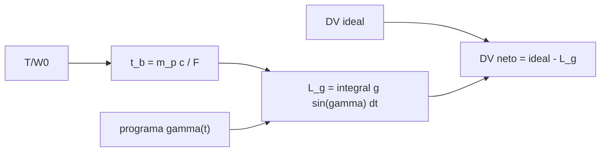

# B77-C08 — Pérdidas gravitacionales

<!-- nav:top -->
[🏠 Programa](../../../../README.md) · [📚 Bloque B77](../../../tronco-comun/B77-dinamica-de-lanzamiento-y-reentrada.md) · [← Anterior: B77-C07 — Separación de etapas conceptual](../B77-C07-separacion-de-etapas-conceptual/CLASE.md) · [Siguiente: B77-C09 — Pérdidas aerodinámicas →](../B77-C09-perdidas-aerodinamicas/CLASE.md)
<!-- /nav -->

## 1. Ubicación, nivel y alcance

Clase 8 del bloque B77. Nivel N3. Mientras el motor trabaja, la gravedad sigue frenando al vehículo. La pérdida gravitacional es la parte del `Δv` ideal que se gasta en vencer el peso, y depende de cuánto dura la combustión y de cuán inclinada va la trayectoria. Usas [C05](../B77-C05-ecuacion-de-cohete-ideal/CLASE.md) y [C06](../B77-C06-relacion-masa-impulso/CLASE.md) para el `Δv` y el empuje. El cohete es sintético.

## 2. Por qué esta clase existe

Un `Δv` ideal alto no garantiza velocidad alta al final. La decisión central: **¿cuánto del `Δv` se pierde por gravedad y cómo se reduce con más empuje o con una trayectoria más inclinada?**

## 3. Lo que podrás hacer al terminar

1. Definir la pérdida gravitacional `∫ g sin γ dt`.
2. Calcularla para ascenso vertical (`g·t_b`) y para trayectoria inclinada constante.
3. Integrarla con la regla de Simpson para un programa de cabeceo lineal.
4. Mostrar cómo baja con el empuje inicial (`T/W`).
5. Obtener el `Δv` neto restando la pérdida del ideal.
6. Separar lo consultado (ecuación con gravedad, `g₀`) de lo ilustrativo (cohete, programa de cabeceo).

La evidencia es la **ficha de pérdidas gravitacionales** del ejercicio 12 (sección 20).

## 4. Con qué llegas y cómo comprobarlo

1. ¿Qué es el ángulo de la trayectoria `γ`?
2. ¿Qué es la regla de Simpson?
3. ¿Qué es el `Δv` ideal?
4. ¿Qué es el tiempo de combustión?
5. ¿Qué es la relación empuje–peso?

<details>
<summary>Ver respuestas</summary>

1. El ángulo entre la velocidad y el horizonte local. 2. Una integración numérica que ajusta parábolas a tramos de la curva. 3. `V_eq·ln(MR)`, sin gravedad ni aire. 4. La masa de propelente dividida por el gasto másico. 5. El empuje dividido por el peso inicial.
</details>

Con cuatro o cinco aciertos, sigue; si no, repasa los prerrequisitos.

## 5. Un caso de contexto y casos de referencia

Un cohete sintético con `Isp = 350 s` y `MR = 8` tiene un `Δv` ideal de `7137,3 m/s`. Con `T/W = 1,2` quema `255,2 s` y en vertical pierde `2502,7 m/s`; con `T/W = 3,0` quema `102,1 s` y pierde `1001,1 m/s`. Un cabeceo lineal de 90° a 30° recorta la pérdida de `T/W = 1,2` a `2069,7 m/s`. Es el **ejemplo conductor**; es **ilustrativo**.

## 6. Vocabulario

La **pérdida gravitacional** es `L_g = ∫ g sin γ dt`. El **programa de cabeceo** es la ley `γ(t)` con que se inclina la trayectoria. El **tiempo de combustión** `t_b` es la duración del empuje. El **`Δv` neto** es `Δv_ideal − L_g` (sin aire). La **Tierra plana** supone `g` constante y horizonte fijo.

## 7. Modelo mental



*Descripción textual:* el empuje inicial fija el tiempo de combustión; con el programa de cabeceo se integra la pérdida gravitacional, que se resta del `Δv` ideal para dar el `Δv` neto.

Analogía: subir una cuesta en bicicleta: cuanto más despacio subes, más tiempo te frena el desnivel; si la cuesta es menos empinada, pierdes menos por metro recorrido. Límite: en un ascenso real `g` baja con la altura y la Tierra es curva.

## 8. La explicación, paso a paso

### 8.1 Definición

En el eje de la velocidad, `dv/dt = F/m − g sin γ`. Integrando, `Δv_neto = V_eq ln(MR) − ∫g sin γ dt`. El segundo término es la pérdida gravitacional.

### 8.2 Vertical y trayectoria inclinada

En vertical `sin γ = 1` y `L_g = g·t_b`. Con `γ` constante, `L_g = g sin γ·t_b`. Con un cabeceo lineal de `γ₀` a `γ_f`: `L_g = g·t_b·(cos γ₀ − cos γ_f)/(γ_f − γ₀)`. La integral de Simpson con 2000 intervalos coincide con la fórmula (error máximo `2,2e-16`).

### 8.3 Efecto del empuje

| `T/W₀` | `t_b` (s) | `L_g` vertical (m/s) | `L_g` cabeceo 90°→30° (m/s) | `Δv` neto con cabeceo (m/s) |
|---|---|---|---|---|
| 1,2 | 255,2 | 2502,7 | 2069,7 | 5067,6 |
| 1,5 | 204,2 | 2002,2 | 1655,8 | 5481,5 |
| 2,0 | 153,1 | 1501,6 | 1241,8 | 5895,5 |
| 3,0 | 102,1 | 1001,1 | 827,9 | 6309,4 |

La pérdida es proporcional a `t_b`, que es inversamente proporcional al empuje: duplicar `T/W` de 1,5 a 3,0 reduce la pérdida vertical a la mitad.

### 8.4 Un compromiso

Más empuje reduce la pérdida gravitacional pero exige motores y estructura más pesados y aumenta la presión dinámica y la carga axial. Inclinar pronto la trayectoria reduce la pérdida pero aumenta el arrastre y las cargas laterales, como se verá en [C09](../B77-C09-perdidas-aerodinamicas/CLASE.md) y [C10](../B77-C10-restricciones-de-cargas-estructurales/CLASE.md).

## 9. Magnitudes, símbolos y unidades

| Símbolo | Qué es | Unidad | Valor / nota |
|---|---|---|---|
| `L_g` | pérdida gravitacional | m/s | 2503 (vertical, T/W=1,2) |
| `γ` | ángulo de la trayectoria | grados | 90 → 30 (ilustrativo) |
| `t_b` | tiempo de combustión | s | 255,2 (T/W=1,2) |
| `g₀` | aceleración estándar | m/s² | 9,80665 (NIST) |
| `Δv_neto` | ganancia de velocidad | m/s | 5068 (cabeceo, T/W=1,2) |
| `T/W₀` | empuje–peso inicial | — | 1,2 a 3,0 (ilustrativo) |

## 10. Convenciones y referencias

`g₀ = 9,80665 m/s²` (NIST). Plano vertical local, Tierra plana, `g` constante, sin aire. Ecuación con gravedad de la NASA Glenn. Cohete, `T/W` y programa de cabeceo ilustrativos.

## 11. De dónde sale lo que afirmamos

| ID | Fuente | Localizador | Respalda | Estado |
|---|---|---|---|---|
| S1 | NASA Glenn, Ideal Rocket Equation — https://www1.grc.nasa.gov/beginners-guide-to-aeronautics/ideal-rocket-equation/ (consultada 2026-11-10) | página completa | Δu = V_eq·ln(MR) − g₀·t_b para ascenso vertical | Consultada |
| S2 | NIST, CODATA 2022, standard acceleration of gravity — https://physics.nist.gov/cgi-bin/cuu/Value?gn (consultada 2026-11-10) | entrada gn | g₀ = 9,80665 m/s² | Consultada |
| — | Pérdida gravitacional como integral de g·sin γ y regla de Simpson | — | las verifica el laboratorio con una segunda vía | No consultada en una fuente concreta |

Límites: Tierra plana y `g` constante; sin curvatura ni aire; el programa de cabeceo es inventado; no se consultó ninguna trayectoria real.

## 12. Cómo ver el resultado

| Magnitud | Valor |
|---|---|
| `Δv` ideal | 7137,3 m/s |
| `L_g` vertical, `T/W` = 1,2 | 2502,7 m/s |
| `L_g` vertical, `T/W` = 3,0 | 1001,1 m/s |
| `L_g` cabeceo, `T/W` = 1,2 | 2069,7 m/s |
| error de la integral | 2,2e-16 |

Descripción larga: la pérdida baja al aumentar el empuje o al inclinar la trayectoria; el `Δv` neto sube en ambos casos.

## 13. Ejemplo trabajado: la pérdida vertical con T/W = 2

**Paso 1 · Propelente.** `m_p = 100 000 × (1 − 1/8) = 87 500 kg`.

**Paso 2 · Tiempo.** `t_b = m_p·c/F = 87 500 × 3432,33/(2 × 100 000 × 9,80665) = 153,12 s`.

**Paso 3 · Pérdida.** `L_g = 9,80665 × 153,12 = 1501,6 m/s`.

## 14. Distintas formas de describir el resultado

**Por fórmula:** `g t_b` o `g sin γ t_b`. **Por tabla:** `T/W` y pérdida. **Por programa:** `γ(t)`. **Por balance:** ideal − pérdida = neto.

## 15. Práctica guiada

**Ejercicio 1 · con los pasos indicados.** Calcula `t_b` si `m_p = 87 500 kg`, `c = 3432,33 m/s` y `F = 2,0 MN`. *Pasos:* `m_p c/F`.

<details><summary>Solución comentada</summary>

`87 500 × 3432,33/2e6 = 150,2 s`.
</details>

**Ejercicio 2 · con una pista.** Pérdida vertical con ese `t_b`. *Pista:* `g t_b`.

<details><summary>Solución comentada</summary>

`9,80665 × 150,2 = 1473 m/s`.
</details>

**Ejercicio 3 · casi autónomo.** ¿Por qué la pérdida baja si aumenta el empuje?

<details><summary>Solución comentada</summary>

Porque el tiempo de combustión baja y la gravedad actúa menos tiempo.
</details>

## 16. Práctica autónoma, transferencia e integrador

**Ejercicio 4 · autónomo.** Pérdida con `γ` constante de 45° y `t_b = 150 s`.

<details><summary>Solución comentada</summary>

`9,80665 × 0,7071 × 150 = 1040 m/s`.
</details>

**Ejercicio 5 · autónomo.** `Δv` neto vertical con `T/W = 3,0`.

<details><summary>Solución comentada</summary>

`6136,2 m/s`.
</details>

**Ejercicio 6 · autónomo.** Ahorro de pasar de vertical a cabeceo con `T/W = 2,0`.

<details><summary>Solución comentada</summary>

`259,8 m/s`.
</details>

**Ejercicio 7 · autónomo.** ¿Qué `T/W` da pérdida vertical de 1000 m/s con estos datos?

<details><summary>Solución comentada</summary>

Pérdida `∝ 1/(T/W)`: `1001` a 3,0 → ≈ `T/W = 3,0` (la tabla da 1001,1 m/s).
</details>

**Ejercicio 8 · autónomo.** ¿Cuál es la pérdida si `T/W = 1` exacto?

<details><summary>Solución comentada</summary>

El vehículo no se despega al principio; el modelo da `t_b = 306 s` y `L_g = 3003 m/s`, pero con velocidad inicial cero sería inalcanzable en la práctica.
</details>

**Ejercicio 9 · transferencia.** **Transferencia.** Un artículo reporta 1500 m/s de pérdida gravitacional para un lanzador real. ¿Basta este modelo para validarlo?

<details><summary>Solución comentada</summary>

No: el modelo es plano, sin aire ni rotación; sirve para el orden de magnitud.
</details>

**Ejercicio 10 · transferencia.** **Transferencia.** Un colega usa `g` constante para un ascenso a 400 km. ¿Qué sesgo introduce?

<details><summary>Solución comentada</summary>

A 400 km `g` es ~12 % menor y la trayectoria es curva; la pérdida es algo menor que la plana.
</details>

**Ejercicio 11 · transferencia.** **Transferencia.** ¿Qué pasa con la pérdida si el cohete inclina a 0° (horizontal) desde el inicio?

<details><summary>Solución comentada</summary>

Sería 0 en este modelo, pero el vehículo caería al suelo: el modelo no incluye la sustentación ni el suelo.
</details>

**Ejercicio 12 · integrador.** **Integrador.** Elabora tu *ficha de pérdidas gravitacionales*: tabla de `T/W`, `t_b`, pérdida vertical y con cabeceo, `Δv` neto y lista de qué es consultado e ilustrativo.

<details><summary>Solución comentada</summary>

Secciones 8.1–8.4 y la salida del laboratorio.
</details>

## 17. Laboratorio: pérdidas gravitacionales de un ascenso sintético

El script [perdida_gravitatoria.py](perdida_gravitatoria.py) calcula la pérdida gravitacional para cuatro `T/W` en vertical y con cabeceo lineal, contrastando la integral de Simpson con la fórmula (**comprueba** error < 1e-9 y que más empuje reduce la pérdida).

**Datos:** la ecuación con gravedad y `g₀` consultados; cohete, `T/W` y cabeceo **ilustrativos**. **Predice antes de ejecutar:** ¿cuánto baja la pérdida vertical al pasar de `T/W = 1,5` a 3,0? (a la mitad: 2002,2 → 1001,1 m/s.) **Ejecución del 2026-11-10 (Python 3.12.9):**

```text
Python 3.12.9 (biblioteca estandar)
Cohete SINTETICO: Isp = 350.0 s (c = 3432.33 m/s), MR = 8.0, DV ideal = 7137.3 m/s, m0 = 100000 kg
 T/W0   t_b [s]  perdida vertical  perdida cabeceo 90->30  (numerica)   DV neto vertical  DV neto cabeceo
  1.2   255.21        2502.7            2069.7            2069.7        4634.6        5067.6
  1.5   204.17        2002.2            1655.8            1655.8        5135.1        5481.5
  2.0   153.12        1501.6            1241.8            1241.8        5635.7        5895.5
  3.0   102.08        1001.1             827.9             827.9        6136.2        6309.4
Error relativo maximo de la integral (cabeceo): 2.20e-16; (vertical): 7.45e-15
Pruebas superadas.
```

```bash
python programa/clases/B77/B77-C08-perdidas-gravitacionales/perdida_gravitatoria.py
```

**Límites:** Tierra plana, `g` constante, sin aire; el cabeceo y la aceleración a lo largo de la velocidad son simplificaciones.

## 18. Errores frecuentes y cómo corregirlos

**Sumar la pérdida gravitacional al `Δv` ideal.** Se corrige con 8.1: se resta.

**Pensar que la pérdida no depende del empuje.** Se corrige con 8.3.

**Usar `g t_b` cuando la trayectoria está inclinada.** Se corrige con 8.2.

**Tomar el cohete sintético por uno real.** Se corrige con la sección 10.

## 19. Cómo sabrás que vas bien

Tras la sección 8: ¿qué pérdida esperabas con `T/W = 2` y cuál obtuviste? Si dudas, repasa el ejemplo 13. Tras el laboratorio: ¿qué comprueba? (ver la sección 17).

## 20. Qué entregas y cómo se evalúa

El producto es tu **ficha de pérdidas gravitacionales** (ejercicio 12).

| Criterio | Inicial | En desarrollo | Logrado | Destacado |
|---|---|---|---|---|
| Conceptos | Los confunde | Parciales | Aplica el modelo con sus supuestos | Explica los límites |
| Cálculo | Sin unidades | Con errores | Tablas completas con unidades | Calcula casos nuevos |
| Numérico | Sin comprobar | Un caso | Contraste con una segunda vía | Interpreta las diferencias |
| Fuentes | Sin fuente | Sin fecha | Fuentes con fecha y estado | Declara lo ilustrativo y lo no consultado |
| Límites | No los nombra | Uno | Tres | Discute qué falta del modelo |

**Condiciones críticas (no se compensan con promedio):** rotular el cohete y el cabeceo como ilustrativos; no presentar el `Δv` neto como el de un vuelo real; citar solo lo consultado.

## 21. Ética, seguridad y límites

Clase educativa: los modelos son simplificados y sus datos son sintéticos o ilustrativos; ningún resultado describe un vehículo real ni sustituye al análisis de seguridad, a la certificación o a los documentos del operador. Nada de lo simulado se presenta como observado ni como datos de vuelo. Accesibilidad: tablas equivalentes a las gráficas, fórmulas en texto, ejercicios sin conexión.

## 22. Para cerrar y seguir

Con `T/W = 1,2` el cohete sintético pierde `2503 m/s` en vertical y `2070 m/s` con cabeceo; con `T/W = 3,0`, `1001 m/s`. Queda una pregunta: ¿cuánto se pierde además por el aire?

**Glosario español–inglés.** pérdida gravitacional · *gravity loss*; programa de cabeceo · *pitch program*; tiempo de combustión · *burn time*; ángulo de la trayectoria · *flight-path angle*; Tierra plana · *flat Earth*.

**Continuidad.** [siguiente]

**Referencias:** ver sección 11.

<!-- nav:bottom -->
---

[← Anterior: B77-C07 — Separación de etapas conceptual](../B77-C07-separacion-de-etapas-conceptual/CLASE.md) · [📚 Bloque B77](../../../tronco-comun/B77-dinamica-de-lanzamiento-y-reentrada.md) · [Siguiente: B77-C09 — Pérdidas aerodinámicas →](../B77-C09-perdidas-aerodinamicas/CLASE.md)
<!-- /nav -->
