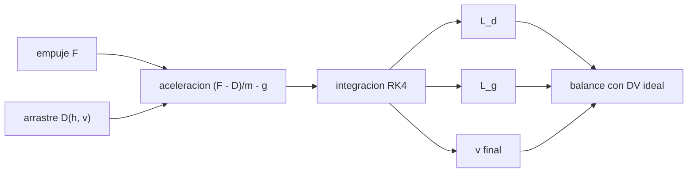

# B77-C09 — Pérdidas aerodinámicas

<!-- nav:top -->
[🏠 Programa](../../../../README.md) · [📚 Bloque B77](../../../tronco-comun/B77-dinamica-de-lanzamiento-y-reentrada.md) · [← Anterior: B77-C08 — Pérdidas gravitacionales](../B77-C08-perdidas-gravitacionales/CLASE.md) · [Siguiente: B77-C10 — Restricciones de cargas estructurales →](../B77-C10-restricciones-de-cargas-estructurales/CLASE.md)
<!-- /nav -->

## 1. Ubicación, nivel y alcance

Clase 9 del bloque B77. Nivel N3. El aire también cobra su parte del `Δv`: la pérdida aerodinámica es lo que el arrastre quita a la velocidad mientras el motor trabaja. Aquí la mides en un ascenso vertical sintético con tres coeficientes de arrastre, la separas de la pérdida gravitacional ([C08](../B77-C08-perdidas-gravitacionales/CLASE.md)) y compruebas el balance del `Δv`. El cohete es sintético.

## 2. Por qué esta clase existe

La velocidad final de un ascenso es el `Δv` ideal menos dos pérdidas. La decisión central: **¿cuánto vale la pérdida aerodinámica frente a la gravitacional y de qué depende?**

## 3. Lo que podrás hacer al terminar

1. Definir la pérdida aerodinámica `∫ (D/m) dt`.
2. Integrar el ascenso con arrastre en una atmósfera exponencial.
3. Verificar el balance `Δv_ideal = v_f + L_g + L_d`.
4. Comparar la pérdida para tres coeficientes de arrastre.
5. Relacionar la pérdida con la presión dinámica máxima y la altitud.
6. Separar lo consultado (atmósfera, ecuaciones) de lo ilustrativo (cohete, `Cd`).

La evidencia es la **ficha de pérdidas de ascenso** del ejercicio 12 (sección 20).

## 4. Con qué llegas y cómo comprobarlo

1. ¿Qué es el arrastre?
2. ¿Qué es la atmósfera exponencial?
3. ¿Qué es la pérdida gravitacional?
4. ¿Qué es un residuo numérico?
5. ¿Qué es el `Δv` ideal?

<details>
<summary>Ver respuestas</summary>

1. La fuerza aerodinámica opuesta a la velocidad. 2. Un modelo de densidad `ρ₀e^(−h/H)`. 3. `∫ g sin γ dt`, la parte del `Δv` gastada contra el peso. 4. La diferencia entre dos vías de cálculo de lo mismo. 5. `V_eq·ln(MR)`.
</details>

Con cuatro o cinco aciertos, sigue; si no, repasa los prerrequisitos.

## 5. Un caso de contexto y casos de referencia

Un cohete sintético de `50 000 kg` a `12 000 kg` con `Isp = 300 s`, `F = 1,2 MN` y `A = 10 m²` tiene un `Δv` ideal de `4198,6 m/s` y quema `93,2 s`. Sin aire llega a `3285,0 m/s`. Con `Cd = 0,30` pierde `226,5 m/s` por arrastre (y `913,6 m/s` por gravedad) y llega a `3058,4 m/s`. Es el **ejemplo conductor**; es **ilustrativo**.

## 6. Vocabulario

La **pérdida aerodinámica** es `L_d = ∫ (D/m) dt`. El **arrastre** es `D = Cd·½ρV²·A`. La **identidad contable** del `Δv` es `V_eq ln(MR) = v_f + L_g + L_d`. La **altitud de quemado** es la altitud al agotarse el propelente. La **presión dinámica máxima** `q_max` mide la carga del aire.

## 7. Modelo mental



*Descripción textual:* el empuje, el arrastre y la gravedad dan la aceleración; la integración produce la velocidad final y las dos pérdidas, que sumadas a la velocidad reproducen el `Δv` ideal.

Analogía: remar contra corriente en un río: el motor da un empuje fijo, y la corriente (el aire) y la pendiente (la gravedad) se llevan una parte. Límite: esta identidad es contable; no dice cuál pérdida se puede reducir sin tocar la otra.

## 8. La explicación, paso a paso

### 8.1 Ecuaciones

Con eje vertical: `dv/dt = (F − D)/m − g`, `dm/dt = −F/V_eq`. Integrando junto con `L_g = ∫ g dt` y `L_d = ∫ (D/m) dt` se tiene `V_eq ln(MR) = v_f + L_g + L_d`.

### 8.2 Resultados

| `Cd` | `v_f` (m/s) | `h_f` (km) | `L_g` (m/s) | `L_d` (m/s) | `q_max` (kPa) |
|---|---|---|---|---|---|
| 0,00 | 3285,0 | 108,0 | 913,6 | 0,0 | 75,3 |
| 0,15 | 3169,2 | 101,8 | 913,6 | 115,8 | 68,5 |
| 0,30 | 3058,4 | 96,2 | 913,6 | 226,5 | 62,7 |
| 0,60 | 2848,0 | 86,1 | 913,6 | 437,0 | 53,3 |

La pérdida gravitacional es la misma (`g·t_b`) porque el tiempo de combustión no cambia; la aerodinámica crece casi en proporción a `Cd`.

### 8.3 Comprobación

El residuo de la identidad es `2,8e-14` del `Δv` ideal: valida el código, no la física, porque la identidad es contable. El caso sin aire coincide con `V_eq ln(MR) − g t_b = 3284,9505 m/s` (error `2,2e-14`).

### 8.4 Qué pierde más

Aquí la gravedad pierde `914 m/s` y el aire `227 m/s` con `Cd = 0,30`: el arrastre es menor, pero no despreciable. La mayor parte del arrastre ocurre en las capas densas, por debajo de unos 20 km; por eso un vehículo con `T/W` alto no pierde demasiado. Un vuelo vertical no es un ascenso real: allí la trayectoria se inclina y los números cambian ([C12](../B77-C12-perfil-de-ascenso-orbital/CLASE.md)).

## 9. Magnitudes, símbolos y unidades

| Símbolo | Qué es | Unidad | Valor / nota |
|---|---|---|---|
| `L_d` | pérdida aerodinámica | m/s | 226,5 (Cd=0,30) |
| `L_g` | pérdida gravitacional | m/s | 913,6 |
| `Cd` | coeficiente de arrastre | — | 0,15; 0,30; 0,60 (ilustrativos) |
| `ρ₀`, `H` | densidad y altura de escala | kg/m³, m | 1,217; 8500 (NASA/NSSDC) |
| `A` | área de referencia | m² | 10 (ilustrativo) |
| `q_max` | presión dinámica máxima | kPa | 62,7 (Cd=0,30) |

## 10. Convenciones y referencias

Eje vertical local, Tierra plana, `g₀ = 9,80665 m/s²` (NIST). `ρ₀` y `H` de la NASA/NSSDC; ecuaciones de la NASA Glenn. Cohete, `Cd` y `A` ilustrativos; el vuelo vertical no representa un ascenso real.

## 11. De dónde sale lo que afirmamos

| ID | Fuente | Localizador | Respalda | Estado |
|---|---|---|---|---|
| S1 | NASA Glenn, Drag Coefficient — https://www1.grc.nasa.gov/beginners-guide-to-aeronautics/drag-coefficient/ (consultada 2026-11-10) | página completa | D = Cd·½ρV²·A | Consultada |
| S2 | NASA Glenn, Ideal Rocket Equation — https://www1.grc.nasa.gov/beginners-guide-to-aeronautics/ideal-rocket-equation/ (consultada 2026-11-10) | página completa | Δu con gravedad: V_eq ln(MR) − g₀ t_b | Consultada |
| S3 | NASA/NSSDC, Earth Fact Sheet — https://nssdc.gsfc.nasa.gov/planetary/factsheet/earthfact.html (consultada 2026-11-10) | ficha completa leída | ρ₀ = 1,217 kg/m³ y altura de escala 8,5 km | Consultada |
| S4 | NIST, CODATA 2022, standard acceleration of gravity — https://physics.nist.gov/cgi-bin/cuu/Value?gn (consultada 2026-11-10) | entrada gn | g₀ = 9,80665 m/s² | Consultada |
| — | Identidad contable de pérdidas e integración RK4 | — | las verifica el laboratorio con una segunda vía | No consultada en una fuente concreta |

Límites: Tierra plana, vuelo vertical, `Cd` constante y atmósfera exponencial; la altura y la velocidad finales no son las de un lanzador real; no se consultó ningún vuelo real.

## 12. Cómo ver el resultado

| Magnitud | Valor |
|---|---|
| `Δv` ideal | 4198,6 m/s |
| `v_f` sin aire | 3285,0 m/s |
| `v_f` con `Cd` = 0,30 | 3058,4 m/s |
| `L_d` con `Cd` = 0,30 | 226,5 m/s |
| residuo de la identidad | 2,8e-14 |

Descripción larga: la pérdida aerodinámica crece con `Cd` mientras la gravitacional queda fija; la suma con la velocidad final reproduce el `Δv` ideal.

## 13. Ejemplo trabajado: el balance del Δv con Cd = 0,30

**Paso 1 · Ideal.** `Δv = 300 × 9,80665 × ln(50 000/12 000) = 4198,6 m/s`.

**Paso 2 · Pérdidas.** `L_g = 913,6` y `L_d = 226,5 m/s`.

**Paso 3 · Velocidad.** `v_f = 4198,6 − 913,6 − 226,5 = 3058,4 m/s`.

## 14. Distintas formas de describir el resultado

**Por tabla:** `Cd` y pérdidas. **Por balance:** ideal = final + pérdidas. **Por fracción:** `L_d/Δv_ideal`. **Por altitud:** `h_f`.

## 15. Práctica guiada

**Ejercicio 1 · con los pasos indicados.** Calcula el `Δv` ideal de `Isp = 300 s` y `MR = 50/12`. *Pasos:* `c·ln MR`.

<details><summary>Solución comentada</summary>

`2941,99 × 1,4271 = 4198,6 m/s`.
</details>

**Ejercicio 2 · con una pista.** Fracción del `Δv` perdida por arrastre con `Cd = 0,30`. *Pista:* `L_d/Δv`.

<details><summary>Solución comentada</summary>

`226,5/4198,6 = 5,4 %`.
</details>

**Ejercicio 3 · casi autónomo.** ¿Por qué `L_g` es igual en los cuatro casos?

<details><summary>Solución comentada</summary>

Porque `L_g = g·t_b` y `t_b` depende solo de la masa de propelente y del empuje, no del arrastre.
</details>

## 16. Práctica autónoma, transferencia e integrador

**Ejercicio 4 · autónomo.** ¿Cuánto vale `L_d` con `Cd = 0,60` respecto de `Cd = 0,15`?

<details><summary>Solución comentada</summary>

`3,77` veces, casi 4 (proporcional a `Cd`, con una ligera diferencia por la velocidad).
</details>

**Ejercicio 5 · autónomo.** Velocidad final con `Cd = 0,15`.

<details><summary>Solución comentada</summary>

`3169,2 m/s`.
</details>

**Ejercicio 6 · autónomo.** Altitud perdida entre `Cd` = 0 y 0,60.

<details><summary>Solución comentada</summary>

`21,9 km`.
</details>

**Ejercicio 7 · autónomo.** ¿Qué pasa con `q_max` al subir `Cd`?

<details><summary>Solución comentada</summary>

Baja, porque el cohete va más lento al cruzar las capas densas.
</details>

**Ejercicio 8 · autónomo.** Si el área se reduce a 5 m² con `Cd = 0,60`, ¿qué otro caso equivale?

<details><summary>Solución comentada</summary>

`Cd·A` igual a `Cd = 0,30` con 10 m²: `L_d ≈ 226,5 m/s`.
</details>

**Ejercicio 9 · transferencia.** **Transferencia.** Un artículo atribuye 150 m/s de pérdida aerodinámica a un lanzador real. ¿Contradice el laboratorio?

<details><summary>Solución comentada</summary>

No: el laboratorio es un vuelo vertical sintético con otros parámetros; no se compara.
</details>

**Ejercicio 10 · transferencia.** **Transferencia.** Un colega incluye la gravedad en la pérdida aerodinámica. ¿Qué error comete?

<details><summary>Solución comentada</summary>

Mezcla dos pérdidas distintas y pierde el balance; cada una tiene su integral.
</details>

**Ejercicio 11 · transferencia.** **Transferencia.** ¿Qué cambia si el cohete asciende inclinado en lugar de vertical?

<details><summary>Solución comentada</summary>

Cambian ambas pérdidas: baja `L_g` pero cambia el arrastre y aparece la pérdida por dirección de empuje.
</details>

**Ejercicio 12 · integrador.** **Integrador.** Elabora tu *ficha de pérdidas de ascenso*: tabla de `Cd`, `v_f`, `L_g`, `L_d`, balance con el `Δv` ideal y lista de qué es consultado e ilustrativo.

<details><summary>Solución comentada</summary>

Secciones 8.1–8.4 y la salida del laboratorio.
</details>

## 17. Laboratorio: pérdidas aerodinámicas de un ascenso vertical sintético

El script [perdida_aerodinamica.py](perdida_aerodinamica.py) integra con RK4 un ascenso vertical con arrastre exponencial para cuatro `Cd` y verifica el balance (**comprueba** residuo < 1e-8 y caso sin aire < 1e-8 frente a la fórmula).

**Datos:** `ρ₀`, `H`, `g₀` y las ecuaciones consultados; cohete, `Cd` y `A` **ilustrativos**. **Predice antes de ejecutar:** ¿cuál es la pérdida aerodinámica con `Cd = 0,60` relativa a la de `Cd = 0,30`? (casi el doble: 437 frente a 227 m/s.) **Ejecución del 2026-11-10 (Python 3.12.9):**

```text
Python 3.12.9 (biblioteca estandar)
Cohete SINTETICO: m0 = 50000 kg, mf = 12000 kg, Isp = 300.0 s, F = 1.2 MN, A = 10.0 m2; DV ideal = 4198.6 m/s; t_b = 93.16 s
  Cd    v_final [m/s]  h_final [km]  perd.grav [m/s]  perd.aero [m/s]  q_max [kPa]  residuo identidad
  0.00      3284.95       108.01         913.62            0.00        75.3  2.7e-14
  0.15      3169.18       101.82         913.62          115.77        68.5  2.6e-14
  0.30      3058.43        96.16         913.62          226.53        62.7  2.8e-14
  0.60      2847.97        86.11         913.62          436.98        53.3  2.6e-14
Sin aire: v numerica = 3284.9505; analitica c ln(MR) - g t_b = 3284.9505; error relativo = 2.2e-14
Pruebas superadas.
```

```bash
python programa/clases/B77/B77-C09-perdidas-aerodinamicas/perdida_aerodinamica.py
```

**Límites:** vertical, Tierra plana, `Cd` constante, sin viento ni Mach; la identidad contable no es una validación física.

## 18. Errores frecuentes y cómo corregirlos

**Creer que la pérdida aerodinámica es igual para todos los vehículos.** Se corrige con 8.2.

**Tomar el cierre de la identidad como validación de la física.** Se corrige con 8.3.

**Confundir `q_max` con la pérdida.** Se corrige con 8.4.

**Dar el vuelo vertical como un ascenso real.** Se corrige con la sección 10.

## 19. Cómo sabrás que vas bien

Tras la sección 8: ¿qué `v_f` esperabas con `Cd = 0,30` y cuál obtuviste? Si dudas, repasa el ejemplo 13. Tras el laboratorio: ¿qué comprueba? (ver la sección 17).

## 20. Qué entregas y cómo se evalúa

El producto es tu **ficha de pérdidas de ascenso** (ejercicio 12).

| Criterio | Inicial | En desarrollo | Logrado | Destacado |
|---|---|---|---|---|
| Conceptos | Los confunde | Parciales | Aplica el modelo con sus supuestos | Explica los límites |
| Cálculo | Sin unidades | Con errores | Tablas completas con unidades | Calcula casos nuevos |
| Numérico | Sin comprobar | Un caso | Contraste con una segunda vía | Interpreta las diferencias |
| Fuentes | Sin fuente | Sin fecha | Fuentes con fecha y estado | Declara lo ilustrativo y lo no consultado |
| Límites | No los nombra | Uno | Tres | Discute qué falta del modelo |

**Condiciones críticas (no se compensan con promedio):** rotular el cohete y el `Cd` como ilustrativos; no confundir la identidad contable con una validación física; citar solo lo consultado.

## 21. Ética, seguridad y límites

Clase educativa: los modelos son simplificados y sus datos son sintéticos o ilustrativos; ningún resultado describe un vehículo real ni sustituye al análisis de seguridad, a la certificación o a los documentos del operador. Nada de lo simulado se presenta como observado ni como datos de vuelo. Accesibilidad: tablas equivalentes a las gráficas, fórmulas en texto, ejercicios sin conexión.

## 22. Para cerrar y seguir

En el ascenso sintético con `Cd = 0,30`, de `4199 m/s` ideales se pierden `914 m/s` por gravedad y `227 m/s` por aire. Queda una pregunta: ¿qué esfuerzos soporta la estructura durante ese ascenso?

**Glosario español–inglés.** pérdida aerodinámica · *drag loss*; arrastre · *drag*; presión dinámica máxima · *max-q*; identidad contable · *accounting identity*; atmósfera exponencial · *exponential atmosphere*.

**Continuidad.** [siguiente]

**Referencias:** ver sección 11.

<!-- nav:bottom -->
---

[← Anterior: B77-C08 — Pérdidas gravitacionales](../B77-C08-perdidas-gravitacionales/CLASE.md) · [📚 Bloque B77](../../../tronco-comun/B77-dinamica-de-lanzamiento-y-reentrada.md) · [Siguiente: B77-C10 — Restricciones de cargas estructurales →](../B77-C10-restricciones-de-cargas-estructurales/CLASE.md)
<!-- /nav -->
