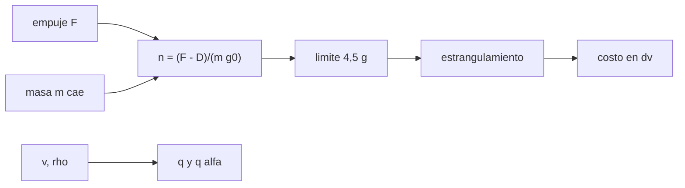

# B77-C10 — Restricciones de cargas estructurales

<!-- nav:top -->
[🏠 Programa](../../../../README.md) · [📚 Bloque B77](../../../tronco-comun/B77-dinamica-de-lanzamiento-y-reentrada.md) · [← Anterior: B77-C09 — Pérdidas aerodinámicas](../B77-C09-perdidas-aerodinamicas/CLASE.md) · [Siguiente: B77-C11 — Ventanas de lanzamiento — Dinámica de lanzamiento y reentrada →](../../../tronco-comun/B77-dinamica-de-lanzamiento-y-reentrada.md#b77-c11)
<!-- /nav -->

## 1. Ubicación, nivel y alcance

Clase 10 del bloque B77. Nivel N3. La estructura de un lanzador debe resistir cargas axiales (por la aceleración del empuje), aerodinámicas (por la presión dinámica) y laterales (por rachas de viento). Aquí calculas esas cargas en el ascenso sintético de [C09](../B77-C09-perdidas-aerodinamicas/CLASE.md), limitas la aceleración axial reduciendo el empuje y mides el costo en velocidad. Los límites son ilustrativos, no de una norma.

## 2. Por qué esta clase existe

El mayor empuje reduce las pérdidas pero carga la estructura, sobre todo al final del quemado, cuando la masa es menor. La decisión central: **¿qué límite de carga impone la estructura y cuánta velocidad cuesta respetarlo?**

## 3. Lo que podrás hacer al terminar

1. Calcular la aceleración axial en g como `(F − D)/(m·g₀)`.
2. Localizar el instante de mayor carga axial y el de max-q.
3. Calcular el producto `q·α` como proxy de la carga lateral por una racha.
4. Estrangular el empuje para respetar un límite de aceleración.
5. Cuantificar el costo en velocidad y tiempo del estrangulamiento.
6. Separar lo consultado (ecuaciones, atmósfera) de lo ilustrativo (límites, racha, factor de seguridad).

La evidencia es la **ficha de cargas de ascenso** del ejercicio 12 (sección 20).

## 4. Con qué llegas y cómo comprobarlo

1. ¿Qué es un g de aceleración?
2. ¿Qué es la presión dinámica máxima?
3. ¿Qué es un factor de seguridad?
4. ¿Qué es el estrangulamiento (throttling)?
5. ¿Qué es un ángulo de ataque inducido por viento?

<details>
<summary>Ver respuestas</summary>

1. Una aceleración igual a `g₀ = 9,80665 m/s²`. 2. El máximo de `ρV²/2` a lo largo del vuelo. 3. El cociente entre la carga de rotura de diseño y la carga límite esperada. 4. Reducir el empuje de un motor. 5. El ángulo entre el eje del vehículo y el flujo relativo causado por una racha lateral.
</details>

Con cuatro o cinco aciertos, sigue; si no, repasa los prerrequisitos.

## 5. Un caso de contexto y casos de referencia

Con el cohete de C09 sin límite, la aceleración axial llega a `10,19 g` al final del quemado, la presión dinámica máxima es `62,7 kPa` a los `35,0 s` y `q·α` (racha de 10 m/s) llega a `1,35 kPa·rad` a los `24,0 s`. Con un límite ilustrativo de `4,5 g`, el empuje se reduce al final, el quemado dura `109,7 s` y se pierden `161 m/s`. Es el **ejemplo conductor**; los límites son **ilustrativos**.

## 6. Vocabulario

La **aceleración axial** (carga axial) es `n = (F − D)/(m g₀)` en g. La **carga lateral** se estima con `q·α`. El **estrangulamiento** reduce el empuje. El **factor de seguridad** multiplica la carga límite para obtener la de diseño. La **carga límite** es la máxima esperada en servicio.

## 7. Modelo mental



*Descripción textual:* empuje, arrastre y masa dan la aceleración axial; si supera el límite se estrangula el empuje, con un costo en velocidad; por otra vía, `q` y la racha dan la carga lateral.

Analogía: llevar una taza llena en un coche: aceleras fuerte al principio, pero al final, cuando el coche va ligero, debes aliviar el acelerador para no derramarla. Límite: la estructura real se analiza con cargas combinadas y normas, no con un solo límite.

## 8. La explicación, paso a paso

### 8.1 Carga axial

`n = (F − D)/(m g₀)`. Como la masa cae de 50 a 12 t con el empuje constante, `n` sube hasta `10,194 g` al agotar el propelente (referencia sin aire: `F₀/(m_f g₀) = 10,197 g`).

### 8.2 Presión dinámica y carga lateral

La presión dinámica máxima es `62,7 kPa` (a los `35,0 s`). La carga lateral por una racha `w` induce `α ≈ w/v`; entonces `q·α = ½ρ·v·w`, máxima a los `24,0 s` (`1,35 kPa·rad`), antes que max-q: cuando el cohete aún va lento la racha inclina más el flujo.

### 8.3 Limitar la aceleración

Con `F = mín(F₀, n_lim·g₀·m + D)` la aceleración queda en `4,500 g`. El quemado se alarga de `93,2` a `109,7 s`, la velocidad final baja de `3058,4` a `2897,0 m/s` y la altitud de quemado sube de `96,2` a `132,2 km`. La carga de diseño ilustrativa es `4,5 × 1,4 = 6,30 g`.

### 8.4 Qué limita y qué no

El límite axial no cambia la presión dinámica máxima, porque el estrangulamiento solo actúa al final. Pero el vehículo real combina carga axial, flexión por `q·α`, presión interna de tanques y vibraciones; ninguna norma se consultó aquí.

## 9. Magnitudes, símbolos y unidades

| Símbolo | Qué es | Unidad | Valor / nota |
|---|---|---|---|
| `n` | aceleración axial | g | 10,19 (sin límite) |
| `q_max` | presión dinámica máxima | kPa | 62,7 |
| `q·α` | proxy de carga lateral | kPa·rad | 1,35 |
| `n_lim` | límite axial | g | 4,5 (ilustrativo) |
| `w` | racha lateral | m/s | 10 (ilustrativa) |
| FS | factor de seguridad | — | 1,4 (ilustrativo) |

## 10. Convenciones y referencias

Eje vertical axial, racha en el plano horizontal. `g₀ = 9,80665 m/s²` (NIST), `ρ₀` y `H` de la NASA/NSSDC. Límite axial, racha y factor de seguridad **ilustrativos**; las normas de cargas estructurales no se consultaron.

## 11. De dónde sale lo que afirmamos

| ID | Fuente | Localizador | Respalda | Estado |
|---|---|---|---|---|
| S1 | NASA Glenn, Drag Coefficient — https://www1.grc.nasa.gov/beginners-guide-to-aeronautics/drag-coefficient/ (consultada 2026-11-10) | página completa | q = ρV²/2 y D = Cd q A | Consultada |
| S2 | NASA/NSSDC, Earth Fact Sheet — https://nssdc.gsfc.nasa.gov/planetary/factsheet/earthfact.html (consultada 2026-11-10) | ficha completa leída | ρ₀ = 1,217 kg/m³ y altura de escala 8,5 km | Consultada |
| S3 | NIST, CODATA 2022, standard acceleration of gravity — https://physics.nist.gov/cgi-bin/cuu/Value?gn (consultada 2026-11-10) | entrada gn | g₀ = 9,80665 m/s² | Consultada |
| — | Aceleración axial en g, producto q·α y estrangulamiento por límite | — | las verifica el laboratorio con una segunda vía | No consultada en una fuente concreta |

Límites: los límites de carga, la racha y el factor de seguridad son inventados; no se consultó ninguna norma de cargas ni guía de usuario de un lanzador.

## 12. Cómo ver el resultado

| Magnitud | Valor |
|---|---|
| `n` máxima sin límite | 10,194 g |
| `n` máxima con límite | 4,500 g |
| `q_max` | 62,7 kPa a 35,0 s |
| `q·α` máximo | 1,35 kPa·rad a 24,0 s |
| costo del límite | 161,4 m/s |

Descripción larga: la carga axial crece hasta el final porque la masa baja; limitarla cuesta velocidad pero no cambia la presión dinámica máxima.

## 13. Ejemplo trabajado: la carga axial al agotar el propelente

**Paso 1 · Masa final.** `m_f = 12 000 kg`.

**Paso 2 · Empuje neto.** `F − D ≈ 1,2·10⁶ N` (aire casi nulo a esa altitud).

**Paso 3 · Carga.** `n = 1,2·10⁶/(12 000 × 9,80665) = 10,20 g`.

## 14. Distintas formas de describir el resultado

**Por tabla:** cargas con y sin límite. **Por tiempo:** `n(t)`, `q(t)`. **Por costo:** pérdida de velocidad. **Por diseño:** carga límite × factor de seguridad.

## 15. Práctica guiada

**Ejercicio 1 · con los pasos indicados.** Calcula `n` si `F = 800 kN`, `D = 0` y `m = 20 000 kg`. *Pasos:* `F/(m g₀)`.

<details><summary>Solución comentada</summary>

`8e5/(2e4 × 9,80665) = 4,08 g`.
</details>

**Ejercicio 2 · con una pista.** Empuje máximo para respetar 4,5 g con `m = 15 000 kg`. *Pista:* `n g₀ m`.

<details><summary>Solución comentada</summary>

`4,5 × 9,80665 × 15 000 = 662 kN`.
</details>

**Ejercicio 3 · casi autónomo.** ¿Por qué la carga axial máxima ocurre al final del quemado?

<details><summary>Solución comentada</summary>

Porque la masa ha bajado y el empuje sigue igual.
</details>

## 16. Práctica autónoma, transferencia e integrador

**Ejercicio 4 · autónomo.** Carga de diseño con límite 4,5 g y factor 1,25.

<details><summary>Solución comentada</summary>

`5,63 g`.
</details>

**Ejercicio 5 · autónomo.** `q·α` con `v = 300 m/s`, `ρ = 0,9 kg/m³` y `w = 10 m/s`.

<details><summary>Solución comentada</summary>

`0,5 × 0,9 × 300 × 10 = 1350 Pa·rad`.
</details>

**Ejercicio 6 · autónomo.** ¿Qué costo tuvo el límite en la velocidad final?

<details><summary>Solución comentada</summary>

`161,4 m/s`.
</details>

**Ejercicio 7 · autónomo.** ¿Cuánto más dura el quemado con el límite?

<details><summary>Solución comentada</summary>

`16,6 s`.
</details>

**Ejercicio 8 · autónomo.** ¿Por qué `q·α` es máximo antes que max-q?

<details><summary>Solución comentada</summary>

Porque `q·α ∝ ρ v`, mientras `q ∝ ρ v²` pesa más a la velocidad; la densidad cae antes.
</details>

**Ejercicio 9 · transferencia.** **Transferencia.** Un lanzador real tiene un límite de 4,5 g. ¿Prueba que el límite sintético es correcto?

<details><summary>Solución comentada</summary>

No: el límite sintético es un valor inventado; sólo comparte el orden de magnitud.
</details>

**Ejercicio 10 · transferencia.** **Transferencia.** Un colega reduce el límite a 3 g sin cambiar el empuje inicial. ¿Qué espera?

<details><summary>Solución comentada</summary>

Más estrangulamiento temprano, quemado más largo y más pérdida gravitacional.
</details>

**Ejercicio 11 · transferencia.** **Transferencia.** ¿Qué falta en este modelo para analizar la flexión de la estructura?

<details><summary>Solución comentada</summary>

La distribución de la carga a lo largo del vehículo, la rigidez y los modos de vibración.
</details>

**Ejercicio 12 · integrador.** **Integrador.** Elabora tu *ficha de cargas de ascenso*: `n`, `q_max`, `q·α` con y sin límite, costo en velocidad y lista de qué es consultado e ilustrativo.

<details><summary>Solución comentada</summary>

Secciones 8.1–8.4 y la salida del laboratorio.
</details>

## 17. Laboratorio: cargas axiales y laterales con estrangulamiento

El script [cargas.py](cargas.py) integra el ascenso de C09 con y sin límite axial y mide `n`, `q` y `q·α` (**comprueba** que con límite `n ≤ 4,5 g + 1e-3`, que la masa final es `m_f` y que el límite cuesta velocidad).

**Datos:** atmósfera, `g₀` y ecuaciones consultadas; cohete, límites, racha y factor **ilustrativos**. **Predice antes de ejecutar:** ¿cambia `q_max` al limitar la aceleración axial? (no: 62,7 kPa a los 35 s, porque el límite actúa al final.) **Ejecución del 2026-11-10 (Python 3.12.9):**

```text
Python 3.12.9 (biblioteca estandar)
Cohete SINTETICO de C09 con Cd = 0.3; limite axial ILUSTRATIVO = 4.5 g; racha lateral w = 10.0 m/s; factor de seguridad ilustrativo = 1.4
                  t_b [s]   v_f [m/s]  h_f [km]  n_ax max [g]  q max [kPa] (t)      q*alfa max [kPa*rad] (t)
sin limite       93.16     3058.4     96.16      10.194      62.7 ( 35.0 s)      1.35 ( 24.0 s)
con limite      109.73     2897.0    132.16       4.500      62.7 ( 35.0 s)      1.35 ( 24.0 s)
n_ax maximo analitico al agotar propelente sin aire ~ F0/(mf g0) = 10.197 g (referencia; con arrastre el simulado es menor)
Carga de diseno ilustrativa = limite x factor de seguridad = 6.30 g
Costo del limite: velocidad final 161.4 m/s menor y t_b 16.6 s mayor
Pruebas superadas.
```

```bash
python programa/clases/B77/B77-C10-restricciones-de-cargas-estructurales/cargas.py
```

**Límites:** vuelo vertical, una sola carga a la vez, sin flexión ni modos; límites inventados.

## 18. Errores frecuentes y cómo corregirlos

**Creer que la carga máxima ocurre en max-q.** Se corrige con 8.1 y 8.2.

**Tomar el límite sintético por una norma.** Se corrige con la sección 10.

**Ignorar el costo en velocidad del límite.** Se corrige con 8.3.

**Confundir carga límite con carga de diseño.** Se corrige con 8.3.

## 19. Cómo sabrás que vas bien

Tras la sección 8: ¿qué `n` máxima esperabas y cuál obtuviste? Si dudas, repasa el ejemplo 13. Tras el laboratorio: ¿qué comprueba? (ver la sección 17).

## 20. Qué entregas y cómo se evalúa

El producto es tu **ficha de cargas de ascenso** (ejercicio 12).

| Criterio | Inicial | En desarrollo | Logrado | Destacado |
|---|---|---|---|---|
| Conceptos | Los confunde | Parciales | Aplica el modelo con sus supuestos | Explica los límites |
| Cálculo | Sin unidades | Con errores | Tablas completas con unidades | Calcula casos nuevos |
| Numérico | Sin comprobar | Un caso | Contraste con una segunda vía | Interpreta las diferencias |
| Fuentes | Sin fuente | Sin fecha | Fuentes con fecha y estado | Declara lo ilustrativo y lo no consultado |
| Límites | No los nombra | Uno | Tres | Discute qué falta del modelo |

**Condiciones críticas (no se compensan con promedio):** rotular los límites de carga como ilustrativos; no presentarlos como una norma; citar solo lo consultado.

## 21. Ética, seguridad y límites

Clase educativa: los modelos son simplificados y sus datos son sintéticos o ilustrativos; ningún resultado describe un vehículo real ni sustituye al análisis de seguridad, a la certificación o a los documentos del operador. Nada de lo simulado se presenta como observado ni como datos de vuelo. Accesibilidad: tablas equivalentes a las gráficas, fórmulas en texto, ejercicios sin conexión.

## 22. Para cerrar y seguir

Sin límite, el cohete sintético llega a `10,2 g`; con un límite de `4,5 g` pierde `161 m/s`. Queda una pregunta: ¿cuándo conviene lanzar para alcanzar el plano orbital deseado?

**Glosario español–inglés.** carga axial · *axial load*; carga límite · *limit load*; factor de seguridad · *factor of safety*; estrangulamiento · *throttling*; presión dinámica máxima · *max-q*.

**Continuidad.** [siguiente]

**Referencias:** ver sección 11.

<!-- nav:bottom -->
---

[← Anterior: B77-C09 — Pérdidas aerodinámicas](../B77-C09-perdidas-aerodinamicas/CLASE.md) · [📚 Bloque B77](../../../tronco-comun/B77-dinamica-de-lanzamiento-y-reentrada.md) · [Siguiente: B77-C11 — Ventanas de lanzamiento — Dinámica de lanzamiento y reentrada →](../../../tronco-comun/B77-dinamica-de-lanzamiento-y-reentrada.md#b77-c11)
<!-- /nav -->
