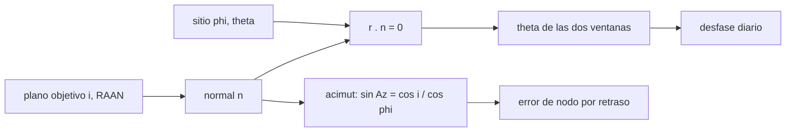

# B77-C11 — Ventanas de lanzamiento — Dinámica de lanzamiento y reentrada

<!-- nav:top -->
[🏠 Programa](../../../../README.md) · [📚 Bloque B77](../../../tronco-comun/B77-dinamica-de-lanzamiento-y-reentrada.md) · [← Anterior: B77-C10 — Restricciones de cargas estructurales](../B77-C10-restricciones-de-cargas-estructurales/CLASE.md) · [Siguiente: B77-C12 — Perfil de ascenso orbital →](../B77-C12-perfil-de-ascenso-orbital/CLASE.md)
<!-- /nav -->

## 1. Ubicación, nivel y alcance

Clase 11 del bloque B77. Nivel N3. La Tierra gira bajo un plano orbital que, para fines prácticos, queda fijo en el espacio inercial. Un sitio de lanzamiento solo está en ese plano en dos instantes por día sidéreo, y a esos instantes se les llama ventanas. Aquí calculas el tiempo sideral y el acimut de cada ventana, el desfase diario y el error de plano de un lanzamiento tardío. El sitio y el plano son sintéticos.

## 2. Por qué esta clase existe

Si el vehículo despega fuera de la ventana, el plano que alcanza no es el deseado y corregirlo cuesta `Δv`. La decisión central: **¿a qué hora sideral y con qué acimut se lanza para entrar en un plano dado, y cuánto error produce un retraso?**

## 3. Lo que podrás hacer al terminar

1. Calcular el acimut de lanzamiento `sin Az = cos i/cos φ`.
2. Hallar el tiempo sideral local de las dos ventanas diarias.
3. Verificar que el sitio está en el plano con el producto escalar `r·n`.
4. Calcular el desfase diario de la ventana (~3 min 56 s).
5. Cuantificar el error de nodo de un retraso con el mismo acimut.
6. Separar lo consultado (periodo sideral, radio) de lo ilustrativo (sitio y plano).

La evidencia es la **ficha de ventanas de lanzamiento** del ejercicio 12 (sección 20).

## 4. Con qué llegas y cómo comprobarlo

1. ¿Qué es la inclinación de una órbita?
2. ¿Qué es la ascensión recta del nodo ascendente (RAAN)?
3. ¿Qué es el día sidéreo?
4. ¿Qué es el acimut?
5. ¿Qué es un vector normal a un plano?

<details>
<summary>Ver respuestas</summary>

1. El ángulo entre su plano y el ecuatorial. 2. El ángulo desde el equinoccio hasta el nodo ascendente, medido en el ecuador. 3. El tiempo que tarda la Tierra en girar 360° respecto de las estrellas, 23,9345 h. 4. El ángulo horizontal medido desde el norte hacia el este. 5. Un vector perpendicular al plano, aquí el momento angular orbital.
</details>

Con cuatro o cinco aciertos, sigue; si no, repasa los prerrequisitos.

## 5. Un caso de contexto y casos de referencia

Para un sitio sintético a `28,5°` de latitud y un plano de `i = 51,6°` y `RAAN = 120°`, la ventana ascendente se abre cuando el tiempo sideral local es `145,489°` con acimut `44,975°`; la descendente a `274,511°` con acimut `135,025°`. La ventana se retrasa `235,8 s` cada día. Un lanzamiento 5 minutos tarde con el mismo acimut deja el nodo `1,253°` desplazado. Es el **ejemplo conductor**; todo es **ilustrativo**.

## 6. Vocabulario

La **ventana de lanzamiento** es el intervalo en que el sitio está en el plano objetivo. El **tiempo sideral local** `θ` es el ángulo entre el equinoccio y el meridiano del sitio. El **acimut de lanzamiento** es la dirección horizontal de la velocidad. El **vector normal** del plano es `n = (sin Ω sin i, −cos Ω sin i, cos i)`. El **lanzamiento ascendente** va hacia el norte; el **descendente**, hacia el sur.

## 7. Modelo mental



*Descripción textual:* el plano da su normal; imponer que el sitio esté en el plano da el tiempo sideral de las dos ventanas; la inclinación y la latitud dan el acimut; el giro de la Tierra da el desfase diario y el error por retraso.

Analogía: tomar un tren que pasa una vez por vuelta: hay que estar en la vía justo cuando pasa, y llegar tarde a bordo del tren equivocado. Límite: el modelo omite la precesión del plano (J2), la dinámica del ascenso y la rotación de la Tierra durante el vuelo.

## 8. La explicación, paso a paso

### 8.1 El sitio está en el plano

Con `r_s = (cos φ cos θ, cos φ sin θ, sin φ)` y `n` del plano, `r_s·n = 0` equivale a `sin(θ − Ω) = tan φ/tan i`. Hay dos soluciones: en términos del argumento de latitud `u`, `sin u = sin φ/sin i` y `u` o `180° − u`. Para `φ = 28,5°`, `i = 51,6°`: `u = 37,507°`.

### 8.2 Tiempos y acimutes

| Ventana | `θ` (°) | `r·n` (valor absoluto) | Acimut (°) |
|---|---|---|---|
| Ascendente | 145,4892 | 1,4e-16 | 44,9751 |
| Descendente | 274,5108 | 3,0e-16 | 135,0249 |

El acimut se obtiene de dos maneras: la fórmula `sin Az = cos i/cos φ` y la dirección de `n × r_s` proyectada en el horizonte local; coinciden (error < 1e-9°). Las dos ventanas están separadas `129,02°`, es decir `514,7` minutos sidéreos.

### 8.3 Desfase diario

La Tierra gira `15,0410°/h` respecto de las estrellas. Como el día solar (24 h) es más largo que el sidéreo (23,9345 h), la ventana ocurre `235,8 s` más temprano cada día (unos 3 min 56 s).

### 8.4 Retraso

Si despegas `Δt` tarde con el mismo acimut, la inclinación se conserva y el nodo se desplaza `ω·Δt`:

| Retraso (min) | `i` alcanzada (°) | RAAN alcanzada (°) | Error de RAAN (°) |
|---|---|---|---|
| 0 | 51,6000 | 120,0000 | +0,0000 |
| 1 | 51,6000 | 120,2507 | +0,2507 |
| 5 | 51,6000 | 121,2534 | +1,2534 |
| 10 | 51,6000 | 122,5068 | +2,5068 |

Una ventana de pocos minutos basta para mantener el error de nodo pequeño; ampliarla exige corregir el plano en vuelo, con un costo en `Δv`. La rotación terrestre además aporta `408,7 m/s` en el sitio, de los que `288,9 m/s` van en la dirección del acimut.

## 9. Magnitudes, símbolos y unidades

| Símbolo | Qué es | Unidad | Valor / nota |
|---|---|---|---|
| `φ` | latitud del sitio | ° | 28,5 (sintética) |
| `i`, `Ω` | inclinación y RAAN del plano | ° | 51,6; 120 (inventados) |
| `θ` | tiempo sideral local | ° | 145,489; 274,511 |
| `Az` | acimut de lanzamiento | ° | 44,975; 135,025 |
| `ω` | velocidad angular terrestre | °/h | 15,0410 |
| `T_sid` | periodo sideral | h | 23,9345 (NASA/NSSDC) |

## 10. Convenciones y referencias

Marco inercial ecuatorial (x al equinoccio, z al polo); Tierra esférica de radio 6378,137 km; sin precesión ni J2. `T_sid` y el radio de la ficha NASA/NSSDC; sitio y plano **inventados**.

## 11. De dónde sale lo que afirmamos

| ID | Fuente | Localizador | Respalda | Estado |
|---|---|---|---|---|
| S1 | NASA/NSSDC, Earth Fact Sheet — https://nssdc.gsfc.nasa.gov/planetary/factsheet/earthfact.html (consultada 2026-11-10) | ficha completa leída | periodo de rotación sideral 23,9345 h y radio ecuatorial 6378,137 km | Consultada |
| — | Geometría del plano orbital, acimut sin Az = cos i/cos φ y producto escalar r·n | — | las verifica el laboratorio con una segunda vía | No consultada en una fuente concreta |

Límites: el sitio y el plano son sintéticos; no se usó ninguna efeméride ni sistema de tiempo (IERS/UT1) y no se modela la precesión; no se consultó ninguna base ni campaña real.

## 12. Cómo ver el resultado

| Magnitud | Valor |
|---|---|
| ventana ascendente | θ = 145,489°, Az = 44,975° |
| ventana descendente | θ = 274,511°, Az = 135,025° |
| desfase diario | 235,8 s |
| error de nodo, 5 min tarde | +1,253° |
| ganancia por rotación | 288,9 m/s |

Descripción larga: el sitio cruza el plano dos veces por día sidéreo; cada minuto de retraso con el mismo acimut desplaza el nodo `0,25°`.

## 13. Ejemplo trabajado: el acimut de lanzamiento

**Paso 1 · Cosenos.** `cos 51,6° = 0,6211` y `cos 28,5° = 0,8788`.

**Paso 2 · Cociente.** `0,6211/0,8788 = 0,7068`.

**Paso 3 · Arcoseno.** `Az = 44,975°` (ascendente) y `180° − Az = 135,025°` (descendente).

## 14. Distintas formas de describir el resultado

**Por ángulo:** `θ` y `Az`. **Por tiempo:** hora sideral. **Por vector:** `r·n = 0`. **Por desfase:** 235,8 s por día. **Por error:** `ω·Δt`.

## 15. Práctica guiada

**Ejercicio 1 · con los pasos indicados.** Calcula el acimut para `i = 45°` y `φ = 30°`. *Pasos:* `cos i/cos φ`, luego arcoseno.

<details><summary>Solución comentada</summary>

`0,7071/0,8660 = 0,8165`; `Az = 54,7°`.
</details>

**Ejercicio 2 · con una pista.** ¿Cuánto vale `ω` en °/min? *Pista:* divide `°/h` entre 60.

<details><summary>Solución comentada</summary>

`0,2507°/min`.
</details>

**Ejercicio 3 · casi autónomo.** ¿Por qué una órbita de `i < φ` no es alcanzable directamente?

<details><summary>Solución comentada</summary>

Porque `cos i/cos φ > 1` y el arcoseno no existe: el sitio nunca está en un plano menos inclinado que su latitud.
</details>

## 16. Práctica autónoma, transferencia e integrador

**Ejercicio 4 · autónomo.** ¿Cuánto se adelanta la ventana en 10 días?

<details><summary>Solución comentada</summary>

`10 × 235,8 s = 39,3 min`.
</details>

**Ejercicio 5 · autónomo.** Error de RAAN por un retraso de 3 min.

<details><summary>Solución comentada</summary>

`3 × 0,2507 = 0,752°`.
</details>

**Ejercicio 6 · autónomo.** Velocidad de rotación en un sitio de latitud 0° (radio 6378,137 km).

<details><summary>Solución comentada</summary>

`ω R = 465,1 m/s`.
</details>

**Ejercicio 7 · autónomo.** Separación de las dos ventanas si `φ = 0°`.

<details><summary>Solución comentada</summary>

`180°`, o 12 h sidéreas.
</details>

**Ejercicio 8 · autónomo.** ¿Qué acimut tiene una órbita polar desde cualquier sitio?

<details><summary>Solución comentada</summary>

`i = 90°` → `cos i = 0`, `Az = 0°` (norte) o 180° (sur).
</details>

**Ejercicio 9 · transferencia.** **Transferencia.** Un operador anuncia una ventana de 1 s. ¿Qué factor la limita?

<details><summary>Solución comentada</summary>

La tolerancia de plano del requisito de la misión (error de nodo admisible) dividida por `0,25°/min`.
</details>

**Ejercicio 10 · transferencia.** **Transferencia.** Un colega ignora la precesión del plano en un lanzamiento para dentro de 3 semanas. ¿Qué sesgo?

<details><summary>Solución comentada</summary>

El plano objetivo (p. ej. de una estación) precesa por J2; el RAAN real difiere del calculado y la ventana se desplaza.
</details>

**Ejercicio 11 · transferencia.** **Transferencia.** ¿Qué cambia si el sitio no es esférico (latitud geodésica vs geocéntrica)?

<details><summary>Solución comentada</summary>

Los ángulos difieren hasta ~0,19° a 45°; con precisión de plano pequeña hay que distinguirlas.
</details>

**Ejercicio 12 · integrador.** **Integrador.** Elabora tu *ficha de ventanas de lanzamiento*: `θ` y `Az` de las dos ventanas, desfase diario, error de nodo por retraso y lista de qué es consultado e ilustrativo.

<details><summary>Solución comentada</summary>

Secciones 8.1–8.4 y la salida del laboratorio.
</details>

## 17. Laboratorio: ventanas y acimut de lanzamiento

El script [ventana.py](ventana.py) halla las dos ventanas de un plano objetivo, el acimut por fórmula y por geometría y el error de nodo con retraso (**comprueba** `|r·n| < 1e-12`, acimut por dos vías < 1e-9° y error de RAAN nulo sin retraso).

**Datos:** periodo sideral y radio consultados; sitio y plano **ilustrativos** (inventados). **Predice antes de ejecutar:** ¿cuántos grados de RAAN se pierden por minuto de retraso? (0,2507°/min.) **Ejecución del 2026-11-10 (Python 3.12.9):**

```text
Python 3.12.9 (biblioteca estandar)
Sitio SINTETICO a 28.5 grados de latitud; plano objetivo i = 51.6 grados, RAAN = 120.0 grados (inventados)
Velocidad angular de la Tierra = 15.0410 grados/h (T sideral 23.9345 h)
Ventana ascendente (hacia el norte): tiempo sideral local = 145.4892 grados; |r.n| = 1.4e-16; acimut analitico = 44.9751; por velocidad = 44.9751
Ventana descendente (hacia el sur): tiempo sideral local = 274.5108 grados; |r.n| = 3.0e-16; acimut analitico = 135.0249; por velocidad = 135.0249
Separacion entre las dos ventanas = 129.022 grados = 514.68 min sidereos
Desfase diario de la ventana = 235.8 s (24 h - T sideral)
Velocidad de rotacion en el sitio = 408.7 m/s; ganancia hacia el acimut de lanzamiento = 288.9 m/s
Retraso con el mismo acimut -> plano alcanzado:
    0.0 min: i = 51.6000 grados, RAAN = 120.0000 grados (error de RAAN = +0.0000 grados)
    1.0 min: i = 51.6000 grados, RAAN = 120.2507 grados (error de RAAN = +0.2507 grados)
    5.0 min: i = 51.6000 grados, RAAN = 121.2534 grados (error de RAAN = +1.2534 grados)
   10.0 min: i = 51.6000 grados, RAAN = 122.5068 grados (error de RAAN = +2.5068 grados)
Pruebas superadas.
```

```bash
python programa/clases/B77/B77-C11-ventanas-de-lanzamiento-dinamica-de-lanzamiento-y-reentrada/ventana.py
```

**Límites:** Tierra esférica y plano fijo (sin J2); latitud geocéntrica; sin tiempo UT1 ni efemérides.

## 18. Errores frecuentes y cómo corregirlos

**Creer que la ventana ocurre a la misma hora cada día.** Se corrige con 8.3.

**Confundir el día sidéreo con el solar.** Se corrige con 8.3.

**Olvidar la segunda ventana (descendente).** Se corrige con 8.1 y 8.2.

**Presentar el sitio sintético como una base real.** Se corrige con la sección 10.

## 19. Cómo sabrás que vas bien

Tras la sección 8: ¿qué acimut esperabas y cuál obtuviste? Si dudas, repasa el ejemplo 13. Tras el laboratorio: ¿qué comprueba? (ver la sección 17).

## 20. Qué entregas y cómo se evalúa

El producto es tu **ficha de ventanas de lanzamiento** (ejercicio 12).

| Criterio | Inicial | En desarrollo | Logrado | Destacado |
|---|---|---|---|---|
| Conceptos | Los confunde | Parciales | Aplica el modelo con sus supuestos | Explica los límites |
| Cálculo | Sin unidades | Con errores | Tablas completas con unidades | Calcula casos nuevos |
| Numérico | Sin comprobar | Un caso | Contraste con una segunda vía | Interpreta las diferencias |
| Fuentes | Sin fuente | Sin fecha | Fuentes con fecha y estado | Declara lo ilustrativo y lo no consultado |
| Límites | No los nombra | Uno | Tres | Discute qué falta del modelo |

**Condiciones críticas (no se compensan con promedio):** rotular el sitio y el plano como inventados; no presentar la ventana como una predicción operativa; citar solo lo consultado.

## 21. Ética, seguridad y límites

Clase educativa: los modelos son simplificados y sus datos son sintéticos o ilustrativos; ningún resultado describe un vehículo real ni sustituye al análisis de seguridad, a la certificación o a los documentos del operador. Nada de lo simulado se presenta como observado ni como datos de vuelo. Accesibilidad: tablas equivalentes a las gráficas, fórmulas en texto, ejercicios sin conexión.

## 22. Para cerrar y seguir

Un sitio sintético a 28,5° alcanza un plano de 51,6° con acimut `45,0°` o `135,0°`, con dos ventanas por día sidéreo. Queda una pregunta: ¿cómo es la trayectoria completa que lleva al plano elegido?

**Glosario español–inglés.** ventana de lanzamiento · *launch window*; tiempo sideral local · *local sidereal time*; acimut de lanzamiento · *launch azimuth*; vector normal · *normal vector*; ascensión recta del nodo · *right ascension of the ascending node*.

**Continuidad.** [siguiente]

**Referencias:** ver sección 11.

<!-- nav:bottom -->
---

[← Anterior: B77-C10 — Restricciones de cargas estructurales](../B77-C10-restricciones-de-cargas-estructurales/CLASE.md) · [📚 Bloque B77](../../../tronco-comun/B77-dinamica-de-lanzamiento-y-reentrada.md) · [Siguiente: B77-C12 — Perfil de ascenso orbital →](../B77-C12-perfil-de-ascenso-orbital/CLASE.md)
<!-- /nav -->
